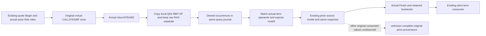

# Rite 动态价格：原 CALL 的 Q64 观测

状态：`SOURCE_ADOPTED_NOT_RUN`。本专题闭合 1.20.0.4 原始调用的数值出口和生产接线；本轮没有编译、测试、原生调用、Game 或查询执行，也没有声称已取得实机动态输出。源证明先于实现，冻结在 `owner-13/SOURCE-DOUBLE-WINDOW-ABI.json`（SHA-256 `3803b0efcfa6cef62c6f86ba7471a0abeed05f6bf5af74544f702f33bb06ce36`）。

## 原生数值出口

已保留完整 `37542D0` 393B 与 `2C628A0` 1054B 源。前者见 `evaluate_named_fixed-DETAIL.json` 的 `new` 分支，后者见 `continuation-03/background-g2-offline-20261011/rite-price-term-2c628a0-01/ACTUAL-2C628A0-SOURCE.json`。精确路径和原件哈希均在 ABI 冻结件中；本轮没有重新采集可执行文件。

`3754364` 从真实 definition 的 `+70` 取 expression；非零路径以 `expression+8` 为 RCX，从已消费 vptr 的 `+30` 取 R10。`375438F` 的原 `41 FF D2` 调用以 `[RBP+5F]` 为输出地址，真实返回地址是 `3754392`。

这里有两个独立结果：返回时的 RAX 是虚目标原返回位；数值是 QWORD `[RBP+5F]`。`3754392` 重新从该局部格取 RAX，`3754396` 才向 helper 原 RDI 输出地址写出。原返回 RAX 因此不能代替 Q64。数值格成功复制为零就是已知零；复制失败仍为空。记录局部最终值也不宣称目标执行过某一具体 store。

父函数在 `2C62A38` 调用该 helper，`2C62A3D` 把输出格读入 RBX，`2C62BC3` 把同一 RBX 写到父函数原 term 输出。中间没有新的 RBX 数值写入。Create 调用的 detail/aux 为 NULL，直接绕过描述支持路径。因此此输出是 Rite term；整个最终价格仍由原 source model 的 base、context223、Rite、独立 context224 和最终算术组合产生。

## 保留原调用的两个窗口

| 阶段 | 精确窗口 | 原字节 | 恢复执行 |
| --- | --- | --- | --- |
| before | `375437C..3754385`，9B | `48 8B 45 7F 48 89 44 24 20` | 复制原寄存器后，只重放这两条 MOV，回到 `3754385` |
| after | `3754392..3754399`，7B | `48 8B 45 5F 48 89 07` | 保留原 RAX、复制局部 Q64 后，只重放原 load/store，回到 `3754399` |

入口使用附近 relay 的 E9 rel32。原 `375438F` CALL、真实 return PC 与 `375439B` literal 分支保留。post 窗口不能使用 14B 绝对入口跳转，否则会覆盖 literal 分支。Relay 只调用只读记录 callback，不移出或重新调用原虚目标；原寄存器、flags、XMM 和 MXCSR 在重放 MOV 前恢复。

helper 的实际 RBP 是入口 RSP 减 `57`。其保存格提供父原调用角色：`[RBP+57]` 是 parent return（应为模块内 `2C62A3D`），`[RBP+2F]` 是原 parent actor R15，`[RBP+67]` 是原 current Rite RBX，`[RBP+6F]` 是原 parent term 输出 RSI。父 R15 在 helper 返回后才被改为 aux，不能以那个后续寄存器代替 actor。Pre 同时复制真正 definition、expression receiver、vptr、target、native context 和原 out 指针。

## 同一查询到价格消费者

当前 `religion_reform12002_resource_costs_mailbox.cpp` 先用原 envelope/stamp 建立 price source Begin，再执行既有 quote，之后 Complete，最后执行原 `FinishQueryMailbox`。新 journal scope 仅借用这次拥有线程的查询生命期，记录原调用的各个独立 occurrence；多个相同输出可形成同值关系，不能用全局最后值取代历史。

实际 numerical actor 是 Begin 的独立 second actor；实际 current Rite 来自 first actor 的 `+B4` full-generation 解析。window `+C8` 继续只属于旧 quote carrier。它们各自的 requested/resolved full ID 保留，不合并或以 player/query metadata 补齐。

`rite_dynamic_call_journal_12004` 在实际 before/after 时复制原调用格，`rite_piety_observed_term_admission_12004` 把这些 owned 事实与当前读取的 term prefix 关联，`rite_piety_price_term_2c628a0_readonly_12004` 的新重载提供 observed route5，`create_piety_final_price_observed_term_12004` 保留原父模型运算顺序。没有输出、读取失败或匹配值不同仍是 unknown；原 zero/literal 路径继续独立可用。

原寄存器/局部栈只在有效的原调用边界复制，不放进 quote 返回后的 `copied_spans` 重读。持久 actor/Rite/definition/expression 与映射仍走原 byte/input bookends。ticket、revision、pump epoch、date 都保持原 metadata，没有被哈希或当作新 native clock。

同一响应新增可选 `religion_rite_dynamic_term_observations_12004`，保留原 Q64、原 RAX、ordered occurrences 与 admission。旧 `religion_creation_price_source_12004` 的原 keyset 和整体 `actual_original_consumed_values=false` 保留，因为其他输入仍为只读源投影。实际 Finish 和原 bookends 继续决定当前最终字段能否使用；Finish 拒绝保留 raw facts，并撤销当前 readiness。严格消费者读取同一响应，不另发 query，也不把单个 term 与最终 native quote 强行设为相等。

`rite_named_fixed_q64_observer_12004` 在既有 suspended-primary 冷启动接入，journal 和 observer 两个生产 TU 各注册一次。startup、CMake 与其它并行包由 Root 顺序采用薄 hunk。安装状态和真正 runtime 输出必须由以后实际执行另行证明，本专题不外推旧 GREEN。

Root applied all eight owner patches in dependency order, preserving the earlier
Activity Bridge/Runtime changes. The fifteen production files and this topic
are adopted source only; no compilation, installation, test or live query followed.
