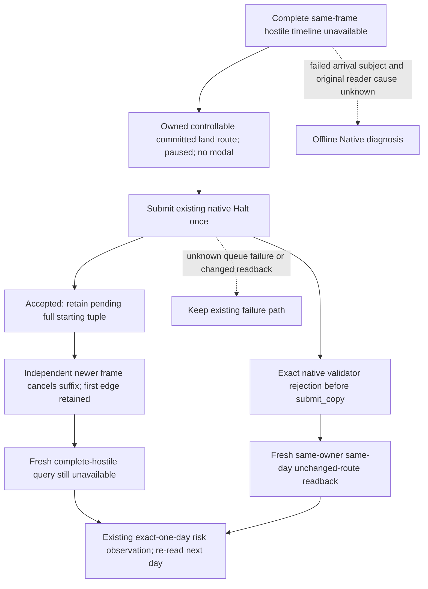

# 完整接触路线不可用的只读终局

机器：`xenoamess-full-tower-eb9d2c1186`。本记录于2026-10-16 01:57 CST补录；实际原错误发生于2026-10-15 17:33:23.612541Z。阶段是源码与离线合同通过；协调者已报告P07同Game续接，尚未由本记录授予新不可用分支的实机通过信用。

## 实际触发与原始边界

N42 P06 AUTO16查询军队318767248到省2635的八个敌军接触时间线；己军当时已位于2635。原生返回`CK3 could not build a complete contact route`，`typed_query_failure_v1`为route/typed_result，executor进入且结束、frame_stable=true、typed_result=false、等待completed、SEH code0。旧SDK把这个已结束的只读“不支持”向上抛成MCP错误，无法让普通规划器继续评估现有受守卫候选。

原件：[P06 AUTO16](D:/codex-ck3-demos/2026-10-14-robert-30year/continuation42-cold-prep/p06-responses/0016-1-result.json)，SHA-256 `ef7d19cb7775a287360d6b59b4972ec6742e5649ae5479fb45d5fcb550d2fcbb`。该回合保持失败，不重发、不追认成功。原MCP诊断投影截断了完整原生请求／响应；入库夹具根据原诊断、完整计划step及METRICS身份重建包络，明确标记`synthetic_envelope=true`，不冒充保留的完整原包。

## 正规化与策略识别

NativeDriver只捕获实际`_NativeCommandRejectedError`，核对canonical只读route parser、request/response protocol1、同request ID、同step、原正整数native revision、ok=false、精确错误文本及完整typed failure。等待未知、执行异常、其他错误或帧不稳定继续抛错。它只读取现有semantic publication一次，核对暂停、map-ready、角色存活和完整snapshot/public/native/date/actor/episode/generation/PID身份；敌军tuple必须不变。没有第二次原生query、移动、日期或业务提交。

结果schema为`xar.route-contact-readonly-unavailable.v1`，status=unavailable，accepted/available/business_submission/replay_allowed均false，route_contact_horizon=null；完整原请求／响应和同帧读回保存在`readonly_unavailable_evidence`。历史行仍`ok=false`，结果正常返回Service。Service外层`executed`只代表这次只读处理函数返回；外部classifier必须给零动作、日期和实质成果信用，不能据外层状态赋信用。

策略仅修改`_current_frame_route_contact_query_failure`。公共前置版本缺完整lease／scope_status，因此一并收回同一个helper中已验证的generation、episode、date和原生revision绑定；当前不可用DTO另外绑定actor、PID和同帧读回。过期lease不永久锁住新帧，未知失败仍受守卫。没有可用horizon就不能称contact-free；后续选择仍走已有路线／战斗守卫，不改变战争意愿、力量准入或军队动作合同。

## 验证、来源与部署

公共增量在`3ad913a804b704d72c4682221c5160c0abb83b7f`上精确移植，保留公共Native拒绝异常中的raw-return-receipt扩展。AST核对仅改Native两个已有方法、增加两个纯helper，以及Strategy一个helper；已有available-route资格分支逐字相同。未包含另包单日speed5修改，也没有重编Native DLL。

一次公共focused验证：**16 tests通过，0.591秒**，包括7项Native/Service链、原6项策略lease及producer/过期/未知边界；另有11项原包拒绝负例和10项帧／敌军变化子场景。现有Service.execute_step、planned execution和auto_turn实际方法使用有限fake transport执行，正常返回DTO并保留失败历史。available路径夹具只验证控制流，normalizer使用隔离stub；不替代原生几何资格或实机结果。

可复现命令：

```text
python -B -X utf8 -m unittest discover -s ck3_autonomous_player/tests/unit -p "test_*route*unavailable*.py"
```

公共夹具在`ck3_autonomous_player/tests/unit/fixtures/route_contact_typed_unavailable_v1.json`，保留原错误SHA、机器ID及合成包络说明。外置[公共测试回执](D:/codex-ck3-demos/2026-10-14-robert-30year/route-contact-unavailable-p06/PUBLIC-FOCUSED-TESTS.json) SHA-256 `a1c3a698981d97c0fcff921b0b2e8c28dadccc39f8cfacf21ee97f1de502c5e2`；[原候选交付](D:/codex-ck3-demos/2026-10-14-robert-30year/route-contact-unavailable-p06/DELIVERY.json) SHA-256 `012949b97b89a32317810f0dd1418fd851e6781217751932c598890572b208b3`。原策略测试SHA为`459a34a4b3e7059f01b9560d26abe54207ed7df9f5e019cb3da0e9ca558644f6`，producer合同测试SHA为`2efb72c19cb68b247f5c3671780e24d0ccbfcb4b2188a4a87a44acebcd391056`。

P06 Native输入SHA为`5b449440b762dde0f1baf34cd29ab30757730aab229c8a1e3f2d507bb3d86b6a`，独立输出为`4329b216156e8bdb5b58f812d38d647d7d79ce2c48b73f617170d6892677a7fd`；P07实际SDK使用合并另包后`d1af257e…`，不能把公共源字节等同其整叶pin。下一步在自然普通回合观察新不可用结果是否被零信用消费，不重放AUTO16；三十年演示与最终成绩继续由主流程结算。

本包无现场操作，不改Main、隔离runtime或冻结SDK。新增均为小型源码／测试／记录；D卷开始观察free=1,121,275,932,672B，未据此声称并发重型写入准入，未清理任何历史资产。外置工作包为派生物48小时、原错误按其原工作包用途与期限复核；协调者仍在消费的冻结输入不得据本记录删除。公共源码按Git维护规则保留。

## 2026-10-16 补录：海运既有路线的到达时间不可观测

P20 AUTO2588 的只读路线查询返回另一已知终局：`CK3 route arrival timeline is unavailable`。
原件 SHA-256 为 `a20a2b151129045c546b254b8ca67758f093c30dfba5b3653979fd89598a5817`；
实际 SEM2589 在同日53410032、native3497/public2942暂停，玩家40526的军队620757086
处于embarked、非战斗／撤退，已有完整11段路线8651→5969。原失败不追认为成功，失败pending8444零业务信用。

已加载1.20.0.4 DLL SHA为`29768ab0872f5dc4510bae3f3cc229886aab2c00e99ad0d3976150130eac0c7d`。
实际Crozier分派调用`ck3_12002::ReadRouteContactHorizon`，不是同DLL中带海运回退的11906读取器。
该分支会在我方或任一敌军的路径头、速度、邻接、原版时长返回或单调日期校验失败时返回
同一timeline_unavailable。原结果没有role/army/stage，SEM没有ETA／首段剩余时长，不能判定
究竟哪支军队、哪项时长读取失败，也不能宣称海运一概不支持。精确生产／调用链与缺口见
[外置源码审计](D:/codex-ck3-demos/2026-10-14-robert-30year/continuation42-cold-prep/p21-arrival-unavailable-repair-candidate01/NATIVE-ARRIVAL-FAILURE-SOURCE-AUDIT.md)。

NativeDriver仅把该精确文本加入既有终局正规化；完整原请求／响应、completed/stable/无异常、
同暂停帧及完整敌军集合的资格不变。普通策略仅在同帧typed结果明确不可用、玩家自有可控海运军队
非战斗／撤退、完整既有路线目标匹配、无必选窗口且已有`life-advance-one-day`时，选择现成单日观察。
它不重发移动，明确contact未知、未证明contact-free；后续由普通规划器重新读取军队与战斗状态。
原生daily之后的+24截止、速度选择、暂停、modal中断和terminal合同沿用原实现。

这是解除真实玩法阻塞的退路，不是策略中立性能收益，不改变1.5倍力量准入，也不授予胜利、
停军或物质成果信用。缺少上述资格仍走原守卫。Native海运读取器的真正修复仍待1.20.0.4
getter/ABI与实际首段观测闭合；本包没有重编或换载DLL。

公共测试直接导入NativeDriver完整战争执行方法和`choose_one_life_turn`，保留实际全军／战争名册，
仅裁掉无关诊断；原生包络依据旧SDK投影重建并明确标synthetic。现有可用路线、未知拒绝、lease、
Service链及新海运正负例共**20 tests、33 subtests通过**。测试与夹具无需本地工作盘；
外置候选另有6项通过，包括真实旧单日原生结果保持不变的新phase分类兼容性。本次公共合入未调用
Game/MCP/SDK/OBS，不给新实机天数、连续三十年或0.5秒/日信用。P21实际部署结果由主线程另行记录。

来源：[候选交付](D:/codex-ck3-demos/2026-10-14-robert-30year/continuation42-cold-prep/p21-arrival-unavailable-repair-candidate01/FINAL.json)
SHA-256 `3bc289f893d55953112bd829ee2c3a40ae1660f0fd1d681df9c39db033d4fd85`。
共享测试新增峰值获准64KiB，复用现有总准入；当前关键原失败与候选复核期限为2026-10-17T09:00Z，
无额外大副本或清理。Python/JSON无新增Paradox语义，open_kaishek不适用。

### P21恢复旧失败缓存的反例

P21 AUTO14尚未提交动作即返回blocked。旧P20历史5268保存了完整completed/stable/无异常的
arrival只读错误文本，但旧Driver没有保存result与queried lease；同Game恢复原样复制历史，
新native3498/public2/connection4不能把它认作当前帧。因而既不允许海运单日退路，也不允许新查询，形成阻塞。
原14与5268均保留，不把unknown_frame伪改为current_frame。

公共策略只对canonical只读route、ok=false、无result，且精确完整错误文本证明已完成／稳定／无异常的
两个已知终局，停止把该无租约历史当作当前availability缓存。普通规划器随后必须发一条新只读查询；
不能直接移动或推进日期。已有当前typed DTO仍按原lease消费，未知、部分执行或业务错误仍受守卫。
Root另行安排现成MCP freshSEM→唯一新只读route查询→freshSEM恢复；实际结果由独立回执记录，不修改冻结SDK或原历史。

便携夹具增加实际AUTO14错误相等性与SEM1身份投影，公共完整普通planner反例证明下一步是新query；
原记录不变。相关验证现为**21 tests、36 subtests通过**，共享测试／夹具64,996B，仍在64KiB额度内。
此源码收口不授予实机恢复、游戏日或连续窗口信用。

### P21 AUTO377：海上已有路线与真正不可安全推进的分支

实际 AUTO347 已取得 native3640/date53411184 的完整13敌军 **available** horizon：我方620757086在海省940，embarked，路线 `[5967,5966,5969]`；次日与536871097在5967相交，`one_day_contact_free=false`。AUTO377随后没有提交业务动作，SEM378仍同帧暂停。这里不能套用前面的 unknown ETA 单日退路。committed timeline 的 effective origin 本身不是锁定数值证明；改目标预览也保留5967，结合原生 resolver 是锁首段线索，当前 raw progress/cutoff 仍缺失。

策略漏掉了两类普通退路：Halt 仅接受 moving，排除了 embarked；capital regroup 又要求主战方、全军 aggregate overmatch，且同一海省上的历史 ghost 军导致 subject 歧义。修复允许本人可控、非战斗／撤退、完整路线的 embarked 军使用已有原生 Halt；允许当前 unsafe embarked subject 按 army ID 进入本国首都**只读候选评估**，不依赖缺失 ghost 的 aggregate。实际 Move 仍走原版 preview、完整敌军 horizon 和原生命令验证，主动接战1.5准入不变；它不承诺改线能避开已锁定登陆。

Driver 的 Halt ACK 增加真实提交前 route/current/target/owner/native revision/connection/episode，仍为 `postcondition_verified=false`。独立同 epoch 更高 native 帧若恰好只剩原 `[front]`，只确认后缀取消、首段保留，不能写成停军完成或 contact-free。普通策略随后重新查询风险，不重发同一 Halt；旧 ACK、旧帧或其他 epoch 仍保持 pending。已有[当前版本锁定 Halt 证据](episode04-r12-locked-halt-r0175-12004.md)证明只留首段后仍可能自然登陆，不可据 ACK 消除这项危险。

便携 gzip 夹具保留实际347／377／378来源 SHA 与全部军队、战争、基础战力名册，原生 Halt ACK 和独立 post-read **明确为 synthetic**。原 HEAD 普通 planner 回放与377一致；候选选择已有 Halt。8 项聚焦测试通过，覆盖提交前 tuple、异步原路线保留、独立 suffix 读回、跨 epoch 反例、非主战／ghost 候选以及普通下一步只读查询。这是源码候选验收，本记录不授予现场 Halt、避免登陆、胜利、推进天数或连续30年信用。

### Retained unsafe first edge: ordinary one-day observation

Machine `xenoamess-full-tower-eb9d2c1186`, 2026-10-16 UTC. The exact .4
`SubmitDisbandArmy` path resolves public CUnit to CArmy and calls vanilla
validator `0x296A600` before `submit_copy`. Its `0x28BBF20` getter tests the
owner war vector; war participation plus valid same-province Army/Fleet
(`0x24E8440`) reaches `CANNOT_DISBAND_WHILE_ARMY_EMBARKED`. Nonprimary war
participation is not an exemption. Combat, retreat, war-leader and hostile-area
checks also exist. Validator rejection is pre-submit, never disband success.
SEM378's named embarked state does not replace a raw FleetID or live validator
observation. No disband was submitted here.

File-only evidence: external
`continuation42-cold-prep/p21-disband-safe-retreat-review01/REVIEW.json`;
validator windows span `0x296A600..0x296B10F`, with reason strings and both
getters retained under raw-window/file SHA-256. Source EXE pin:
`98702f88a547cde2eaf29a85f93b85f68ee4cf8148336a4f7afaeb75319dd518`.
No EXE loading or Game/Native/MCP calls occurred.

After existing safe objective/capital replans are exhausted, the ordinary
planner now has a narrow liveness exit: independent Halt suffix readback must
leave exactly the original front/target, on the same actor/connection/episode
with a newer Native publication. A fresh complete horizon still says contact
is unsafe. With no mandatory modal it may select existing
`life-advance-one-day`, retain the route, then observe army/battle state again.
This is passive observation of movement CK3 retained, not a new Move, safe
contact claim, 1.5 strength waiver or battle success. The suffix remains usable
across dates only while that edge/source identity persists; later Move
invalidates it. ACK alone or the unchanged old full route cannot use this exit.

Combined portable focus: **26 tests and 5 subtests passed**. Complete ordinary
choose tests start with actual347/377/378 and explicitly synthetic Halt ACK,
suffix frame, new-frame queries and capital candidate; they verify next-day
continuation without duplicate Halt and reject stale/foreign/combat/modal
cases. Candidate: external
`continuation42-cold-prep/p22-retained-edge-watch-candidate01/DELIVERY.json`.
Live Halt, landing, outcome, uninterrupted years and speed remain separate
runtime evidence.

### Unadvertised capital preview after actual suffix readback

P24 AUTO32 submitted the existing Halt; independent SEM33 actually retained
only `[5967]` with target5967. Fresh AUTO41's horizon still reported unsafe
contact. AUTO75 then stopped at `native_war_capital_regroup_preview` because
the required `preview-move-army-620757086-to-2619` was not advertised. This was
an early return before the existing retained-edge observation exit.

The public planner now tries that same strict exit in this one unadvertised
preview branch. An advertised preview is still queried first. The existing
halt/post-read, source identity, retained-edge, exhausted-route, complete
hostile horizon and one-day-action guards remain authoritative. No Move or
Halt is replayed, and unsafe contact does not become safe or qualified combat.

The four actual receipts, original candidate and public replay are recorded
under external `continuation42-cold-prep/p25-retained-edge-watch01/`.
`PUBLIC-FOCUSED-RESULT.json`, SHA-256
`b9e5e829d530f4de62359d7dd0e3f78b7a0e1eb9450e98c31fb672f75d4adead`,
replays the actual early branch plus six rejecting variants against public
source. The portable ordinary chooser suite passes 10 tests and 5 subtests;
its original P21 inputs and synthetic halt/readback/root-capital adaptations
are explicitly distinguished from actual P24 receipts. These tests establish
source behavior, not P25 game-day advancement, survival or a successful battle.

### Same-Game reconnect and actual P26 first day

The P25 early-return fix was insufficient by itself. Original AUTO12 still
stopped at `native_war_unsafe_route_halt_pending`: its independent same-day
suffix publication was in a newer SDK connection than the original Halt32.
Those blocked receipts remain blocked. The public guard now also accepts a
strictly newer connection only on the original submission date, with a current
hello/bridge PID match and the existing actor/episode/newer-Native/route guards.
The original same-connection path keeps its already verified cross-day
retained-edge behavior; it does not acquire the reconnect-only date limit.

Root's same-Game P26 FULL3 completed; AUTO46 used the existing
`life-advance-one-day`, and independent METRICS47 actually observed paused
actor40526 at raw53411208, one day after53411184. Game PID100984 and the D-drive
recording continued. This is actual date advancement under the retained-edge
observation, not a safe landing or battle result. Evidence under external
`continuation42-cold-prep/p26-hot-halt-generation01/`:

- `DELIVERY.json`, SHA-256
  `7412a92d6bd40227a4758b5df59f9b7f4486c170a7d2d37963d17ab624b2a337`.
- `PUBLIC-HOT-HALT-FOCUSED.json`, SHA-256
  `10d03c4fc6882c7c435cf99ccaf213ae6b95f5fddd206d077f9a0e7a08be9753`,
  replays actual Halt32/P25SEM13/AUTO12 plus eight rejecting variants against
  public source. The ordinary chooser suite passes 11 tests and 5 subtests,
  including prior same-connection next-day behavior and fresh read priority.

The actual P26 runtime source and public source differ in that final preserved
cross-day branch; public integration does not rewrite the frozen live SDK.
No uninterrupted 30-year, 0.5 seconds/day or victory credit follows from this
single observed day.

### Same-day move/negative-contact/Halt loop

P26 actual AUTO56/58/62, 74/76/80, 91/93/97 and 109/111/115 each show the same
day 53411208: a move to 5965 whose geometric audit said safe, a fresh Native
contact result saying `one_day_contact_free=false`, then Halt. The former
candidate loop queried exact contact only for geometrically unsafe routes.
Geometric separation therefore allowed repeated moving-hostile conflicts.

The public planner now obtains the complete fresh Native hostile horizon for
both geometrically safe and unsafe candidate routes. A negative result vetoes
the candidate; a positive hypothetical horizon alone does not authorize Move.
Existing original preview, source freshness, command legality and 1.5 combat
admission stay in place.

After every exact objective has a native-negative rejection, a single owned,
controllable, stationary nonleader attacking army may evaluate its directly
held capital through the existing query/preview/horizon route. This uses a
same-frame complete held-title partition; it does not assume a capital from
missing context. With every objective and capital exit still negative, the
ordinary planner can retain position and use existing exact-one-day defensive
observation. It does not order an offensive move or label contact safe.

The evidence projections and six rejecting capability/route variants are in
the portable gzip fixture. Its capital context and title 999 are explicitly
synthetic. A public ordinary-chooser test also proves that geometric safety
first selects the complete hostile query, then respects a synthetic Native
negative without issuing Move. Existing route guards and the new clock profile
passed the combined 41-test, five-subtest public suite. External candidate:
`continuation42-cold-prep/p26-same-day-route-loop-candidate02/DELIVERY.json`,
SHA-256 `f693d2cd62f9853377d02ccd9528c9d4f18c8748520bf9b61743f646ffea64b7`.
No actual capital query, capital preview, successful return or defensive hold
is established by these offline cases; Root separately deploys and observes
the normal planner. The four original cycles remain actual failed progress.

### Complete hostile timeline unavailable on an existing land route

Machine `xenoamess-full-tower-eb9d2c1186`. Actual P28 AUTO537 and independent
SEM542 project the same paused player land army402653503, committed route
`[5966,5969]`, and all 13 published non-retreating hostiles. The route reader
returned `CK3 route arrival timeline is unavailable`; later AUTO541 stopped
the outer batch on this cached failure. Window25 failed after76 days. The
lightweight fixture retains its original response/source pins and labels
projection separately from later synthetic Halt outcomes.

The existing Native mailbox reports that error only for
`RouteContactHorizonStatus::timeline_unavailable`. It does not identify
which army's arrival reader failed. A correlated missing-CArmy observation
for army637534417 is not proof of that failure's cause. No hostile is dropped
to manufacture an available or contact-free horizon.

The existing military command path constructs one full CUnitID Halt command,
validates it, and only then calls `submit_copy`. In
`native_bridge/src/ck3_12002_military.cpp`, `validator_rejected` returns before
submission; `bridge.cpp` maps it to the exact validation-failed error.
The different queue-rejected error is not eligible for the new typed result.
Existing locked-edge behavior remains as documented in
[R0175](episode04-r12-locked-halt-r0175-12004.md).



The ordinary planner now uses this narrow exit after the existing embarked
case. It checks the exact current query lease and independently reconstructs
all published non-retreating hostiles. A route tail is halted before time
advance; an ACK is pending, never a stopped-army claim. The only one-day exits
are a separately verified retained first edge, or the exact zero-submit
validator rejection with unchanged route and owner. Unknown errors remain
errors; a same-date rejection is not resent. The day uses the original Native
deadline, pause and modal contracts, records contact as unknown, and gives
no movement reissue, offensive admission, war victory or material credit.
The 1.5 combat admission remains unchanged.

Public Strategy and Driver imports pass 8 focused tests/16 subtests, including
actual537/542 scope, synthetic independent partial Halt, native error wire
without a `step` field, foreign/changed routes, modal/retreat/combat, stale
lease and wrong request. Source candidates are in external
`continuation42-cold-prep/p28-land-route-timeline-unavailable03/`, delivery
`0b3bdb6e…`. The composed SDK30 test package separately passed32 production
method cases; the public changed methods and adjacent existing guards passed
31 tests/23 subtests. Neither result proves actual SDK30 gameplay, safety, survival
or performance. The current public integration never changes a frozen SDK,
Native DLL, Game or recording. Stable30-year play has priority; first target
is below 1 second/day, then 0.5. None is achieved by this source change.

Root subsequently hot-connected actual SDK30 to the same Game6068 and
Native21, retaining OBS278060 and the same D recording. Original P28 owner
exit0/0 is retained. SEM1 observed raw53434272; FULL3 completed30 turns and
eight days to53434464/cumulative10862. Actual AUTO14 submitted Halt on
`[5966,5969]`; its accepted ACK remained pending. Independent SEM16 published
native2954/public3, still paused on the same date, with route/target `[5966]`.
The existing post-reader observed suffix cancellation and retained first edge,
while `postcondition_verified` stayed false. The following complete h13
timeline became available and ordinary exact-day play continued. This is
actual accepted-Halt/suffix behavior; it does not demonstrate the synthetic
validator-veto or still-unavailable-after-Halt branches, safe contact or victory.

The public pending-Halt reader also replays that exact small AUTO14/SEM16
projection, adding a ninth focused test. The original full responses remain
external; their SHA-256 are respectively
`9213f82d0fc5888029dc233562d088c561194e6e96d0b2f6571357c543616c9f` and
`b5074b11fd63fd6d902e80a72412e3a21121de151f39b6831187946f20832798`.
Independent SEM65/METRICS66 then bound the paused batch endpoint. Root's
`ROOT-P30-CONTINUITY-RESUME01-ADMITTED.json`, SHA-256
`851374943480816de4c4ed5c6c58df47627d7ec9d7e83c92aacc1197c03a4350`,
starts window26 at53434464. Root reported a13-day running prefix; old failed
window25's76 days are not carried. This is a timestamped prefix, not30-year
completion. No WAL, Game restart or OBS restart occurred.

The matching [portable Halt outcome classifier](../../tools/g2_saved_campaign/land_route_halt_outcome.py)
requires the caller's reviewed gameplay-start binding callback; it imports
no frozen SDK namespace. It distinguishes pending accepted Halt from an exact
typed native validator veto, whose action/business/date credit remain zero.
The [complete historical classifier delta](../../tools/g2_saved_campaign/patches/p30-land-halt-classifier-runtime.patch)
is archived separately. The portable parser also accepts public CUnit ID0;
that compatibility test does not rewrite live classifier de0077 or claim
actual Army0 execution. The final public source/classifier/adjacent guard
scope passed41 tests/43 subtests, including actual ACK/suffix projections and
explicitly synthetic veto/error variants. Public common-runner installation
still needs a reviewed adapter; library publication does not deploy one.
## SDK31 实际三日路线结果分类修正

实际query12与AUTO14使用同帧完整敌军集合，但旧class把已撤退军也列入watch，拒结算真实3日。
同SDK控制16安装 `1637aa68…`、17重消费原14，FULL18／MET19结算72raw，原clock未重放。
公共[便携分类器](../../tools/g2_saved_campaign/route_window_advance_outcome.py)只排除原生明确retreating=true，
保留unknown为敌军、完整scope和原clock守卫；战争自然变动只计日期，无胜利或物质信用。
实际完整回执与13KB投影输出一致，新增12项分类用例通过；宿主仍须注入已审核帧绑定／parser／sentinel validator。
完整窄patch、原件SHA和边界见[研究提取](research/sdk31-route-window-sdk32-ui-defer/README.md)。
