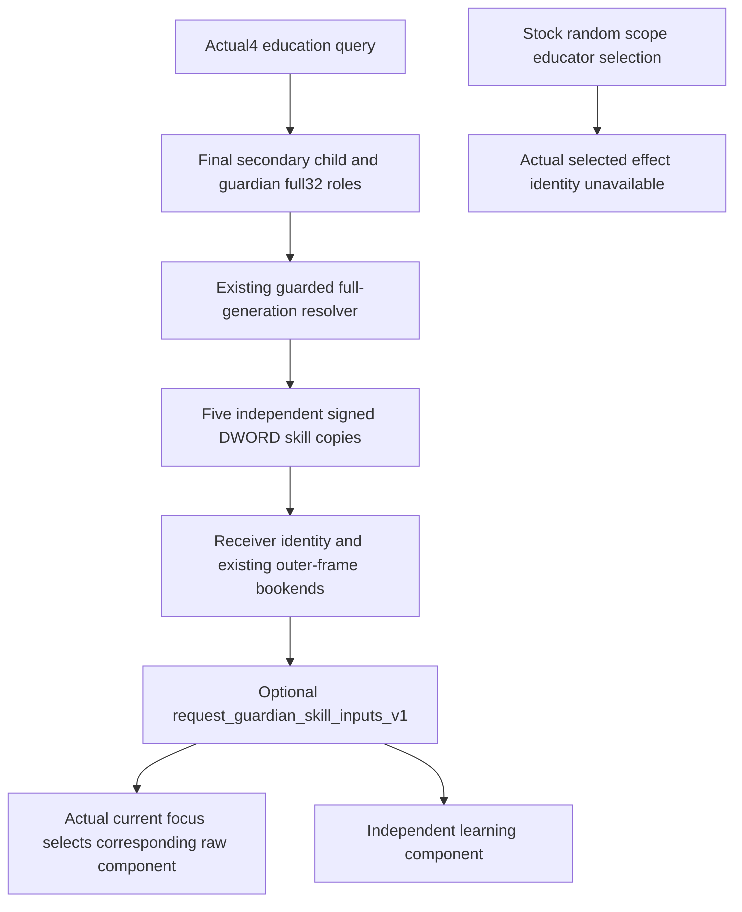

# Current request guardian skill inputs in 1.20.0.4

The existing education interaction query can copy five current cached skill components from its final secondary actor. This is the guardian bound to that interaction request. Stock education effects choose their `scope:educator` separately; this profile does not observe that choice.

The source identity is CK3 1.20.0.4 / Steam 25734779, inherited executable SHA-256 `98702F88A547CDE2EAF29A85F93B85F68EE4CF8148336A4F7AFAEB75319DD518`. The retained actual function is `0x28B1690`, with the valid enum arm at `0x28B16D8`: `MOV EAX,DWORD[RCX+RBX*4+0xD8]`, followed by register restoration and `RET 0x28B16E9`. The unsigned enum check admits 0 through 5. This arm has no child call. The reader copies the corresponding member values and never invokes the getter or its invalid-enum assertion path.

The actual source receipt is [council effective skill DETAIL](Z:/ck3_mod_rewrite_process_assets/g2-migration-20261007/council-government/native-candidates/capture01/council_effective_skill-DETAIL.json), with the retained field mapping in [SOURCE-PROOF](Z:/ck3_mod_rewrite_process_assets/g2-migration-20261007/council-government/native-candidates/SOURCE-PROOF.json). The current production [council profiles](../../ck3_autonomous_player/native_bridge/include/xar_bridge/ck3_12004_council_candidates.hpp) and [reader](../../ck3_autonomous_player/native_bridge/src/ck3_12004_council_candidates.cpp) use that same mapping after full-generation identity resolution. The 94-byte retained instruction packet includes the complete function and four trailing INT3 bytes. No new native bytes were captured.

The martial name is independently joined to the retained [named martial parent DETAIL](Z:/ck3_mod_rewrite_process_assets/g2-background-20261007/upstream-build-migration/army-family-12004/commander-supply/support-first01/support_2C0B270-DETAIL.json). The actual parent is `0x2C0B250`, complete 208 bytes through `0x2C0B320`; its `0x2C0B27A` instruction copies `MOV EDI,DWORD[RCX+0xDC]` from the checked Character receiver. The named return then adds `trunc(modifier19B/100000)`. This profile copies only the signed, unscaled cached +DC component: it does not read that modifier, call the parent, or claim the parent's total martial result. B11-19's retained intake wording “cached total martial” is corrected here; the original intake remains unchanged. The name is not inferred only from adjacent offsets or a legacy identity reader.

| Component | Qualified enum | Character member | Result |
| --- | ---: | --- | --- |
| diplomacy | 0 | signed DWORD +D8 | independently copied |
| martial | 1, independently named source | signed DWORD +DC | independently copied cached component |
| stewardship | 2 | signed DWORD +E0 | independently copied |
| intrigue | 3 | signed DWORD +E4 | independently copied |
| learning | 4 | signed DWORD +E8 | independently copied |

The leaf is [ck3_12004_request_guardian_skill_inputs.hpp](../../ck3_autonomous_player/native_bridge/include/xar_bridge/ck3_12004_request_guardian_skill_inputs.hpp). `ReadRequestGuardianSkillInputs12004(access, final_child_full_id, final_secondary_actor_full_id, owning_native_revision)` accepts the existing guarded full-generation resolver and DWORD reader. The actual ordinary caller owns exact-build admission, final-role observation and the enclosing query frame checks. It supplies final `roles[3]` and `roles[2]` after native role and option materialization, while its local context remains alive.

The reader checks each full32 identity at Character +18, copies each qualified skill twice, then resolves and checks both receivers again. A skill read failure or value change affects only that component. Receiver identity drift invalidates all five copied values. Zero and negative observed DWORD values keep their signed source representation; this leaf performs no arithmetic or normalization.

A null guardian ID is accepted only from a successfully copied final-role DWORD of -1 and produces `binding_status=known_null`. An unavailable role read produces no profile. A resolver failure retains the observed role ID with `binding_status=unavailable`; it does not infer absence or use a fallback character.

`WriteRequestGuardianSkillInputs12004(std::ostream&, profile)` writes the object for optional key `request_guardian_skill_inputs_v1`. Its exact keys are `schema`, `role_source`, `child_character_id`, `character_id`, `owning_native_revision`, `binding_status`, `unavailable_reason` and `skills`. IDs are unsigned full32 integers or null; skill values are signed int32 integers or null. Each of the five named skill objects has `available`, `value` and `unavailable_reason`. The source role literal is `request_guardian_secondary_actor`.

The existing query publishes the optional profile only for actual4 education when its ordinary query and frame checks succeed. Raw skill failure changes no existing context support, CanSend, native-ready or queue decision. The consumer can select the raw component matching the child's independently observed current education focus and retain learning independently. A learning focus reuses the same copied learning value for both source terms if a separately qualified conditional calculation needs them.

The profile may support facts about the requested guardian or a conditional statement about this person serving as educator. It does not populate actual effect `educator_present`, `educator_id`, `educator_values` or `educator_selection_observed`. Traits, culture, house modifiers, probability and education outcome remain outside this leaf.

The martial extension uses the same guarded receiver, two scalar samples, full child/guardian IDs, owning revision and final-role/outer-frame bookends as the four existing skills. Martial has independent partial availability and joins the existing all-skill invalidation. The generic five-component serializer already fits this result; the SDK removes only its martial-specific forced-null rule. Existing preference maps `education_martial` to `martial` and the Service retains the whole query, so this extension adds no ranking, Service or projection hunk.

The retained [education source packet](Z:/ck3_mod_rewrite_process_assets/g2-parallel-20261008/family-genetic-inputs40/stock/SOURCE-READS-RAW.json) records literal `educator_skill_modifier_factor=0.4` and `educator_learning_skill_modifier_factor=0.2` at `00_education_values.txt:5–6`. In `00_education_effects.txt:341–349`, the same saved educator contributes focused skill times 2/5 and learning times 1/5; focus selection supplies martial at line 36. These are success-weight inputs, not XP or a final probability. The internal first-match intellect/shrewd term precedes those additions, and that educator's `better_ward_education` then replaces the entire internal expression with 10 at lines 350–354. House +5 is outside that override; child inputs and failure terms remain separate. Requested guardian does not establish the effect-selected educator, and cached +DC does not establish an authored total-skill operand. No complete education expression or outcome is reported.

Readiness is `SOURCE_ADOPTED_NOT_RUN`. The API, native caller and consumer are source work only. No tests, imports, build, game query or native getter invocation ran for this change.
