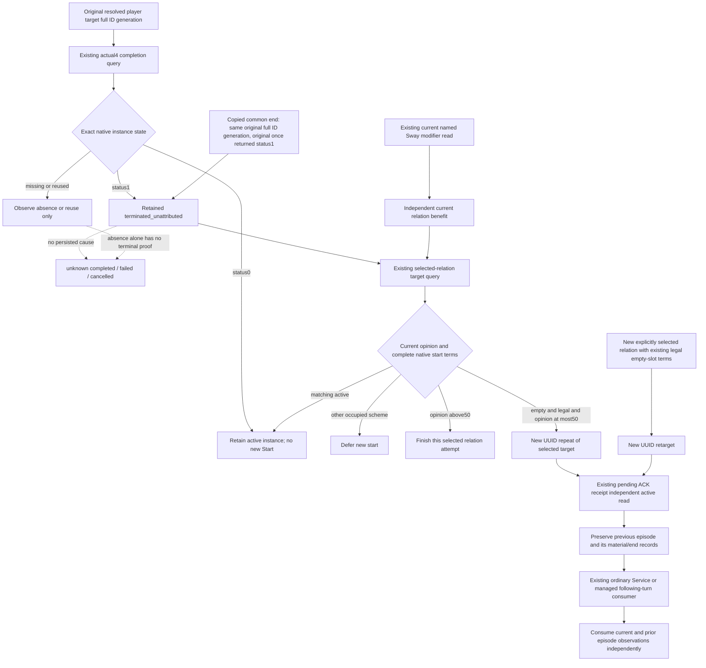

# Sway beneficial retained end to an ordinary follow-up

Initial source work: 2026-10-08 / ISO 2026-W41, on
`a59b2df4a2b3ab6a951bfdc4f12845faf27439d7`. Current status reconciled
2026-10-11: already adopted by `8e0f317d`, with subsequent actual4 consumer
migration `97b25aa5`; the original offline compound passed on October8.
The [source and existing qualification index](D:/codex-ck3-background-spill/native71-continuation-20261010/continuation-01-m6c/M6C-RESULT.json)
records this reconciliation without replaying that qualification.
The held actual CK3 1.20.0.4 SHA is
`98702F88A547CDE2EAF29A85F93B85F68EE4CF8148336A4F7AFAEB75319DD518`.
No native address, query, Start contract or schema is replaced.

The native input tree was recorded before this policy change. The
[actual4 retained reader](sway-terminal-retained-row-12004.md) observes the
original full SchemeID/generation, target and owner. Status0 is continuing;
status1 is `terminated_unattributed`. Missing/reused storage by itself has no terminal
meaning, and status1 supplies no completed/failed/cancelled cause. The
[stock outcome tree](ck3-1.20.0.2-sway-outcome.md) shows that a phase benefit
can reset progress and continue the same instance. The
[stock start tree](ck3-1.20.0.2-sway-state.md#low-positive-opinion-native-start-value-before-counter-policy)
already supports the selected-relation opinion ceiling50. Fifty governs a new
start, not continuation or native completion. The current exact4 query supplies
actual owner count, matching Sway rows, target opinion and complete native
CanSend/legal. Those inputs and the existing current modifier reader are held
and qualified; this lane reads no EXE and replays no qualification.

The original source change addressed an unconditional same-player/same-target
`already_applied` branch. It is already implemented in the current
`consume_sway_private_once`: `_same_target_followup` admits
`repeat_selected_target` after the original instance has an independently
observed retained end and positive named relation material for the queried raw
date. The existing empty-slot, opinion ceiling50, complete native CanSend/legal
and event/interaction checks still govern a new Start. A fresh UUID identifies
the new action, and resolution preserves the old episode inside
`resolved.previous_interventions`. The original top-level ledger shape and
pending recovery remain unchanged; pending actions never get resent. Retarget
still requires a separately selected target. This closes the former permanent
same-target suppression; it adds no global ranking or hidden faction inference.

Current named material must be observed for the queried raw date. A persistent
positive modifier is relationship value, not proof of a new gain or terminal
success. The historical34333/gen8 benefit at53249664 is outside Root's R77
two-year material window; a fresh25 is persistence only. This loop neither
credits that history as a new M4 intervention nor derives an end cause.

The ordinary following-turn hook consumes archived episode records too, so
starting a new legal episode does not discard an unconsumed prior end/material.
The original policy compound is
`ck3_autonomous_player/tests/unit/test_sway_beneficial_followup_12004.py`.
The original [Root qualification](Z:/ck3_mod_rewrite_process_assets/g2-background-20261008/r77-python-functional-first01/sway/ROOT-FIRST-RESULT.json)
executed once on2026-10-08T05:50:36.361277Z..05:50:43.612804Z, exit0,
`1 passed in 6.36s`. Its source inputs/backend are synthetic and
its consumer, registered query callbacks and Service turn are production code.
It covers repeat, prior record retention through normal turn/cold reopen,
continuation, finish, retarget and pending recovery in one compound. No new
live, game day, terminal cause, faction departure or G2 credit is claimed.

## 2026-10-11 common native end to the existing follow-up

This source increment connects five existing Python production files. Previously,
after the original Sway returned from native end and disappeared from current
storage, the ordinary observer's target-only read could leave no durable terminal
input for `_same_target_followup`. Current absence/reuse remains insufficient
on its own. The independent copied return observation described in the
[actual4 native end source tree](sway-native-end-source-tree-12004.md) can retain
the original episode's neutral terminal fact even when its storage row is gone.

`native_auto_run.py::_observe_private_active_scheme_sway_once` matches the
existing applied receipt's action, actor, target, full32 SchemeID and generation.
Before the existing formal consumer, it invokes the existing completion,
termination (`after_sequence=0`) and opinion queries in that order, each under
its own permission. It passes the public `before["revision"]`; the existing
transport maps and validates the native revision. Unmatched receipts or all
three permissions disabled keep the previous target-only path. The paused
frame check and pending-action handling remain unchanged.

`bridge/service.py::_attach_sway_terminal_sources` sends the producer's complete
composition to `record_sway_common_native_end_observation`. Direct termination
also enters this composer when execution observation is disabled.
`bridge/sway_terminal_source_producer_12004.py` retains the copied
`common_native_end_source` separately from `retained_common_end_observation`.
The latter requires original forwarding once and return, independently observed
entry/return full IDs and generations matching the original, returned status1,
and returned owner equal to the original actor or `FFFFFFFF`. Partial/status0
records stay diagnostic. No pre-status0 transition, optional header diagnostic
or Core frame is invented to admit this neutral `terminated_unattributed` fact;
raw DL does not establish completed, cancelled or invalidated cause.

`sway_lifecycle_consumer.py` stages that qualified input as a durable neutral
`terminal_intervention`, without replacing the latest storage observation. A
missing query date/revision retains the known common-end observation separately
and supplies no fabricated terminal provenance. With an actual query stamp,
`source_date_raw`/`source_native_revision` describe that read receipt. Only an
actually observed returned Core supplies `captured_event_frame` and its
`event_date_raw`; otherwise those event fields remain absent. Episode equality
uses action/actor/target/fullID/generation, so a richer prior cause, event date,
build/hash and consumed/following state survive a later qualified .4 common-end
read. Its new proof stays separate from historical .3 cause qualification.

The fifth file, `sway_material_consumer.py::_record_sway_material`, fixes a
specific same-value case: a fresh available opinion query could previously
return the old material record unchanged, retaining its old date and blocking
a positive follow-up at the current date. It now refreshes that actual query's
date, native revision and build/hash even when named modifier/opinion values
are unchanged. Consumed/following state remains intact; persistent positive
material is not counted again as an incremental gain or rearmed consumption.
Together, the existing observer, Service and ledgers supply the current inputs
to `_same_target_followup`: an independent retained end, fresh positive named
material, an empty slot, opinion at most50 and the existing native legal and
event/interaction terms. A new UUID starts only the admitted next episode.

One policy gap remains: known current nonpositive named material and unavailable
material still share `observe_current_named_relation_material`. They must not
be credited as a positive benefit or used to directly retry the same zero-value
target. This increment does not claim that next selection policy is resolved.

The final source receipts are the
[51 producer contract](D:/codex-ck3-background-spill/native71-continuation-20261010/background-g2-source-round-20261011-1152/owner-51/m6-common-end-lifecycle/DELIVERY.json),
[15 final lifecycle/material corrections](D:/codex-ck3-background-spill/native71-continuation-20261010/background-g2-source-round-20261011-1152/owner-15/m6-common-end-lifecycle/FINAL-SEMANTIC-CORRECTIONS-ADDENDUM.json),
[61 corrected-context Service patch](D:/codex-ck3-background-spill/native71-continuation-20261010/background-g2-source-round-20261011-1152/owner-61/m6-common-end-lifecycle/service-m6-common-end-lifecycle-v2.patch)
and [01 observer mount](D:/codex-ck3-background-spill/native71-continuation-20261010/background-g2-source-round-20261011-1152/owner-01/m6-common-end-lifecycle/M6-COMMON-END-OBSERVER-MOUNT.diff).
Their SHA prefixes are respectively `15e917c7`, `30e9a3ff`, `f9945aa3` and
`f008a8aa`. This connected increment is source-authored, not executed or
qualified; the October8 compound above does not qualify it. This topic writer
performed no binary read, production import, test, build or game query, and
claims no new native terminal cause, material gain or continuous-runtime credit.
