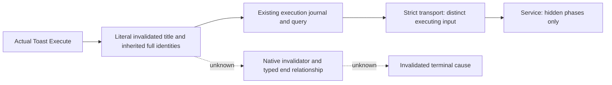

# Actual .4 Sway invalidation execution wire

This change captures the executing `sway_invalidated_title` Toast with the current 1.20.0.4 binder and copies its full root/owner/target/scheme tokens into the existing retained execution journal. It supplies an observed input source. It supplies no invalidated or cancelled terminal cause.

The prior invalidation reason reader binds legacy .2 addresses, including Toast vptr `4837428`. The qualified .4 input family uses Toast `4837438`, title wrapper `48BD0C0`, plain scalar `4929F18`, scope lookup `373B520` and global command-key getter `3F4F8E0`. Its inherited lookup preserves the full 16-byte token. The new leaf uses these current binders and the existing real Toast Execute installer; it is not a renamed legacy reader.

## The actual source branch

The held source is `Crusader Kings III/game/common/schemes/scheme_types/sway_scheme.txt`, SHA-256 `b2b1a4baa88315e329efff3f194a09da11e29bc397961a125f922f742a1632b1`. Owner/target scopes are saved around lines 524–529. `on_invalidated` has three relevant notifications:

| Branch | Literal tree |
| --- | --- |
| dead, 535–539 | `sway_invalidated_title`, `custom_tooltip = sway_invalidated_dead` |
| war, 549–553 | `sway_invalidated_title`, `custom_tooltip = sway_invalidated_war` |
| range, 564–571 | `sway_invalidated_title`, `custom_description_no_bullet`, `scheme_target_not_in_diplomatic_range` |

Each of these Toasts contains its reason child and no `scope:scheme/end_scheme` child. The existing completion source is different: `sway_complete` contains the `scope:scheme/end_scheme` child actually associated with the typed original end invocation.

The complete held .4 Toast body is `NotificationExecute_legacy02_2CC8490-DETAIL.json`, `new.instructions`, in `D:/codex-ck3-background-spill/sway-hidden-phase-current04-mapping/root-capture01`. Its actual body spans `[2CC8470,2CC9414)`, 4004 bytes. The child vector at effect `+30`, count `+3C`, loops through dispatcher CALL `2CC93C7 -> 3765E50`, return `2CC93CC`. That loop does not create an end child that the authored tree lacks.

The already closed path `3765E50/slot22 -> 2D67BD0/slot24 -> 2D11B30 or 2D11AD0` retains its same-root, exact full identity, original-once and ordered native return requirements. The dispatcher preserves context root `+0`; it does not convert the Toast actor root kind 4 into a Scheme root kind 9. No new accepted relation kind is justified for the held invalidation tree.

## Concrete production wiring

Owner 22 adds `sway_invalidation_branch_12004.hpp/.cpp`. The leaf verifies the admitted actual Toast, static command domain 0, `send_interface_toast`, current title/scalar types, plain scalar delegate null, `sway_invalidated_title`, living played actor, full copied scopes and frame bookends. It captures neither an unqualified reason child nor an end relationship. Current .4 Tooltip/description primary identities are not in the held five-primary input mapping and are not guessed from the legacy addresses.

Owner 56 adds `authored_sway_invalidated_title_source` to the existing execution DTO and source key. The existing Toast wrapper attempts this input after the completion source fails to match, appends the copied source with the same real invocation stamp, and forwards the original once. The retained query/serializer emits null `stock_event` and `phase_result`, its copied native invocation/scopes, and false enqueue/material/native terminal flags.

The invalidation input leaves the existing completion parent `captured` flag false. It therefore remains a nearest-parent barrier and cannot borrow an outer completed Toast. Owner 27's source relation header/implementation and all root-kind/return-path gates remain unchanged. Owner 23 supplies no reducer and owner 15 supplies no optional cause hook for this unsupported branch.

The strict execution transport accepts this new source only in exact .4. It validates the copied invocation's session, thread, Toast ID, record sequence and full Token16 tuple. This stamp supplies executing-input identity, not an end association. Hidden-phase records retain their own existing schema.

Service owner 35 restricts phase persistence to `hidden_phase_success_source` and `hidden_phase_failure_source`. This is necessary because the existing phase filter excluded only completion. The new title source must not become a failure phase. The existing cause validator continues to select only the actual completion source.

Root must add the new owner-22 production TU under the existing Sway execution build option. No new installation call, Bridge.cpp modification or listener is required.

## Qualification and remaining entry

This package is `SOURCE_AUTHORED_NOT_RUN`. It reuses the held native and stock source and changes the actual producer/recorder/query/strict transport path. No test, application import, compiler, GO, Game/Steam/UI/query/RPC/injection/console/acceptance or new native-body read has run. Earlier completion wholewire GREEN does not qualify this new input leaf or wire.

An actual invalidated terminal cause requires the independent native invalidator/end entry and its concrete caller/parent relationship to this exact original SchemeID. A matching title, notification key, date or retained status 1 does not supply that relationship. This source proves that the existing completion-child route is absent from these three authored invalidation Toasts; it does not assert that every possible Toast or script can never call an end original.

Root source adoption on 2026-10-11 registers the new Runtime TU under the existing option and connects all eight production files. Exact build: CK3 1.20.0.4, Steam 25734779, EXE SHA-256 `98702F88A547CDE2EAF29A85F93B85F68EE4CF8148336A4F7AFAEB75319DD518`. Qualification remains `research / SOURCE_ADOPTED_NOT_RUN`; physical Native84/SDK84 still use compiled Source594. Root receipt: `D:/codex-ck3-background-spill/native71-continuation-20261010/ROOT-SWAY-INVALIDATION-SOURCE-ADOPTION-20261011.json`. No local tests, project imports, compilation, game operation or live reads ran. The commit skips remote CI under the owner's stop-testing instruction.

