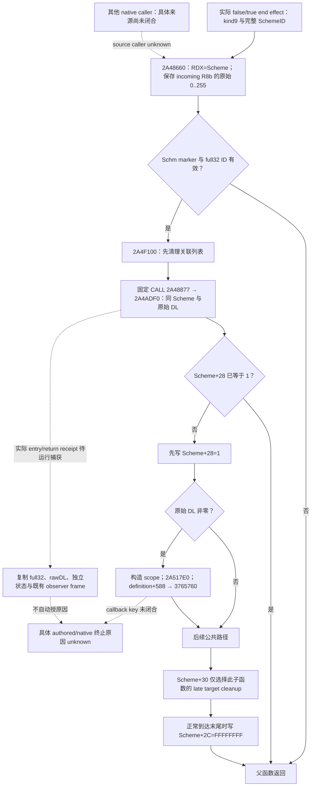

# CK3 1.20.0.4 Sway native end 源码树

2026-10-11。本文复用已闭合的实际 `.4` 父函数与两个顺序子函数，
不新增二进制读取。版本为 CK3 `1.20.0.4` / Steam build `25734779`，EXE SHA-256
`98702F88A547CDE2EAF29A85F93B85F68EE4CF8148336A4F7AFAEB75319DD518`。
原生入/返观察、Scheme 终态和具体终止原因分别保留；当前源码不能把共享 callback
命名为 `on_invalidated`，也不能从 invalidated Toast 推出 native end 的原因。

研究前置为 [实际 typed end 输入](native71-sway-end-invocation-12004.md)、
[completion 到 end 的关系](native71-sway-child-end-causal-path-12004.md)、
[当前 invalidation 执行输入](sway-invalidation-executing-input-12004.md) 与
[invalidation 接线](sway-invalidation-execution-wire-12004.md)。旧 `.2` purge 链只保留
历史身份，不能替代这里的实际 `.4` 函数和字段。



## 三段实际源码与调用顺序

| 函数 | 已闭实际范围 | 关键合同 |
| --- | --- | --- |
| 父 end `2A48660` | `[2A48660,2A48895)`，565B | 原始 RDX 保存为 RDI；`2A4868A` 保存 R8b 为 SIL；guard 通过后先 cleanup，再 end |
| 先行 cleanup `2A4F100` | `[2A4F100,2A4F28E)`，398B，由三个实际 pdata 范围组成 | 完整 CFG 到 `RET 2A4F28D`；父不消费其 RAX |
| 状态/end `2A4ADF0` | `[2A4ADF0,2A4B15B)`，875B | 消费同 Scheme 与原始 DL；`+28` 是状态，`+2C` 是 owner，`+30` 独立 |

父函数以 Scheme `+14 == 0x5363686D` 与 `+10 != FFFFFFFF` 判断是否继续。
SchemeID 始终保留完整 uint32；generation 来自 `fullID >> 24`。既有 typed effect
只把低 24 位用于索引，并比较完整 ID，不能把索引当作实例身份。父的 `+30 != 0`
跳过前面的条件通知工作，仍进入两次公共调用。

固定公共序列为：

```text
2A48868  mov rcx,rdi
2A4886B  call 2A4F100       ; 返回 2A48870
2A48870  movzx edx,sil     ; 原始 R8b，保留 0..255
2A48874  mov rcx,rdi
2A48877  call 2A4ADF0      ; bytes E8 74 25 00 00，返回 2A4887C
```

false/true typed effect 的来源已经分别闭合为原始 R8=0 / R8b=1；这只是两个
effect 的输入来源，不能推广为所有 caller 或具体 authored reason。新的中立观察也
不把 2..255 归一化为 bool。

## cleanup 与状态字段的实际作用

`2A4F100` 从关联 Character `+1C0` 的集合移除所有等于完整 Scheme `+10` 的
DWORD 项。数据位于集合 `+368`，有符号 count 位于 `+374`；非匹配项维持原顺序。
移除数大于零时先调用 `4226860(new_end,old_end,0)`，返回后才减 count。
Character marker/fullID、death 字段与 linked pointer 有各自 guard；非 kind1 的
`2A500F0` resolver 和该复制调用的内部效果尚未在本树展开。清理返回不是 Boolean
成功证据，也不证明后续 end 已完成。

`2A4ADF0` 在 `2A4AE17` 检查 `DWORD[Scheme+28] == 1`。已经为 1 时直接离开，
不重复下面的新 stores/callback。其他正常路径在 `2A4AE21` 先写 `+28=1`，然后
测试原始 DL。DL 非零才走 `889F60` 本地 scope、`2A517E0(Scheme,scope)`，以及
`3765760(definition+588,scope)`；该 callback 的 key、scope 完整语义和具体原生
source caller 均未闭合。本树没有据名称补成 `on_invalidated`。

在这个子函数内，`+30 != 0` 仅跳过后面的 target cleanup，仍可到达
`2A4B138` 的 `DWORD[Scheme+2C]=FFFFFFFF`。`+30` 不是终态字段。
末尾 owner store 是正常到达该位置的源码效果；只有实际 original 返回后复制的
raw 值才能成为本次入/返观察，不能用静态 store 替代动态证据。

## 中立入/返与终止原因的边界

[既有 typed reader](../../ck3_autonomous_player/native_bridge/include/xar_bridge/sway_end_invocation_12004.hpp)
的增量 API 消费真实 RCX Scheme、原始 DL 与已有 session/thread/invocation stamp。
新中立 DTO 独立复制 entry/return 的 full32 ID、generation、`+28/+2C/+30`，
kind0 时的 `+34` target，以及已供应的 observer Core frame；不再读取 clock 或
发起 query。original 只转发一次。完整 ID 相等是 raw 身份诊断，不自动证明当前
storage membership，也不填造 incoming native return address。

实际同实例 `pre+28=0 → post+28=1` 可以支持该次终态转变；返回 owner 原始
`FFFFFFFF` 保持原值，query actor 取 entry owner。实际入/返、状态转变和来源原因
分别保存。固定 callsite、rawDL 非零、附近 Toast、共用日期或 observer 序列
均不能单独赋予 completed/failed/cancelled/invalidated 标签。
[因果 consumer 合同](native71-sway-end-causal-join-12004.md) 与旧 accepted kinds
保持独立，不能从这棵静态源码树补造 causal token 或 gate。

三段源证据位于当前 D continuation 根：

- `continuation-06k-sway-end-source/ACTUAL-2A48660-SOURCE.json`；565B body SHA
  `9f0a8e21cf6233bf4cb0df2c1946c9cc9a0695d2c0467d45114129b2ddd1beeb`。
- `continuation-24/background-g2-offline-20261011/scheme-end-2a4f100/SOURCE-SEMANTICS-CONTRACT.json`；398B 三段 CFG。
- `continuation-15/background-g2-offline-20261011/native-end-2a4adf0/SOURCE-CONTRACT.json`；875B body SHA
  `dd6deb1305410da45251c233443fb1ed13589f7a405a7a61c4457b1bce59304f`。

本次只有源码合同与 D 候选；未执行 production import、测试、构建、安装、Game、
Steam、query 或新的实际入/返捕获。

Root adopted this source tree on 2026-10-11 before adopting the new common-end observation wire. The incremental APIs described above remain external source candidates until their complete installer, journal/query, decoder and Service path is integrated. This document records static native source and candidate semantics; it grants no actual entry/return, state transition or cause evidence. Qualification remains `research`, with no local tests, project imports, compilation or Game/Steam/live operations. All current source commits skip CI; Native84/SDK84 remain compiled Source594.
