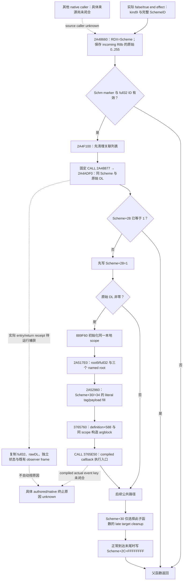

# CK3 1.20.0.4 Sway native end 源码树

2026-10-11。本文复用已闭合的实际 `.4` 父函数与两个顺序子函数，
不新增二进制读取。版本为 CK3 `1.20.0.4` / Steam build `25734779`，EXE SHA-256
`98702F88A547CDE2EAF29A85F93B85F68EE4CF8148336A4F7AFAEB75319DD518`。
原生入/返观察、Scheme 终态和具体终止原因分别保留；当前源码不能把共享 callback
命名为 `on_invalidated`，也不能从 invalidated Toast 推出 native end 的原因。

研究前置为 [实际 typed end 输入](native71-sway-end-invocation-12004.md)、
[completion 到 end 的关系](native71-sway-child-end-causal-path-12004.md)、
[当前 invalidation 执行输入](sway-invalidation-executing-input-12004.md) 与
[invalidation 接线](sway-invalidation-execution-wire-12004.md)。旧 `.2` purge 链只保留
历史身份，不能替代这里的实际 `.4` 函数和字段。



## 三段实际源码与调用顺序

| 函数 | 已闭实际范围 | 关键合同 |
| --- | --- | --- |
| 父 end `2A48660` | `[2A48660,2A48895)`，565B | 原始 RDX 保存为 RDI；`2A4868A` 保存 R8b 为 SIL；guard 通过后先 cleanup，再 end |
| 先行 cleanup `2A4F100` | `[2A4F100,2A4F28E)`，398B，由三个实际 pdata 范围组成 | 完整 CFG 到 `RET 2A4F28D`；父不消费其 RAX |
| 状态/end `2A4ADF0` | `[2A4ADF0,2A4B15B)`，875B | 消费同 Scheme 与原始 DL；`+28` 是状态，`+2C` 是 owner，`+30` 独立 |

父函数以 Scheme `+14 == 0x5363686D` 与 `+10 != FFFFFFFF` 判断是否继续。
SchemeID 始终保留完整 uint32；generation 来自 `fullID >> 24`。既有 typed effect
只把低 24 位用于索引，并比较完整 ID，不能把索引当作实例身份。父的 `+30 != 0`
跳过前面的条件通知工作，仍进入两次公共调用。

固定公共序列为：

```text
2A48868  mov rcx,rdi
2A4886B  call 2A4F100       ; 返回 2A48870
2A48870  movzx edx,sil     ; 原始 R8b，保留 0..255
2A48874  mov rcx,rdi
2A48877  call 2A4ADF0      ; bytes E8 74 25 00 00，返回 2A4887C
```

false/true typed effect 的来源已经分别闭合为原始 R8=0 / R8b=1；这只是两个
effect 的输入来源，不能推广为所有 caller 或具体 authored reason。新的中立观察也
不把 2..255 归一化为 bool。

## cleanup 与状态字段的实际作用

`2A4F100` 从关联 Character `+1C0` 的集合移除所有等于完整 Scheme `+10` 的
DWORD 项。数据位于集合 `+368`，有符号 count 位于 `+374`；非匹配项维持原顺序。
移除数大于零时先调用 `4226860(new_end,old_end,0)`，返回后才减 count。
Character marker/fullID、death 字段与 linked pointer 有各自 guard；非 kind1 的
`2A500F0` resolver 和该复制调用的内部效果尚未在本树展开。清理返回不是 Boolean
成功证据，也不证明后续 end 已完成。

`2A4ADF0` 在 `2A4AE17` 检查 `DWORD[Scheme+28] == 1`。已经为 1 时直接离开，
不重复下面的新 stores/callback。其他正常路径在 `2A4AE21` 先写 `+28=1`，然后
测试原始 DL。DL 非零才走 `889F60` 本地 scope、`2A517E0(Scheme,scope)`，以及
`3765760(definition+588,scope)`。下节补入已闭的 literal scope fill 与 generic
compiled callback 调用路径；compiled actual event key、完整 transitive effects 与
具体原生 source caller 仍未闭合。本树没有据名称补成 `on_invalidated`。

在这个子函数内，`+30 != 0` 仅跳过后面的 target cleanup，仍可到达
`2A4B138` 的 `DWORD[Scheme+2C]=FFFFFFFF`。`+30` 不是终态字段。
末尾 owner store 是正常到达该位置的源码效果；只有实际 original 返回后复制的
raw 值才能成为本次入/返观察，不能用静态 store 替代动态证据。

## 同一本地 scope 到 compiled callback 的三个实际节点

这次增量只复用三个 owner 的薄源码合同，不新增二进制读取或代码。父仍为
rawDL 非零路径的 `2A4ADF0`：`889F60` 初始化 parent `RSP+50`，
`2A4AEA3` 把同 Scheme 与同 scope 传给 `2A517E0`，返回后
`2A4AEB8` 把 `[Scheme+20]+588` 与该 scope 传给 `3765760`。

| 实际节点 | 已闭范围 | literal 结果与正常执行路径 |
| --- | --- | --- |
| `2A517E0` | `[2A517E0,2A51891)`，177B | 写 scope `WORD+0=9` / `QWORD+8=zext(Scheme DWORD+10)`；三个 named root 调用后 tail-JMP `2A52960` |
| `2A52960` | `[2A52960,2A52A3B)`，219B，完整自身 CFG | 输入 RCX 为 `Scheme+30`，RDX 为同 scope；tag/payload 分支只调用 `373A0F0`，各正常出口已闭 |
| `3765760` | `[3765760,376585C)`，252B | 保留输入 scope 与 compiled callback，构造 argblock；`37657E2 CALL3765E50`，返回 `37657E7`，条件清理后 `RET376585B` |

`2A517E0` 的 named root descriptor 与 key slot 如下。每次 `373A0F0` 的
RCX 都是同 scope `+18`，R8 是本地 descriptor 地址，EDX 是该 key slot 的
实际 DWORD；这里仅记录 slot RVA，不把它解析成 event/cause 名称。

| 调用点 | descriptor root DWORD | payload QWORD | key DWORD 的 module RVA |
| --- | ---: | --- | --- |
| `2A51824` | `9` | 独立重读 `Scheme+10` DWORD 并 zero-extend | `5D4BD60` |
| `2A51848` | `4` | `zext(DWORD[Scheme+2C])` | `5D4BD5C` |
| `2A5186C` | `1F` | `zext(DWORD[Scheme+40])` | `5D4C018` |

因此 scope 根 payload 与第一个 named payload 来自两次独立的 `Scheme+10`
读取；静态来源相同不授原子一致性。generation 仍来自完整 ID 的高 8 位。
末尾 `2A5188C` tail-JMP 将 `Scheme+30` 地址与同 scope 交给下一节点。

`2A52960` 把该地址的 DWORD 当作 raw tag，`+4` 即 `Scheme+34` 的 DWORD
作为 payload。payload 均 zero-extend 至 descriptor QWORD；descriptor 是
callee `RSP+20` DWORD 与 `RSP+28` QWORD，中间四字节不能假定为零。
所有 reached `373A0F0` 都接收 scope `+18` 与这个 descriptor：

| raw tag | descriptor root | key DWORD RVA | 具体分支 |
| ---: | ---: | --- | --- |
| `0` | `4` | `5D4BD58` | 公共 `CALL2A52A2B` |
| `1` | `5`，然后另一个 `5` | `5D4BD58`，然后 `5D4C1B4` | `CALL2A529CF`，独立重读 payload 后 `CALL2A529F2`；`RET2A52A0B` |
| `2` | `1A` | `5D4BD58` | 公共 `CALL2A52A2B` |
| `3` | `D` | `5D4BD58` | 公共 `CALL2A52A2B` |
| 其他完整 DWORD | 无 | 无 | 不读取 payload，不调用 helper，直接 `RET2A52A3A` |

tag1 的 payload 两次读取点分别是 `2A529A3` 与 `2A529D4`，必须保持独立；
tag0/2/3 公共正常出口为 `RET2A52A3A`。这些 raw tag 没有在本专题命名为
target 类型或终止原因；`373A0F0` 的完整 insertion effects 仍属于既有独立来源。

`3765760` 将原始 scope 保存为 RBX、compiled callback 保存为 RDI。
其 normal path 依次调用 `37652B0` 构造临时 frame，再调用 `3736040` / `3735F90`
初始化本地 scratch/frame；这些是调用路径，不是本次重跑初始化器或授整体 effects。
传给 `3765E50` 的原始 argblock 为：

| wrapper stack 字段 | raw 值 |
| --- | --- |
| `RSP+20` | 输入 scope QWORD |
| `RSP+28` | 零 QWORD |
| `RSP+30` | 同输入 scope QWORD |
| `RSP+38` | `&RSP+50` |
| `RSP+40` | 从 module `5D1DADC` 复制的 BYTE |
| `RSP+48` | `&RSP+440` |

literal `37657E2` 的 RCX 是原输入 compiled callback，RDX 是 `&RSP+20`。
normal return 后按各自非空字段执行条件清理，最终 `RET376585B`；wrapper
不检查 event-specific result/status/cause。这闭合的是 actual scope/argblock 到
compiled executor 的连接，尚未闭合 definition `+588` 所代表的 actual event key、
其他 native caller 到父 end 的来源关联或具体终止原因。Mermaid 中这三项仍为
unknown 虚线，不改变 accepted kinds，不补造 causal token。

新增薄合同仍位于同一 continuation 根：

- `continuation-03/background-g2-offline-20261011/native-end-scope-2a517e0/SOURCE-CONTRACT.json`，SHA `8f063e31630f560871cce1077ef0a95cda6d8cec19634488993b090389016373`。
- `continuation-45/background-m6-end-scope-tail-20261011/SOURCE-CONTRACT.json`，SHA `1a3a07fb358b7d33ec4ec07bbae464dd5cda876b47439b39baf0b0ef3e5f92ae`。
- `continuation-15/background-g2-offline-20261011/native-callback-3765760/SOURCE-CONTRACT.json`，SHA `6992b817d9b856821a947cd91d79e7ef69b1ca2ee4763f42352ffc4ebc0fad55`。

此次知识增量保持 source-only：reader 两个文件不变，未执行 local tests、
production imports、CL/link、Game/Steam/UI/RPC 或新的入/返捕获。

## 中立入/返与终止原因的边界

[既有 typed reader](../../ck3_autonomous_player/native_bridge/include/xar_bridge/sway_end_invocation_12004.hpp)
的增量 API 消费真实 RCX Scheme、原始 DL 与已有 session/thread/invocation stamp。
新中立 DTO 独立复制 entry/return 的 full32 ID、generation、`+28/+2C/+30`，
kind0 时的 `+34` target，以及已供应的 observer Core frame；不再读取 clock 或
发起 query。original 只转发一次。完整 ID 相等是 raw 身份诊断，不自动证明当前
storage membership，也不填造 incoming native return address。

实际同实例 `pre+28=0 → post+28=1` 可以支持该次终态转变；返回 owner 原始
`FFFFFFFF` 保持原值，query actor 取 entry owner。实际入/返、状态转变和来源原因
分别保存。固定 callsite、rawDL 非零、附近 Toast、共用日期或 observer 序列
均不能单独赋予 completed/failed/cancelled/invalidated 标签。
[因果 consumer 合同](native71-sway-end-causal-join-12004.md) 与旧 accepted kinds
保持独立，不能从这棵静态源码树补造 causal token 或 gate。

三段源证据位于当前 D continuation 根：

- `continuation-06k-sway-end-source/ACTUAL-2A48660-SOURCE.json`；565B body SHA
  `9f0a8e21cf6233bf4cb0df2c1946c9cc9a0695d2c0467d45114129b2ddd1beeb`。
- `continuation-24/background-g2-offline-20261011/scheme-end-2a4f100/SOURCE-SEMANTICS-CONTRACT.json`；398B 三段 CFG。
- `continuation-15/background-g2-offline-20261011/native-end-2a4adf0/SOURCE-CONTRACT.json`；875B body SHA
  `dd6deb1305410da45251c233443fb1ed13589f7a405a7a61c4457b1bce59304f`。

本次只有源码合同与 D 候选；未执行 production import、测试、构建、安装、Game、
Steam、query 或新的实际入/返捕获。

Root adopted this source tree on 2026-10-11 before adopting the new common-end observation wire. The incremental APIs described above remain external source candidates until their complete installer, journal/query, decoder and Service path is integrated. This document records static native source and candidate semantics; it grants no actual entry/return, state transition or cause evidence. Qualification remains `research`, with no local tests, project imports, compilation or Game/Steam/live operations. All current source commits skip CI; Native84/SDK84 remain compiled Source594.

## Connected common native end observation source

Root adopted eleven connected production files from the coherent M6 source packet. The fixed native `CALL 2A48877 -> 2A4ADF0` now has an authored observer, copied entry/normal-return fields, an independent retained ring, the existing query serializer, strict decoder and four-line forwarding in the existing Service. Bridge registration uses the existing exact-build startup window; CMake adds one Runtime translation unit under the existing option. Only precise shared-file hunks were applied, preserving the adopted education, CourtOwner and invalidation source groups.

The actual original call is forwarded once. Raw DL retains all values 0..255. Status `+28`, owner full DWORD `+2C`, kind `+30` and kind0 target `+34` each retain their independent read flags and raw values on entry and return. Failed header/full-ID reads do not erase independently successful field reads. Same-full-ID is a diagnostic comparison. No current Core frame producer is supplied, so that group remains unobserved. Source callsite/return constants are provenance, not an observed incoming native return address.

```mermaid
flowchart LR
  A[Fixed native CALL 2A48877] --> B[Actual entry operands]
  B --> C[Original 2A4ADF0 once]
  C --> D[Normal-return field copies]
  D --> E[Independent retained observation ring]
  E --> F[Existing termination query and serializer]
  F --> G[Strict decoder and existing Service]
  G -. source caller and actual event key unresolved .-> H[Specific end cause]
```



Ordinary Stop records detached availability and retains backing because it has no suspended-thread proof. This is authored source behavior; no installer or teardown was executed. The old three accepted source classes and end-cause qualifications remain unchanged. These fields do not complete M6 or establish a current terminal result.

Qualification: `research / SOURCE_ADOPTED_NOT_RUN`. No tests, project imports, compilation, Game/Steam/UI/RPC operations or live reads. Native84/SDK84 remain compiled Source594. Actual adoption receipt: `D:/codex-ck3-background-spill/native71-continuation-20261010/ROOT-M6-COMMON-NATIVE-END-SOURCE-ADOPTION-20261011.json`. The scope/callback source delta above was adopted in the same package; its three original thin contracts are retained as source evidence.
