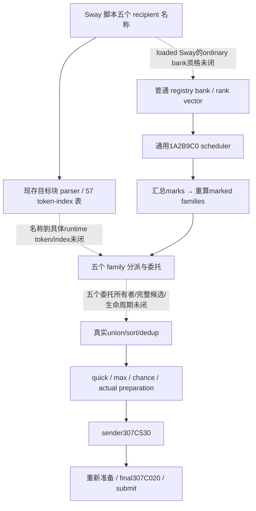

# Sway 原生目标来源：把未知边缩到实际缺口

`machine_id: xenoamess-full-tower-eb9d2c1186`。本轮沿 Host source-plan 的两个 exact source ref 反查现存 `source04/source07`，没有读取 EXE、新采样、启动游戏或重跑 Java。版本仍绑定 `1.20.0.4` / SHA `98702f88a547cde2eaf29a85f93b85f68ee4cf8148336a4f7afaeb75319dd518`；当前安装元数据由共享 `resume61/formal_release/INSTALLATION-WITNESS02.json` 观察。本文件不更新其他机器的安装或实机资格。

旧 Sway 交接把 `.4` native target-group/enumerator/sender caller 一并写为 unknown，范围过宽。实际已保留的 M6 `NATIVE-GRAPH04.json` 说明通用交互的真实 scheduler、sender value 和 final CanSend；`NATIVE-GRAPH07.json` 已分开完整 57 分派入口与仍未闭合的委托语义。这里复用其结论，不重复已有 QuickFilter/NativeInteractionAi 实现或把源码当新实机证据。

| 现存 exact 记录 | 已有静态来源范围 |
| --- | --- |
| `D:/codex-ck3-demos/2026-10-22-java-phase1/scratch/resume-current-20261024/ai_scheme_m6_native04/NATIVE-GRAPH04.json` | 普通交互 bank/rank index；`19E82A7 → 1A2B9C0 → 1A2B310`；sender `307C530`，随后重新准备、`307C020` 和实际 submit |
| `D:/codex-ck3-demos/2026-10-22-java-phase1/scratch/resume-current-20261024/revisions/m6_research/native07/NATIVE-GRAPH07.json` | 目标块 callback `292E2A0`；57 runtime-token 表；mark/recompute、union、quick filter 与 max/chance 的具体边界 |
| 同目录 `NATIVE-SOURCE07.json` | 原有限读取的 span SHA、unwind、固定表和原始 token 值；文件身份不单独证明语义 |

本轮读取的当前安装文本仍给 Sway 三个独立 `ai_targets` block：`liege + neighboring_rulers` 的 max 为 10；`vassals + peer_vassals` 的 max 为 10；`councillors` 未声明 max。不能把它们合成一个总 10 项上限。`_character_interactions.info` 声明列表可组合、max 会抽取随机目标；它并不提供这五个名称到 native runtime token 或 57 index 的具体绑定。源文件与本次精确摘要都在 plan 的 evidence 表，安装文本不冒充经 depot 核验的 vanilla 身份。

已有通用链会汇总本轮所选 definition 所需的 family marks，再于 `1A2BF81 → 2930260` 只重算被标记的 family。`2931C30` 拼接所需 family vectors，然后排序和相邻去重。quick filter 逆序 swap-last 删除，max trim 再按原生 RNG 替换；它不是稳定过滤后取前 N 项。原生调用有 mutable context/cache 和 RNG，不能直接暴露成我方只读查询或为了对照任意重复调用。

下一步只定位三类具体未知边：五个名称的真实 token/index；definition `+272A` 的 authored 字段及 loaded Sway 所属 bank；这五类的实际 delegated helper、所有者和 vector 生命周期。不能按 `.info` 的声明顺序给 57 index 命名，也不能把仅在少数已核行观察到的 registry ordinal 与 runtime token 差一规律外推到整个表。已向唯一 b64 owner 请求现存 token/name/初始化索引的五名精确查询；没有具名输入时不进行盲 EXE 扫描或整表导出。

研究计划使用既有 `tools/native_research_plan.py` 工作流：`resume61/sway_ordinary/native-target-plan72.json`，10178 B，SHA `036c91a93b650ce7ad96b190935a7047b112d5da9ad8244eab9f271bcfa80381`；同源生成的 Mermaid/边表在 `native-target-graph72.md`。实际 `check` exit0，核 5 份小输入的文件完整性和声明；`semantic_correctness_verified=false`、`live_execution_performed=false`。计划仍明确没有 live window、真实 producer trigger 未闭，五组 case 全部 pending。没有 native AI 候选完整性、策略等价、提速或新 G2 业务信用。
