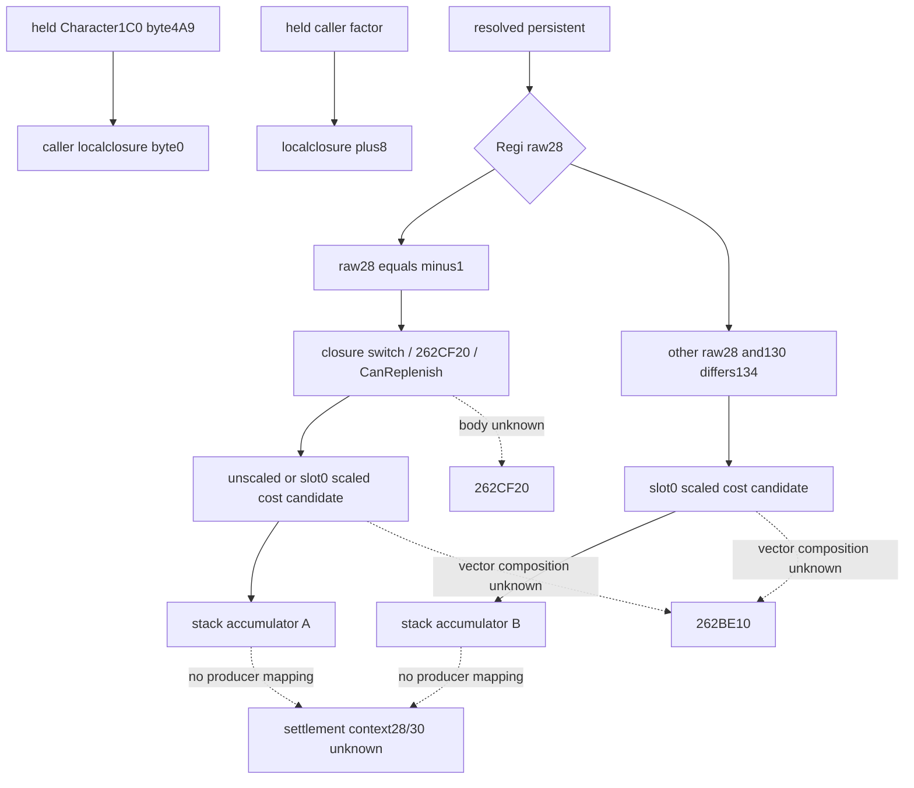

# CK3 1.20.0.4：current 费用向量的 context108 helper

当前已闭合 `2C14440→2C14D70` 的完整参数和13个分支：它将 persistent 的候选费用向量加到 caller 的两个栈上累加器。**没有建立 settlement context `+28/+30` 的生产或已付军费语义。** `maintenance_attribution=unclosed`。

来源机器 `machine_id: desktop-3fevhd2-1c74096080`，精确采集UTC在证据回执。CK3 1.20.0.4 / Steam25734779，EXE SHA `98702f88a547cde2eaf29a85f93b85f68ee4cf8148336a4f7afaeb75319dd518`。完整唯一unchained函数 `[2C14D70,2C14FD5)` 为613B、155指令、13个jump，raw SHA `773a1667a77bcda019c1adb03cb359b7d964c557035f676f0d3e3db1acede39a`。本轮220B metadata/20 reads；没有callee、EXE整hash、游戏、SDK、桌面、构建、注入或主树写入。

## 参数与实际对象层级

上游完整 `2C142B0` 已证 caller 传入 RCX=&本次调用的local closure、RDX=已解析完整FullID的persistent Regi。closure中的字节0来自 Character1C0 的4A9；+8为caller算出的factor；+10/+18分别指向caller `RSP+50`、`RBP-60` 的两个十槽累加器。该helper没有Character指针参数或Character1C0解引用；caller忽略RAX，不能把它虚构为返回out指针的getter。

| 分支条件 | 实际候选vector调用与输出 |
| --- | --- |
| Regi raw28==-1；closure开关0，或`262CF20`返回true，或`262C6E0(Regi,Regi+18)`返回false | 调`262BE10(Regi,localout80,0,1)`，未经本helper的factor缩放，逐槽加到A。`262CF20`正式意义未展开。 |
| raw28==-1；开关非零、262CF20=false、CanReplenish=true | 同一`262BE10(...,0,1)`，仅slot0走内联factor整数算术，其他9槽保持返回值，逐槽加到A。 |
| raw28!=-1，Regi130==Regi134 | 直接返回，不加任一累加器。 |
| raw28!=-1，Regi130!=Regi134 | 调`262BE10(Regi,localout80,1,0)`，仅slot0走内联factor整数算术，逐槽加到B。两个bool参数正式名未知。 |

`CanReplenish=false` 在第一分支中仍选择候选费用getter，不是把费用清零的指令。它也不证明该getter一定返回正数，或事件军实际收费；实际支付仍需源分量、payer/wallet store与调度证据。内联乘法的fast/fallback分支和常量均保留在原件，不将普通数值范围的简式外推到溢出边界。

## +28/+30的对象不能混用

`2C14F9F` 确实执行 `ADD [RCX+28]`，`2C14FA7` 确实执行 `ADD [RCX+30]`。但RCX来自closure+10或+18，已闭合为caller的栈上十槽向量。这里的+28/+30是向量槽5/6；`Regi+28`条件又属于另一个receiver。三者不能因为offset相同就认作 `*(Character+1C0)+28/+30`。



## 原件与离线复放

证据位于 [来源合同](acceptance/2026-10-16-current-military-context2c14d70/SOURCE-CONTRACT.actual.json)、[原始source ZIP](acceptance/2026-10-16-current-military-context2c14d70/source-originals.zip) 和 [逐文件清单](acceptance/2026-10-16-current-military-context2c14d70/MANIFEST.json)。ZIP保留原始613B、全部155条指令、13分支原始记录、逐分支合同、实际读取账本、读取前plan/check/render和具名上游literal slices；无需历史绝对路径或capstone即可校验。

```text
python -B -O docs/ck3-native-ai/acceptance/2026-10-16-current-military-context2c14d70/verify_source.py --machine-id <当前机器ID> --output <新外置回执.json>
```

stdlib verifier只核保存字节、完整指令覆盖、真实relative CALL/JUMP目标、13分支逐一合同及有限读取回执。它不自动证明人工语义，不授另一机器安装/运行或实际支付资格。未知的262CF20/262BE10及payer/cadence边界继续保持；本scope没有自动follow。来源知识可移机，机器与实机事实只属于原记录当时的机器。原复核截止 `2026-10-16T07:45:01.597Z` 不延长。
