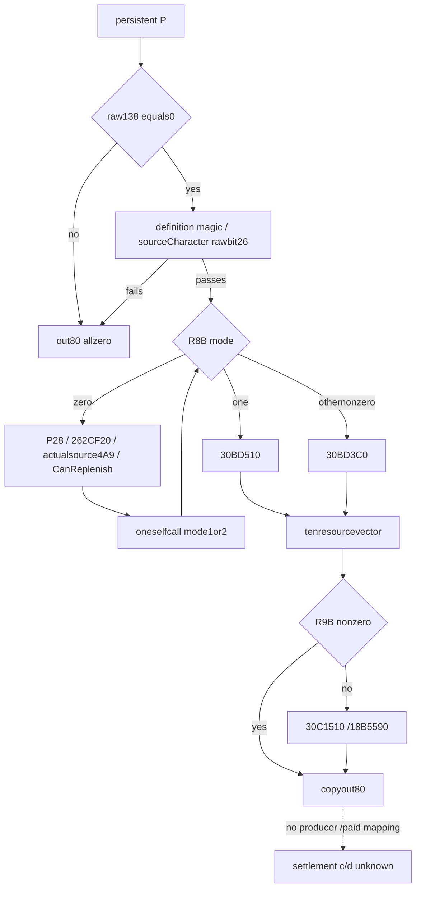

# CK3 1.20.0.4：persistent Regi 十资源费用向量

`262BE10` 已取得完整660B。其最早门槛是 **persistent raw138非零就将十资源输出全部清零并返回**，早于定义、来源角色、模式和补员开关。它证明当前Regi在这个getter的贡献为零，不能升级成全部事件军、全部费用渠道或实际付款为零。`maintenance_attribution=unclosed`。

来源机器 `machine_id: desktop-3fevhd2-1c74096080`；UTC见实际读取回执。精确CK3 1.20.0.4 / Steam25734779，EXE SHA `98702f88a547cde2eaf29a85f93b85f68ee4cf8148336a4f7afaeb75319dd518`。唯一unchained完整范围 `[262BE10,262C0A4)`，660B、171指令、32个jump；raw SHA `b565d2261e9e4549c7f34ff31c97fd14849756a8e68d10e6fb7c23e9109230ef`。本轮220Bmetadata/20reads，没有externalcallee、整EXEhash、游戏、SDK、桌面、注入、构建、EXE执行或主树写入。来源基线c4992c304d196135d9590799d69ffb3c9f5510e6。

## 参数与三种输出路径

RCX=P（persistent Regi），RDX=caller-owned out80；RAX最终返回该out指针。R8B由`262BE29`零扩展保存为mode；R9B由`262BE25`零扩展保存。a07/a08六处实际调用只传过R8B/R9B=(0,1)或(1,0)，但本函数自己的真实递归还传R8B=2。因此旧专题把R8称“bool”仅是当时观测形状；本来源补注为**含0/1/2的raw模式字节，正式枚举名未知**。R9B的正式名也未知。

| 条件 | 此函数的实际结果 |
| --- | --- |
| P138!=0 | `262BE3C`清XMM0，五次MOVUPS覆盖out80，直接返回。此费用门为“非零”；CanReplenish的138门为“等于1”，不能混同。 |
| P138=0但definition[P118]+38不是4744624F，或实际来源角色`28C2DF0`返回对象DWORD40 bit26未置位 | 同样将out80清零。raw位的业务名不猜测。 |
| R8B=0 | 自动选择一次递归，目标R8B为1或2，保留同P/out/R9B。子调用R8B非零，不再进入自动选择。 |
| R8B=1 | 调`30BD510`取十资源向量。 |
| 其他非零R8B，包括实际递归的2 | 调`30BD3C0`取十资源向量。其他字节正式范围未知，只记录此体的分派。 |
| R9B非零 | 跳过额外factor变换，复制该十资源向量到out80。 |
| R9B=0 | 对实际来源Character调用`30C1510(out64,Character,0)`，再`18B5590(localvector,factor)`，随后复制out80。两个callee公式未展开。 |

来源角色按P130/P12C的原生分支、registry完整generation和fallback解析：exclusive P130分支用所解析对象的128角色ID；direct P12C分支直接解析角色；其他组合选择-1/fallback。它可能不同于played Character或外层caller Character，不能借用玩家开关。

## 自动模式、开关与原生数量

越过三个清零门后，R8B=0且P28!=-1直接递归mode1。P28==-1时，若`262CF20(P)`为true、来源Character1C0缺失、其4A9为0或`CanReplenish(P,P+18)`为false，则递归mode2；其余递归mode1。开关影响的是这个模式选择，不是“关掉就清零”的通用开关。直接mode1/2调用不会经过这段4A9检查。

两个cost leaf的实际ABI为：RCX=definition[P118]，RDX=localout80，R8=上述真实source Character，R9=`signextend_i32(P128)*100000`，第五参数字节=`P130!=-1且P12C==-1`。本体没有遍历七个physical chunk求current人数，也不读取ArRg的UI缓存；不能以当前画面兵数替换原始P128输入。30BD510/30BD3C0的定义费率、每资源组合和数量公式继续未知，本scope不扩。



这补齐了事件Regi raw138=1在此getter的零结果来源；没有证明raw138终生不变，也没有证明其他费用（包括独立付款来源）为零。source本体未读取或写入secondary context28/30/2C0/2C8；同一Character1C0的4A9参与模式选择不构成结算四term生产边。旧的“false路径未经caller缩放”事实保留，不能单凭该事实判断免费；这里的零来自更早的明确清零门。

## 原件与标准库复放

[来源合同](acceptance/2026-10-16-persistent-cost262be10/SOURCE-CONTRACT.actual.json)、[source ZIP](acceptance/2026-10-16-persistent-cost262be10/source-originals.zip)、[逐文件清单](acceptance/2026-10-16-persistent-cost262be10/MANIFEST.json)保留完整660B、171条指令、32分支逐一合同、九处CALL（其中两处递归到同一个已持函数）、六处上游参数写入、实际read账本和读取前plan/check/render。

```text
python -B -O docs/ck3-native-ai/acceptance/2026-10-16-persistent-cost262be10/verify_source.py --machine-id <当前机器ID> --output <新外置回执.json>
```

stdlib verifier只核保存字节、完整指令覆盖、relative CALL/JUMP、分支合同与实际预算；不自动证明人工语义或游戏业务。ZIP无需旧绝对路径或capstone；机器安装/运行/实机事实不随源知识迁移。原复核截止2026-10-16T07:45:01.597Z不延长。
