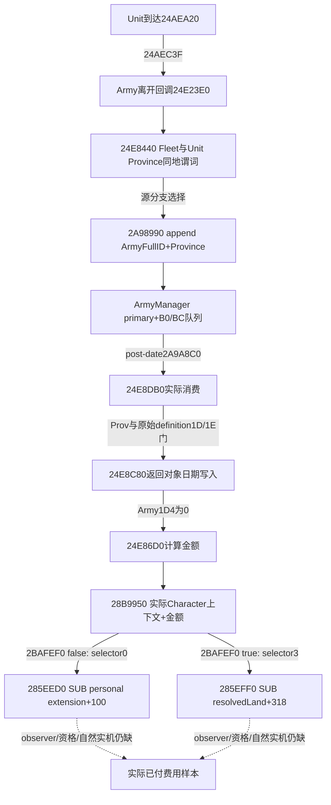

# CK3 1.20.0.4 登船扣款源链与被动观察器

machine_id: `desktop-3fevhd2-1c74096080`  
observed_at: `2026-10-15T08:45:04.217247+00:00`  
CK3: `1.20.0.4 / Steam25734779`  
EXE SHA-256: `98702f88a547cde2eaf29a85f93b85f68ee4cf8148336a4f7afaeb75319dd518`

这是**静态源链已闭合、实际付款尚未观察**的结果。使用Root一次验真的冻结EXE；A有限读取本体并复用B已经落盘的同机/同EXE小型源，不重复B的EXE读取或实现。当前机器状态只由本文件列出的本机回执支持，知识/代码可移机复用，部署和实机不外推。



`2A98990`只入队，`24E8440`只判定有效Fleet及两publicUnit的ProvinceFullID同地，二者都不是付款函数。队列记录为16B：ArmyFullID@0、Province*@8，4..7为padding。post-date原顺序读取同一队列，fullID解析Army后将queuedProvince传给24E8DB0，最后清count；因此移动提交ACK、到达前帧、队列增长都不能代替付款。

`24E8DB0`在检查Province tag和原始definition1D/1E后调用24E8C80，写返回对象日期；只有Army1D4==0才走计算金额及gateway。24E8C80 transitive effects未展开，不把“未走此direct费用路径”泛化为所有登船都免费。

费用计算器ABI是 `out_amount* = 24E86D0(CArmy*, out_amount*, optional_context*)`，实际consumer传null context，跳过presentation构建。先从Army124→完整Unit→Unit174→完整Character解析上下文；modifier key0x11B加100000，与loadedfloor比较取大。依次遍历每个有效ArRg occurrence，把current38按signed32 wrap累加，保留原始重复，不按physicalalias去重。源定义的数值图可写为：

```text
S = 100000
N = wrap_i32(sum(each accepted ArRg.current38 occurrence))
M = max_i64(wrap_i64(owner_modifier_0x11B + S), loaded_qword_at_0x5C68F68)
T = fixed_div_i64(i64(N)*S, 10000000)    # 源段24E8884..24E896C；正常可表示域等于N*1000
C = fixed_mul_i64(T, loaded_qword_at_0x5C698A0)  #24E896F..24E8A06
C = fixed_mul_i64(C, M)                        #24E8A06..24E8A86
R = max_i64(0, C)                             #24E8A86..24E8A8C
W = narrow_i32(trunc_i64(wrap_i64(R + 50000) / S))
*out_amount = i64(W)*S                        #24E8C23..24E8C5D
return out_amount
```

`fixed_div_i64`和`fixed_mul_i64`是上述源中内联的signed fixed-point及防乘法溢出的商/余数分支，不是新可调用函数。机器宽度、wrap和signed32 narrowing不能在全范围预测中省掉。clamp发生在round/narrow之前，不声称极端溢出输入的最终signed64输出永远非负。两个loadedglobal的当前运行值/名称及当前modifier没有在本包读取；这张源公式不能凭空生成本场数值。

真正应用调用为 `24E8F3B ->28B9950(Character*, selector, amount, 3)`，return24E8F40。selector取 `2BAFEF0(Character)?3:0`：实际55B函数仅在28C2DF0返回对象+40的bit32置位且2BAFD80 true时返回1；未给该原始条件杜撰政府名称。

资源0的实际jump-table目标28B99A0，24E8F3B传入的Character extension+1B0经+F8成为wrapper，`28B99AD ->285EED0`，`285EEF7`执行个人extension+100减amount。资源3的目标28B99E7，按原生Land解析及tag/fullID门，`28B9A68 ->285EFF0`，wrapper=Land+310，`285F01A`减Land+318。Character是上下文，**真正付款账户可能是个人或Land**，不能只观察个人钱包。gateway的extension缺失、amount==0或Land门失败会跳过相应写；零事件仍要和明确执行的跳过门、捕获失败、retention覆盖区分。

最小observer源ABI在 `OBSERVER-ABI-CANDIDATE.actual.json`。B统一准备自然original-once seam，A不重复实现：24E8DB0自然parent invocation →28B9950 gateway（精确return24E8F40）→personal/Land SUB leaf，实际payer从gatewayRCX和leafR8/receiver读取。TLSentry旧owner只作来源，不替代callee中的真实payer；所有角色ID动态绑定本场normal campaign，不能硬编码历史29829或当前其他场ID。保留entry/actual账户身份、signed64 delta、immediate before/after、真实PC/全局native序号及错误/overflow；共享既有cash private query，不新建公共工具。

| A实际保留源 | 精确字节/范围 | 证明范围 |
|---|---|---|
| arrival |1049B，24AEA20..24AEE39|到达前Army回调与初次Province写入顺序|
| departure |1679B，24E23E0..24E2A6F|原始definition分支、Fleet谓词、入队call|
| Fleet predicate |253B代码，24E8440..24E853D；实际有限读256B|两个RET和内部branch闭合，无callee|
| queue append |299B代码，2A98990..2A98ABB；实际拼接304B|73B+192B .pdata片段及39B尾块，只有分配接口|
| post-date |1539B，2A9A570..2A9AB73|与既有源SHA60520f...ca4a7一致，同B0/BC消费|
| selected consumer |406B，24E8DB0..24E8F46|计算金额与实际Character gateway call|
| calculator |1448B，24E86D0..24E8C78|金额、round/narrow、source-owner上下文|

B复用源：gateway540B（含真实jump table）、selector55B、personal SUB131B、Land SUB137B。路径、完整span SHA、read-receipt machine_id、plan SHA与EXE绑定都保存在 `BRANCH-B-SOURCE-INTAKE.actual.json`，本次未重读这些EXE区间。

A已知EXE读8013B/71reads（headers608、pdata660、code6745）；一次早期失败pdata lookup逐read未保留，另保守占用≤228B/19reads，总上界8241B/90reads。一次64B locator错误按whole函数decode后重读64B，已计入code并保留失败事实；原始slice从指令中间开始的decode不作语义证据，Fleet权威结果从连续保留raw重新完整解码。所有后继先plan/check，callee先metadata extent再body。输出不到1MiB；没有全EXE扫描/哈希、游戏/SDK/desktop/注入/build或主树写入。

尚缺：B seam实现的必要离线复合资格、common runtime实际部署、自然登船的一次真实account before/after样本；维持费实际生产caller和applied军事component也未由本分支关闭。源树可以用于实装，不能把这份static source当主片实付款证据。


## 2026-10-15 整合状态补注

机器仍为 `desktop-3fevhd2-1c74096080`。上述静态源结论保留；随后本机离线复合fixture实际通过 **202项native检查＋68项独立compiled-wire检查**。旧封存交付曾误写204，追加勘误为202，不改写旧回执。来源为 `C:/ck3-war-episode04-research-20261004-a01/payment-observer-qualification-20261015-a01/build-a09/RESULT.actual.json`，SHA `3bec649d764525c1b49666f636d89ed1482d48ef2d6fc03ef4997ae4840cac0d`。这不授真实自然付款资格。

实现位于 `ck3_autonomous_player/native_bridge/` 的 `war_payment_{passive,runtime,window}_12004.hpp` 与对应src；CMake `XAR_ENABLE_WAR_PAYMENT_PASSIVE_12004` 默认OFF，要求自然阶段编译开关同时开启。生产DLL全量构建、冷载、真实登船付款和维持费归因仍待完成。

SDK复用现金查询，`payment_sampling=None` 不增加请求字段；显式 `enable` 要求 `payment_window_contract="same_owned_process_no_load_v1"` 并绑定本机机器ID、实际PID/creation time、connection generation及当前player。此合同不制造loaded-game epoch；停用自然采样、读失败、断线、回档或owner变化使window失效，须重新明确启用。付款证据保留原始entry/return、账户余额、正额、真实leaf write及自然父链，不以钱包净差推实际军事费用。

可移植回归使用保存的9个compiled serializer案例（第10个只是同一journal包装的重复），夹具中的机器ID明确仅作来源标签，测试替换机器provider避免向其他机器外推本机事实。
