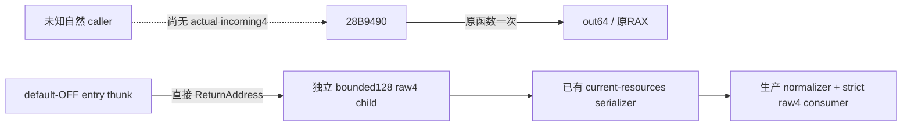

# exact4 selector4 自然 getter 观察候选

machine_id: `desktop-3fevhd2-1c74096080`
observed_at_utc: `2026-10-16T22:59:40.924267+00:00`
source_base: `d7135ca3bf40c33c2d5416242ce844077f1e8cbe`
CK3: `1.20.0.4 / 25734779 / 98702f88a547cde2eaf29a85f93b85f68ee4cf8148336a4f7afaeb75319dd518`

这是已接线、默认关闭、未构建未部署的候选。它复用现有 payment installer、controlled no-load window、共享 event clock、owner filter、sampling permit、clear 与 current-resources journal。没有新增 SDK/tool/游戏动作，也不主动调用 getter。当前 a32/a37 不包含本候选；本轮新 EXE 读取、native 构建、游戏与桌面操作均为0。

## 原版来源与实施范围

已封 [rawselector4 getter/写入别名](episode04-r08-selector-wallet-link-12004.md) 闭合 `28B9490(Character* RCX, out64* RDX, selector R8D)`：selector4 在 extension `*(Character+1B0)` 存在后取 `context=*(Character+1C0)`，context存在则读 `context+4A0`，否则写默认0；返回原 out 指针。getter 的可读分支没有 `2BAFF30` 使用许可门。已知实际 caller `2BCA61F` 只传0/3；本包没有一条实际 incoming4。

原件 `resource_read.bin` 的256B SHA为 `a321c1283d0c8348674bb0fd9dca7598507d909fbba956c147917a67fe315557`，来自先前有限读取；232B代码与24B表的更正仍由上专题保存。14B prefix `48 83 EC 28 4C 8B 91 B0 01 00 00 4C 8B CA` 恰为4+7+3B完整指令，无RIP相对操作数，续接 `28B949E`。本轮只比对已持 bin，没有重新读取 EXE。caller RVA只在已持 `.text [1000,43D9848)` 内给出；原 absolute PC始终保留，越界不伪造RVA。

新增 `XAR_ENABLE_WAR_PAYMENT_RAW4_GETTER_12004=OFF` 是既有 installer 的第六槽；OFF仍为原5槽且不发布 child。ON要求已有 payment flag，沿用 exact SHA/prefix/suspended-primary/quiescent uninstall 检查，不提供热开旁路。旧 payment kinds0..4 与 boarding debit计算未扩展；raw4 child 单独计序号和覆盖次数。

entry thunk在任何helper前直接取 `_ReturnAddress()`。只有自然 selector==4、已就绪/启用、同受管 owner、有效 sampling permit 才留记录；其他 selector、关闭、递归 telemetry 都仅透传原调用。原 getter 只在一个明确位置执行一次，传原三参数、保存并返回原RAX；读失败、未知caller、原RAX与out不一致仅影响资格，不重试、不替换返回。不读调用前尚未初始化的 out。

每条保存 Character指针、FullID/+1C magic、extension、context、物理4A0原始64位、实际caller absolute/RVA、out指针、原返回/out64、前后session/event及可选自然parent。前后物理捕获最多64B加post-out8B，另复用现有owner/window身份检查。没有全机/全对象扫描，没有主动GetCurrency或全栈采样。raw4重入时仍运行原函数但不递归记录。

## 严格消费

现有生产 `war_payment_observations_v1.normalize_journal` 条件接受 `raw_resource4_getter_v1`。公共纯消费者 `war_payment_raw4_getter_v1.consume_raw4_getter_observations(value, snapshot=..., machine_id=...)` 先走该 normalizer，再从literal记录推导 `qualified_raw4_reads`；没有child时仍是原行为。

资格要求同当前machine/PID/create/generation/player/frame、有效同会话、同thread有序event、完整未覆盖ring、原调用返回、RAX等于原out、前后CharacterFullID/magic/context/物理值稳定、out与源分支吻合。无日更parent也可观察GUI自然getter，不能把GUI读当作日更或付款。

`physical_context_4a0` 与 `default_zero_missing_extension_or_context` 分别输出；真实物理0与缺context默认0不合并。读失败与身份/返回/值变化保留raw诊断且不授qualified read。64位保留原bits，另按two's-complement解释signed值。child严格拒绝新币种名、paid字段、非4 selector、伪造RVA与不一致ring；`resource_name=unknown`、`payment_attribution=unclosed` 固定。

## 本轮验证与未来最小 live 验收

本轮4项新 Python 行为检查调用真实生产 normalizer，验证optional接线/旧journal兼容、负数bits、两类0、return/context/session/read失败诊断及伪造输入拒收。它们是synthetic wire fixture，不是native构建或自然实机。native `raw4_fixture.cpp` 与 EXCLUDE_FROM_ALL target已写好，待后续Root显式构建；覆盖原函数次数与参数/返回透传、非4/关闭不留行、读失败不重调、clear。它没有CK3进程资格，不能从手工 seam 调用产生“自然caller”。

后续只需一个独立受管正常冷载窗口：Root先按现有producer/broker合同构建并登记实际唯一EXE输出、核精确SYSTEM结果及helper/runtime SHA；正常加载这份候选，不热改当前场。以已有现金查询显式 `payment_sampling="enable"`、`payment_window_contract="same_owned_process_no_load_v1"` 开一次受管窗口，查询本身不调用28B9490。随后允许已有正常业务/GUI自然发生调用；一次查询journal即可。逐条用本consumer确认caller PC、FullID/context/out/RAX与会话；若0行就保留0，不能强制getter/反复造动作补样本。按原disable正常清空，不把自然采样窗口自动续长。

未来acceptance至少保留default-OFF不含child、ON实际prefix安装与窗口绑定、一条真实自然4或真实0行、停用清空四个独立事实。当前无live执行，不授formal resource/currency名、CanUse、已支付军费、维护component或周期；下一定位入口是未来真实caller-return PC前的实际CALL及其具名registrar/consumer，而非六槽顺序或数值相似性。

源码候选可跨机器复用；安装、broker排除、部署和实机结果必须在目标机器重新绑定。protected SYSTEM policy不修改，不重复UAC，不把旧登记外推新输出。完整原件与构建manifest由未来Root保全；本轮仅交相对patch与小型可移植代码。

## a03 / d7135ca 最小候选与 a02 未采纳更正

本机2026-10-17按Root收窄要求重新封包。a03从已直接applycheck通过的a01观察器生成，直接用于clean d7135ca；不要先叠加a01/a02。保留默认OFF、原直接 `_ReturnAddress()`、held14B完整prologue、独立raw4 ring、原函数一次/原返回透传和现有payment窗口/serializer/normalizer。旧payment协议与60de相比零diff；a32/R194不包含本候选。

a02曾新增三处mailbox callback TLS fence。该改动未获采用：当时只有“SDK wrapper可能间接调用getter4”的理论路径，尚无当前生产exact可达query→raw4 getter调用链、实际污染回执或生产路径确定性复现。不能据此称当前存在缺陷，也不能把fence、额外native SEH验证或其测试设为a33/下一实机的前置。a02原件保持历史，不合入a03；a03不改main_thread_query_mailbox_v1.cpp、不新增driver-fence header、也不添加额外wire/门禁。遵循当前AGENTS.md476–478：理论可能和生产者不可达伪造状态不构成处理依据，发现后停止展开。

直接caller不在已持.text范围时仍保留absolute PC而不给qualified caller RVA，这是本功能原有provenance。getter entry记录只证明实际进入了该入口；当前没有真实natural raw4样本。本包不主动调用getter，不把手工seam/测试callback算自然caller；也没有假定当前cash query一定会产生4。未来若出现真实raw4，只保留并解释实际caller，未知不先扩充安全边界。

a01既有4项Python consumer行为结果继续引用，不重跑。a02已通过的2项生产NativeDriver→transport行为结果可作为Python模块未变时的旧wire/optional child/public/native revision兼容证据；这两项只fake Native I/O，没有native/game执行，也没有证明query能实际调用raw4 getter。相关exact测试源与结果仍可读于a02，不纳入本最小代码patch；不重跑原矩阵。

未来a33最小CMake仍仅新增默认OFF的 `XAR_ENABLE_WAR_PAYMENT_RAW4_GETTER_12004`，ON依赖现有payment/natural flags并同给Bridge/Runtime；原authored raw4 native seam fixture保留为未来显式测试目标，本轮未构建。它验证本新增observer的原函数一次/参数返回/非4与OFF不留行/读失败/clear，不能给自然实机或资源命名/付款/周期资格。生产coherent build与正常冷载仍由Root另行执行；本候选不触当前现场。

## 2026-10-17：R0195 两窗实际发布与零保留 raw4

machine_id: `desktop-3fevhd2-1c74096080`。实际消费时间为 `2026-10-17T01:45:50Z`，cash ADD澄清为 `01:48:17Z`；来源是 `611bc985ae95f477dd7314df11f8602cd1e595f3 / a33` 的 R0195 冻结原件。此前“未构建未部署”属于候选阶段的历史状态；本补注只追加下列实际查询与离线消费资格，不改写旧记录。

两段末 cash 都确实发布 `war_payment_observations_v1.raw_resource4_getter_v1`，`installed=true / install_failure_flags=0`。分别使用各自独立保存的 `cash-before` snapshot，执行生产 `consume_raw4_getter_observations`，完整 normalizer和strict raw4 consumer均通过，没有从journal伪造snapshot。

| 冻结窗 | date_raw | public/native revision | window / payment epoch | natural pre/post | payment记录 | raw4 retained / qualified |
|---|---:|---|---|---|---|---|
|s1|53148768|84 / 83|1 / 1|24 / 24|11条transition、1条cash personal_add|0 / 0|
|s2|53148960|110 / 109|3 / 3|8 / 8|2条transition|0 / 0|

两窗的实际共同绑定是PID `29000`、creation time `134366728035105406`、connection generation `1`、受管玩家 CharacterFullID `31254`。raw4 child各自 `read_complete=true`，latest、oldest、overwritten与publication_failures均为0；查询时sampling enabled且idle。它们是**停用前**冻结末包，不能用其中enabled状态表示查询之后仍在采样。本补注不以这些旧包重新证明Root的后续OFF、exit0或完整R07验收。

这证明本场的子日志发布和独立同帧strict消费通路；没有一条实际raw4记录，故尚未取得自然raw4 caller PC，也未取得实际逐记录的Character/context/out64人口值资格。不能把零保留行升级为全进程没有调用、资源值0、零费用、已付款维持费、币种名、费率或周期结论。这里的范围是本场两个受管玩家窗口；没有新caller可沿，不继续制造来源研究，也不重新引入a02未采纳的理论TLS fence。

### 唯一 cash personal_add 的用词澄清

s1唯一 `observer kind=2` 是cash观察器的 `personal_add` 记录，不是native resource enum，也不是Army/ArRg兵员ADD：journal_sequence `3`，`resource_kind_raw=-1`，实际caller-return RVA `0x28A6D7C`，entry/return共享clock事件 `19518349→19518350`、thread `31688`，原调用/返回均true。原始RAX `0xFFFFFFFF` 只按opaque返回位保存，不作amount或subject。

此前已闭exact4来源将该PC对应到 `28A6D77 CALL285EE40` 的个人现金wrapper writer，源定义槽为 `wrapper+8`，调用源映射个人extension+100。**当前小literal没有保存本条receiver、second_pointer、amount或before/after余额**，所以不能把source映射当作这条记录实测的物理slot，也不能用window actor31254补作记录subject。具体subject、amount、receiver和实际slot在这份小投影中均不授资格。本补注未重读末cash恢复遗漏值。它不证明R06补员，也未转给R06 lane。

### 可复用证据

- [两窗结果与限定范围](evidence/rawselector4-r195-control-actual-20261017/outcome.actual.json)。
- 生产消费者逐窗返回：[s1](evidence/rawselector4-r195-control-actual-20261017/s1-consumed.actual.json)、[s2](evidence/rawselector4-r195-control-actual-20261017/s2-consumed.actual.json)。
- [cash personal_add澄清](evidence/rawselector4-r195-control-actual-20261017/cash-personal-add-clarification.actual.json)。
- [四份原件pins、消费者SHA与原执行argv](evidence/rawselector4-r195-control-actual-20261017/provenance.actual.json)。末cash为456,600B / SHA `780b1242…de528e4` 与127,749B / SHA `4bd8d2cc…5f0ad`；独立snapshots的完整pins同表保存。Root/R07 portable统一无损归档原件，本专题不重复复制大cash/snapshot或day1ZIP。复算完整生产consumer仍需要这四件原文，小结果和选中literal不是其替代输入。

这些记录属于上述来源机器与R0195时段；代码和知识可跨机器复用，不能外推其他机器的部署、权限、进程或实机通过。该次canonical追加只读已封小结果，未新query、构建、EXE读取、源码扩读、消费者重跑或主树现场操作。
