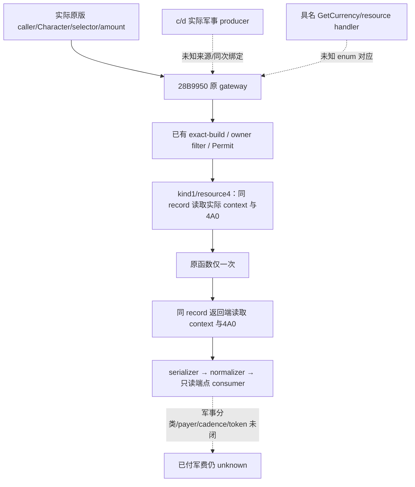

# selector4 网关的实际 context 与余额端点（1.20.0.4）

本能力补齐已证观测缺口：旧 gateway 记录虽然保存 `resource_kind_raw=4`，其
`personal_gold_bits` 实际读取的是 `Character+1B0 → extension+100`；原版 selector4
加减使用的则是 `Character+1C0 → context+4A0`。不能拿前者的变化充作后者实付。
原版来源见 [selector4 同槽关系](episode04-r08-selector-wallet-link-12004.md) 与
[rate/application](episode04-r08-rate-resource4-application-12004.md)。

代码固定于 CK3 `1.20.0.4 / Steam25734779`、EXE SHA
`98702f88a547cde2eaf29a85f93b85f68ee4cf8148336a4f7afaeb75319dd518`。
原版入口 `28B9950` 的真实调用者传入 Character、selector、amount、component；
其 selector4 分支通过原条件后在 `28B9B3C` 写 `context+4A0`。自然调度、军事 c/d
生产者、正式资源名与 payer 归因仍未闭合。`28B9490` 是独立 getter；不能主动调用它
来伪造自然付款证据，也不能把 `28C2DF0` 解析对象或 TopLiege ID 当付款账户。

## 原版执行与桥接观察边界

同源记录：[研究方案](evidence/resource4-gateway-context-12004/plan.json) 与
[工具生成图和证据表](evidence/resource4-gateway-context-12004/graph.md)。普通离线
check 只核记录/文件一致性，不是 `--for-observation` 或现场授权。

既有 exact-build/payment 安装、owner filter 与 sampling Permit 不变。只有已获许可的
`kind=1 / resource_kind_raw=4` 原回调创建可选 `resource4_wallet_context_v1`。
原函数仍调用一次，参数和返回保持原路径。新增读取复用原 `Raw4Frame`：FullID、magic、
extension、context、4A0；每边最多 5 次／32 B，两边**新增**最多 10 次／64 B。
既有 Capture、session 和 natural metadata 的读取另计；不扫描 world、增加 hook、
操作付款或使用调试寄存器。extension/context 为空或读取失败保存 null，不补成余额0。

child 直接附在同一原 record，继承实际 source/caller、journal sequence、entry/return
event、session 和 owner；没有新造 settlement token。serializer 保留完整 before/after；
生产 normalizer 严格校验可选 child，旧无 child 的 wire 继续可消费。
`consume_resource4_wallet_contexts` 调用完整 normalizer 后，仅对身份、FullID、context、
会话和读取都成立的记录输出 `qualified_resource4_boundaries`。失败和 context 变化仍在
literal journal，合格列表为空不能解释为没有付款。此证明不读取 `personal_gold_bits`。



端点比较 `after == before-requested_amount (mod 2^64)` 只是诊断，不证明原 callback
内部只有一个 store，不赋予金额军事类别。`resource_name=unknown`；military paid、payer、
cadence、settlement token 都为 null。真实0与缺失读取不同。现四槽 writer observer 的
c/d actual PC 仍须另取来源，不能由相同日期、相邻 journal 或个人 ADD 补出因果链。

## 验证与生产资格

新增焦点测试通过完整 producer-shaped journal、真实 normalizer 与 consumer，保留
public/native revision 不相等的 snapshot；覆盖同 callback 身份/完整64位端点、跨 owner、
context/会话变化、读取失败、缺 child、个人金币不能替代4A0、物理0与禁止业务升级。
它复用已编译夹具的完整 envelope，新增 child 仍是 synthetic wire；不冒充这次 C++
serializer 已编译或实机已有样本。执行命令：

```text
tools/.venv/Scripts/python.exe -B -X utf8 -m unittest discover -s ck3_autonomous_player/tests/unit -p test_war_payment_resource4_wallet.py -v
```

主线首次生产资格仍为 **pending coherent native build / normal cold-load / live**。
不修改当前隔离 R200 的 scene、prepared、工作树或加载字节。后续资格由 Root 绑定实际
新 source/native/cap 与独立场；源码和知识可跨机器复用，安装与实机资格不能外推。

来源候选：机器 `desktop-3fevhd2-1c74096080` 于 2026-10-17 离线封存的
`gateway-resource4.patch`（10457 B，SHA `a26f64ab799956c0e68ef1ab452a545d38064c87abf26fdb249eee66ee066450`），
SOURCE SHA `4594c65418bdac3dec3b578be4b764ee9d04c7472aa1a70195379b80f14a6a41`。
基线26449到采纳基线 b8be8ca6c 的五目标无上游差异；旧候选原件不改。

## 2026-10-18 R204：连续32日与7条自然回调

`machine_id: desktop-3fevhd2-1c74096080`；[R204专题](episode04-r204-battle-natural-payments-12004.md)绑定实际19024/a35、PID29068/gen1。32连续日53148888→53149656=片中5+a01已成功1+a02的26；原大小写suffix RED保留，已推进日步不重投、unknown[]、同token未再arm。6条kind0 Army transition+1条个人现金ADD206846（Char31254/28A6D7C），不是兵员ADD；自然64条/phase各32无overflow，resource4/raw4无样本≠军费0。

原片23.266秒698帧decode/PTS通过，候选[0.5,20)待全审，无clean/1×/人审/cue信用；另外27日不在片中。手工OFF+独立clear完成，正常Save74,845,159B/SHA101f8fbf…32d7245/date53149656、CK3/bootstrap0与screen6346空资源；close NOT_CONFIGURED不抹手工cleanup。研究9/14、业务6/11、合格动态0/11、ABC0/3均不涨。
