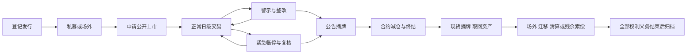

# 虚拟货币发行成本 容量与退市设计

2026-11-18，配套[金融市场综合设计](futures-and-virtual-currency-markets.md)，适用于其修订版 3。默认选择是：所有 AI 保有发行资格，但发行、公开上市和维持服务都要付出真实成本；将 4,096 种同时上市币作为标准验收目标，另有 2,048 保守档与 8,192 扩展档。退市退出的是交易所服务，财产、合约和债务依各自规则继续。

金额、期限与容量均为本模组初始参数。现实来源用于借鉴制度，不作为游戏已经能承载某个规模的证据。

## 1 发行与上市分开

登记发行只创建主体、章程、供应和初始归属，可以私募或场外转让；公开上市才提供搜索曝光、公开订单簿、报价和上市维护服务。拥有发行资格不表示系统每天替每个 AI 发一枚币，也不表示发行就自动获得买家。

同一角色同时最多控制一个存续个人币、一个待办新发行申请，主动新发冷却 24 游戏月。宗族、政权与商会按自己的稳定主体计数，不占个人币名额；换控制者、改名、分封或短暂退市不重置冷却和失信记录。已存在的币优先追加融资或修订章程，减少用一堆新币替代旧币的冲动。

AI 申请前要评估自己的融资需求、能触达的真实认购、预计净融资、维护能力、已有债务及声誉成本。判断使用其所知信息和性格，可以乐观、投机甚至欺诈，但不能由系统强行安排认购成功。没有资金者可申请真实承销或赞助，代价是配售、费用或明确借款。

## 2 发币需要付出哪些成本

### 2.1 两档服务和资金占用

R 表示该批次实际募集金币。微型档适用于同一主体滚动 12 月累计募集及尚在履约的融资规模均不超过 50 金币，且符合微型服务范围；超过后按公告补足标准档要求，已支付同类费用抵扣，不重复计费。存续融资由项目实际履约、结清与章程状态判定，不以发行者把募资花光就视为消失。档位按发行规模和服务选择划分，不按爵位划分。

| 项目 | 微型档 | 标准档 | 财产属性 |
| --- | --- | --- | --- |
| 登记申请费 | 1 金币 | 5 金币 | 实际服务支出；申请失败也不返还已提供服务部分 |
| 上市服务费 | 1 + R×2% | 10 + R×2% | 认购成功上市时支付；实际募集额是基数 |
| 月维护服务费 | 0.1 金币 | 1 金币 | 按月提供服务并入交易所收入；首期预存 6 个月 |
| 履约保证金 | max(1, R×5%) | max(10, R×5%) | 归发行主体的受限资产；只按已披露违约条款动用 |
| 做市金币侧 | max(2, R×10%) | max(20, R×10%) | 出资者自有风险资本，冻结或实际挂买盘，可能交易亏损 |
| 做市币侧 | 对应实际库存 | 对应实际库存 | 需有真币，不将“自己发行的市值”当另一份金币 |

微型币仍每天可交易，访问时能进入详细撮合；它的报价深度较薄、服务成本较低，初始不开衍生品。达到独立流动性和价格来源条件后可升级，不能仅付一笔钱就直接获得高杠杆资格。

维护预存款在服务发生前是托管资产，每月履约时才确认为费用。履约保证金不能同时拿来做市、充客户保证金或宣传成保本储备；做市资本也不是已经消耗掉的手续费。初始双边资金只用于有限深度，不承诺永久护盘。

IPO 可以预先披露从募集款支付上市费、维护预存与做市投入；未募集成功则按章程退款，不能把尚未到账的认购预测当现金。任何使用客户保证金或专属兑付储备支付发行费用的路径都拒绝。

### 2.2 两个融资例子

标准档募集 200 金币：登记 5、上市 14、维护预存 6、履约保证金 10、做市金币 20，总共支出或占用 55，新增可自由用于项目的现金为 145。55 中只有 19 为当期已收服务费，其余 36 各有不同归属和释放条件。

若发行者原有 100 金币，募集后最终自由现金为 245；交易所已得费用 19，维护托管 6、履约保证金 10、做市金币 20，合计仍为 300。做市币库存另按币量核对，不把它的估值再加进金币总额。

微型档募集 20：登记 1、上市 1.4、维护预存 0.6、保证金 1、做市金币 2，总占用 6，项目可用 14。小人物也能参与，但发行不是零成本复制资产；要筹几金币的小需求可能不值得公开上市。

### 2.3 持续成本与救济

每月先计算可从真实、尚未分配的本币交易费中使用的抵扣信用，再以“月费减该信用”的净应缴额扣维护预存或明确赞助；不足时发账单与补缴通知，默认给 30 游戏日处理。月费 1、合格抵扣 0.4 时只再扣预存 0.6，不先扣 1 又收一份分成。信用使用是既有费用的用途重分类，不将同一金币再次计为总收入；未用余额保留原账或按合同留作下期信用，不重复发给发行者。可以由接任控制者、持有人团体或新承销人继续维护。

冷清项目可以停止额外广告和专业做市服务、申请转为低成本微型服务，前提是补足旧义务、符合规模与披露要求。不能单方面撤出已冻结委托或尚有索偿的保证金。没有人继续维护时走正常摘牌，而非删除资产。

滚动 12 月募集归零不自动降档。降档需公告并同时满足存续融资规模和微型服务条件；仍有未平衍生品、超出微型范围的担保或争议索偿时，先按相关合同停止新增、结清或获同意迁移，不能少付维护费却保留原有高风险服务。降档也不提前释放仍被索偿占用的保证金。

服务费并非永远消失于系统：有实际交易所主体时进入其收入；若使用抽象服务提供者，明确记作服务金币消耗。它不能再被算成发行者利润或第二份风险基金。

## 3 多少种币合适

### 3.1 推荐容量

| 档位 | 正常上市币目标 | 详细热点缓存 | 未平仓记录压力档 | AI 主动决策/日 | 定位 |
| --- | ---: | ---: | ---: | ---: | --- |
| 保守 | 2,048 | 32 | 2,000 | 256 | 低配与首轮基线 |
| 标准 | 4,096 | 64，短时可至 128 | 4,000 | 512 | 默认设计和发布验收目标 |
| 扩展 | 8,192 | 128 | 8,000 | 512 | 实测通过后开放 |
| 上界探索 | 16,384 | 128 | 16,000 | 1,024 | 压力研究档，不默认承诺可用 |

总登记数、正常上市数、交易对数、详细簿、持有人关系、有效委托和未平仓分别计量。退市仍有持有人或索偿的资产不占正常上市名额，但仍占存档和权利登记空间，不能说它们完全没有成本。

默认每币一个金币交易对。增加同币多场所或币币交易对，要计入额外交易对和做市预算；同一币开 5 个市场的处理成本不能仍只按 1 个市场估计。

4,096 是希望提供的规模，不是必须用无资金 AI 填满的指标。早期可能只有几百或一两千，繁荣期自然扩张，衰退期摘牌增多。达到软容量时先排队新上市，不随机摘除现有好币；等待队列按时间与实际处理成本调度，不长期饿死低阶或无地发行者。

### 3.2 数量取决于发行与退出的平衡

稳定上市存量大致等于参与发行的角色数乘每年实际上市率，再乘平均挂牌年数。假设有 20,000 名 AI，每年 1% 实际上市、平均挂牌 10 年，约为 2,000 种；若变为 3% 和 15 年，约为 9,000 种。这是设计情景，不是对原版角色数量或实际发币率的测量。

因此同时要调成本、冷却、认购成功率、维护和退市，而不只改一个最大币数。成本太低、所有失败币永久上市，即便 8,192 也会很快用完；成本过高则有容量却没有可玩的市场。

### 3.3 日级工作量

    每日成本 ≈ 上市交易对轻量更新
             + 实际委托与成交
             + 全部未平杠杆仓位
             + 轮转 AI 决策数 × 有限关注数
             + 当日发行、到期与新闻事件

普通 AI 的关注上限仍为 6，不运行全体角色乘全部币。币到持有人/订单/仓位、发行主体到相关币采用稀疏索引。详细热点是缓存预算，访问长尾币立即局部处理；淘汰缓存不会撤单、退市或跳过保证金。

例如假设有 20,000 名 AI，逐一搜索 4,096 币会产生每日 81,920,000 次候选比较；标准轮转的 512 名乘 6 个关注币仅为 3,072 次。这只比较 AI 搜索量，仍须另算行情、订单、风险和事件开销，不能据此宣称游戏实际提速相同倍数。

同一做市者在所有币上共享真实冻结余额。所有未平仓每日处理，处于退市流程的仓位也在其中。无到期任务、无委托、无未平仓的退市残余资产按需读，不再每天跑一套行情逻辑；到期债权继续由单独日程处理。

标准压力场景目标：日增量 P95 不超过 100 ms、P99 不超过 300 ms，普通单币详情打开/刷新不超过 16 ms；4,096 档长期状态以 16 MiB 为待测预算。必须同时报告最慢停顿、保存/载入增长和延迟业务数，不能只测安静市场。

压力测试另覆盖同日访问大量冷币、集中解锁、认购失败退款、全市场战争冲击、批量爆仓与摘牌。超载先减少无持仓 AI 搜索、传播扇出和历史图表；再暂停新上市或新信用风险，不漏掉既有仓位、不关闭正常上市币的日级入口。

## 4 现实制度怎样借鉴

以下为截至 2026-11-18 查阅到的具体平台做法，适用范围和安排不同：

- Binance 明确区分交易对下架与资产退市；撤掉某一交易对后，资产仍可能通过其他交易对交易。[官方交易对下架公告](https://www.binance.com/en/support/announcement/detail/23504a5454d545998414c9ad3e8832f3)
- Coinbase 区分交易截止、迁移以及转出支持；仅停止交易的情形可能仍能将资产转出。[官方退市与迁移说明](https://help.coinbase.com/en-sg/coinbase/trading-and-funding/sending-or-receiving-cryptocurrency/token-migrations)
- Kraken 的一批退市安排将停止交易、停止提取、剩余资产清算分成不同日期，并提示清算可能远低于参考价、甚至几乎没有收入。[官方退市案例](https://support.kraken.com/articles/asset-delistings-july-2026)
- Bybit 的衍生品退市机制包含通知、取消委托和未平仓终结，并采用公告约定的参考价格；不能直接用最后一笔小额成交代替处理。[官方衍生品退市机制](https://www.bybit.com/en/help-center/article/Bybit-Derivatives-Delisting-Mechanism-DDM)
- 纽约州 DFS 对其监管范围内主体的指引强调提前通知、客户退出安排与处置记录；它不是全球交易所的统一期限。[2023 年最终指引](https://www.dfs.ny.gov/industry_guidance/industry_letters/il20231115_listing_virtual_currencies)

模组借鉴这些分层、公告、退出与终结原则，不照搬平台的分钟、法定期限或收费。下面统一使用游戏日。

## 5 三种身份与生命周期分开

| 层次 | 主要状态 | 结束什么 |
| --- | --- | --- |
| 发行主体 | 存续、接管、重整、清算、终止 | 谁控制资产与承担义务 |
| 币资产 | 已发行、停止增发、迁移、残余权利、全部注销 | 币供应与持有人的权利 |
| 单场所交易对 | 申请、试运行、正常、风险警示、临时停牌、退市公告、已摘牌 | 该场所的交易服务 |

正常和风险警示的上市币仍每天可交易。临时停牌与摘牌是清楚标识的异常状态，不把“每天可交易”写成所有资产永远不能停牌，也不暗中将冷门币移到一个不更新的类别。

一次交易对下架只影响这个场所；其他获准市场继续。全部场所都摘牌后，币仍可保留在角色自持账簿，允许真实双方约定的场外转让，承担缺少公开深度的风险。这里的自持与转出是游戏内所有权和托管账的移动，不是创建现实钱包。

## 6 观察与退市条件

例行复核每 30 游戏日处理一次，可按交易对分桶；到期窗口与紧急事件仍按日或事件处理。初始条件如下：

| 原因 | 初始观察规则 | 后续处置 |
| --- | --- | --- |
| 无人维护 | 预存不足后给 30 日补缴/赞助/服务调整期 | 仍不足则提出摘牌，不能没收持仓 |
| 长期没有独立需求 | 存续满 90 日后，连续 90 日低独立成交、极少独立持有人、极低真实深度中的至少两项持续成立 | 人工意义上的规则复核，核对实际用途后再警示/摘牌 |
| 欺诈、虚假担保或未披露增发 | 根据账本、调查与章程形成明确事实 | 可临停、冻结争议资产、整改或摘牌，保留责任 |
| 项目终止、合并、主体清算 | 有章程事件、表决、继承或重整事实 | 进入迁移/清算专用退出，不假称一般价格下跌 |
| 价格精度或可靠报价不足 | 无法稳定用当前手数和精度交易，或不满足合约指数要求 | 优先公开调整计价/缩股；衍生品可先终结，不以低单价自动删除现货 |
| 本地政治禁令 | 有真实管辖和合法实施的政治事件 | 只影响受管场所；境外交易、黑市或场外可继续 |

可供原型使用的“低需求”参考阈值为 30 日独立成交不足 5 金币、独立外部持有人少于 3、可执行真实买盘不足 2 金币，必须合并持续期与实际用途判断。正在用于缴费、兑付或履行项目的低换手币，不能单凭成交少就摘牌；关联对倒不算独立需求。

价格下跌、发行者死亡、AI 爵位低、玩家未关注和缓存被淘汰，都不是单独的自动注销条件。发行者主动退出也要按章程处理公共义务。

## 7 普通摘牌的三十日流程

下表只处理被摘牌场所的相关合约，以及确实依赖将失效价格源、无法按原资格继续的合约。其他健康场所的现货和有可靠参考源的合约继续运行；单个交易对退出不会自动关闭全球所有同币期货。涉及全资产欺诈或系统性故障时，各场所另有记录地启动自己的风险处置。

| 时间 | 现货与资产 | 衍生品与债权 |
| --- | --- | --- |
| 第 0 日公告 | 通知原因、场所、最后交易日、费用、资产去向和申诉/整改入口 | 停止新增杠杆风险，撤销开仓单，允许减仓；公布既定终结条款 |
| 第 1 至 14 日 | 每日买卖和撤单继续；发行者可补资、迁移或提出整改 | 自愿平仓、补保证金或经同意转移到真正接收的场所 |
| 第 15 至 20 日 | 继续现货撮合并采集合格独立数据 | 形成合约事先约定的终结参考窗口，不接受发行者临时指定终价 |
| 第 21 日 | 现货仍可交易 | 正常情况下完成剩余期货/永续的终止现金结算，记录欠款与未付索偿 |
| 第 22 至 29 日 | 继续转出自由资产、迁移及最后交易 | 合约已结款项仍可领取，债权处理继续 |
| 第 30 日 | 取消该场所未成交委托，释放已核自由资产，关闭现货交易对 | 已付与未付分别保存，不把摘牌当免债 |

此处现金终结是合约约定的支付义务，并非伪装成市场上已找到对手盘的平仓成交。若价格来源失效且无合同允许的可靠替代，进入待定处置，保留抵押和索偿、暂停无可靠依据的资金费，并定期公告；不能为赶第 21 日把价格定为零或强称付清。争议状态不阻止到期债权继续登记，交易所也不据此侵占自由资产。

现货是双向市场，公告期不能简单设置“所有人只能卖”，使买盘在规则上消失；可以减少开放委托类型，但仍允许有真实预算的买家接盘。用户持有币不能被默认按历史最高价、最后报价或面额兑换金币。

紧急故障可立即临停，目标在 3 游戏日内发布首次复核、之后每 7 日更新处置；取消安全可撤订单并返还已确认自由资产，仅争议财产单独冻结。短期保护用最后可靠标记时必须显示陈旧与风险，最终价格按原条款处置，不将旧高价当永久保本承诺。

## 8 摘牌后资产与合约怎样保全

- 转入其他场所：实际移走同一份币和金币，接收方确认后才能入账，不复制库存；新交易场所需自己的深度和资格。
- 转入角色自持：停止交易所撮合服务，所有权仍在，可以查询、赠与或在真实双方之间场外交易。
- 项目主动清算：将可支配项目资产按章程和登记债权的顺序处理；概念币没有保本承诺时不自动取得本金债权。
- 币迁移或并币：公告换算、期限和承接责任，兑换时锁定/销毁对应旧供应再交付新权利。
- 衍生品迁移：接收清算方、仓位双方及所需保证人按规则同意，资产、抵押和全部义务一起转移；旧仓与新仓衔接只结算一次。
- 未认领款与争议债务：保持权利人、金额、到期和状态，不能在公告期限后自动变成交易所利润。

履约保证金在与该保证合同相关的已约定索偿、争议和结算结束后释放剩余，不因为币价下跌就全罚没，也不因为摘牌就提前全部退给发行者。无担保关联的持币者私人杠杆债务不占用发行者履约保证金。自由做市资本可依法撤出，已经被委托、抵押或索偿占用的部分不得逃逸。

## 9 冷存 归档与重新上市

摘牌且没有订单、未平仓和需要每日处理任务的币可以冷存：保留供应、持有关系、主体、章程、债务和必要事实；人物查询、场外请求或新清算事件才唤醒。仍存在的债权按到期队列继续处理，不因币页面休眠就停止计时。

完全归档要求无持有人、无委托、无抵押、无未平合约、无兑付与债务、无待领资产，或所有权利已依法清偿、放弃并完成记录。只保存永久 ID、主体关系、供应终结和重要失信事件等最小记录，不保留整本历史订单；ID 永不复用。零成交、零参考价或没人点开页面不满足此条件。

重新上市沿用币 ID、供应、持有与失信历史，补齐维护、做市和需处理的公开责任，默认经历 30 日重新观察。不得靠换名、换发行人、换场所或“旧币换新币”洗掉债务。历史登记可以超过正常上市容量，但其存档和索引成本仍纳入压力测试。

## 10 一个有持仓和欠款的摘牌例

渡口币流通 20,000 枚，只有一家公开交易场所。发行者不再续约维护，已到期分红欠款 8 金币，项目实际可用现金仅 3；本例不含另有服务欠费和本次交易/终结费用。这些分红按到期登记的受益人确认为债权，之后买卖币不会让同一份旧分红再支付一次。

第 0 日公告、第 1 至 14 日可自愿退出。没有其他场所愿意接收，不能显示迁移成功。第 15 至 20 日仍有合格独立数据，按合约既定窗口得到每币 0.014 的终价；这不是因为摘牌自动打折。

第 21 日，一笔 1,000 枚等值多仓相对最后已结标记 0.020 亏损 6 金币。它有保证金 4，真实风险基金支付另外 2 给盈利方并取得对多方的债权 2；合约结束，但债务未结束。项目现金 3 按分红债权支付，原分红尚欠 5；不能拿衍生品基金再替发行项目还这 5。

第 30 日现货摘牌并释放自由冻结资产。20,000 枚币、项目欠款 5 和多方个人欠款 2 分别保留，可以继续场外买卖或处理重整。发行者死亡不清除这些义务；存在债权、持有人或待领款时只能冷存，不可彻底归档。

## 11 验收重点

发行费用、维护预存、保证金和做市资本的分类与例子要逐笔守恒；微型与标准档不得通过拆分批次、改主体或补收费重复获利。补缴、赞助、降档、正常退市和紧急临停都要从公共入口验证。

同一币在两个场所上架时，关闭一个不影响另一个的合法订单。未平合约、永续最后资金费、参考价失效、无流动性、跨所接收失败与无人领取款的路径分别验收；世界新闻和直接持有人通知不能只依赖名称匹配。

2,048、4,096、8,192、16,384 分档测试币、交易对、持有人密度、委托、仓位与爆发事件。是否开放某档取决于实机耗时与存档结果；本次没有为容量主张启动 CK3。
