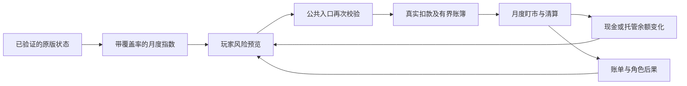

# 期货市场与虚拟货币市场：综合设计

> 状态：设计稿，2026-11-18。目标基线为 CK3 1.21「Florin」。本文没有对应的已实现模组、已通过脚本接口或实机验收，也不构成发布记录。文中的合约、指数、费率、币量、资金池和性能数值均为**本模组初始设计参数，不是原版规则**。
>
> 交付边界：独立、纯游戏内金融模组；玩家客户端只需 CK3 与模组。标准模式不依赖 Java 服务、DLL、联网行情、现实区块链、现实钱包或现实货币。Java + Maven + Quarkus 只用于遵循本仓库规范的开发构建、参考计算与校验工具，不成为玩家运行依赖。本轮交付综合设计，不实施、不启动游戏、不上传 Workshop。

## 1. 产品定位与默认决定

本模组把领主的财政风险变成可观察、可承受、可结算的金融决策：为未来战争预留现金，为粮食短缺建立有限责任期约，把部分财富兑换成账簿币，或承担浮动币的流动性风险。玩法重点是政治局势判断、现金调配、对冲和角色选择。

默认采用中世纪包装：交易所称「商会会馆」，清算所称「公证清算账房」，期货称「远期期约」，储备币称「金库账币」，浮动币称「行会筹币」。帮助页同时显示现代术语，避免玩家因包装误解保证金和兑付。可选「架空币」规则替换名称、图标与叙事，核心资金规则保持一致。

必须直说的产品限制：**在单人游戏中，若禁止 AI 出资、禁止凭空增加金币，清算所和币池只能来自玩家已经实际支付的注资、交易损失与费用。玩家与这组封闭资金池交易，不能让「本人现金 + 托管资产 + 全部池子」的合计财富凭空增长。** 窗口内交易获利可以为正，但计入建所注资后的累计收益未必为正。MVP 不是靠自家资金池持续发财的印钞机。

多人游戏可出现不同人类玩家之间的真实财富转移，仍由内部清算账簿担任有界对手，不直接接入 AI 钱包。若将来希望单人市场有外部净资金流入，必须另立需求，写清有限来源、扣款对象、授权和成本；本设计不暗设 NPC 商人、无限银行、自动政府补贴或 AI 例外。原版税收本来就是收入，转存其中一部分不能再计一次交易收入。

| 事项 | 默认决定 | 原因 |
| --- | --- | --- |
| 独立产品 | 独立目录、独立命名空间 `xfm_` | 与主模组、其他独立产品保持可拆卸边界 |
| 生效对象 | 明确选择加入的人类玩家 | 根 AGENTS 的玩家限定没有本产品例外 |
| 对手 | 有资金约束的模组清算账簿和 AMM 币池 | 不制造 AI 交易行为或借用 AI 金币 |
| 行情 | 原版状态输入 + 明示的模组指数 | 不把新增指数伪称为原版商品成交价 |
| 期货 | 按月盯市、现金结算、有限追索 | 适合 CK3 月度经济节奏，避免借贷追杀和无限负债 |
| 虚拟币 | 全额储备账币 + 有限资金浮动币 | 分开解释兑付承诺与市场价格 |
| 客户端 | 纯脚本、GUI、本地化、资源文件 | 不要求玩家部署智能体或外部服务 |
| 不在 MVP | 实物交割、裸贷、挖矿、质押生息、币期货、跨市场套利自动化 | 先证明核心账簿和结算可用 |

## 2. 原版事实与新增机制的边界

### 2.1 已有官方依据

官方 1.21 发布公告确定了 Florin 的正式发布；实际本机 EXE、安装 build、内容差异与证据由本轮[经济分析](../ck3-1.21-economy-analysis-2026-11-18.md)记录，不能用本文的目标版本替代安装验证。[官方发布公告](https://steamcommunity.com/games/1158310/announcements/detail/746069122013463406)

官方交易开发日志说明：供需影响可交易的数量，**不进入原版买价/卖价公式**；一般垄断也不直接改变商品价格。月度剩余和缺口池并不等于逐件储存、实时撮合的实物仓库。因此「战争导致稀缺，所以原版粮价自动暴涨」不能作为本模组的机制前提。[官方 DD8：Trade in Practice](https://steamcommunity.com/games/1158310/announcements/detail/701031128264350037)

官方模组开发日志介绍了市场、路线、垄断作用域，商品类型/类别数据库作用域，Variable Maps，以及市场/路线等变量和修正支持。这说明有值得验证的接线方向；它没有替本模组证明「任意市场的实际成交量、逐项供需、完整价格」都能由纯脚本准确读取。开发日志中的工作中数值不能直接当成正式版平衡值。[官方 DD9：Modding](https://steamcommunity.com/games/1158310/announcements/detail/699905862545705792)

### 2.2 三种数字必须分开显示

| 数字 | 定义 | 可以用于什么 | 不可以宣称什么 |
| --- | --- | --- | --- |
| 原版商品买卖价格 | 原版实际可验证的对应价格及修正 | 展示、对照；读取得到时记录来源 | 不能由供需差自行推算成原版价格 |
| 原版可交易数量/缺口 | 对应市场、月份与商品的原版数据 | 指数的供需或流动性信号 | 不是模组拥有的实物库存，也不是已成交量 |
| 模组风险指数 | 本文公式产生的点数 | 期约结算、风险提示 | 不是原版商品价格，也不改变原版贸易结算 |

模组不通过商品价格修正能力偷偷改原版价，再用自己改出的价格结算持仓。不改原版供需、建筑、路线、税率、垄断或 AI 策略来制造金融利润。商品、建筑需求、道路和各类税项是研究输入；具体字段只在本机正式数据核实后接入，不以开发日志替代 API 验证。

### 2.3 与原版财政和借贷的接线

全部存款、注资、费用和兑付默认只操作当前合法人类玩家的**私人金币**。共和国等政府的公共 Treasury 是另一种财政资源，不是角色私人现金，也不是模组可自动抽走的清算资本；如要将来支持公共出资，必须作为另一个有明确权限、实际扣款和独立账簿的功能设计。[官方 DD4：Republics](https://steamcommunity.com/games/1158310/announcements/detail/677374546802640261)

原版商人放贷、债务期间的 Strong Hook 与债务继承有各自合同。本模组不以期约有限责任条款替玩家免除原版债务，不继承原版债权、不消费原版 Hook，也不重复发放原版贷款本金。DD6 描述了 Usury 教义和宗教争议；本机正式 1.21 脚本也保留接受、反对、仅对外人及禁止四类相关教义，以及公开利息、隐蔽费用、无息三种贷款选项和拒付高利贷决议。具体适用条件须读取对应教义、互动和决议，不能将所有信仰统一视为禁止，也不能声称该制度已取消。本产品若添加宗教争议，应区分原版条件与新增剧情；利率与额度不直接采用开发期示例。[官方 DD6：Merchants](https://steamcommunity.com/games/1158310/announcements/detail/711160422578783399)、[正式脚本核对](../ck3-1.21-economy-analysis-2026-11-18.md)

财政预览可以把原版税收、贸易、运输报酬和军费等已验证项目分列，帮助玩家判断现金缺口；不将「未来预期税收」预先铸成金币，也不因既有收入进入金库就额外发一份模组收益。原版转口/配送的循环防护与实际路线方向用于理解输入，不复制成一条免费模组运输收入链。[官方 DD5：Trade iteration](https://steamcommunity.com/games/1158310/announcements/detail/687515256220549926)

## 3. 核心循环与体验节奏

1. 玩家通过公共决议进入会馆，阅读风险说明并主动开立账簿；只看行情和模拟交易不花金币。
2. 选择关注的区域与指数，看到构成、资料覆盖率、战争/饥荒/商路因素、当月结算日期。
3. 将明确数量的现金划入保证金，或出资建立清算/币池。确认页列出实际扣款、费用、最大可损失、池子对手与资金来源。
4. 选择多头/空头期约，或买卖两类游戏内币。交易在提交时重新检查当前版本和余额。
5. 每游戏月固定一次结算：更新指数、逐笔计算差额、调整保证金、处理强平/到期、产生一份合并账单。
6. 玩家根据实际财政安排平仓、增加保证金、赎回账币或接受有限损失；宏观事件可能带来压力、执照和清算风险。
7. 死亡、继承、失地、断线、读档沿同一账簿处理，不重新开仓、不重复发钱。



不逐日弹窗、不强迫暂停、不自动替玩家交易。普通月度账单收进会馆；保证金不足、兑付中止或继承待认领才给一次合并通知。通知本身不执行交易。

## 4. 玩家限定与资金来源

### 4.1 入口守卫

- 开户、决议、互动、GUI 执行、月度个人消费、继承认领均要求真实人类玩家与本产品主动加入标志，不能只靠 `ai_will_do = 0`。
- 全局 `on_action` 的个人 effect 必须有等价 `is_ai = no` 与加入资格双守卫；不扫描全场活人向 AI 发事件。
- GUI 显示自己的账户，实际执行按游戏角色身份检查；不能把 GUI 当前选中角色当作账户主人。
- 清算账房是数据，不生成可参与政治、继承、战争或收款的隐藏 NPC。AI 不开户、不发币、不提供保证金、不接受自动扣款。
- AI 角色的战争、宗教、亲属和商路状态可作为只读输入；本产品不借剧情强迫 AI 资金行为，也不自主改变 AI 的持仓与金币。任何将来例外都须单独获授权。

### 4.2 两个独立的风险池

| 池子 | 初始来源 | 可支出 | 不可挪用 |
| --- | --- | --- | --- |
| 期约清算资本 | 人类玩家主动支付的建所注资，初始目标 200 金币；后续自愿注资、已实现客户损失、明确划入的费用 | 已承诺的期约盈利与获准的清算支出 | 客户未损失保证金、储备账币兑付金、浮动币池金币 |
| 浮动币 AMM | 人类玩家主动支付的启动资本，初始目标 200 金币；买币流入及留在该池的已明示资金 | 对应规则下的卖币支出 | 期约保证金、储备账币兑付金、其他池子的资本 |

建所注资默认视为不可随意抽走的公共风险资本，不是购买「保本存款」。MVP 不提供经营者分红或资本提现。多人可自愿补充资金，必须逐笔真实扣款；无人出资时相应产品只显示模拟盘和「无可用对手资金」。两个池子可以分别启用，不要求一次支付 400 金币。

储备账币的兑付金全部来自实际铸币存款，不需要上述风险资本替它保本。费用先入单独费用账，按已公布规则转入相应风险池；不得把同一笔费用同时计入两个池子。

### 4.3 金币守恒与玩家可见统计

每一笔模组交易必须满足：

```text
Δ玩家实际金币 + Δ保证金托管 + Δ储备兑付金 + Δ清算资本
  + Δ浮动币池金币 + Δ费用金币 + Δ其他明确冻结金币 = 0
```

这些托管金币由玩家真实扣款后，以模组保存的数值账簿保管；不是额外生成一份角色金币。兑付时减少同一笔托管余额再增加玩家实际金币。凭证、币量和指数点数是另一套单位，不能相加进金币守恒式。

守恒式各项互不重叠：「储备兑付金」只指仍对应活跃兑付义务的本金，无主冻结储备归入「其他明确冻结金币」。UI 可以展示两者合计的总储备，但总额不得再作为第三笔资金相加。

原版正常税收、军费、活动费和其他模组的合法收支不在此局部守恒式内；不能因角色金币比上月增加，就把全部增量认作市场利润。统计至少分列交易已实现盈亏、费用、注资、存入/取出、原版收入、当前未实现估值、包含注资的累计净现金流。把钱从现金转成币，不算收入；平仓返还本金，不算盈利。

## 5. 指数：参数、取数和降级

### 5.1 产品与样本

MVP 最多提供三个风险篮子：「粮食供给」「手工业贸易」「军需材料」。这是设计类别名，不是已经核实的原版商品 ID。施工时必须从正式版商品定义中建立显式映射，并在帮助页列出真实商品名、权重与不纳入的商品。若无法合理映射，删减篮子，不伪造一种原版商品。

每个清算区域最多取 8 个已验证市场，MVP 最多 4 个区域。选取来源应优先是原版实际市场/路线关联，不遍历全地图猜邻近。篮子权重、市场名单和基准值按季度冻结；玩家改首都、开战或新造一座建筑，不得立即重置旧持仓的基准。单一市场权重上限 30%，缺少合格样本则减少区域数量。

所有区域对该区域参与者共享同一个已发布月度基准。不能让同一合约因持有人身份不同而出现不同结算价。

### 5.2 初始合成方式

指数首期为 100 点，绝对边界为 40 至 240 点。该边界是合约的一部分，开仓前明示，不能为了救资金池临时缩窄旧合约边界。

| 信号 | 定义与范围 | 目标权重 | 读取不到时 |
| --- | --- | --- | --- |
| `D` 供需缺口 | `clamp((需求-可用供给)/max(需求+可用供给, 1), -1, 1)`；只使用单位一致的可验证月度字段 | 0.30 | 不把缺字段当 0；改用已标明的代理模式或暂停该篮子 |
| `R` 路线受阻 | 固定样本路线中受阻权重占比，0 至 1；须核实引擎的真实受阻语义 | 0.20 | 删除该项并显示覆盖率下降 |
| `W` 战争扰动 | 固定样本中受战争/占领影响的份额，0 至 1；不能只用全世界战争总数 | 0.15 | 无精确地域关联时不使用 |
| `H` 饥荒影响 | 正式版本能验证的当地饥荒状态，0 至 1 | 0.25 | 不假定有气候/收成 API；删除该项 |
| `P` 稳定供给 | 经核实的当地发展/稳定供给代理，0 至 1；与其他项去重复 | -0.10 | 删除该项 |

初始风险目标值和普通调整如下；首次建指数时同时保存 `T_0`，此后使用风险目标的**变化量**，不把一个恒定、已经公开的目标拆成未来数月可预知的单边补涨：

```text
目标 T = 100 × clamp(1 + 0.30D + 0.20R + 0.15W + 0.25H - 0.10P, 0.40, 2.40)
普通调整 = clamp(0.50 × (本月 T - 上月 T), -15, +15)
本月指数 I = clamp(上月指数 + 普通调整 + 已登记重大冲击, 40, 240)
```

超过普通限幅的风险目标变化不形成以后自动补涨/补跌的队列。已登记重大冲击是预先列出的事件类型及强度，初始单月合计范围为 -60 至 +60 点；它允许跳空，不能因为出现穿仓就将真实规则改成「最多涨跌 15 点」。同一原版事件只登记一次，结束/反转规则写在事件表；不叠加一条无条件、可反复套利的预定价格回归。没有可靠事件身份时只采月末状态，不把每次读取都算一场新冲击。

上述系数只用于初始可读原型，不声称已与正式版经济校准。每种篮子可以有不同权重，但同一商品/地区不能把「占领」「路线受阻」「饥荒」对同一缺口的全部后果无限重复叠加；压力测试决定是否减少重叠项。

### 5.3 数据质量与交易状态

覆盖率按冻结权重计算，不能因缺字段后重新归一而仍显示 100%。先在以下整套模式中选一种，再开放新合约，不逐字段静默切换：

| 模式 | 条件 | 玩家看到的行为 |
| --- | --- | --- |
| A：原版交易输入 | 正式供需、市场/路线关联及关键单位已读通，覆盖率至少 80% | 显示「交易风险指数」，开放新仓 |
| B：政治代理指数 | 无法准确读供需，但战争、占领等稳定公共字段足够；权重表独立冻结 | 明示「政治代理」，另列合约，不冒用粮食价格名；新仓杠杆上限降为 2 倍 |
| C：资料不足 | 关键单位/来源不明、覆盖率低于 80%或已过期 | 不开新仓；展示最后可用值与月份 |

旧合约的指数模式、绝对边界与权重版本开仓时固定。资料缺失只允许按旧版本已公布的故障条款处理：单月暂用最后有效结算值并标注停更，连续两月仍缺失则按该最后有效值进行保护性终止，不继续收取停更月份的持仓费。不能换一个更有利于清算所的新指数补算过去盈亏。

MVP 对同一地区/篮子只维持一个活跃结算规则版本；变更模式或权重版本时先停止该篮子新仓，等旧合约全部结清后再切换。不能一面承诺旧规则永续，一面让新旧版本按月无限增殖，突破指数和存档预算。

使用原版买卖价格作为可选展示时，记录其实际市场、币种单位、读数月份和来源；价格 accessor 未验证时显示「未接通」，不拿指数点数填入该栏。

## 6. 期约规则

### 6.1 初始合约

| 参数 | 默认值 | 含义 |
| --- | --- | --- |
| 合约单位 | 1 手 × 1 金币/指数点 | 指数 100 时名义金额为 100 金币，不是购买 100 件粮食 |
| 期限 | 3 或 6 个游戏月；MVP 首先实现 3 月 | 保存固定到期月序号，不按现实时间计时 |
| 方向 | 多头或空头 | 买入方向与损益符号分别保存 |
| 开仓/平仓费 | 每手各 1 金币 | 无隐藏利息；强平费用不得造成额外负债 |
| 初始保证金 | 开仓名义金额的 25% | 基础最高开仓名义杠杆 4 倍 |
| 维持保证金 | 当前名义金额的 15% | 不足则进入强平判断 |
| 代理指数/危机新仓 | 初始保证金至少 50% | 最高开仓名义杠杆 2 倍；旧合约不突然追溯改条款 |
| 客户责任 | 仅该仓位已存入的保证金 | 不自动扣国库、不抵押头衔、不追索继承人其他财产 |
| 交割 | 到期按该月指数现金结算 | 没有原版货物出入库、没有实物承诺 |
| 账户限额 | 最多 6 个活跃仓位、每指数最多 2 手 | 不是 6 个仓位每个无限手数 |
| 集中度 | 新开仓保证金总额不超过该账户模组金融资产的 50% | 金融资产定义含现金、托管本金，不按浮动币未实现高价放大额度 |

MVP 期约的开仓标记价等于最新已发布指数，不另造利息曲线。多空均支付上述费用。后续若加入期限升贴水，必须独立定义逐月合约标记价及到期收敛，不能直接套在既有平价合约上。

4 倍/2 倍约束的是开仓及主动提款后的保证金要求；行情造成的持仓杠杆可高于该值，直到触及 15% 维持线。UI 同时显示当前杠杆和维持要求，不能将开仓上限宣传成持有期间始终不超过的风险上限。

期约采用月度交易窗口：当月结算完成后的第一个游戏日开放新仓及按该标记平仓；月中只接受手动追加和「下一合法结算后关闭」指示，不能承诺在重大事件发生后仍立即按上月旧价脱身。窗口中发现新的重大定价状态变化则暂停交易，到下一合法发布后重开。报价、风险预留与数据版本必须一起重验，结算尚未完成时禁止开仓。币池交易仍按各自实时账簿状态报价，不依赖期约旧标记。

这是一种**有限追索的指数期约**，不是声称完全复刻现实期货交易所的无限追偿合同。后续也不默认增加会掏空玩家国库的严苛模式。

### 6.2 按月盯市与到期不重复

设方向 `s` 为多头 +1、空头 -1，手数 `q`，每点金币 `k`，本次标记 `F_t`，前次已结算标记 `F_prev`：

```text
本次理论差额 V_t = s × q × k × (F_t - F_prev)
```

开仓时 `F_prev = 开仓标记`。每次结算只处理这个差额，再保存新的 `F_prev`、已结算月和仓位版本。累计理论盈亏应等于逐期差额的合计；发生有限责任强平时另记已实现收付和已豁免差额。

盈利先由清算所专属预留金转入该仓位保证金。玩家可提走超过「当前名义金额 × 该仓开仓时适用的初始保证金比例」的部分，默认不自动提取；普通仓位用 25%，代理指数/危机新仓用至少 50%，比例保存在仓位条款中，不能先以 50% 开仓再按 25% 提走保证金恢复高杠杆。亏损先减少自己的该仓位保证金；不调用另一仓位或储备账币救仓。到期执行**最后一次未结算差额**、扣获准费用、返还剩余保证金并关闭仓位，不能再支付一遍「到期指数减开仓指数」的总盈亏。

每仓保证金独立，不做交叉保证金。默认不自动补仓；可提供玩家事先填写的「最多追加 X 金币」授权，但 MVP 先只做手动追加。任何追加也必须从实际现金扣款，不能将未兑付索偿或浮动币估值当成金币。

所有损益先确定方向，再对正数金额计算并舍入一次，记账双方使用同一个金币金额；不能对负差额直接向下取整而多扣一单位。保证金要求和服务费向上取整到金币量子，实际支付向下取整，差额明确留在相应池内。不能让客户端显示舍入、脚本舍入与两个记账方向各自计算。期约点数与乘数保证损益可精确表达时直接使用精确值，不额外制造尘额。

MVP 只支持整数手数、整仓关闭。后续减仓须先对关闭的整数手数结算尚未支付的差额，按明确比例返还对应保证金与释放对应预留，再更新剩余手数和版本；不能因拆成多次关闭多返一份本金或逃掉费用。反向新仓不能把旧仓默认为已平。

### 6.3 跳空、强平和有限责任

1. 固定本月合法结算标记，计算差额。
2. 亏损不超过保证金时足额划转；划转后低于维持保证金则立即平仓。玩家不能等看到本月结果后再追溯补款。
3. 理论亏损超过该仓保证金时，最多划走现有保证金，仓位关闭；余额归零，不出现负金币债务。
4. 超出的理论损失记为「清算所承保/豁免差额」，不再追索角色、配偶、继承人、头衔或 AI。
5. 清算所作为唯一账面对手时，未收回的差额是预期收益未实现，**不能再从现有现金扣第二遍**。若同批另有客户盈利应付，则使用其开仓时已预留的真实金币支付。
6. 强平费最多取剩余可用保证金；不足部分明确减免，不转成额外负债。关闭后不再接受旧 GUI 的追加或平仓提交。

止损只能在真实结算标记上触发，不保证按输入止损价成交。月度观察不能模拟日内逐笔止损，UI 必须明确这一点。重大事件导致 +55 点的跳空可以越过维持线，不能伪称早已按 +15 点成交。

### 6.4 清算所承诺与兑付顺序

期约开仓前必须对每个旧仓和拟新增仓计算剩余最大正向支付：

```text
多头剩余支付上界 = q × k × (240 - 当前已结算标记)
空头剩余支付上界 = q × k × (当前已结算标记 - 40)
所需预留 = 对每仓分别取上界后相加
```

不用多空净额抵扣这个上界；有限责任和强平可能使理论对冲在不同时间失效。清算资本需同时覆盖全部上界和 20 金币运营缓冲，不满足就拒绝新仓。保证金、储备兑付金和 AMM 资本不算清算资本。多头在 100 点开 1 手，清算所需为其预留 140 金币；因此 200 金币的初始池不会承接无限订单。

正常月度批次先统一确定所有仓位的差额和资金需求，再收取合法损失、支付盈利、处理强平与到期，最后才允许费用再分配；遍历顺序不能让某个玩家优先挤兑同一批的应付款。

异常兑付顺序固定为：

1. 客户尚未依法损失的隔离保证金和储备账币兑付金保持独立，不作为清算所救助金。
2. 使用对应仓位已预留清算资本支付该批盈利；同批意外不足时按应付款比例分配，未付部分保留无息索偿，不能把余额清零当「已结算」。
3. 使用本池已留存费用和自愿、实际扣款的新增注资补足；不得自动向玩家或其他池子征款。
4. 暂停新仓与资本支出，保留客户查询、持仓关闭与索偿记录。

在完整按最坏边界预留的规则下，普通行情不应造成金币短缺。若出现短缺，必须记录是数值错误、迁移、其他模组干扰还是未预见的引擎语义；不能用隐藏削发或额外加金币掩盖故障。

## 7. 期约完整数值账例

以下两例独立开始。清算所的 200 金币均来自玩家早先真实支付的建所注资；例内期初可用现金为 1,000 金币，不能据此把清算资本当免费赠送。表中费用仍在独立费用账，尚未转入清算资本。

### 7.1 多头逐月获利、提取部分盈利、到期只结差额

1 手多头，100 点开仓，3 月到期；开/平仓费各 1，初始保证金 25。

| 时点/动作 | 指数 | 本次损益 | 玩家现金 | 保证金 | 清算资本 | 费用账 | 合计金币 |
| --- | ---: | ---: | ---: | ---: | ---: | ---: | ---: |
| 期初 | 100 | — | 1,000 | 0 | 200 | 0 | 1,200 |
| 开仓：存 25、付费 1 | 100 | 0 | 974 | 25 | 200 | 1 | 1,200 |
| 第 1 月盯市 | 112 | +12 | 974 | 37 | 188 | 1 | 1,200 |
| 提走超出目标保证金 28 的 9 | 112 | 0 | 983 | 28 | 188 | 1 | 1,200 |
| 第 2 月盯市 | 109 | -3 | 983 | 25 | 191 | 1 | 1,200 |
| 第 3 月到期最后差额 | 118 | +9 | 983 | 34 | 182 | 1 | 1,200 |
| 付平仓费 1、返还 33 | 118 | 0 | 1,016 | 0 | 182 | 2 | 1,200 |

理论总盈亏为 `12 - 3 + 9 = 18`，等于 `118 - 100`；客户净盈利 16，清算资本减少 18，费用增加 2。到期没有再加 18。若把建所注资 200 纳入该玩家全生命周期现金流，则这次交易的 +16 不能掩盖先前的 -200。

### 7.2 空头遇到跳空，穿仓后不追索

1 手空头，100 点开仓，保证金 25、开仓费 1；首月因已登记重大冲击结算到 155 点。

| 时点/动作 | 理论差额 | 实际划转 | 玩家现金 | 保证金 | 清算资本 | 费用账 | 合计金币 |
| --- | ---: | ---: | ---: | ---: | ---: | ---: | ---: |
| 期初 | — | — | 1,000 | 0 | 200 | 0 | 1,200 |
| 开仓 | 0 | 保证金 25、费用 1 | 974 | 25 | 200 | 1 | 1,200 |
| 155 点结算、有限责任强平 | -55 | 只划走 25 | 974 | 0 | 225 | 1 | 1,200 |

理论亏损 55，已承担 25，承保/豁免差额 30，强平费因无余额而减免。玩家损失 26（含开仓费），没有 -30 的隐藏负债。清算所真实增加 25，不应错误地再从现金减 30。该仓位终态后，重复月度 pulse、读档和再次点关闭都不能再次扣 25。

## 8. 两类虚拟币

### 8.1 储备账币：兑现承诺，不是升值资产

「金库账币」每 1 枚代表 1 金币兑付本金，采用 100% 金币储备；供应上限初始为 10,000 枚，每次新铸造必须有同笔实际存入。铸币和赎回分别收本金的 1% 服务费，费用不属于兑付储备。没有保底年息、借贷收益或无限铸币权。

铸 100 枚时玩家支付本金 100 + 费用 1，共 101 金币；账币增加 100、兑付储备增加 100、费用账增加 1。赎回 40 枚时先销毁 40 枚，减少储备 40，其中 39.60 返还玩家、0.40 进入费用账。此时流通 60 枚、储备 60，费用累计 1.40。重复赎回请求不能再次销毁或付款。

主动销毁 10 枚账币只消灭对应索偿；金币不会同时消失、自动转给玩家或算作清算收益。例中流通量变 50、储备仍 60，其中 10 标成「无主冻结储备」；MVP 不释放这部分给经营者，也不拿它免存款再铸币。帮助页同时显示活跃兑付义务、超额冻结储备和费用。

此时总储备 `60 = 活跃兑付本金 50 + 无主冻结储备 10`；两类互斥，不能将总额 60 再与冻结额 10 相加为 70。

储备币标准铸赎价始终是 1 金币本金，买卖损耗来自明示费用与可能的暂停，不因战争把「保本赎回价」悄悄改成 0.8。若政治事故冻结兑付，显示冻结本金和原因，不能继续挂着「随时可兑」的承诺。

储备账币在单人模式主要是账簿保管和资金用途区分；在多人模式可向另一个已加入的人类玩家转账。转账只转索偿权，不移动或复制储备，不产生收益，不允许把币转给 AI。

### 8.2 浮动币：有限 AMM，没有保本兑付

「行会筹币」初始总发行上限 10,000 枚，一次性铸入币池库存；标准模式不再增发，没有开发者预挖私有分配、挖矿、质押生息或自动回购。初始金币池 200 来自玩家实际注资，池内筹币 10,000，初始边际参考价为 0.02 金币/枚。筹币本身不是金币，不按面额兑换。

采用有限常数乘积做市，记池内金币 `X`、筹币 `Y`：

```text
金币买币：投入池内净金币 dX，获得 floor(Y×dX/(X+dX)) 枚筹币
筹币卖金：投入 dY 枚筹币，池子毛支付 floor(X_cents×dY/(Y+dY)) 金币分单位
参考边际价：X / Y
```

`X_cents = 100×X`，买入也优先用相同金币分单位完成分式。完整乘除后才向下取整，不能先把 `X×Y/(X+dX)` 截断再从 `Y` 相减，那会多付筹币。例：池为 200 金币/10,000 币，净买入 1 金币应得 49 币；若错误地先截断商，会付出 50 币并破坏乘积单调不减的条件。若整数结果为零，拒绝该笔交易且不收费。

买入费为净投入池金币 `dX` 的 1%，向上取整到金币量子，另行支付；卖出费为池子**毛支付**的 1%，向上取整后从毛支付中扣除。两者均进入独立费用账，不按扣费后的净收入反算费用。实际成交均价包含价格冲击；边际价不等于整笔可成交价。舍入只能形成标明的池内尘额，不能让往返交易生成金币。单位精度与数值上限需通过第 14 节的引擎验证。

初始约束：一笔买入净金币最多为池内现有金币的 25%；一笔卖出毛兑付最多为池内金币的 20%；交易后金币不低于初始注资的 20%，筹币库存不低于初始发行量的 20%。池内金币硬上限初定 1,000，以限制纯脚本数值乘积；达到上限只能减少相应方向交易，不能自动把多余金币转成新池或新币。单账户持币最多为初始发行量的 20%。最终上限以引擎安全范围为准，修改不得损坏旧仓兑付。

没有流动性时只拒绝该笔交易或重新给出更小可成交量，不按上一次参考价无限收币。MVP 不承诺持续双边报价、不提供挂单和做市挖矿，也不允许经营者提走池中金币。

### 8.3 浮动币完整往返账例

独立示例：玩家现金 1,000，币池金币 200、筹币 10,000，费用账为 0；这 200 仍来自先前真实注资。

| 动作 | 玩家现金 | 玩家筹币 | 池内金币 | 池内筹币 | 费用金币 | 合计金币 |
| --- | ---: | ---: | ---: | ---: | ---: | ---: |
| 期初 | 1,000 | 0 | 200 | 10,000 | 0 | 1,200 |
| 用净 50 + 费用 0.50 买入 | 949.50 | 2,000 | 250 | 8,000 | 0.50 | 1,200 |
| 卖回全部 2,000；毛 50、费 0.50、净 49.50 | 999 | 0 | 200 | 10,000 | 1 | 1,200 |

买入均价为 `50/2000 = 0.025`，买入后边际价为 `250/8000 = 0.03125`；不能拿后者给全部 2,000 枚立即估值再承诺无冲击兑付。往返后少 1 金币，全部进入费用账，币量和金币守恒。这笔交易恰好碰到设计中的单笔买入 25% 和回卖 20% 限额。

玩家主动烧掉自己持有的筹币，会使「玩家持币」减少、「已销毁」增加；AMM 的 `Y` 是实际池内库存，不能因为外部销毁就同步减少一次。金币储备不变，不会因烧币凭空返还金币，也不能通过反复销毁/重铸套利。供应守恒为：

```text
历史已铸币 = 玩家持币 + 池内库存 + 冻结币 + 已销毁币
历史已铸币 <= 10,000
```

### 8.4 宏观情绪与币价不能偷换

战争、宗教争议和骗局可提高风险等级、限制新买入、冻结特定兑付或影响玩家的叙事选择。浮动币执行价仍由真实 `X/Y` 和本次交易决定；「信心指数」只能是另列的提示，不是覆盖资金池数学的免费外部报价。

单人没有其他实际买家时，币价不会因隐藏 NPC 的乐观情绪不断上涨。政治事件若要改变储备，必须有一笔明确的已存在资金划转；若要降低流通量，必须真销毁对应币量。MVP 不以随机价格漂移、无限做市或税收重复入账制造投机收益。

## 9. 政治、战争、宗教与角色叙事

| 情境 | 金融层变化 | 玩家选择与代价 | 守恒/授权边界 |
| --- | --- | --- | --- |
| 战争与围城 | 地区指数、资料覆盖率和新仓保证金风险上升 | 减仓、保留现金、付实际费用申请账簿转移 | 不自动增发金币，不从 AI 战争国库取钱 |
| 饥荒与供应紧张 | 已验证的饥荒/缺口信号影响对应指数 | 选择不投机、对冲财政、捐出自己的已实现收益 | 不宣称改动原版粮价；捐赠不转成第二次盈利 |
| 商路中断 | 对应样本的路线风险、交易限额或停更 | 付实际费用改用另一地区的新合约 | 旧仓不追溯换样本，不瞬移原版货物 |
| 垄断和特许权 | 显示风险集中度，提供玩家执照叙事 | 用自己的金币和威望换取手续便利 | 不默认改变原版垄断或 AI 意愿 |
| 宗教争议 | 对已核实教义与法律的叙事响应；服务费与利息分开说明 | 玩家选择公开、改名、退出或承受压力/虔诚后果 | 不凭现实印象给全部宗教贴规则，不自动向 AI 发宗教事件 |
| 亲属、情人、仇敌 | 作为玩家受信任/诱惑风险的输入 | 玩家承担压力、声望、秘密暴露或选择放弃交易 | 关系只读；没有 NPC 自动担保或强制捐款 |
| 贪婪、节制、胆怯等性格 | 影响玩家自己的事件选项与压力结果 | 接受小额确定成本或承担事前显示的风险 | 具体原版特质 ID 与压力效果施工时核实 |
| 账房诈骗 | 可疑条款、资料质量或冻结索偿 | 调查、拒绝、支付有限调查费 | 不伪造已到账收益，不诱导现实支付 |

骗局的可损失上限在接受时列出，最多涉及玩家主动投入的那笔资金；不能突然吞掉角色全部金币。若发生「储备被劫」，对应金币从可兑付储备移至明确冻结/被劫账，后续追回只能从该账返回，不能用事件凭空补足；不写进任何 AI 钱包。MVP 第一版只实现骗局预警和拒绝，不先把可兑现账币与随机偷储备混在一起。

不提供「币越多，原版税收自动乘倍」之类被动增益。交易技能、名望等奖励也不能带来循环可刷金币；重复开户、烧币、亲属切换和读档不重复给成长奖励。

## 10. UI 与透明风险预览

公共入口是一项玩家决议，打开独立会馆窗口；若顶栏快捷入口未经兼容验证，MVP 只用决议入口。自定义窗口按仓库规范注册到 `gui/scripted_widgets/`，不覆盖整份原版贸易窗口。

| 页面 | 主要内容 | 必须可见的限制 |
| --- | --- | --- |
| 总览 | 现金、保证金、币、本月盈亏、终身净流入、风险警报 | 建所注资与本金返还不能混进利润 |
| 行情 | 地区、指数历史、原版数据、覆盖率、贡献因子 | 指数/原版价格明确分栏；缺数据不画伪造曲线 |
| 期约 | 开仓、手动追加、整仓平仓、到期日、逐月差额；减仓后续启用 | 名义金额、保证金、最高损失、无日内止损保证 |
| 金库账币 | 铸币、赎回、已加入玩家转账、储备证明 | 活跃兑付义务、冻结储备、费用、是否暂停 |
| 行会筹币 | 买卖数量、AMM 现金/币库存、流动性与历史 | 边际价、实际均价、滑点、可成交量分列 |
| 清算账单 | 交易编号、时间、借贷两边、已付/未付/豁免 | 逐月盈亏与到期付款不重复 |
| 规则与存档 | 单位、模式、版本、继承、故障与退出 | 不承诺移除模组后继续管理资产 |

每笔真实提交前显示：

- 当前报价所属月和状态版本，交易方向、数量、到期日。
- 本次角色实际扣款/入账、托管本金变化、单列费用。
- 下一个已定义压力情景的亏损、保证金缺口和强平结果；期约显示绝对边界下最大损失。
- 对手资本、已承诺总预留、该笔新增预留；资金不足时禁用并给出具体原因。
- 虚拟币的本次成交均价、下一笔边际价、反向卖回可得、储备覆盖与无法承诺兑付的部分。
- 有限责任只覆盖该笔仓位；玩家自己追加的金额也会进入风险范围。

确认按钮一次只提交一笔动作。报价已变时不静默按新价格成交，返回更新后的预览；不能把按钮置灰当作唯一并发守卫。显示只读状态可以刷新，实际财务动作必须使用同一公共校验入口。

本组所有实机保持最小化、无 topmost、不抢焦点；将来 UI 验收应通过后台原生 GUI 状态与实际装载读回完成，缺后台通道先修通道，不能为截图或点击恢复游戏前台。界面美术实现与后台读回业务通过分别记录。

## 11. 生命周期、多人和恢复

### 11.1 账户和所有权

账户有独立、只增不复用的模组 `account_id`，保存当前合法玩家角色、前持有人、加入记录及继承状态。不是拿王朝 ID 当钱包，也不以本地客户端 `GetPlayer` 结果创建全局金融身份。多个同王朝人类玩家不能互相认领；同一角色重开窗口不能得到第二份启动资本。

具体脚本能否持久保存角色引用、稳定关联玩家控制权与继承后角色，是施工前的能力验证项。没有稳定身份时不承诺跨角色自动迁移，用冻结待认领而非猜测玩家身份。

### 11.2 死亡与继承

默认政策为「财产保持，责任不扩散」：

1. 原玩家失去有效控制/死亡时，账户进入继承待确认；禁止新仓和新增币交易，保留原有保证金、币量、索偿与日志。
2. 已有仓位在下一合法结算批次按既定条款完成差额并保护性平仓，剩余金额进入原账户待领金，不先发给可能为 AI 的继承角色；死亡不授予按过期旧价即时脱身的权利。
3. 只有经真实原版继承关系和当前人类玩家资格核实的接续角色，才能通过公共「认领先代账簿」入口一次性接管。窗口展示原持有人、资产和已豁免债务。
4. 未成年玩家可以查看和认领财产，但只开放取回/退出，不开放期约与浮动币新增买入；不能由 AI 监护人代为投资。
5. 没有合格人类接续者时资金保留在待领账；不直接发给 AI、不清账伪称归还，也不把同王朝所有人当受益人。

若正式脚本无法可靠识别死亡瞬间的玩家身份或接续关系，该自动路径暂不开放；先要求玩家在活着时平仓退出并提供待领保护，不用猜测后代或未经证实的 on_action 顺序发钱。死亡触发和月度触发同月到达时都消费同一仓位版本，最多结算一次。

### 11.3 无地、被囚与失去执照

普通开户要求在世、成年、已加入的人类玩家；土地不是资金所有权。具有可验证原版无地玩法能力时允许合格人类无地角色继续账户；无该能力的版本/存档下仍保留取回和关闭路径。失地或被囚可关闭新业务，但不能把已托管金币变成没收收入。无地 DLC 特性和具体角色可玩性必须读实际能力，不把某个政府名硬写成通用资格。

### 11.4 多人和断线

全部财务计算由游戏的同步脚本状态完成，不在本地 UI 上随机决定价格。多个人类玩家同月访问一个池子时，动作按引擎权威顺序逐笔消费池版本；第二笔旧预览必须拒绝或重新确认，不能穿透库存。随机剧情使用可同步、可保存的游戏随机结果，报价本身不依赖客户端时间。

断线不触发额外交易、赔偿或重新注册；账户保持，月度合约条款继续有效。若角色被移交 AI，账户暂停新业务，不允许 AI 接续投资；原人类玩家资产只在纯账簿层按预先同意的规则清算，不向 AI 金币发放。重新加入先读真实账户和已结算月份，不补发以前已经领取的金额。

没有经多人同步验收，不标称多人兼容。首个公开 MVP 可明确限定单人；多人不是靠「理论上都在脚本里」就算通过。

### 11.5 保存、重载、月度缺口与卸载

保存字段至少包含规则/数据版本、账户 ID、每仓 ID、最后结算月/标记、已实现差额、保证金、各币量、池余额、交易序号、待领/索偿和迁移版本。月序号取游戏日期定义的年与月，不取现实时间，也不假设每月固定 30 天。

同一月份重复触发或载入同一保存态不得再结算。载入旧存档按该存档自己的余额与序号继续；不与未来另一条时间线的外部缓存拼接，标准模式没有外部钱包。

发现月份缺口时只能消费已持久保存的历史月价；不能拿当前战争状态反复计算出过去六个月行情。短暂缺口按第 5 节停更条款处理；缺少必要历史且无法安全恢复时冻结新增、保全资产、显示原因，不能静默补收益。

迁移按 `from_version → to_version` 一次转换，保留旧值与迁移完成标记；重载不会再乘一次面值或重发本金。新费率和风险边界只作用于新合约。无法理解的未来 schema 保持停用，不初始化成零余额。旧存档没有本产品字段时，只有玩家主动开户后才创建空账簿，不自动赠送启动资本。

提供「结清并退出」公共动作：按当前合法报价平仓/卖币、赎回可兑付账币、列出不能立即结清的资产，待全部义务关闭再退出。带未平仓/未兑付资产直接移除模组不受支持；不能承诺卸载后游戏还能替模组保存金融权利。

## 12. 数据模型与结算一致性

这里的名称是逻辑字段，不是对尚未核实 CK3 API 的语法承诺。

| 对象 | 必需字段 |
| --- | --- |
| 规则集 | schema、指数规则版本、精度、费用、绝对边界、已启用能力、模式 |
| 指数期次 | 地区/篮子 ID、月份、标记、模式、权重版本、覆盖率、输入摘要、状态 |
| 玩家账户 | account ID、当前/前持有人、加入资格、账户版本、保证金合计、币余额、待领/索偿、状态 |
| 仓位 | position ID、账户、区域/篮子、方向、手数、乘数、开仓标记、开仓初始保证金率、维持率、费率/条款版本、最后标记/月、到期月、保证金、累计已收付/豁免、下一结算关闭标志、状态 |
| 清算池 | 来源注资、可用金币、分仓预留、费用转入、已付/已收、缓冲、版本 |
| 储备账币 | 历史铸造、流通、已销毁、有效兑付义务、可兑付储备、无主/冻结储备 |
| 浮动币池 | 金币 X、库存 Y、历史铸造、玩家/冻结/销毁量、费用、上下限、版本 |
| 交易/结算记录 | 唯一动作 ID、账户/池前后版本、月、动作类型、金币/币两边增减、费用、终态 |

内部状态使用有限枚举语义，例如账户 `ACTIVE / CLOSE_ONLY / SUCCESSION_PENDING / SUSPENDED / CLOSED`，仓位 `OPEN / CLOSED / LIQUIDATED / EXPIRED`，结算 `PREPARED / COMMITTED / REJECTED / HELD`。展示文案不能反向决定状态。

新变量 maps 是候选存储手段，不因官方宣布 maps 就假定其排序、数值精度、序列化和角色引用均满足本产品。若 map 不能可靠表达固定模型，MVP 可以用固定槽位和明确变量，避免先造通用数据库平台。

财务执行应在一个经验证的同步 effect 中完成：先检查所有身份、版本、数值和余额，再更新玩家金币与所有账簿，最后提交终态；中途不弹事件、不延迟到下一天、不异步外调。单有动作 ID 不会自动解决「扣款后尚未写完成标记」的中断问题。

**必须实证引擎不会在该同步 effect 中间保存出部分状态。** 若能保存半笔交易，需用引擎支持的可靠机制修复；在此之前实际游戏金币交易路径不开放，不能靠重放 `PREPARED` 就宣称幂等。异常账簿只读冻结，不能猜测一次金币增加是否已经发生。

## 13. DLC、规则与兼容策略

按实际能力启用，不仅靠版本字符串或玩家是否买了某 DLC。具体内容 ID 与 feature trigger 在正式本机文件核实前保持待定，不虚构 DLC 名称或 API。

| 能力 | 缺少时的默认路径 | 有能力时的增量 |
| --- | --- | --- |
| 通用角色金币、日期、战争与玩家资格 | 缺少关键能力则只读设计/模拟盘，禁用真实资金路径 | 核心账户、现金与基本指数 |
| 正式贸易市场与商品供需取数 | 使用独立命名的政治代理指数，或只启用币模块 | 供需篮子与原版贸易信息对照 |
| 可读路线与垄断 | 不显示虚假的具体路线利润 | 路线风险与集中度说明 |
| 饥荒/收成等详细状态 | 删除该信号并显示覆盖率 | 事件与指数更细分 |
| 无地可玩角色 | 保留旧账户关闭/待领；不承诺新无地开户 | 经验证的人类无地账户 |
| 特定政府、宗教、活动或特许权 | 使用通用会馆手续 | 专属玩家剧情和外观，不改核心兑付 |
| 多人同步与继承身份 | MVP 限单人并保留冻结保护 | 通过专项后开放多人/自动接续 |

兼容方向是追加式脚本与独立 GUI，不替换原版整文件。所有 ID 用 `xfm_` 前缀，原版月度/death 钩子采用仓库允许的扩展模式，不能靠同名顶层覆盖。与大型经济 overhaul 同用时先检测关键商品/市场定义；无法确定输入含义就退到明确的代理模式或停用，不能保证通用兼容。

## 14. 纯脚本可行性与性能预算

### 14.1 施工前能力清单

| 能力 | 当前设计判断 | 通过要求/降级 |
| --- | --- | --- |
| 新市场/路线/垄断 scope、Variable Maps | 官方已宣布存在 | 实际语法、可存字段和保存读回待核 |
| 准确供需和成交量 accessor | 未验证 | 不用商品价格修正冒充读取；先做只读样本，失败则代理指数 |
| 精确金币扣款与持久数值 | 关键待验证 | 设计金币量子 0.01、指数 0.01 点、币和手数为整数；若不可靠，全套改为整金币参数并重算案例/验收，不能只改显示 |
| AMM 乘除与溢出 | 关键待验证 | 最大金币分单位 × 币库存初定不超过 10 亿；验证中间乘积、舍入与边界，失败则缩小上限或不开放浮动币 |
| 同步 effect 的完整性 | 关键待验证 | 证明无半笔保存；否则不开放真实资金 |
| 死亡/玩家接续身份 | 关键待验证 | 不可靠则保护性平仓、待领，不猜继承人 |
| GUI 数据列表/排序/按钮执行 | 待接线 | 固定槽位和分页可作为 MVP，不先造通用 UI 框架 |
| 多人确定性 | 未验证 | 专项通过前明确单人 |

参考计算工具使用 Java 明确领域模型及整数/精确十进制运算，验证脚本的预期结果。不能把 Java 参考实现当成游戏脚本已经具备同样精度；同一案例必须在脚本实际执行后读回一致。

### 14.2 有界工作量

初始产品容量上限为 32 个主动账户、每账户 6 个仓位、4 个区域 × 8 个样本市场、每区域 3 个指数。这里的 32 是产品设计上限，不是关于 CK3 官方多人上限的事实。先用真实 1/8 人场景与合成 32 账户压力样本验收，不能用合成样本冒充多人成功。

- 月度只读样本一次，发布最多 12 个共享指数，再处理最多 192 个仓位；禁止对每仓重扫全地图。
- 无账户且无未结义务时不运行市场采样；市场/路线变更只标记相关缓存需更新，不每个 GUI 帧重算。
- GUI 使用已发布数据和最多 6 个仓位，历史只保存最近 24 个月可视图和最近 100 笔摘要；更早只保留累计守恒统计、仍有效的法律/兑付义务及迁移所需字段。
- 不按日扫描全部角色、建筑和路线；需要实际发现索引时先查原版候选入口，避免以 `every_*` 全图遍历补接口缺口。
- 每个人类玩家每月最多一份汇总通知；严重故障去重，不重复每仓弹窗。

性能目标需在指定机器、版本和同一保存态上测：普通月度结算新增墙钟目标不超过 100 ms、满容量不超过 300 ms；GUI 打开后的普通只读刷新目标不超过 16 ms，模组长期保存态目标不超过 1 MiB。它们是待测预算，不是已经达到的结果；脚本 profiler 与真实日期推进/保存耗时分别记录。

若超预算，优先减少样本、指数或产品容量，保持财务语义；不通过漏结月份、跳过亏损、减少保存验证来「优化」。最小化不会作为拒绝正确后台操作的理由；没有后台测量能力时先补能力，不抢焦点。

## 15. 开发目录与编码计划

下一阶段才创建产品目录，本文不提前生成空实现或发布产物。建议结构：

```text
mod_futures_and_virtual_currency_markets/
  descriptor.mod
  common/
    decisions/                  # 唯一玩家公共入口
    scripted_triggers/          # 身份、余额、权限、能力、版本守卫
    scripted_effects/           # 账簿交易、清算、迁移
    script_values/              # 指数、报价、风险界限；不是 scripted_values
    scripted_guis/              # 公共执行入口与只读 GUI 桥
    on_action/                  # 按正式版目录语法核实后扩展
    game_rules/                 # 中世纪/架空包装、已验功能开关
  events/                       # 主动加入、账单、保护性退出、角色剧情
  gui/
    scripted_widgets/           # 自定义窗口注册
    xfm_market.gui
  localization/
    simp_chinese/
    english/
  gfx/interface/                # 初期复用获准的原版图标；不挪用第三方资产
  tools/                        # Java/Maven/Quarkus 构建与校验，无新 Python 模块
  docs/
    requirements.md
    interfaces.md              # exact-build 原版定义、接口与最小样本
    test-plan.md
    acceptance/
```

脚本、`.gui`、`.yml` 按根规范采用 UTF-8 BOM，并实测加载；YAML 语言头、key、占位符和作用域必须校验。日常只创作简体中文与英文，简体中文做语义审阅，英文只做格式检查；实机统一简体中文。其他语言遵循进入发布阶段后的独立流程，本轮不翻译、不调用本地模型。

不新增与现有通用工具平行的游戏平台、金融服务、网络代理或钱包后端。构建器使用显式 allowlist staging，排除测试 fixture、验收钩子、真实保存态和本机路径；未来发布 ID 只有首次真实发布后登记，当前不猜 Workshop ID。

## 16. 分期与可独立交付工作包

| 阶段 | 范围 | 完成标准 |
| --- | --- | --- |
| 0：接口样本 | 正式经济定义、玩家资格、金币精度、日期、保存、同步 effect、GUI、死亡/继承 | 列出逐能力事实与最小可重复样本；未通过部分明确不启用 |
| 0.1：只读会馆/模拟盘 | 原版/指数分栏、代理或正式指数、费用和风险预览、无真实扣款 | 玩家公共入口、AI 拒绝、最小化后台读回；不宣称资金产品完成 |
| 0.2：单人期约 MVP | 1 区域、1 篮子、3 月、单仓 1 手、隔离保证金、完整预留、月度/到期/强平 | 两个期约账例实际读回、重载无重复、合法退出和死亡保护 |
| 0.3：储备账币 | 逐笔存款铸币、赎回/销毁、储备证明、限额、待领 | 本金守恒及全部拒绝路径；财富保管绕过风险验收 |
| 0.4：浮动币 | 有界 AMM、成交预览、容量/流动性/精度守卫、全生命周期币量 | 完整往返与极端卖出读回；任何路径无无限兑付 |
| 0.5：角色与区域扩展 | 3 篮子、6 月、分区、战争/宗教/压力/骗局，仍不改 AI 钱包 | 核心守恒不变，新增事件有明确玩家边界 |
| 1.0：完整兼容 | 多人、可靠继承、可选 DLC、正式发布构建与帮助 | 完整中文公共入口矩阵；正常发布流程另行执行 |

0.2 可形成一个真正能玩的有限产品；不要为了同时填满所有金融种类而延迟验证第一条完整生产链。储备币与浮动币的启用以各自验收为准，默认关闭未验部分。阶段号是规划，不是当前存在的版本。

后续候选包括人类玩家间转账、真实出资的区域清算会馆、有限预算的公开赞助、期限升贴水。每个候选都需要先说明金币从哪里扣；实物交割、借贷、清算所经营分红、加密币期货均不自动纳入。

## 17. 验收矩阵：静态、真实脚本与公共入口

以下是计划，没有任何一行因本文完成而成为 PASS。资金业务必须从正常玩家公共入口进入，调试直接调用内部 effect 只能用于诊断，不替代验收。所有实机记录附 `machine_id`、观察时间、游戏/build/EXE、模组 commit/加载闭包、命令/入口、实际前后余额和结果；脚本/软件通过与实际装载通过分开。

| 编号 | 场景 | 静态/参考检查 | 必要的实际脚本/实机结果 |
| --- | --- | --- | --- |
| A01 | 开户与 AI 拒绝 | 所有入口有玩家/加入双闸门；全局钩子检查 | 玩家只开户一次；AI/未加入/其他玩家身份入口零扣款、零持仓 |
| A02 | 编码、加载、公共 GUI | BOM、语法、localization key、注册与 staging 清单 | 中文公共决议打开真实窗口；后台读回各页和按钮状态；无抢焦点 |
| A03 | 原版/指数边界 | 商品映射、单位、权重、模式与覆盖率 | 同一月份能对照读数；缺值明确降级，不把指数显示成原版价 |
| A04 | 多头完整生命周期 | 第 7.1 节精确算例，逐月和累计相等 | 正常开仓、部分提取、到期；实际 +16，返还本金不重复盈利 |
| A05 | 跳空和强平 | 第 7.2 节，跳过维持线、不追索 | 实际只损失 26；保证金不负、无隐藏债、同月二次触发零变更 |
| A06 | 资本不足与最坏边界 | 全仓逐个预留，不能净额抵扣；初始保证金率随仓保存 | 资金不足拒绝新仓，拒绝时无部分扣款；极值行情仍能足额付盈利；50% 仓位不得按 25% 提款 |
| A07 | 到期与平仓竞争 | 同一仓位版本/动作去重 | 到期、关闭按钮、死亡同月发生只支付一次 |
| A08 | 储备铸赎 | 101 入账/40 赎回、费用独立、供应上限 | 真实余额与第 8.1 节一致；重载后不再次铸币/赎回 |
| A09 | 烧币 | 活跃义务/冻结储备/已销毁分开 | 不返金币、不凭空放大储备利润、不允许无存款重铸 |
| A10 | AMM 往返与整数舍入 | 第 8.3 节、乘积/舍入/溢出、循环负收益；另测净买 1 金币只得 49 币 | 实际往返 -1 金币；币池回到 200/10,000；费用 +1；非整除案例不因提前截断多付 |
| A11 | AMM 枯竭与旧报价 | 单笔上限、池下限、账户限仓、版本冲突 | 拒绝大额卖出/旧预览；不按参考价超额兑付，不部分扣币 |
| A12 | 负数/零/错误输入 | 整数币/手数、单位和界限；不接受字符串冒充数字 | 无零额领奖、负费用、负币量、超大乘积、溢出套利 |
| A13 | 月份与载入 | 同月重复、年末跨月、不同月长度、历史缺口 | 月序连续；不按现实时间补收益；加载无双结算 |
| A14 | 死亡/继承/未成年 | 明确继承资格和待领、非王朝泛化 | 旧仓保护性关闭、资金待领；人类合法接续一次；AI 零收款 |
| A15 | 失地/被囚/停用 | close-only 不丢资产 | 无地能力开/关都能保护既有本金，不自动送给新领主 |
| A16 | 存档迁移与降级 | 迁移一次、未知 schema 拒绝、旧条款保留 | 连续重载余额不变；旧面值不乘两次；新规则不改旧仓 |
| A17 | 多人并发/断线 | 同步状态、无本地随机报价、池版本 | 两人同时卖出不透支；断线重连不重领；未做前标单人 |
| A18 | 兼容和 DLC 缺失 | 能力分级、无原版整文件覆盖 | 无 DLC/overhaul 缺数据明确退化；原版交易仍正常 |
| A19 | 持续成本与财富保管绕过 | 原版按现金定价的潜在规避路径 | 存币前后测原版动态花费；若可低成本循环规避，先限额/锁期或关闭该功能，不宣传已解决 |
| A20 | 性能和存档增长 | 容量上限、历史裁剪、活跃义务不裁剪 | 固定保存态前后量测月度/GUI/存档体积，给实耗与机器 ID |
| A21 | 正常结清退出 | 活跃仓、币、冻结索偿完整列示 | 能兑付的实际结清；仍有义务时拒绝假装退出完成 |

A19 是纯脚本设计的重要风险：原版可能只按角色当前金币计算某些费用，外置保管会降低其可见财富。模组无法假装已通用改写全部原版消费逻辑。储备币初版可采用低托管限额和三游戏月提现锁期缓解；若实际仍出现稳定、廉价的费用规避收益，储备币保持未启用，直到有明确兼容解法。限额/锁期必须在存款前展示，不能事后扣住玩家本金。

静态验证只运行新增产品和受影响的通用消费者；Java 工具使用默认 `mvn` 与缓存增量，最后按仓库规范做一次完整验收。账簿回归接入持久 CI，不能用只检查脚本包含某字符串代替执行参考账例。实机以真实前后保存态和后台原生读回确认，ACK 或窗口出现都不等于盈亏结算成功。

## 18. 待决项与进入施工的条件

以下默认决定已足以继续施工准备，不需要在本轮额外索取一般许可；涉及真实能力的事项由最小样本验证来决定启用范围。

| 待决项 | 当前默认 | 何时必须再决定 |
| --- | --- | --- |
| 中世纪或架空视觉 | 中世纪默认、架空为可选包装 | 美术制作前 |
| 商品实际 ID 与 DLC 范围 | 以正式版定义/能力为准，不猜名称 | 接入正式指数前 |
| 建所资金 200、币池 200 | 分别主动出资、不可随意提走 | 第一轮可玩性测试后，可只影响新池 |
| 闭合单人经济是否足够有趣 | 先验证对冲、调配与角色叙事；直说不能自生财富 | 若用户要求单人长期净获利，再设计明确外部资金来源或另问 AI 例外 |
| 有限责任 vs 无限追索 | 有限责任，不自动扣国库 | 只有后续明确产品需求才另立模式 |
| 真实供需接口不可读 | 独立命名的政治代理指数，绝不冒充原版粮价 | 取数最小样本后 |
| 储备币财富规避 | 低限额、三月锁期作为候选；实测不过不开 | 启用储备币前 |
| 玩家继承身份不可靠 | 保护性平仓、保留待领，禁止猜继承人 | 开放自动接续前 |
| AMM 精度/溢出不可靠 | 缩小参数/改整数；仍不可靠则不开放 | 真实资金浮动币前 |
| 多人 | 第一可玩版可限定单人 | 多人同步全矩阵通过后 |
| 新式图标和历史图 | 初期获准原版资源与简洁表格 | 玩法链确认后，不先堆美术 |
| 发布 | 本轮不实施或发布 | 实现并完成对应矩阵后沿仓库正常发布流程 |

进入实际游戏金币脚本实现前，最小必要证据是：人类玩家身份可靠、金币与数值精度可靠、同一同步 effect 不留下半笔保存、月序与已结算状态可持久化、原生后台可读回余额与 UI 公共入口。未满足的金融模块保持模拟或关闭，已通过的独立模块可以继续开发，不以未接通的附加 DLC 信号阻塞全部工作。

## 19. 主要设计风险与应对

1. **封闭池的趣味不足。** 单人不能靠自家池创造新财富；通过真实财政对冲、现金机会成本和角色风险验证乐趣，不能靠偷加 NPC 金币解决。
2. **商品状态不是商品价格。** 将原版数量、原版价格、模组指数分层，来源或单位不明时停用该输入。
3. **纯脚本财务完整性。** 玩家金币和账簿若不能同步保存，必须先修完整性；不能靠去重 ID 或 Java 参考模型掩盖实机半笔交易。
4. **有限责任被当成免费期权反复利用。** 明示合同性质，收取费用、限仓、严格预留，压力测试不同方向/账户切换；不以无限对手和无限开仓弥补。
5. **保管币绕过原版财富成本。** 执行 A19，必要时关闭；不承诺通用兼容或通过强制修改全部原版费用冒然扩范围。
6. **继承、多人或版本变化复制资产。** 单一账户与动作版本、待领状态、未知 schema 冻结，保持真实余额和旧条款。
7. **界面数字看似精确却不可兑付。** 同时显示实际成交、储备、限额、未付索偿与缺数据，所有真实支付都受资金余额约束。
8. **研究扩成基础设施重构。** 先做一条玩家决议到实际月度结算的完整小链，复用通用工具；不把外部金融服务器、链或新平台列为前置。

## 20. 来源与施工索引

- [本轮 CK3 1.21 经济分析](../ck3-1.21-economy-analysis-2026-11-18.md)：正式版经济、安装事实、原版脚本证据和本机身份的主入口。
- [CK3 1.21 官方发布公告](https://steamcommunity.com/games/1158310/announcements/detail/746069122013463406)：版本发布来源。
- [官方 DD8：Trade in Practice](https://steamcommunity.com/games/1158310/announcements/detail/701031128264350037)：原版交易数量、供需与价格的界限。
- [官方 DD9：Modding](https://steamcommunity.com/games/1158310/announcements/detail/699905862545705792)：新 scope、变量和脚本扩展方向；不是本产品逐接口通过证明。
- [官方 DD4：Republics](https://steamcommunity.com/games/1158310/announcements/detail/677374546802640261)：公共 Treasury 与私人钱包的区分。
- [官方 DD5：Trade iteration](https://steamcommunity.com/games/1158310/announcements/detail/687515256220549926)：转口、配送迭代与方向性防循环的背景。
- [官方 DD6：Merchants](https://steamcommunity.com/games/1158310/announcements/detail/711160422578783399)：原版借贷、Hook、继承与 Usury 教义的设计来源；正式条件以本机脚本核对为准。
- [根 AGENTS](../../AGENTS.md)：玩家限定、Java 开发工具、编码、本地化、增量验证、后台静默和正常 Git 交付的项目约束。

本文的金融模型是独立玩法设计，所有默认数值都须经可玩性与守恒验证调整；官方来源只支撑对应原版事实，不支撑本模组已经实现、已经盈利或已经通过实机的结论。
