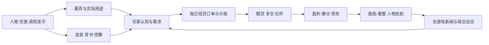

# 期货市场与虚拟货币市场综合设计

修订版 3，2026-11-18，面向 CK3 1.21 Florin。产品是一个由人物、宗族、国家、信仰和商会共同参与的金融市场：发行货币、募集资金、制造概念、争取买家、操纵行情、做多做空、加杠杆，并承受财富转移和政治反噬。当前交付为设计；下面的参数是待平衡的模组规则。

本版取代提交 38a608399 中的第一稿。所有 AI 均有发行资格，上市币每天可交易；单人游戏中存在使用自身资金和信用的 AI 买家、卖家、发行者、投机者和债权人。玩家独资清算池、只读政治指数、月度交易窗口和全面有限责任不再作为产品核心。

## 1 玩家能做什么

玩家可以同时扮演发行者、投资者、庄家、交易所经营者和政治统治者。核心体验包括：

- 给自己的个人币、宗族币、王国币、信仰币或商会币起名，指定徽章、供应制度、用途、分配和控制权。
- 预售融资、向盟友配售、给宗族成员分币，花钱宣发，争取宗教或政治背书，把持币者变成利益共同体。
- 在大量币种中筛选、关注、限价挂单、即时买卖、吸筹、拉盘、兑现、砸盘和接盘；也可能根本找不到买家。
- 用币支付约定费用、抵扣部分税款或领取明确收入分成，让概念有实际需求；也可以发行纯靠共识和宣传维持的概念币。
- 对合格币种和商品指数做多、做空、加杠杆、补保证金、止盈止损、移仓、对冲现货，承担爆仓和追索债务。
- 资助王位争夺者、组织宗族持币联盟、打压敌国币、救市或拒绝救市，把金融输赢带进 CK3 的人物关系与政治。
- 从全游戏气泡中看到暴涨、崩盘、巨额爆仓、发行者违约、宗族救助和债务危机导致的离世。

这里的币是游戏内可发行、可持有、可转让的资产。正常使用只需 CK3 和模组；不连接现实交易所、现实支付或真实区块链。中世纪外观称其为票币、宗族凭券和商会账币；现代术语保留在帮助和交易页。

## 2 三个相连的市场

| 市场 | 交易对象 | 价格或金额怎样产生 | 谁承担对手义务 |
| --- | --- | --- | --- |
| 一级发行 | 尚未上市的初始币、追加发行 | 发行者定价、认购或发行拍卖 | 购买者实付金币；发行主体交付已分配币 |
| 币的现货市场 | 已上市币的实际所有权 | 买卖订单撮合、有限库存做市报价 | 卖方冻结币，买方冻结金币 |
| 期货及永续市场 | 标准化的多空合约 | 独立多空订单报价，受现货、预期、融资及到期约束 | 匹配的多空账户缴保证金，清算所处理收付与违约 |

现货价格、参考价值、期货价格、结算标记价分别展示。市值等于价格乘流通或总发行量的相应口径，不能当成市场里存在同额金币。成交量、未平仓量和深度也分别展示；一个币涨了十倍，不表示所有持有人都能按最新价卖掉。

期货的基本参考来自交易所对统一结算价、逐日盯市及未平仓量的说明；本产品将其改造成按游戏日运行的规则。[CME 逐日盯市](https://www.cmegroup.com/education/courses/introduction-to-futures/mark-to-market)、[CME 未平仓量](https://www.cmegroup.com/education/courses/introduction-to-futures/open-interest)

## 3 每个 AI 都能发币

### 3.1 资格与发行频率

发行资格不以玩家、爵位、是否有地或是否属于某种政府区分。无地冒险者可以发个人概念币，伯爵可以发领地融资币，家族首领可以申请宗族币；儿童及受监护者通过有权代理人处理发行和财产。某个 AI 不发币，原因应是没有预算、收益不合适、冷却未到或尚未轮到其决策，而不是系统只给高阶人物资格。

个人主动新发冷却 24 游戏月，同时最多控制一个存续个人币和一个待办申请。登记发行与公开上市分开：微型档登记 1 金币、标准档 5 金币，公开上市还要支付服务费、预存维护费、提供履约保证金和真实做市资金。无力支付者可申请真实承销或赞助，交换配售或费用债务；没有真实出资就等待。公共主体发行还要满足控制权限，复制个人身份、换头衔、改名或短暂退市不重置冷却。

同一世界可以有大量同主题、同宗族甚至相互竞争的币。币有永久唯一 ID，名称、图标、简称不是身份。死亡或改名不会把旧币 ID 重新发给另一个人。

### 3.2 AI 为什么会发行

AI 发行目标包括筹集婚礼或战争费用、经营商路、赎身、挽救财政、扩大宗族影响、支持争位、投机获利和模仿热门概念。贪婪、野心、勇敢、谨慎、诚实、欺诈及财政状况改变选择权重、承诺和融资用途，不直接给其免费买盘。

AI 发行前评估可触达的潜在买家、承销成本、自己的信用和已有同概念竞争。发行可以失败，认购不足可退款或缩量发行。不能因为发行者是 AI，就自动替它把所有币卖完。

例如标准档实际募集 200 金币，登记与上市费用为 19、维护预存 6、履约保证金 10、做市金币 20，新增自由项目现金为 145；微型档募集 20 时总支出或占用 6，项目现金 14。预存、保证金和做市资产不混成手续费，具体公式、赞助及补缴/退出见[发行成本、容量与退市](futures-and-virtual-currency-listing-lifecycle.md)。

## 4 发行主体与政治绑定

| 币的主体 | 稳定身份及控制者 | 可兑现的用途与叙事 | 权力变动怎样影响币 |
| --- | --- | --- | --- |
| 个人币 | 角色 ID；本人或合法代理 | 个人名望、冒险事业、赎身、社交圈与募资项目 | 本人死亡后按发行章程清算、转交或成为失去信用的遗产币 |
| 家族币 | 家族 ID；家主及章程指定人 | 家族事业、支系团结、共同投资、特定收益分配 | 家主更替接管管理权；叛离支系不会自动搬走所有人的币 |
| 宗族币 | 宗族 ID；宗族首领与议事安排 | 宗族成员持有、共同金库、声望背书、救助额度 | 宗族分裂可产生新币与兑换提议；既有持仓和旧债继续存在 |
| 政权币 | 头衔 ID，加实际政权/发行批次 | 公共支出、限定税费接受、贸易特权、国库承诺 | 继位承接主体；被征服者可承认、折价重整或拒绝旧债 |
| 信仰币 | 信仰或获授权组织 ID | 朝圣服务、募捐、圣战募资、特定教团用途 | 宗教领袖更替、分裂和宗教谴责改变需求与承诺 |
| 商会币 | 真实商会/企业主体或明确模组组织 ID | 商会服务、手续费折扣、已实现收入分配 | 公司迁移、关闭及控制权转让按章程执行 |
| 叙事币 | 发行角色或组织 ID，加概念标签 | 复兴帝国、龙裔、边疆开拓、胜利、末日等社会叙事 | 可没有赎回或收益权，价值依赖买家预期与传播 |

绑定不是简单把币名换成宗族名。每个币要记录发行主体、控制权、资金所有权、承诺、受益对象、履约期限、持币者权利，以及违约时可追索的对象。关联政权不自动获得公共国库权限；统治者私币与王国公币必须分账。

同一个“宗族币”名称可能只借用了名号，也可能获得公开背书，或已经有真实金额的担保。三层分别用图标与章程标示，声誉关联不自动变成全宗族共同赔钱。增发表决使用公告前的资格快照，新印的币不能立即给自己的增发提案投票。

### 4.1 宗族与家族怎样成为买家

宗族成员会在忠诚、关系、预期收益、可用资金和其他持仓约束下购买宗族币；竞争支系可能另发币、抛售或资助反对者。持币关系可以成为新的政治共同利益，但币不能凭空提供不可撤销的忠诚或自动控制所有成员。

宗族首领可以提议共同出资、救助、回购和分红。每次都要有支付主体及其真实余额。持币成员可能支持首领的冒险政策，因为胜利有利于他们，也可能在资金被挪用时组成追责集团。

### 4.2 概念怎样兑现

| 承诺 | 玩家与 AI 的实际操作 | 成本与失信后果 |
| --- | --- | --- |
| 税费用途 | 有权政权接受币抵扣某类明确费用，收到后销毁或进入公共库 | 减少可收现金；接受比例与换算率有限额，不能把同一笔税收重复计入金币 |
| 收入分成 | 按实收、扣除成本后的指定项目收入分配 | 先实际划入分配账，再按记录支付；币价上涨不是可分配收入 |
| 商贸用途 | 用币换取商会服务、运输或交易费折扣 | 服务提供者承担机会成本；没有原版接入能力时只开放已实现的模组服务 |
| 政治支持 | 持币达到门槛可参与该币的金库/项目表决 | 不直接改写原版王位继承或议会权力；章程要写明表决范围 |
| 回购承诺 | 发行主体按比例从真实可用收入拨款买入 | 没钱时无法持续；承诺落空损害信用，不能固定币价无限回购 |
| 战争项目 | 发行收入实际投入军费、赎金或明确补助 | 战败和资金挪用造成政治、信用及债务后果；持币本身不是保本债权 |
| 纯概念 | 宣传主题与发行者的身份、实绩相联系 | 没有默认本金兑付；失败可能价格归零，但不自动生成等额负债 |

承诺生成时冻结责任条款。改制或追加承诺只能向后生效，不能追溯取消已经到期的兑付义务。

## 5 发币流程与供应政策

发行工作台依次选择主体、名称与徽章、叙事标签、实际用途、供应制度、分配、认购、资金用途、控制权和退出规则，然后发布可查看的发行章程。

| 事项 | 可选玩法 | 必须显示的数字 |
| --- | --- | --- |
| 供应 | 固定上限、按日历增发、经表决增发、发行者可增发 | 已发行、最大/可变上限、增发权限、预计解锁 |
| 分配 | 公开认购、发行者保留、宗族/盟友配售、项目金库、奖励、做市库存 | 各项份额，之和等于已分配供应；未发行不能当流通量 |
| 认购 | 固定价、价格区间拍卖、软顶/硬顶、最低募集额 | 收到的实际金币、交付币量、退款条件 |
| 锁仓 | 立即流通、分期解锁、按项目里程碑解锁 | 每期日期与数量，关联方可出售数量 |
| 增发 | 公告增发、表决增发、秘密违约增发剧情 | 发行权限、稀释比例、收入去向和调查风险 |
| 销毁 | 买回后销毁、手续费销毁、持有人自愿销毁 | 实际减少供应；不会自动增加金币储备 |
| 退出 | 清算、并币、迁移或失败归档 | 偿付顺序、兑换比例、未付债务与剩余币 |

建议普通币初始发行量 100,000 枚，允许规模差异。发行者可保留大份额，市场会看到披露信息并形成折价；隐匿关联持仓可以成为阴谋与调查玩法。界面同时列出总量、可流通量、锁仓量、关联方持仓和未核实披露。

发行募得的金币属于章程指定主体。直接转进个人钱包、用于公共战争或锁作兑付储备，是不同选择，分别影响买家预期与后续追索。

## 6 宣发与概念竞争

### 6.1 传播渠道

| 渠道 | 主要受众 | 代价 | 怎样影响交易 |
| --- | --- | --- | --- |
| 宫廷游说、宴会、婚盟 | 亲族、封臣、盟友和宫廷投资者 | 金币、活动成本、关系及人情 | 把币加入这些人物的候选/关注列表，改变信任与认购意愿 |
| 宗族动员 | 同族成员和支系 | 宗族影响、信誉、共同出资承诺 | 提高触达；成员仍按各自预算决定买卖 |
| 商人网络 | 商贸地区、公司、承销人 | 广告费、佣金、代币配售 | 带来真实委托和竞争做市者，可能要求折价 |
| 宗教背书 | 同信仰人物、朝圣者、教团 | 捐赠、虔诚、授权与教义约束 | 增强信任或争议；教义不允许的金融安排可能被谴责 |
| 政权公告 | 本国及贸易伙伴 | 政治资本、信用和执行成本 | 改变采用预期；正式接受用途才产生实际需求 |
| 谣言、虚假利好、隐蔽推广 | 易受传播影响的投机者 | 情报、秘密、人情、事后追责风险 | 改变受众所相信的信息，不能直接把最新成交价乘倍 |

每次推广记录主题、受众、持续期、真实程度、承诺截止日和实际触达。重复同一口号的效果衰减；违约、战败、增发、解锁和调查结果会反向传播。宣传可以有效，也可能遭遇冷场、反宣传或聪明买家的反向交易。

### 6.2 实绩与叙事分开

“帝国复兴币”会因战争胜利、争位进展和盟友背书吸引买家；实际是否获得领土、是否按承诺投入军费，则决定长期信誉。“宗族繁荣币”可依赖成员团结与项目收入；在控制者侵吞金库时，忠诚的宗族买家会成为最愤怒的投资者和受益人，已有到期付款请求权者才是相应债权人。

世界真实状态与角色所知信息分开保存。AI 不自动知道尚未公开的密谋、隐匿持仓或未来战果。谨慎者要求更大折价，贪婪者追逐涨幅，敌对者可能故意做空；任何一种性格都不会无限出资。

## 7 每天能买卖的现货市场

### 7.1 委托与撮合

所有正常上市与风险警示的币每天开放交易，不设月度交易窗口。明确的临时停牌、摘牌和清算按[退出规则](futures-and-virtual-currency-listing-lifecycle.md)处理，不因冷门或缓存淘汰暗中停止交易。玩家在游戏暂停或运行时均可通过交易界面提交操作；同一游戏日可多次交易。具体暂停态 effect 的执行资格在原型中验证。

首版提供市价买/卖、限价买/卖、撤单和带最高滑点的市价委托。买单先冻结最高可付金币与费用，卖单冻结实际持币；没有现货借币模块时不允许裸卖出。市价单按价格优先、同价按提交顺序逐级成交；限价单可以部分成交，余量保留或按有效期撤销。

每笔成交明确买卖双方、数量、价格、费用和实际收付。行情页提供最新成交、买一卖一、深度、当日成交量和成交区间；没有成交时不伪造 K 线。交易界面可以显示新的参考报价，但必须与上次成交价分开。

### 7.2 单位、费用和部分成交

首版标准交易手为 100 枚币，报价使用“每 100 枚币的金币分”，最小金币分为 0.01 金币。订单与成交量取整数手，使每笔本金能精确落在金币分，不对买卖双方各算一个本金；碎币可合并或转让，未满一手不单独撮合。拆币或改变手数规格要通过公开、一次性的资产迁移，不改旧币实际财产。

现货默认向买卖双方各收成交本金的 0.3%，合约默认各收 0.05%；这是交易费而非资金费。买方支付本金加买费，卖方收本金减卖费，两项费用进入交易所收入账。原始订单发生部分成交时，累计费用按该订单累计精确成交本金向上取整，再减去已收费用；最低一分适用于整张实际成交订单，不在每个碎片重复收最低费。撤单只释放剩余冻结，不返还已发生交易费。

报价、订单确认页和成交回执均显示费用基数、计费率与实付。设定优惠或做市返佣时须有实际费用来源，不能产生无限负手续费。

### 7.3 有限做市与长尾币

做市人使用自己的金币和币库存挂双边报价，根据库存、风险、新闻和资金压力调整价差。发行者可以支付上市或做市服务费，不能凭一次上市就获得无限接盘资金。

长尾币使用少量价格档和聚合委托，任何币被查看或下单时立即进入局部详细撮合。热度分层只改变模拟精度和 AI 主动搜索频率，不撤销日级交易资格。冷门币可能只有很宽的价差，甚至没有卖方或买方；界面显示真实缺口，不按参考价保证成交。

### 7.4 价格发现

价格由实际订单与成交形成。角色的估值综合币的用途、储备或收益权、稀释、发行者信用、政治前景、近期行情和其所知信息，再受预算与持仓约束转成买卖订单。

不采用“点击宣发，所有持仓立刻按新高价变现”的规则。买入可以推高有限卖盘，卖出可以击穿有限买盘，锁仓解禁可以增加抛压；市场不会为了让每个投机者盈利而补造金币。

## 8 操控币价与发行者的灰暗玩法

| 手段 | 游戏内操作 | 有效条件 | 代价、反制与后果 |
| --- | --- | --- | --- |
| 吸筹控盘 | 发行前保留、配售给盟友、分批收购流通币 | 有钱、有可卖筹码、能维持关联合作 | 抬高成本、集中风险、关联方背叛和解锁抛压 |
| 拉盘 | 用真实资金连续买入，同时推广概念 | 流通盘薄、确有接续买家 | 消耗现金，价格冲击，跟风者可以提前兑现 |
| 出货与砸盘 | 卖出保留份额或集中抛售 | 有真实接盘和可流通库存 | 滑点、信誉损失、支持者敌意及后续融资困难 |
| 增发稀释 | 使用章程权限或实施被调查的秘密违约 | 有增发权或承担违规风险 | 新供应不等于金币，必须售出；旧持有人可能抛售和追责 |
| 回购与销毁 | 用发行主体的真实收入买回并销毁 | 有持续资金、愿牺牲其他支出 | 资金耗尽会失守；不能按旧价格无限兑付 |
| 关联对倒 | 关联账户互相成交或制造热度叙事 | 有真实冻结资金、币和账户控制关系 | 付费用，不能净造财富；可识别关联量从合格结算样本剔除 |
| 撤出做市资金 | 取消自己未成交的报价，取回自由资金 | 资产确属自己且未抵押、未冻结 | 深度骤降、价格波动、持币者反噬 |
| 挪用兑付储备 | 发行者选择违法背叛自己章程的剧情 | 真实转走金库金币 | 兑付债务继续保留，形成追索、调查和政治丑闻 |
| 空头围猎 | 在有对手盘时建立空仓，揭露或捏造利空 | 能缴保证金，买家相信信息或基本面恶化 | 错判会亏损、爆仓甚至负债；诬告可能败露 |
| 逼空与清算连锁 | 控筹、买入并促使真实做空者回补 | 有足够资金和薄弱深度 | 现货拉升不保证结算标记同幅上升，资金可能先耗尽 |
| 政治围堵 | 限制本国采用、提出禁令、压迫承销人 | 有真实管辖权且能承担政治成本 | 转往境外交易、黑市、外交摩擦和本国持币者受损 |

这些都是局内可选行动及其反制。一般交易者可以调查关联方、提前卖出、分散持仓、做空或退出。交易所的治理、披露和腐败程度决定可用手段与处罚，不能让发行者因为由玩家控制就免除追索。

## 9 AI 交易者与外部资金

AI 分别拥有发行者、长期使用者、宗族支持者、基本面投资者、趋势投机者、逆向交易者、做市人、承销人、套利者和杠杆投机者等策略。一个人物可以有数种动机，但共享同一钱包、持仓、信用额度与风险预算。

AI 的初始金融投入按可支配资产与未来生活/军费支出计算，初始普通投资预算建议为可支配现金的 10%，单币通常不超过其金融组合的 25%；高风险性格可在明确信用与抵押下超限。发行投资支出实际扣款，不能凭身份生成一笔虚拟买盘。

每个 AI 只关注有限币：默认至多 6 个，包括自己的、宗族的、相关政权的、曾交易的和被新闻触达的币。好友推荐、宗教宣传、战争与市场排行改变关注列表。正常 AI 无须每天重新判断，但每笔未平杠杆仓位每天必须清算；重大新闻可以触发有限的提前重评。

个人钱包、公共国库、宗族资金、借款、保证金、交易所资本分别记账。借款的出借者要真实支付本金；发行募资来自真实认购者。系统不以“市场资金”为名反复增加角色金币。

## 10 期货合约和永续合约

### 10.1 合约品种

期货是核心玩法，不推迟到币市场之外。每个通过流动性、价格来源和风险评估的币可申请开设币价期货；低流动性新币先只有现货，成熟后开放衍生品。不是所有刚发出的骗局币当天就有 20 倍杠杆对手盘。

| 合约 | 标的与到期 | 用途 |
| --- | --- | --- |
| 币价期货 | 指定币，1 或 3 游戏月到期，金币现金结算 | 做多、做空、锁定预期售价、跨期交易 |
| 永续合约 | 指定成熟币，无固定到期，按规则交换资金费 | 持续多空与杠杆投机；须单独开设和配置 |
| 商品/行业指数期货 | 模组定义的粮食、军需或商贸指数 | 战争或经营风险投机及对冲；不冒充原版自动浮动的现货粮价 |

合约显示基础单位、每手币数/点值、价格精度、到期、保证金、费率、标记及指数来源、追索条款和停市安排。币期货初始每手 100 枚币等值；现货持币不是开空的必要条件，保证金与真实多方对手盘才是。

### 10.2 做多、做空与平仓

多空使用独立订单簿报价，成交后清算账簿生成相等规模的多头和空头义务。新增双方各自开仓时未平仓量增加；双方都平仓时减少；一方转手给新持有人时可以保持不变。累计成交量不当成未平仓量。

玩家选择开多、开空、减仓、平仓或反向开仓；“仅减仓”不能意外翻成更大反向头寸。买回空仓、卖出多仓是在合约市场平仓，不消耗一份并不存在的现货。到期只处理最后尚未结算差额，不再次支付总盈亏。

### 10.3 杠杆档位

基础提供 1、2、3、5、10 倍；成熟、深度足够且风险资格通过的市场可提供 20 倍。新币、信用薄弱或波动大的币降低可开档位。AI 同样能使用杠杆，按性格、认知、资产和信用选择，而非所有 AI 自动冲最高档。

    名义价值 = 合约数量 × 每手单位 × 成交价
    初始保证金 = 名义价值 / 开仓杠杆
    账户权益 = 当前实有保证金 + 尚未结算盈亏 - 尚未扣除的应付费用

当前实有保证金已经包含已结算的收付，不再把累计已结算盈利加第二遍。调杠杆也不自动发出一笔现金贷款；只有另有真实出借者并实际支付本金，才产生可支出的借款金币。

维持率随品种和档位分表设置，例如 5 倍初始率 20%、维持率 12%；10 倍初始率 10%、维持率 6%；20 倍初始率 5%、维持率 3%。开仓杠杆不是持有期间永不突破的上限。

调高杠杆会重新计算可提保证金，受信用、流动性、未实现亏损和已公告规则约束；旧预览不能直接释放资金。支持手动补保证金、降低杠杆和可撤销的限额自动补仓。默认逐仓；全仓模式只覆盖事先指定的金融保证金账户，不自动掏空所有个人或公共资产。

## 11 每日盯市、强平与真实债务

### 11.1 一个游戏日的处理

1. 消费已确认发生的发行、解锁、新闻与政治变更，刷新相关交易者的已知信息。
2. 处理有效现货和合约委托，记录实际成交；玩家当日局部交易不必等到统一时点。
3. 形成各市场当日统一结算标记，逐仓计算相对上次标记的差额，并计入该次应付资金费、借款利息和到期费用。
4. 核查保证金，触发追加要求、止损或强平，撮合可执行的平仓；无买盘时不虚构成交。
5. 处理到期、欠款及兑付；任何追加扣费或转款后立即重验保证金，更新真实余额、索偿、风险与债务危机。
6. 输出行情与全局新闻，保存当日已处理序号，禁止同日重复结算。

强平不是保证能按触发价成交。跳空、买盘消失、流动性不足可以使平仓损失超过保证金。开仓时必须显示这点及追索规则。

逐日差额为方向乘合约单位数再乘本日标记与上次已结算标记之差。标记用于统一估值与风险检查；强平损益最终依据实际可执行的平仓成交，并只补记相对上次已结标记的剩余差额。无对手盘时保持“待强平/未平”与风险记录，不能按理想标记伪造已成交，或把日结与平仓各付一遍。

例如 1,000 枚等值多仓已从 1.00 按标记 0.60 结算亏损 400，随后在 0.55 实际平仓，只追加亏损 50，总亏损 450。每日统一清算序号与同日每笔交易序号分开保存，“同日已清算”不阻止之后合法新仓、减仓或实际成交差额。

### 11.2 债务如何产生

普通现货持币跌到零只损失持币价值，不自动欠下等额债务。债务来自真实借款、期货穿仓、已担保兑付、到期分配欠款或明确担保；债权人、形成日期、未偿本金、实际支付、计息与违约状态逐笔保存。

穿仓后先消耗违约账户的可用保证金与事先指定的担保资产。其余缺口成为清算债务，不能把负权益钳成零就取消债权。清算所依次使用违约者专属违约储备、已实际缴入的风险基金与自有资本，资本仍不足时记录未付获利索偿，暂停新增风险并启动公开重整。

基金已替违约者付给赢家的部分，转成基金对该违约者的债权；尚未付给赢家的部分仍是未付索偿。不能同时把同一笔缺口记成基金损失、赢家已收款和第二笔未付赔偿。风险共担或自动减仓只按该市场事先公布的规则执行，不能临时给盈利者凭空加钱。

### 11.3 穿仓数值例

AI 甲以 10 倍杠杆做多 1,000 枚币等值，开仓价 1 金币，存入保证金 100；AI 乙做空相同数量，存入自己的保证金。以下忽略费用，两个价格点之间视为突发跳空。

| 事项 | 甲保证金 | 乙本次已收盈利 | 真实风险基金 | 甲对基金欠债 |
| --- | ---: | ---: | ---: | ---: |
| 开仓后 | 100 | 0 | 500 | 0 |
| 成交/结算骤至 0.60，甲理论亏损 400 | 0 | 400 | 200 | 300 |
| 甲从实际收入归还 30 | 0 | 400 | 230 | 270 |

乙收到的 400 由甲原保证金 100 和基金真实金币 300 组成。甲的债务 300 不是又一份现金；归还 30 后基金恢复 30、甲的钱包相应减少 30。若基金只有 200，乙最多先收 300，剩余 100 显示未付索偿，不能写“全额到账”。

### 11.4 永续资金费与到期收敛

永续合约每天按现货指数与合约溢价计算资金费，溢价为正通常由多方向空方支付，负值反向。默认日费率绝对值封顶 0.1%，从真实保证金划转；收付双方一致，清算所不从中免费制造收益。缺可靠现货指数时不开新永续仓。

资金费名义额以同一日、同一合约的现货参考指数乘单位数计算，不按各人的历史入场价或最后一笔小额成交计算。先确定实际可收总额，再按合约数量向对应另一方分配同一总额，尾差按固定顺序处理；欠付金额记索偿，不分别对两边取整制造新金币。有到期期货不收永续资金费；贷款利息和保证费用另列。

有到期期货可以有升贴水；到期现金结算收敛到事先定义的现货参考窗口。持有现货并做空期货可对冲，但资金成本、基差、手续费、未付索偿和流动性都可能使其亏损。

## 12 操盘与结算价的边界

最新一笔小额成交不能决定所有高杠杆仓位的价值。币指数优先使用多个合格独立交易场所、实际成交的截尾或中位结果，以及滚动窗口；单一场所时使用更长窗口和更低杠杆，不能假装存在不存在的跨所报价。

可识别的同一经济控制人对倒、极小交易和异常离群报价不作为合格结算样本。足够规模的真实买卖仍可影响指数，也就保留了拉升、砸盘、逼空和反向狙击的博弈空间。不能一边宣称可操盘，一边把标记价永久固定到一个不可影响的后台公式。

数据不足时先禁止新杠杆仓，对既有仓位使用已公布的停市/保护性结算条款。现货仍可按真实买卖订单交易，停开期货不等于把所有币锁到月底。新规则不能事后改变已开合约的终结价格。

止盈止损是条件委托，触发后仍受深度和滑点约束。指数、标记、最新成交和可执行平仓价在界面中分栏，杜绝“明明看到涨价却不知道为什么爆仓”的信息混乱。

### 12.1 必须防住的账本套利

| 漏洞 | 产品规则 |
| --- | --- |
| 发行者自己印币、拉高估值、无限抵押借金 | 对发行者及同一经济控制人的本币抵押价值为零；其他币按可执行深度、集中度和压力折价，出借者仍要付出真实金币 |
| 关联多空相互交易、薄壳账户爆仓骗基金 | 同一实际受益人相对仓不享基金赔付；隐匿关联仓有调查、延迟放款和追缴规则，发行方内幕空仓另收风险保证 |
| 一枚金币给多币重复做市或抵押 | 统一可用余额与冻结索引，每份资产只有明确且互斥的占用归属 |
| 靠死亡、换名、分家、转头衔清债 | 永久主体、交易与债务 ID 不重置，遗产和担保按合同处置 |
| 既获基金现金又保留同额赢家索偿 | 基金实际代付时转移相应债权，原未付索偿同步减少 |

同宗族不等于同一钱包，也不一概当作同一经济控制人；真实控制与代持关系需要有记录。允许发行者选择灰暗操盘，也保留被识破、追缴与失去市场资格的代价，不能把基金做成无限可提款的游戏漏洞。

## 13 债务危机与人物后果

AI 的风险看偿债能力、可变现资产、月净收入、担保、战争支出、到期时间和既有信用，不能只按欠债绝对金币数。小领主欠 200 可能比皇帝欠 2,000 更严重；富有而流动性暂缺也不同于彻底资不抵债。

危机链为：预警、催收、追加/借新还旧、失去信用、援助与重整谈判、严重困境、终局。角色可以请求亲族或盟友救助、卖出资产、以合法条件借款、达成减记/展期、出逃、失去地位、被追责，或在严重绝望时进入离世剧情。

自杀风险只用于符合本产品债务危机链的 AI；综合持续无力偿债、压力、孤立、公开羞辱和性格，同时接受亲族陪伴、援助、重整和时间恢复的抑制。不会把一次价格下跌等同于必死。金库中的可兑付资产仍计入可恢复财产，不能藏起现金再反复刷“穷困”剧情。

债务评估在重大亏损或催收时登记，低频推进，不每天为全世界所有负债角色抽一次死亡。危机有状态、截止日、已给援助和冷却，同一角色的死亡只结算一次；救助与死亡都不会让原账户、持币或债务凭空归零。

20 个不同的非血腥剧情结局、全局气泡文本和财产后续见[债务危机剧情与通知](futures-and-virtual-currency-debt-events.md)。它们是游戏剧情变体，不包含实施步骤，也不给死亡提供额外金融奖励。

## 14 全游戏气泡和市场新闻

全局指世界范围，不仅是玩家宫廷、亲属或视野附近。所有人类玩家都可以收到本产品重大金融事件；最小化运行不激活窗口。

| 类型 | 默认触发与内容 | 后续操作 |
| --- | --- | --- |
| 新币与热点 | 有规模的发行、热度跃升，显示主体、主题、募资和关联势力 | 查看币、章程、关注、买卖 |
| 大涨大跌 | 真实成交支持的重大变化，显示流动性和成交额 | 查看深度与相关新闻 |
| 巨额爆仓 | 角色、币种、方向、杠杆、已实现损失和真实欠款 | 查看持仓终态与债权 |
| 违约和重整 | 未偿义务、担保人、救助方、减记/展期安排 | 查看债权与支持/反对选择 |
| 绝望离世 | 人物肖像、政治身份、关联币、非血腥事件摘要 | 查看遗产、债务、宗族与市场反应 |
| 操盘丑闻 | 宣传与实际用途不符、隐匿增发、关联出货等被揭露 | 调查关系、抛售、做空或退出 |

涉及债务危机的每次离世均生成独立全局气泡，不靠只通知亲属过滤掉。前台同时显示至多 3 张，余下排队并保留在可滚动新闻簿；同一事件 ID 不重复。普通发行和小波动可做每日汇总，批量危机有总览卡并保留每个人的子条目。

默认不强制暂停，不要求逐个点确认。可调通知频率、屏蔽价格类消息或切换较含蓄的离世文案；全局严重事件仍有完整记录，不以减小显示负载删掉债务或死亡事实。

### 14.1 市场终端

| 页面 | 玩家看到和能操作的内容 |
| --- | --- |
| 全市场 | 所有上市币的分页列表，按名称、宗族/政权、主题、涨跌、成交额、流通量和风险筛选排序；默认每页 50 行 |
| 单币详情 | 日级 K 线、成交与参考报价、买卖盘、实际流动性、发行章程、持仓集中、解锁日历和关联新闻 |
| 交易面板 | 限价/市价、数量、滑点、实际可成交量、费用、部分成交、挂单和撤单 |
| 发行工作台 | 主体、徽章、概念、用途、供应、分配、锁仓、认购、披露、宣传和金库资金去向 |
| 宣发与经营 | 选择受众和渠道，查看费用、承诺截止日、实际触达、项目履约、回购和可解锁库存 |
| 合约面板 | 开多/开空、1 至 20 倍可用档位、保证金、预计清算价、标记/最新价、资金费和止盈止损 |
| 我的资产与债务 | 现金、现货、锁仓、委托冻结、逐仓/全仓权益、借款、债权、担保和预期现金流 |
| 政治与宗族 | 持币成员和利益关系、背书/担保、共同金库、救助提案、重整投票和控制权争议 |
| 全局新闻簿 | 世界范围的发行、暴涨、操盘揭露、爆仓、救助、违约和离世，可跳转人物与币 |

买卖、发币和合约可从固定交易所决议进入；顶栏快捷入口作为经过兼容验证的增强。搜索和排序使用有限的缓存索引，不在每个 GUI 帧重扫全世界。

## 15 身份、继承和政治实体消亡

个人钱包、交易账户、发行主体、币持仓和债务是不同对象。持有币不代表控制发行金库，人物死亡也不意味着所有关联币消失。

- 角色死亡：个人资产按已核实的继承关系转交，未平杠杆仓按事先条款平仓或转给合格账户；未成交委托撤回，已成交不回滚。
- 家主/宗族首领更替：主体 ID 不变，控制权转交；私人投资者的币不重置，前任个人债务不自动并入宗族金库。
- 政权易主：新政府按章程和政治选择承认、折价重整或拒绝旧义务；拒绝会造成对持有人、外交和后续融资的影响。
- 头衔暂时销毁：旧发行批次保留为待处置主体；重建头衔不无声复活或注销全部旧债。
- 宗族分裂：旧币继续存在，分支可另发币；换币只在公告、冻结旧币和实际兑换后完成，不能两边都保留同一份本金。
- 断线或玩家移交 AI：金融主体与资产继续存在，按当前控制者策略运行；不得因切换 AI 再送一份本金。

救助是政治选择：宗族可以牺牲共同金库保住首领，也可要求其交权、处分资产或接受改革。债权人对遗产与担保的权利只按章程和真实合同执行，不因同宗族就无限连坐。

### 15.1 停牌 摘牌与资产注销

退市机制将发行主体、币资产与单场所交易对分开。币先经过风险观察与整改，普通摘牌提前 30 游戏日公告；公告后停止受影响场所的新增杠杆风险，通常在第 21 日按原条款终结相关剩余合约，第 30 日关闭现货交易对并释放已核自由冻结资产。其他健康场所及有可靠独立价格源的合约继续。重大故障可紧急停牌并定期复核，不能借故没收财产或把失去报价直接当价格归零。

关闭某个交易对不影响其他合格场所；全部摘牌后可取回币到角色自持账簿，或在有真实双方时场外交易。发行者死亡不自动摘牌，管理人和赞助者可接管；低成交但仍有实际用途的币不单凭冷清淘汰。只有所有持有、委托、抵押、合约、兑付、债务及待领权利均结束，才进入最小历史归档。完整状态机、现实依据、期限与数值例见[上市与退市设计](futures-and-virtual-currency-listing-lifecycle.md)。

## 16 两条完整玩法链

### 16.1 伯爵发行宗族复兴币

伯爵争取宗族首领及章程规定机构授权，用宗族徽章发行 100,000 枚币。分配为公开认购 30,000、创始人 30,000（其中 20,000 锁仓）、项目金库 20,000、做市库存 10,000、成员奖励 10,000。公开认购中实际售出 20,000 枚，每枚 0.01 金币，募得 200 金币；剩余 10,000 未售出，不计金币收入。若只取得所在家族家主授权，则应发行家族币，不能假称代表整个宗族。

他拿 40 金币进行宗族宣发，60 用于已公告项目，100 保留在主体金库。亲族、盟友和投机者基于各自资金购买；项目兑现、战争胜利和推广带来后续需求，实际订单将成交价推到 0.03。发行者可以继续经营、按实收分配，也可以卖出已解锁保留份额，把政治信用换成自己的现金。

竞争支系揭露资金挪用，宗族成员抛售，敌对商人做空。发行者可花金库现金回购、提出增发救急、请求家主救助，或者拒绝履约。回购可能耗尽金库；增发会稀释支持者；被迫救助可换来家主控制权。币价、资金、关系与权力一起变化。

### 16.2 无地冒险者追逐王国币

无地 AI 可以发行自己的冒险概念币，也可以买入热门王国币。某冒险者先靠真实买卖获利，随后以 10 倍杠杆做多王国币；发行王国战败、增发并遇到流动性撤出，触发跳空，保证金不足并留下清算债务。

他尝试卖出自己剩余币、向承销人展期、请求亲族赎债，甚至发行有真实出资者购买的新融资批次；不能凭发出新币就自动还清旧金币债务。援助成功可失去收益权或自由，失败可陷入长期催收与严重压力。极端危机可能进入离世剧情，全球气泡同时告知其债务与相关币；债权和遗产按合同继续处理。

## 17 很多币与每日交易的性能方案

### 17.1 默认世界容量

标准档改为以 4,096 种同时正常上市币为验收目标，2,048 为保守档、8,192 为扩展目标、16,384 只用于上界压力探索。总登记数、上市数、交易对、详细热点、持有关系和未平仓分别预算；历史与退市资产不占正常上市名额，但其存档仍有成本。档位需要实测，当前不保证某个数量已能流畅运行。

市场自然由发行与退市共同决定，初期无需强行生成 4,096 个币。达到软容量时新上市排队，按等待时间和实际成本处理，不按爵位剥夺资格、不随机删除现有好币。成本、冷却与 AI 预计收益控制发行密度；存续期和退出机制控制长期膨胀。

所有正常上市币每天保留行情状态和交易入口，不用月度更新代替日级交易。长期无需求、无人维护或违规的币先观察、整改、公告再摘牌；正式摘牌后保留持有、场外、迁移和索偿路径。只有全部资产与权利义务结束才可压缩归档，不能为省性能没收仍有持有人的币。

### 17.2 工作分层

| 工作 | 频率与上限 | 不允许省略的业务 |
| --- | --- | --- |
| 币的轻量状态 | 所有上市币每日一次，仅余额/公告/必要报价和日序号 | 每日日期一致，能查询和下单 |
| 详细订单簿 | 默认 64 个热点，可提高至 128；玩家访问与持仓事件立即提升 | 任意币都能进入，不能等下个月 |
| 未平杠杆合约 | 每日全部处理，按实际活跃仓位数计费 | 保证金、强平、债务与到期不能因冷门跳过 |
| AI 主动决策 | 有界轮转，标准档每天 512 个角色；每人至多 6 个关注币 | 发行资格普遍，长期不饿死低阶或无地角色 |
| 发行队列 | 默认每日最多完成 8 个新币，复杂发行可占多份预算 | 已收款认购、退款和交付按期完成 |
| 新闻反应 | 去重后的角色/币待处理队列 | 重要冲击对相关真实持仓和保证金及时生效 |
| 债务危机 | 新严重亏损即时登记；其余每 7 日推进相关危机 | 危机重复保护与已到期义务仍每日核查 |

初始世界角色发现使用原版可用索引和增量队列，分批完成，不在每个日 tick 扫描全世界角色乘全币种。出生、死亡、角色取得可支配财产等事件只维护候选；未验证索引前用有界扫描建立一次注册表，不把临时技术困难变成“只有皇帝能发币”。

同一做市者跨币共享预算，报价必须占用或原子检查同一份可用资金，不能在 2,048 个币上重复承诺同一枚金币。局部撮合、每日风险和新闻共享当前账本，避免图表页面每帧遍历全部市场。

热币保留最近 90 个日线和 52 个周线，长尾保留近 14 个日线及有限周线；当日无成交则显示零量/沿用成交，不补造历史。详细成交仅保留近期窗口，仍有效的订单、持仓、债务、担保与迁移记录不因历史裁剪删除。保留累计发行与供应核对值，使压缩历史不破坏财产。

### 17.3 性能目标与过载行为

标准压力场景为 4,096 币、64 详细市场、512 次 AI 决策/日及 4,000 个未平仓，目标为每日增量墙钟 P95 不超过 100 ms、P99 不超过 300 ms，普通单币详情刷新不超过 16 ms，长期状态以 16 MiB 为预算。另测 2,048、8,192 与 16,384 档及高持有人/订单密度、批量爆仓、集中摘牌；必须实测后调整，数字不是当前成果。

过载先减少无持仓 AI 的重新搜索和推广传播扇出，再压缩订单档位、新闻显示批次与历史深度；必要时暂停新上市或新杠杆仓。现有资产每日交易入口、已开仓清算和到期收付优先，不能靠漏记亏损或关闭长尾交易提速。

## 18 实现结构与一致性

采用一个独立 Mod、一个 Workshop 条目，实际目录 mod_financial_markets，命名空间 xfm_。内部共用金融底座，拆分现货、期货、主体宣传、债务新闻模块；开关只阻止新增风险，不删除既有资产和义务。生产内容使用 CK3 脚本、GUI、本地化与资源文件；Java、Maven、Quarkus 只承载开发参考计算、构建和验证，不要求玩家运行服务。

| 对象 | 关键字段 |
| --- | --- |
| 发行主体 | 稳定 ID、类型、实际控制者、钱包/金库、章程、担保、存续与重整状态 |
| 币 | 唯一 ID、发行主体、标签、供应/流通/锁仓/销毁、增发权、用途、披露、资产状态和风险 |
| 上市与退出 | 场所/交易对 ID、服务档、费用与受限资产、警示/停牌/摘牌状态、通知日期、终结规则、迁移和残余权利 |
| 账户 | 人物/主体 ID、可用与冻结金币、币持仓、保证金、借款、债权和关注列表 |
| 订单与成交 | 单号、主体、市场、方向、限价、数量、已冻结资产、先后顺序、部分成交和终态 |
| 合约与仓位 | 标的/到期、单位、方向、数量、成交价、上次标记/日、保证金、档位、条款与风险版本 |
| 债务 | 债务人与债权人、来源、已付/未付、基金代付、担保、期限、利息与重整 |
| 宣发与事件 | 主题、投放者、资金来源、受众、信息真假、开始/失效、事实与角色所知 |
| 日清算与新闻 | 游戏日序号、输入版本、已提交结果、危机/死亡 ID、广播去重和队列 |

金币采用经原型验证的最小整数单位，币量为整数，价格采用明确分母的报价单位；每次交易先计算一个最终收付金额，再同时更新双方。正数金额统一舍入，买卖方向不各算一次。小于最小成交金额的委托拒绝，不让拆单和负费用套利。

同步 effect 先验证权限、资产、版本和范围，再完成扣款、转币、费用、仓位与终态。GUI 按钮置灰不是并发锁；报价变化须重算并确认。保存/重载消费同一日序和事件 ID，既不重复清算，也不把未知半笔交易自动重放。

## 19 与原版经济接线

原版 1.21 的商品生产和需求、繁荣、商路、税收、国库、信仰与角色关系提供输入和政治背景。[经济分析](../ck3-1.21-economy-analysis-2026-11-18.md)已核对正式脚本，但原版供需不直接形成浮动商品成交价；本产品的新币价和商品指数都属于新增市场。

发行章程需要的税款抵扣、公共金库支付、收入分成、宗族资金与继承，要逐项验证实际原版接口。某个接口未接通时隐藏对应承诺选项并指出施工入口，不伪造已扣税或已分红。普通个人币、AI 交易和日级市场不依赖所有政府专属接口先齐备。

Usury 教义与原版借贷规则保持独立。新金融债务不能覆盖原版债务对象，普通币也不自动继承原版 Strong Hook；金融剧情产生的诉求、追责和政治后果需要明确接入。

## 20 开发顺序与验收

首个可玩切片必须同时包含 AI 发币、多人格买卖、每天行情、玩家发行及交易，避免先交付一套只有自家资金池的金融计算器。

| 阶段 | 范围 | 可玩交付 |
| --- | --- | --- |
| A 发行与每日现货 | 所有 AI 资格、批量发行、至少百币、真实订单、玩家连续交易、基本宣发 | 能发自己的币，也能每天买卖大量 AI 的币；价格有真实对手资金 |
| B 政治与操盘 | 宗族/政权绑定、概念传播、分配/解锁/增发、控筹/出货、实际用途 | 完成一条融资、宣发、兑现或背叛、政治追责的链 |
| C 杠杆市场 | 币期货、多空、1 至 10 倍、日清算、止损强平、债务和风险基金 | 能用多空对冲或投机，跳空穿仓留下可追索债务 |
| D 世界后果 | 援助/重整、20 种离世剧情、全球气泡、继承与政权更替 | 角色与政治后果可观察，死亡不删债、继位不复制资产 |
| E 扩展和压力 | 永续、合格 20 倍、商品指数、更多场所、4,096 标准与 8,192 扩展性能 | 每日、退出和多人确定性专项通过后开放对应容量和功能；16,384 为探索档 |

| 验收主题 | 必须看到的结果 |
| --- | --- |
| 普遍发行资格 | 玩家、低阶 AI、无地 AI、宗族和政权按各自权限发行；性能排队不改成身份禁入 |
| 多币与每天交易 | 2,048/4,096 等压力档中，随机正常上市冷币与热币都能当天委托、撮合、撤单；同日可多笔 |
| 发行成本 | 两档募集例子守恒，登记/服务费、预存、履约保证金、做市资本互斥；无真实资金无法免费上市 |
| 停牌与退市 | 场所下架不注销币，提前公告、合约终结、撤单退款、迁移失败、残余索偿与重上市各自验证 |
| 真实资金与所有权 | 买卖、认购、承销、宣发、回购、借款和手续费均追到实际余额；同币供应守恒 |
| 宣发与操盘 | 宣传改变受众和真实订单；有接续买家可拉升，有接盘才可出货，无资金不固定抬价 |
| 宗族/政治权力 | 死亡、换家主、继位、宗族分裂、征服、拒债后，币/金库/债务身份仍准确 |
| 多空杠杆 | 双方真实保证金、未平仓量、同日减仓/反向、调杠杆、日盯市和到期不重复 |
| 穿仓与兑付 | 第 11.3 节数值复现；基金不足显示未付索偿，不能凭空取消债务或补钱 |
| 结算价 | 小额尾盘和关联对倒不能任意决定全部杠杆标记；真正市场变化仍可影响价格 |
| 危机与离世 | 20 个变体、援助与重整分支，重复事件零二次扣款/死亡；不自动杀玩家角色 |
| 全游戏气泡 | 与玩家无关系的远方角色事件仍广播，每次离世可在队列/新闻簿找到 |
| 保存与多人 | 同日重载、断线、控制权转换不重复发币/返钱/清算，按游戏权威顺序撮合 |
| 性能 | 日级全市场、冷币即时提升、全部未平仓风险检查及新闻爆发场景分别测量 |

原型先验证金币精度、同步保存、稳定主体身份、后台公共入口和日历回调。验收使用正常玩家入口及 AI 实际事件链，简体中文实机保持最小化、不抢焦点。脚本 UTF-8 BOM、追加 on_action、窗口注册、构建 allowlist 和公共工具沿根规范执行。

## 21 资料与状态

- [原版经济分析](../ck3-1.21-economy-analysis-2026-11-18.md)及[正式文件来源索引](../ck3-1.21-economy-sources-2026-11-18.json)。
- [债务危机剧情与通知](futures-and-virtual-currency-debt-events.md)。
- [发行成本、容量与退市](futures-and-virtual-currency-listing-lifecycle.md)：收费与资本、分档性能、现实参考、场所退出和残余权利。
- [本次需求纠正记录](../maintenance/2026-11-18-financial-market-design-revision.md)。
- [项目规则与本产品 AI 例外](../../AGENTS.md)。

本版保留资金、供应和义务的一致性要求，同时以发行、交易、操盘和政治后果组织玩法。用户已要求开工，详见[实现计划](../../mod_financial_markets/docs/implementation-plan.md)、[测试验收方案](../../mod_financial_markets/docs/test-and-acceptance-plan.md)和[实际施工状态](../../mod_financial_markets/docs/development-status.md)；初始原型不授完整设计实现、游戏实测或发布通过。
