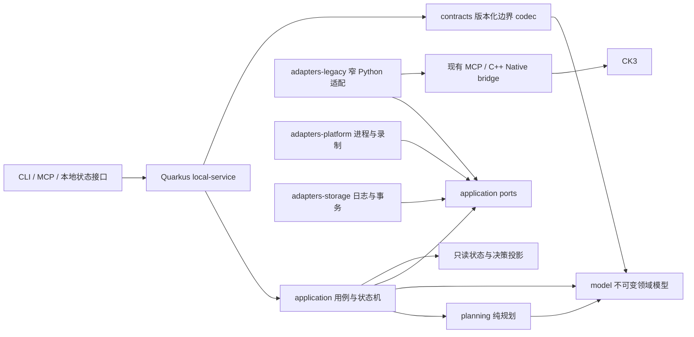

# 下一代 Java 自动游玩控制架构

版本：设计 1.0，2026-10-22。状态：**目标架构与迁移约束，按垂直链逐步实施**。责任入口：本文件；迁移顺序见[实施计划](python-java-incremental-migration-plan-2026-10-22.md)。历史成本分析保留在[原评估](python-java-migration-assessment-2026-10-19.md)。本文件不把设计、编译、HTTP 验收或实际游戏验收混为同一完成状态。

## 1. 架构决定与要解决的问题

采用 **Java 21 + 默认命令行 `mvn`（至少 3.10.0）+ 单个常驻 Quarkus 宿主 + 进程内领域模块**。Maven 低于最低版本才在各机器原位置更新，已满足时无需追逐最新版；版本记录不锁定安装目录。现有 C++ 原生桥继续负责 CK3 内部访问；迁移期用窄 Python 适配器接入现有合格链，逐条替换。每个游戏实例只有一个动作提交者和一个权威持久化写者。并发用于观测计算、规划候选、离线分析与独立研发，不用于重复提交游戏动作。

优先解决合同漂移、生成源码膨胀、权威分散、恢复重放不明、现场等待和测试范围混淆。不能把 Python 大模块逐个翻译成 Java 大类，也不能把每个旧脚本变成一个 HTTP 服务。初期不引入 Kubernetes、消息中间件、远程数据库或每次请求新 JVM。

| 本次实际问题 | 新架构的处理位置 | 必须能执行的反例 |
| --- | --- | --- |
| owner 139,469 B 超过 feeder 旧 128 KiB 上限；SDK 源超过另一个通用文件上限 | `contracts` 的分类型尺寸合同；发布清单列全部消费者；构建时校验部署闭包 | 合法的大 source item 被接收；超限请求/回执仍拒绝；不能统一改成无限大 |
| N45 FILETIME 被 Root 写成 string，冻结 Python 消费者要求整数，最后一步才拒绝 | 身份值对象、集中 codec、完整生产者→全部消费者差分 | bool、float、字符串替身、超范围和精度损失均拒绝；合法 uint64 原值往返 |
| 生成器、复制源码、外层来源表和导入路径形成多重事实 | 编译产物与不可变发布清单；运行期仅加载数据配置；迁移适配器检查真实加载来源 | 漏打包、混版本、重复类、错误 classpath 和错误 Python 导入均失败 |
| qualify/Prepared/ACK 被误解为恢复或业务完成 | 分范围资格与动作状态机；真实 reducer 预演；提交事务内重验 | 形状正确但 reducer 不接纳；Task 返回成功但 child exit 非零；ACK 后无原生效果 |
| 动作结果未知，重启后可能再次提交 | 持久化提交意图、单动作权威、未知结果隔离和原生后态核对 | 游戏已执行但回执丢失；提交前崩溃与提交后崩溃；同 action ID 不同正文 |
| 多次冷启、检查与修复耗掉墙钟，新增保存日很少 | 常驻宿主、同 Game 连续批、阶段耗时、完成保存才计分 | 零新增保存日的失败窗口仍计耗时；不把未保存推进算业绩 |
| 本轮 Maven 依赖代理、cmd 参数故障直到临场才发现 | 一次性工具链预检与统一 ProcessRunner；传播原始终态 | 下载失败、命令语法错误、进程超时、Job 残留不能被外层工具成功掩盖 |

本表的现场依据为[周转审计](ck3-native-ai/robert-source32-runtime-turnaround-audit-20261022.md)、[N45 零 RPC 闭场](ck3-native-ai/evidence/robert-source32-a45-zero-rpc-closeout-20261022.json)与本轮实施计划的工具链记录。机器事实仅限 `machine_id: xenoamess-full-tower-eb9d2c1186`，不能外推到其他机器。

## 2. 整体结构与依赖方向



箭头表示编译依赖或明确调用；适配器实现 ports，application 不导入适配器。`local-service` 是唯一组装根。HTTP、CDI、Jackson、文件系统、系统进程与 native pipe 不进入纯规划内核。

### Maven 模块边界

| 目标模块 | 负责 | 不应拥有 |
| --- | --- | --- |
| `model` | Machine/Game/Frame/Action 身份、观测事实、计划、资金与风险、状态分支 | Jackson 节点、文件访问、Quarkus 注解、动作副作用 |
| `contracts` | wire schema、严格 parser/emitter、版本转换、golden vectors、尺寸合同 | 游戏查询、资格授予、持久化提交 |
| `planning` | 完整普通规划器、战争/政务/外交/建设/事件策略、排序及解释 | 直接调用 MCP/Native、读写 ledger、修改观测 |
| `application` | SessionController、ActionCoordinator、恢复/保存用例、ports 与资源调度 | 平台细节、未经验证的 JSON、特定场次脚本 |
| `adapters-legacy` | 映射现有 Python/MCP 合同，传递原返回码、精确字节及真实证据 | 另一套 attempt 专用 reducer、自动重放未知动作 |
| `adapters-platform` | Win32 进程身份、Job/Task、后台 Steam 查询、录制及文件身份 | 领域决策、绕开原生合法通道、抢占用户窗口 |
| `adapters-storage` | 本地事务、事件/索引、检查点及证据引用，限额与保留适配 | 将 ACK 写成业务成功、根据过期直接删永久资产 |
| `local-service` | Quarkus 生命周期、REST/MCP 边界、配置、健康与依赖注入 | 将各领域逻辑堆进 resource/service 大类 |

这是目标拆分。首条实际 map 链由 `contracts` 与 `local-service` 完成；已验证的九模块另含 `native-diagnostics`、`war-policy`、`campaign-score`、`finance-policy`、`event-policy`、`military-policy` 与 `late-outcome-reconciliation`。后续组件按真实依赖加入[父 POM](../java/ck3-control/pom.xml)，分别记录构建与接管范围，不能继承 map 链的实机资格。`build-tools` 独立构建，承载 Java 进程、构建和 CI 支持；不会作为游戏 HTTP 服务启动。随后按实际依赖提取共享 `model` 等模块，不预建一批空工程。ArchUnit/构建依赖检查将禁止 domain→adapter、跨模块绕过端口和模块循环。

`coat_of_arms_editer_of_ck3` 的正式 Pages 继续保持纯前端；此架构不成为它的线上依赖。Workshop 发布也继续走自己的发布合同，不因语言迁移重跑缓存业务矩阵。

## 3. 合同：类型系统与运行时共同约束

### 唯一规范与三个表示层

`contracts` 中的版本化 wire schema/字段目录是公共协议的唯一规范，记录必填、可选、可空、整数域、单位、状态分支、字节上限与错误码。Java records、Python 兼容 parser 和未来 JS 客户端共同跑同一组 golden vectors。字段目录、Java DTO、OpenAPI、Python 类型文件不能各自成为互不验证的规范。当前一期以现有 Python producer/全部消费者作为 v1 的实际兼容基准；schema 工程不阻塞本场首次 Java 实测。

三个模型明确分开：

1. **Wire DTO**：版本化输入输出，保留 missing/null/empty 与历史整数域。
2. **Domain model**：校验完成后的不可变值对象、集合和 sealed 状态；业务层不传播 `Map<String,Object>` 或 `JsonNode`。
3. **Persistence DTO**：带独立存储版本的事务记录；读取通过明确迁移函数进入领域模型，不能直接 bean 绑定历史 JSON。

Java record 的字段 final 不会自动让内部 List 不可变；构造时防御复制，返回不可变集合。身份、金额、序号、日期和来源引用使用不同值对象，避免同为 `long`/`String` 就能互换。records 的语言行为见 [Java 21 官方说明](https://docs.oracle.com/en/java/javase/21/language/records.html)。

共享领域值对象不等于复用历史 wire DTO：战争观测的 `played_character_id`、Map SavedFrame 的 `actor_character_id`，以及各自 revision 范围/原生 snapshot 约束分别保留。经各自 codec 验证后才显式映射领域模型，不用字段别名统一吞并差异。

### 整数、时间与缺失语义

| 数据域 | 内存表示与 wire 要求 |
| --- | --- |
| Python-only v1 opaque uint64 | `PythonOnlyUInt64(BigInteger)`，JSON integer；拒绝 bool/float/string。当前 Game creation FILETIME 属于此历史 ABI |
| 跨 Python/Java/JS 的 FileID/FILETIME | 独立值对象，规范十进制字符串；禁止经过 JS Number。128 位文件身份也不用 signed long 代替 |
| 原消费者约定的 safe-number 序号/ID | 范围继续限制为该协议的安全整数域，不能因为 Java long 更宽就放宽 |
| 货币、军费、分数、比例 | 保留来源单位/缩放；整数定点或带明确 scale/rounding 的 BigDecimal；禁止隐式 double |
| 观察时间 | 内部 `Instant`；单独保留 `OriginalTimestamp` 供旧 wire 字节与审计使用；不将格式归一化追认为旧原件 |
| Missing / Null / Empty / Unknown | wire 层显式存在性；进入领域后用明确分支，例如 `Unavailable(reason)`、`KnownEmpty`、`Known(value)`，不统一转 Optional.empty |

文件身份必须区分 Win32 `FILE_ID_INFO`、卷身份、文件长度与写入时间；PID 不能脱离出生 FILETIME 使用。`GameGeneration(machineId,pid,creationFiletime)` 与 run/episode 分别表达进程身份和业务身份。来源 SHA、原生 revision 和 ledger generation 也分别建模。

### 统一入口校验

所有 HTTP、JSON、文件、MCP 和 native 回执入口依次核：字节预算→UTF-8→重复键/尾随内容→完整字段集合→真实 token 类型→范围/单位→schema 版本→跨字段不变量→领域构造。允许 null 的字段逐个声明；未知字段默认拒绝。注解和 Java 类型不替代 token 校验。

完整字段集与未知字段拒绝适用于新版本 wrapper 和已定义的严格 leaf。既有 SDK 的可扩展 snapshot/root 容器按其原合同读取，适配器仅投影明确声明且验证过的字段，保留原件摘要；不能套新的 exact-key 集合误拒正常额外字段。故障投影须标明 `projection_not_original`、原 schema 与原件 SHA，不能重编码后冒充原始响应。

数值计算另带逐算子的 `ArithmeticProfile`，列 precision、rounding、单位、缩放与 wire 数值域。Python Decimal 的 40/80 位 context、sqrt、中间舍入、向外取整与词法需要真实差分；BigDecimal 的 scale-sensitive equals、signed zero 与指数格式也单列。报告里的十进制 string/null 与 number 不互换，不能为一个评分用例放宽一期 Map 的 integer-only codec。

Quarkus 的 Jackson 配置必须显式拒绝未知字段；当前 map 使用集中 raw-token codec，REST 直接返回 canonical UTF-8 原字节，不能把 `byte[]` 再序列化成 base64。实际选择由[官方 JSON 配置说明](https://quarkus.io/guides/rest-json/#configuring-json-support)约束，边界回归防止框架默认值变化。

版本演进一次覆盖 producer、全部消费者、存储兼容、序列化与测试。旧版适配只存在于明确的边界模块，记录支持范围和退出条件；禁止 int/string 双接收、字段别名或默认零掩盖遗漏。旧错误回执保留，不重新签发舍入后的身份。

尺寸不是一个全局 `MAX_METADATA_BYTES`。请求、回执、source item、manifest、trace、Driver/SAVE 各自有合同；发布清单验证所有真实消费者最小读取上限。读大输入用有界流和一次解析，不能为了 Java 迁移复制/重读整份 Driver 或 SAVE。

## 4. 单一权威与完整决策闭环

```text
ObservationPort → ObservedWorld → WorldModel → Planner
       → ProposedAction + DecisionExplanation + ExpectedPostcondition
       → ActionCoordinator → Native/Legacy port
       → NativeObservation → OutcomeVerifier
       → settled result / unresolved result → Continuity + SAVE checkpoint
```

`ObservedWorld` 是不可变的同源观测批，附 machine/GameGeneration、frame/revision、游戏日期、实际观察时间、能力版本与来源引用。`WorldModel` 可派生事实，但推断必须携带依据、有效期与不确定性，不能伪装成原生读回。

Planner 是无副作用函数，输入世界、既有承诺、目标和规则版本，输出候选、理由、风险、冲突与所需能力。同一输入能离线重放和比较；随机选择须记录种子。长期目标与当前行动分开保存，方便解释“为什么延后建设”“为什么优先军费”。

只有 ActionCoordinator 能提交游戏动作。它检查目标 Game、观测新鲜性、capability、资源承诺、前置条件及当前 action 状态；动作生效后使相关缓存失效。模型/规划线程、UI、离线研究及 HTTP handler 都不能直接调用 native submit。

### 决策能力按领域持续迁移

- 战争：将可能失地损失、战况、有效兵力、到场推断、可用雇佣兵、费用与后续负担纳入同一计划；区分兵数对比、到场推断与胜率。紧急军费和已承诺费用先于可延期建设。
- 建设：战争期间只在资金十分充裕且保留应急能力时新增支出；缺输入时延后可选建设，继续其他合法行动。
- 资金：取消在建只用原生合法取消与实际退款报价；借款核资格、成本与到账后钱包；未知结果不重复提交，不直接改金币。
- 事件/通知：已知规则优先；陌生事件先记实例/定义、角色、frame、实际显示选项和原缺口，经原生接口选第一显示项继续。陌生交互通知遵循合法左侧语义，禁用/无通道时保留诊断；ACK 与窗口消失分别核。离线补知识与下一批推进并行。
- 外交/政务/军事：进入完整普通规划器，不重引入 nonwar-only 公共开关。真实战争进入战争处理，关通知不构成应战。

规则知识按定义 ID、游戏/build、来源 SHA 和适用条件索引；重复陌生事件应成为已分析规则。模型调用与规则规划的输出都经过同一个 typed action/authority/verifier，不能从自由文本直达游戏。G2 每个 M 的完成仍回链其能力验收和实机证据，迁移完成不代表能力完成。

纯风险分类只说明来源绑定条件下的暴露或紧急程度，不授予投降、重试或暂停资格，也不证明实际效果；等级 0 不等于战争安全。观测事实、条件投影、可用能力与已验证效果分别建模。

## 5. 动作状态机与结果未知

建议接口表达为 sealed `ActionState`，由各分支承载必要证据：

```text
PROPOSED → VALIDATED → INTENT_DURABLE → SUBMITTING
  ├─ REJECTED_BEFORE_DISPATCH（必须有真实零 dispatch 证明）
  └─ ACK_RECEIVED / ACK_MISSING
             → EFFECT_VERIFIED → SETTLED
             → EFFECT_REJECTED → SETTLED
             → UNRESOLVED → reconciliation only
```

`ACK_RECEIVED` 不是 `EFFECT_VERIFIED`；HTTP/Task 成功也不是游戏状态改变。提交意图先持久化，内容包含 action ID、原 body SHA、GameGeneration、前置 frame、命令序号、能力及预期后态。**持久化与 CK3 动作无法组成一个数据库事务，因此不声称 exactly-once。** 崩溃发生在意图落盘后、发送证明缺失时，保守进入 UNRESOLVED。

同 action ID、同 body 的再次 API 请求只返回既有状态；同 ID 不同 body 返回冲突，不能创建第二次提交。只有协议明确可重复的只读查询可自动重试。动作超时、断管、ACK 丢失、进程重启或用户请求重试，均不构成再次提交理由。

Reconciliation 依据同 Game/episode、当前原生后态及旧命令证据判断已执行/未执行/仍未知。无法判定时冻结该动作及冲突资源，继续可证明独立的工作；若依赖全局日期/资金或无法隔离，停止下一动作并报告真实缺口。禁止清空 pending、重置序号或改 ledger 把 UNKNOWN 变成功。

终态保留 `Settled(Applied(effectProof) | Rejected(nativeRejectionProof))` 的区别，未知单独为 `Unknown(reason,evidence)`。当前后态暂未满足预期只证明“尚未确认”，不能凭此写 `EFFECT_REJECTED`。动作成功也不直接授予已保存日数，后者只能来自验证过的 checkpoint。

取消同样是动作：取消请求的 ACK 不会抹掉原动作，必须核原动作与取消动作各自终态。重启与退回旧实现不能隐式重放旧队列。

## 6. 会话、恢复和保存

SessionController 负责生命周期：`CREATED → INPUTS_VERIFIED → PREPARED → STARTING → WARM_BOUND → ATTACHED → RUNNING → DRAINING → CLOSED`，故障进入 `RECOVERY_REQUIRED`。状态是可恢复事实的投影，不用构造器调用或一个 `ready=true` 授予下一阶段。

资格明确分范围：source/deployment verified、metadata validated、实际恢复 reducer preview、锁内接续重验、native warm binding、具体能力实机结果。每份资格包含 source tuple、输入身份、适用操作、ledger generation 与有效期；源、Game、ledger 或必需输入改变后只失效相关范围，不能复用旧全绿结论。

恢复用例按顺序执行：

1. 只读核当前机器、真实 Game/进程和 canonical ledger head；识别未终结动作、已知失败与最后实际 SAVE。
2. 纯 reducer 对已闭场原事件做 metadata recovery/forward 预演，返回候选状态、理由、要求的输入与不可重放集合。
3. 在**原权威 writer 锁内**重核 head/文件身份/关键前置条件，执行相同 reducer 并原子记录闭场恢复事件。该事件仍可保持 `RECOVERY_REQUIRED`，不绑定未来 Game、不授 FULL。失败保留原账本；不能回滚掉已记录恢复事件后重新添加。
4. 新实例的真实 warm 证据齐备后，针对**当前 head + 当前 warm + 新 Game 代际**另做 attachment reducer 预演；仍在原 writer 锁内重验并提交实际接续，才进入 `ATTACHED`。闭场 metadata forward 与新实例 attach 是不同事件、不同资格，不能互相替代。
5. 首批 FULL 和自动 SAVE 后，读取实际后态与 checkpoint，才计入新增保存日。

`ContinuationToken` 绑定原 T0/window、ledger sequence/digest、实际 NEXT、Game/SDK 代际、checkpoint、source manifest 与 deadline。`resume(token)` 只产生候选计划；不能恢复服务时重置计时/序号，不能拿旧 head 冒充当前前驱，最终仍走上面的 warm 与锁内 attachment。

迁移期间 Python writer 与原文件锁保持唯一权威；Java 先做纯 reducer shadow。Java `FileLock` 与旧 Windows 锁、replace、FileID 语义未经跨独立进程实测前不得替换。新 writer 接管只能在已结算、保存完成、旧 writer 实际退出/释放锁的边界进行。

连续批复用同一 Game、SDK、录制与宿主；只在实际损坏、版本切换或已定义生命周期要求下冷启。首批要求 Root review 时进入明确 review hold；通过后消费同一批对象继续，不手工再发 SEM/SAVE 或重复 FULL。

## 7. 持久化目标与旧账本接续

### 迁移期与目标存储分开

一期不改变现有 ledger/Driver/SAVE 格式。Java map 服务是无状态纯 producer，不拥有账本。后续 reducer shadow 也不产生第二份可写 canonical 状态。

目标是 `adapters-storage` 提供的**本地 SQLite 事务日志 + 外置有界原件**，由单 writer 使用明确 JDBC 事务，不引入 ORM/XA/Dev Services 自动数据库。SQLite 的 JDBC 驱动与迁移实现另立工程变更，当前尚未实现或资格化。

此选择用于消除反复解析巨型 JSON、多个状态文件分别更新、索引与事件不一致的问题。数据库仅放本地受管卷；WAL 的共享内存要求使其不能作为网络文件系统上的共享数据库，具体限制见 [SQLite WAL 官方文档](https://www.sqlite.org/wal.html)。工作区 Z: 的源码位置不决定运行数据库位置。

### 事务与最小逻辑表

| 表/聚合 | 内容与约束 |
| --- | --- |
| `session` | machine/GameGeneration、episode、source tuple、当前 generation；活跃权威唯一 |
| `action` | action ID 唯一、body SHA、顺序号、状态、前置 frame、提交与后态证据；相同 ID 不同正文拒绝 |
| `event` | append-only 序号、事件类型/版本、前后 generation、来源；合法状态转换与 checkpoint 同事务写入 |
| `checkpoint` | 实际 SAVE 身份、日期、验证状态、已保存天数与对应 event head；不能仅靠文件名存在 |
| `evidence_ref` | 有界路径/字节/SHA/身份、现有可读性与保留期限；删除后标 unavailable，不伪造原件 |
| `resource_lease` | owner、用途、期限、卷/预算与 generation；数据库记录不自动证明 OS 资源已释放 |

状态、事件与索引更新在同一事务内完成。动作提交先落意图，事务提交后调用 native，再由新事务记录真实后态；绝不长时间持事务等待游戏。SQLite WAL、同步持久化、磁盘满、锁竞争、断电恢复与 checkpoint 策略用故障注入验证后才接管，不能靠默认 PRAGMA 声称耐故障。

外置原件先完整写入受管临时文件、验证、持久化并原子发布，事务才提交其引用；失败最多留下尚未被引用的孤儿，不允许留下已提交的悬空证据。不可变原件的删除也检查所有实际引用与保留合同。数据库与外部文件不是一个原子事务，具体 fsync/FlushFileBuffers/rename 行为须按平台验收。

容量包含 `.db`、`-wal`、`-shm`、迁移副本和备份峰值。提交可能仍在 WAL，不能只复制/hash 主 DB 代表当前 head；一致备份通过 SQLite 的受控备份/快照流程完成并验证恢复。读事务有期限，避免长读阻止 checkpoint；WAL 接近预算时停止新批并按结算边界处理，不能直接删除 WAL/SHM。

大原件不塞进数据库、HTTP 或每条事件。原 Driver/SAVE 的精确读取和哈希沿既有输入资格与 I/O 预算执行，保留小引用；可变游戏文件不能用可写硬链接共享。不可变产物可按内容寻址去重，生命周期继续受[统一存储策略](storage-retention-policy.md)与[永久保留索引](maintenance/user-permanent-assets.json)约束。

接管用一次显式迁移：旧 writer 停写→读一致 head→导入与逐项 reducer 差分→核 checkpoint→写迁移基线及 generation→启动新 writer。旧文件只读保留必要恢复输入。回退必须先停新 writer，在已保存且无未结算冲突动作的边界导出兼容状态；不能启动旧 writer 读取过期 head。历史 UNKNOWN 记录原样迁入并保留不可重放约束，不要求为了迁移把它们改成已解决。

跨存储的唯一选择由持久 `AuthorityBinding(storeKind,deploymentId,epoch,migrationHead)` 决定，所有受管启动/恢复入口共同消费，未知版本或冲突拒绝启动。先准备并验证新 store，再在旧 writer 确已退出的条件下原子转换 binding；转换前旧 store 唯一，转换后新 store 唯一。崩溃后按实际 binding 恢复，不能因新 DB 不可读自动退回旧 JSON；准备完成但未获 binding 的新 DB 是未接管候选。

此切换还要求同步新的 cold/continuation reader、部署和源资格，不修改旧冻结读者来假装支持数据库。旧 JSON/事件原字节、digest 与 source-index 保留原身份；数据库重编码结果只能有新身份，不能追认为旧证据。Binding 自身的原子替换、持久化、恢复和旧 epoch 拒绝纳入迁移故障注入。

## 8. 并发、资源与进程生命周期

### 三种执行通道

| 通道 | 并发与背压 |
| --- | --- |
| 同一 Game 的状态变更 | 单队列，至多一个在途动作；NEXT、日期推进、SAVE 与资源承诺串行 |
| 只读 I/O | 有界并发；native 单连接能力仍串行访问；同源同帧读可合并，写后失效 |
| CPU 规划/解析与离线分析 | 有界线程池与有界输入；过载拒收/延后，不无限堆 Future 或线程 |

虚拟线程可用于可证明的等待型请求，并仍受 semaphore/队列限流；它不加速 CPU 或 CK3 主线程。阻塞 native/JNI 先实测，不能因使用虚拟线程就放开游戏提交并发。[Quarkus 官方线程说明](https://quarkus.io/guides/virtual-threads/)是实现参考。

每个任务都有 correlation ID、parent、deadline、预算与取消语义。队列同时限制项目数和载荷字节；全机 RAM 汇总 Game、录制、常驻 JVM 与全部并行 Job 的峰值/预留，不能各任务单独满足就并发超售。压力出现先减少离线研究和 CPU 分析，保障当前动作结算、SAVE 与收尾。这属于现有资源调度规则，不额外创建一轮启动门禁。

HTTP 客户端断开不代表动作取消；后台动作仍由 authority 结算。排队超时与已提交后超时分别建模。CPU 规划可以丢弃过期结果；已提交动作不能简单丢弃。

### 统一 ProcessRunner 与 custody

进程启动使用明确 EXE、参数数组、cwd、环境增量、Job/超时和受限日志；避免拼 shell 字符串。Maven 的 Windows `.cmd` 调用集中在一处经过真实回归的薄 launcher，传递实际 `%errorlevel%`。内存限制覆盖 vendor 的 `java -version` 探测和全部后代，不能仅给 Maven 主 JVM 设置 heap；实际 Job 峰值与命令成功分别验收。项目不新增受禁的脚本引擎入口。

`ProcessResult` 分别记录启动失败、真实 PID/出生/EXE、child exit、超时/终止原因、Job 后态、stdout/stderr 引用；Task registration/run ACK 是另一个字段。只有前一步真实终态满足条件才启动后一步。系统进程、Task、录制、游戏和 SDK 各有唯一 owner，owner 变更需旧持有者真实释放与新 generation。

Steam 离线状态继续使用后台原生查询，不激活窗口；未确认离线不启动受管游戏。录制独立 owner，原帧/场景/关闭结果分别核，旧蓝色面板不回归。正常退出未知与 forced exit 必须区分，不能将 Job exit 1 写成正常退出。

### 容量与降载

按卷计预算、其他尚未消费预留、系统增长与安全余量；元数据读取、扫描和哈希在全局资源锁外进行，锁内仅做少量 CAS/登记。租约不是一个永久授权文件，过期要核真实使用再释放。

接近 RAM/磁盘/媒体或 deadline 时，先停止接收下一批，保留当前动作结算、SAVE、录制尾段和关闭所需余量。不能只给录制一个帽、却允许在主链等待时无限增长。旧失败媒体有精确结论与替代证据后按策略回收，不能无限保留，也不能删当前基线。

本次 C 盘 Maven 小型替换的用户单次例外只适用于该次安装，不写进未来默认容量规则。

## 9. 发布、配置与来源身份

构建是唯一程序发布入口：Maven reactor `verify`→完整 fast-jar→依赖清单/SBOM→部署 manifest→真实启动 smoke。运行期不拼 Java/Python 源码，不复制生产实现到每个 attempt，不修改已冻结 tuple。

发布 manifest 是一张无环表：artifact 的路径/长度/SHA、构建版本、Git/source 身份、JDK/Quarkus/依赖版本、合同版本、尺寸能力、native ABI 与测试范围。manifest 不把自身 SHA 写进自身；其 digest 由外部部署记录绑定，从结构上消除固定点自引用。

`quarkus-run.jar` 只是入口，资格覆盖完整 `quarkus-app` 的 app/lib 等闭包。发布后按 manifest 只读使用；试验工作树与正式发行用不同 deployment ID。artifact identity 在启动时绑定实际进程，不能只信 HTTP 自报 version。重复核验以不可变产物和真实文件身份为依据，缓存有失效条件，不能每 RPC 全量重哈希全部 JAR。

配置使用版本化 typed config，路径必须显式给出；禁止 import 时冻结 cwd/环境。机器适配只有 machine ID、获准根、卷映射、依赖位置和系统预留，策略规则在仓库保持单一版本。工作包参数是数据，不携带另一套生产函数。

发行记录实际 JDK major、Maven 版本和来源，固定 Quarkus BOM 与插件，不在构建时盲目追逐动态依赖。Maven 使用该机器命令行默认 `mvn`，要求至少 3.10.0；已达标时不强制升级，低版本在原安装位置更新，不设本机或跨机器的绝对安装路径要求。Maven Enforcer 检查 Java/Maven 范围与依赖收敛；工具链或依赖升级跑对应完整 CI。本机默认 Maven 已核验 3.10.0，其他机器分别核读，不能据此声称全机群已部署。

## 10. 本地 API 与错误模型

一期仅 loopback map compose；未来宿主新增控制端点时另行完成动作资格。每个 endpoint 有自己的 schema、字节预算、超时与操作范围，拒绝将 raw native 命令/任意路径执行暴露为通用后门。只有本地状态只读投影可以直接给显示界面，界面不持有游戏写权限。

| 错误类别 | 含义与处理 |
| --- | --- |
| `INVALID_CONTRACT` | 类型、缺字段、版本、字节或组合错误，提交前拒绝；保留原输入摘要 |
| `STALE_OBSERVATION` / `IDENTITY_DRIFT` | 观测/进程/来源已变，重新观测或重新绑定；不得重签旧证据 |
| `CAPABILITY_UNAVAILABLE` | 明确未支持的操作，延后相关动作；不会自动缩成只处理非战争 |
| `PRECONDITION_REJECTED` | 合法业务拒绝，产生可解释的新计划 |
| `RESOURCE_LIMIT` / `DEADLINE` | 停接新工作并按结算/保存边界收尾 |
| `UNRESOLVED_OUTCOME` | 可能已提交，进入核对，禁止重试 |
| `DEPENDENCY_FAILURE` / `INTERNAL_FAILURE` | 真实依赖或实现故障；保留 cause/阶段和实际终态，不映射为成功 |

异常仅在 adapter→application 边界归类，不能 `catch(Exception)` 后返回空成功。未来动作 API 的 202 仅表示接受/排队，查询返回 typed action 状态；HTTP 成功与游戏效果分层。错误日志不输出凭据、完整用户 settings 或无界原始 payload。

目前 map 服务无副作用；未来动作入口增加每次宿主启动的本地凭据、操作授权范围与相应 HTTP 防护，原生动作权威不由 CORS/loopback 单独保证。这些不是当前 map 实测的额外前置任务。

## 11. 性能目标与量测

目标仍是完整能力条件下 **每新增已保存游戏日不超过 1 秒**，不因迁移而改为只推进、少决策或忽略战争。量测至少同时报告：

```text
连续运行秒/日 = 完整已保存批墙钟 / 该窗口新增已保存日
任务累计秒/日 = 固定原 T0 至实际观察/闭场时刻的单一 elapsed
                ------------------------------------------
                    canonical 保存 frontier 的真实新增日数
```

分母 0 时报告“无新增保存日，耗时 X”，不能算 0 秒/日。T0 不因迁移/重试/服务重启重置；并行准备/失败/运行区间不能相加重计，可用互斥分类或区间 union 分摊。回退后重走已保存的日期不重复增加 frontier。短 span/CPU 用 monotonic 计时，UTC 作跨进程审计锚。原生进度、未保存日期、RPC ACK、测试数量和源码量不进入成功分母。

一条 trace 分解为 observe/queue/IPC/native read/native serialize/model/plan/submit/game wait/verify/save/persist/review hold，记录 p50/p95、失败次数与缓存命中。父子 span 定义嵌套关系，避免耗时重复相加。Java CPU、GC、堆与进程内存用于定位；JVM 语言切换本身不构成优化证据。

第一轮优化顺序：去同帧重复查询→常驻进程与连接→有界增量解析/索引→减少无必要跨进程往返→规划纯计算热点→经新的 source/ABI 资格后优化 native 批接口。观测合并必须证明同 Game/同 frame/同 source、无中间写入；不能把旧 frame 缓存到动作后。

当前审计中 Army AUTO 6.083374 秒只有 0.686448 秒已归为 native read+serialize，其余尚不能称 Python CPU。N41 FULL 35.345887 秒/6 未保存日、N45 零新增保存日但周转 1131.489009 秒，均不满足目标。Java 版必须用同能力、真实 SAVE、同口径端到端对照后才报告改善。

## 12. 验证策略与故障注入

测试以生产者到全部消费者为主线，Java 本地单测不替代跨语言或实机。新增门禁接入持久 CI；缺环境显式 RED/未执行，不能将 skip、零测试或仅类型检查计通过。

| 层次 | 实际证明范围 | 必测故障 |
| --- | --- | --- |
| 编译/架构 | 完整 reactor、无循环依赖/业务层动态 JSON、固定依赖 | 模块反向依赖、重复类、错误 JDK/Maven |
| 合同差分 | 同 golden vectors，原字节或明确 JSON 域等价，完整真实 producer→consumer | missing/null/empty、未知/重复 key、bool/float、64/128 位边界、Unicode、尺寸、历史往返 |
| 纯领域/状态机 | reducer、规划、资金、动作分支；任意合法事件序列不破坏不变量 | 非法状态跳转、double spend、未知动作重放、投影/持久化不同步 |
| adapter 集成 | 真 HTTP、真实独立进程、Win32 身份、文件锁、部署闭包 | PID 复用、身份漂移、断管、超时、非零 exit、错误 classpath、文件替换 |
| 恢复/持久化 | 原真实 reducer、锁内 CAS、崩溃恢复和迁移 | 意图前后/提交前后/SAVE 前后崩溃、磁盘满、半写、锁竞争、陈旧 generation |
| 实机垂直链 | Java producer→冻结 Queue/feeder→实际 Native→SAVE 后态 | 首次真实失败保留并修共享模块；不在 attempt 内另写实现 |
| 性能/长期运行 | 完整批与累计墙钟、真实保存日、资源封顶 | 冷缓存、战争/事件密集、长局、GC/磁盘/媒体压力、关闭与恢复 |

动态边界集中、窄化并解释；Java 不用 raw type/unchecked cast/宽泛 suppressed warnings 掩盖合同，Python 兼容叶继续实际 strict 静态检查。契约测试包含拒绝路径且验证真实副作用次数为 0/1；不为每个 getter 增添镜像测试。

更改 cold/warm/SDK 或请求合同时，执行对应 **完整 CI step 命令组**，包括独立 Python 进程 continuation；只挑关键测试不授完整 step 通过。Native 与平台能力的真实资格单列，研究实验 ACK 不能上升为业务能力。

## 13. 分期切换与回退边界

| 阶段 | 迁移范围 | 接管条件与回退 |
| --- | --- | --- |
| 1，当前 | contracts + 无状态 map composer + 严格 Python client | 完整 Maven verify、真 HTTP 差分及原 owner/Queue/feeder/reducer 全链→当前 Game 实际 map 发布→FULL/SAVE。Java 失败保存原响应并停止该发布，不静默调用 Python producer |
| 2 | 共享 schema/纯预算与评分、恢复 reducer shadow、来源 manifest 模型 | 同输入差分与真实失败回归；旧 writer/提交者仍唯一。shadow 无权写游戏或 canonical ledger |
| 3 | SessionController/ProcessRunner/批调度、只读观测与 verifier | 一条完整实际会话包括失败/关闭/恢复；旧调度真实退出后接管，保留单一 custody；不先迁 native ABI |
| 4 | ActionCoordinator 与完整普通 planner 的逐领域接管 | Java/Python 各领域计划均汇聚**同一全 Game 提交权威**；不能 Java 战争与 Python 建设各自 submit。旧提交者真实退出、在途已结算后才转换权威；按能力真实后态和长期批验证，不以公共 flag 暗中禁用战争 |
| 5 | 本地事务存储与权威 writer；随后评估直接 Java native transport | 锁/事务/崩溃/迁移矩阵及真实接续通过；每次在已结算保存边界转换，不双写、不从陈旧状态回退 |

阶段是实施顺序，不能要求全部未来阶段先完成才测试一期。源码或差分达到可运行条件就执行该阶段真实链，出现错误修共享生产路径，保留失败。每条切换有 owner、唯一 writer、输入/输出、来源、实际测试与旧路径退役条件，避免双栈无限扩散。

若 Java 已产生真实动作或新存储事件，回退也必须消费这些事实。只有纯 producer 尚未发布/使用时才能无状态撤回；已发布原件不能删除后同名生成另一份。不为回退重放 UNKNOWN。

Writer/提交权威转换必须验证旧进程身份与真实退出、Job 后态及在途动作。数据库 epoch 只能约束已经接入该协议的调用方；当前 Native ABI 不理解新 epoch，不能声称写一个 fencing token 就能拦住旧进程。旧提交者不能证明已停止时，拒绝转权。

## 14. 本轮实施快照与未完成项

以下是 **2026-10-22T12:24Z** 附近本次执行机器的快照，不替代后续实测回执：

- `machine_id: xenoamess-full-tower-eb9d2c1186`，身份来自 `tools/ck3_live_run_id.py machine`；所有本机路径、依赖与进程事实只适用该机器。
- 已有 [contracts](../java/ck3-control/contracts/pom.xml)、[map composer](../java/ck3-control/contracts/src/main/java/org/xar/ck3/control/contracts/CampaignMapAdmissionComposer.java)、[Quarkus resource](../java/ck3-control/local-service/src/main/java/org/xar/ck3/control/service/CampaignMapAdmissionResource.java)及[Python client](../tools/g2_saved_campaign/java_map_admission_client_v1.py)。宿主只监听 `127.0.0.1:8089`，不提交游戏动作。
- `D:/codex-ck3-demos/2026-10-22-java-phase1/DEFAULT-MAVEN-3100-ACTUAL01.json`：12:20:12.065470Z fresh cmd 实读默认 `C:/apache-maven` 3.10.0、Java 21.0.10，官方 SHA-512 与 113 文件核验。C 盘单次约 12 MiB 例外已获用户明确许可，旧安装备份于 2026-10-24T12:20:06.318177Z 复核。
- Maven 02 依赖代理 RED，03/04 cmd 语法 RED 均保留；05 已实际编译 contracts 并执行 **11 项 JUnit，0 failure/0 error/0 skipped**。截至该快照 local-service reactor 仍构建中，不将其写成完整构建通过、HTTP 已通过或当前 Game 已切换。
- 未来的 model/planning/application/platform/storage、SQLite writer、完整 Java planner、直接 native transport、性能改善均未因本文而实现或验收。G2、30 年与 1 秒/日分别保持原有真实进展口径。

下一步先完成当前 Java map 实测和实际游戏保存，再按本设计提取下一条模块链。执行结果追加带时间、source tuple 与机器身份的记录；不覆盖上述历史快照。

### 2026-10-22T12:42Z 实施追加

同机器 `xenoamess-full-tower-eb9d2c1186`：Maven 07 于 12:28:14.401735Z–12:28:44.430420Z 完整 verify exit 0，11 项 JUnit 零失败/零跳过，Job 最终 0、峰值 639,901,696 B；依赖与产物闭包实际验收。05/06 的内存异常保留并更正，未追认为容量合规。

`JAVA-PYTHON-MAP-INTEGRATION05.json` 于 12:36:40.503583Z 终态通过，两完整 Python 兼容叶 strict/equality 和 6 项真实 HTTP 测试通过，包含原冻结 Queue→feeder→reducer 三条 lineage。Root 约 12:37:02Z 使用同一 Java 服务实际生成并发布 N46 地图回执，原字节通过冻结消费者；无 Python producer fallback。

随后实际 FULL11543 于 12:39:22Z 失败：第 8 次 AUTO11558 报 `StepPostconditionError`，原生 exact-day clock 的 owner/verified pump 停滞；日期未新增，SEM/SAVE 均未产生，新增保存日为 0。失败动作不可重放，原件保留并进入闭场/共享原生故障调查。**Java map 已实际接入，不等于完整实机批成功，也不等于性能目标完成。** 小型软件证据见[一期 HTTP 全消费者证据](ck3-native-ai/evidence/java-map-phase1-http-all-consumers-20261022.json)，原始故障在本机 N46 `p37-responses/11558-1-result.json`。

### 2026-10-22 用户追加开发规范

后续新任务、新模块全部 Java 开发；一期范围内的旧 Python 生产逻辑修改进入 Java，范围外暂可维护旧 Python。[AGENTS.md](../AGENTS.md)已记录。新构建/CI 生产模块也遵守这条规则，本轮未交付的新 Python CI 草稿不作为正式入口；既有跨语言消费者测试只验证兼容链。C++ 原生桥、前端和 CK3 脚本保持各自实现语言，不因本条整体重写。

### 2026-10-22T13:14Z Java 构建与故障恢复进展

同机器的 [Java 构建与 owner 全组实证](ck3-native-ai/evidence/java-control-build-and-owner-http-20261022.json)已记录：Java `ControlBuild` 实际构建原两模块并执行 11 项 JUnit；`build-tools` 执行 7 项测试，包含真实 Win32 Job、出生时间、后代超时回收和 TCP 所属进程读回；Java 服务 owner 下的完整 strict 与 6 项 HTTP 测试、三条原消费者链通过。新服务已关闭，Job 最终为 0。Hosted bootstrap/工作流与新增纯叶必须另行验收，不能将这份本地结果外推。

N46 于 12:44Z 已闭场，原 Game 为强制退出；原保存前沿仍为 5628/10950 日，没有后继成功 SAVE。当前失败批留有 pending 周期，旧“完整成功 FULL 但未保存”的恢复流程要求 pending 为空，不能直接套用。原 writer 接续资格和回到已有存档的实际共享路径是下一场的阻塞，不能手清 pending 或重放 AUTO11558。

[迟到时钟核对提案](java-clock-late-outcome-reconciliation-proposal-2026-10-22.md)服务于下一次仍持有原 Game/SDK 的超时现场：Java 有界安排 STATUS→SEM→STATUS，只输出核对提案；原 writer 锁内真实 reducer 与后态重验另行授予接续。取消 sentinel 仍须先证明已暂停；不在 timeout 的 finally 中解除可能仍会暂停游戏的守卫。N46 的迟到画面不是新鲜原生资格，不能据其补回成功或保存信用。

### 2026-10-22T14:44Z 九模块整合与并发原则

同机器 `xenoamess-full-tower-eb9d2c1186`：[共享 manifest 修复及完整验收](ck3-native-ai/evidence/java-control-owner-manifest-repair-20261022.json)保留两次真实 RED。合法 program manifest 实际 66,728 B，现按原 producer 合同独立限制为 1 MiB；运行/启动/闭场回执仍为 64 KiB，没有放宽全部文件上限。`build-java07.json` 完整九模块 verify 为 **458 项 JUnit、零失败/错误/跳过**；`build-java-tools19.json` 为 **22 项、零失败/错误/跳过**；`JAVA-MAP-CI-VERIFICATION05.json` 包含两个完整 Python 兼容叶、六项真实 HTTP 测试和三条原消费者 lineage，实际 Job 终态为 0。原件位于本机 `D:/codex-ck3-demos/2026-10-22-java-phase1/logs/`。这些结果不授予新增模块的游戏接管或保存信用。

今晚按用户最新要求，以 **56 条并行实现线为原则目标**，不强行拆分或凑任务；等待采样、依赖或构建不计活跃实现。[调度与所有权](java-overnight-migration-dispatch-2026-10-22.md)记录自然组件和域负责人。完整源码、真实 producer 差分、完整 Java 验证、实际消费者接管和游戏保存分别记录。已冻结的有限批次先整合验收，后续自然组件进入下一批目录，避免持续加源码使构建永远不能闭场。十五模块 `build-java08.json` 于 14:44:16.784778600Z 真实 RED：治理 132 项中三项失败，后续六模块尚未执行；原九模块仍通过。失败已回派原 owner 修复，不外推九模块结果。

## 15. 维护规则

每次架构变更先指出解决的实际故障或扩展需求、影响的唯一权威、合同/持久化兼容与真实验收；重大取舍以短 ADR 追加到本文或邻接文档。固定接口、错误分支和依赖规则进入构建，文档不承担运行时校验。

拒绝以模块数、代码量、门禁数、回执数或并发智能体数评价成果。以故障是否可恢复、重复提交是否受控、保存是否真实、完整批是否推进、长期墙钟与维护成本是否改善评价架构。本文及小型设计记录按 `record` 于 2027-04-20 复核；技术决策在首次实机切换或主要依赖变更时提前复核。
