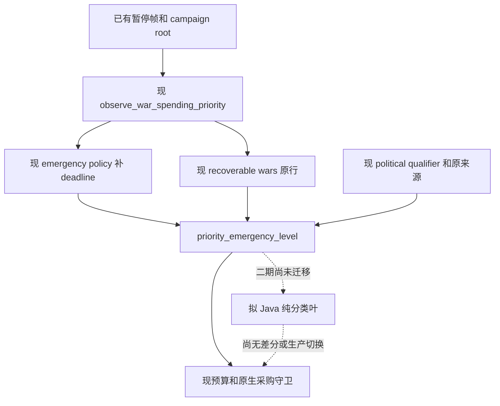

# Java 二期纯策略叶：首个迁移边界

建议先迁 `priority_emergency_level_v1`：只返回应急等级，有两个真实消费者可精确差分，不涉及金额、舍入、采购账本或原生调用。收益是收敛政策合同，**没有 CPU 热点证据，不能承诺秒/日改善**。未来应在已有规划请求内批量计算；每场战争新增 HTTP 可能更慢。

本页是只读施工边界，尚无 Java pure-policy 实现、JUnit、差分运行或生产切换。当前只有一期 map 的软件链通过：`D:/codex-ck3-demos/2026-10-22-java-phase1/logs/JAVA-PYTHON-MAP-INTEGRATION05.json` 于 `12:36:40.503583Z` 为 PASS；`client-n46-map-e90880ecb92241949213bef1c893d1d8.outcome.json` 于 `12:37:02.403415Z` 记录原 Java 字节已发布、Python fallback 为 false、Game RPC 为 0。这不授预算策略、FULL 或游戏推进资格。

`machine_id: xenoamess-full-tower-eb9d2c1186`；本次源审始于 `2026-10-22T12:38:46Z`，机器身份沿用 Root 的实际机器回执（入口见[迁移方向](python-java-incremental-migration-plan-2026-10-22.md)），不查询 Game、Steam、Driver 或 SAVE。数值域由 `/root/g2_m6` 独立源审交叉核对；本页未运行测试、Java 构建或外部写入。

源审固定输入：

| 源文件 | 本次实际 SHA-256 |
| --- | --- |
| [war_emergency_budget_v1.py](../ck3_autonomous_player/src/xar_autoplayer/war_emergency_budget_v1.py) | `e85888d3167c8069c78812a1fad644b9d9f7400e349b191453f3cc16714b8614` |
| [campaign_development_score_v1.py](../ck3_autonomous_player/src/xar_autoplayer/campaign_development_score_v1.py) | `ba4421fdc66048852e3c7a158a461e8fa2dad5d96c75904e4077e8797652dd4d` |

## 实际生产和消费链

普通 Service → `war_mercenary_consumer_v1.plan_war_mercenary_turn_v1` → `war_strategic_reserve_v1.assess_mercenary_reinforcement_v1`。后者先调用 `observe_war_spending_priority_v1` 生产当前战争行，再有两个分类调用点：

1. `observe_emergency_policy_v1` 为行补入当前 root 的主要直辖头衔资格，以及从真实敌方围城 `days_left >= 0` 过滤、取最小值的 deadline，再调用分类器。它另核 spending/frame/hostile union，等级大于零才进入应急候选。
2. `war_strategic_reserve_v1._recoverable_wars` 直接分类 priority 行，决定战分不高于 −100 的活跃战争能否保留在采购比较。此处通常尚无 deadline；不能拿第一处补出的字段倒填第二处。当前 priority producer 已在两条链之前生成 `major_direct_title_targeted`，不能按旧印象说第二处没有该字段。

政治观测 producer 和 `political_survival_stakes_qualified_v1` 仍由 Python 核来源/profile/CB/角色/帧；Java 只消费已合格结果及来源，不签新资格。其 observed_frame 不是一期 SavedFrame：原键 `played_character_id`，且无 native:id/safe 上限，不能用 `actor_character_id` 别名吞差异。军费/原生合法/可负担/单发/pending 后验留原消费者。

## 首叶输入、单位和缺失语义

建议新增版本化 facts 合同，保留字段存在状态及原来源，禁止直接让 Jackson bean 把缺失值变为 false/0。以下是实际 Python 字段，不是已经发布的 Java DTO：

| 实际输入 | 单位与当前行为 |
| --- | --- |
| `primary_player_war` | 只有 `is True` 合格；缺失/null/false 不合格。 |
| `player_side` | 当前原生域为 attacker/defender；原函数缺失/其他值不能凭主将资格入普通守方分支。 |
| `target_stakes_v1.current_root_available`、`primary_title_targeted`、`major_direct_title_targeted` | 严格 true；major = rootAvailable AND (primaryTarget OR majorDirectTarget)。不是败战已经转移头衔。 |
| `player_relative_war_score` | 玩家视角有符号战分，阈值为 −25/−50/−75；只有 `type(x) is int` 有效。bool/float/string 均使原叶返回 0。原叶本身无整数范围限制；真实 native normalizer 为 signed32，两者须分列。若保留 raw 兼容，用有符号 BigInteger，不能用 UInt64 codec。 |
| `observed_primary_opponent_objective_occupation_province_ids` | 只是是否有观察行；原代码 `bool(value)`，缺失/null/[] 为 false，非空列表为 true。不得把列表元素当已失去头衔。 |
| `observed_hostile_siege_in_player_subrealm_army_ids` | 同上；原生军队/成员及来源校验仍归原 producer。新的严格入口不应接受非空字符串充当 true。 |
| `raised_force_deficit` | 严格 true 才有缺口；null/缺失不能说兵力充足。兵数缺口不是胜率。 |
| `observed_risk_deadline_days` | 游戏日；缺失/null/非 exact-int 不构成 imminent；imminent = siege AND exact-int deadline≤7。**原叶允许负数满足此比较**，是前述 producer 保证≥0；Java leaf 不能暗加下界并声称与 raw Python 等价。 |
| `political_survival_stakes_v1` | 原 qualifier 合格，且 side=attacker 才为 political；原 proof/来源保留，不用任意 caller bool 代替资格。 |

拟 wire 的缺失、null、exact value 用 sealed 状态表示；集合至少区分 missing/null/empty/nonempty，并保留来源。算术叶可用归一布尔，但 presence 不能在 adapter 中消失。严格 wire 对 wrong token/未知字段/重复 key 的拒绝属于 `INVALID_CONTRACT`；它与旧宽松函数对错误 score 返回 0 是两类行为，差分报告必须分别列出，不能把新拒绝冒充同值通过。

输出只有 exact integer **0、1、2**，无金额、概率或胜负。设 O=occupation 非空、S=siege 非空、F=deficit、T=imminent；先要求 primary、有效 score，以及 (守方 major 或 political)：

1. score≤−75 且 `(O AND (F OR S)) OR (T AND F)` → 2。
2. 其余 political → 0；政治分支不开放等级 1。
3. score≤−50 且 `(F OR O OR S)`，或 score≤−25 且 `O AND S` → 1；否则 0。

0 表示本政策未授应急覆盖，包含输入不足；不是战争安全、停止观察或投降。服务不可用/超时/错误结果不得转为 0，也不得自动改用另一套实现重投；按明确启用阶段保留原 Python 路线或报告该次依赖失败。仅 shadow 时继续使用原结果，Java 结果只作比较。

## 哪些仍留在 Python

`emergency_quote_budget_v1` 不宜与首叶同迁。它还消费同帧 treasury、完整合同、当前最大军费、未付承诺、local/全局兵数、epoch 及历史 revision。金额为 Q100000 原生 gold，费用率为 Q100000 gold/month，months 是正整数；合同报价是一次全款，不能乘合同月数假造月费。加减乘、包额度和 reserve 中间值用 Python 任意精度整数，不能在 Java long 溢出后继续判断。将来应使用 BigInteger 计算，并只在原接口边界核实际范围。

同一 epoch 不因收入或换战重置上限；更高等级需新 native 帧；未知 pending 不再采购；未到账融资为 0。`valid_saved_emergency_revision_v1`、原采购账本和 `observe_emergency_recovery_v1` 仍消费原对象，等级 0..2 不包含后来预算层的 level 3。原 writer/锁/Native 与任何未来 reducer 提交不在此迁移内。

epoch 后备 hash 用 Python 默认 `json.dumps(..., sort_keys=True)`，含默认空格及 ensure_ascii；一期紧凑 UTF-8 canonical 不等字节，不能改变持久 epoch。package 若 missing 可默认 0，显式 null 却可算术报错；未来 NoPrior/Active/Unavailable 必须分开，不能全并零。负 treasury 合法，price/reserved/maintenance 各非负。

评分的实际入口是 `score_ck3_campaign.py.export`：SAVE reader `project_metrics` 先产当前/基线 metric，再调用 `build_report` → `state_intervals` → `aggregate_state`。普通月采样 `campaign_score_cadence_v1` 与 `campaign_score_existing_inputs_v1` 只提供原已取得输入，不提供完整评分；不为迁移重读实际 SAVE。`score_360` 是独立数学 API，本次查到生产 CLI 没有调用它，不能称 360 月历史已齐。

评分后续迁移必须冻结以下不同合同：

- metric 的 value 是显式十进制 string/int/Decimal，拒 float/bool/非 finite；unit 按 UNITS 精确相等。gold 可负，其余受现校验；control/rebel 为 fraction，continuation 为十进制 0/1，不能改 JSON bool。observed/known_absent 都仍需显式 value；当前 parser **没有**额外要求 known_absent 必为零，不得暗加规则。缺失/null 不补零、不改成 known_absent。
- Q/K 是品质县当量、P 是标准兵当量、收入/军费是 gold/month；未知为真实区间。固定六域权重不因缺输入重分配；360 个固定月槽不能缩短或均值补齐，终点身份仍由 caller 核。
- `state_intervals`/`quality_power`/`score_360` 用 precision40 HALF_EVEN；Interval.scale/add 等用 precision80，部分继承 ambient rounding；单独调用 R 还依赖 caller context。Java 不能统一一次末尾舍入。sqrt 与逐行累加顺序保留 regiment_id 的 **str 词典序**。
- BigDecimal 已知区间判断用 compareTo，不能用按 scale 区分的 equals。Python fmt 的 `-0.00→-0`、`1E+3→1E+3` 不能被 stripTrailingZeros/toPlainString 擅改；区间展示下界 FLOOR/上界 CEILING，exact 展示量化保留原 context。
- 报告 bounds/value 是 decimal string/null，weight 当前为 JSON number；不能复用一期 integer-only canonical emitter，也不能把整个报告数值全改字符串。报告、来源和中文解释先留在 Python。

## 已有 golden 与差分缺口

以下是现存 Python 预言机入口，**本次只读清单，没有重新运行，也不是 Java golden 已导出**：

| 现存测试 | 应保留的观察面 |
| --- | --- |
| `test_war_emergency_budget_v1.py::test_normal_budget_unchanged_and_high_loss_can_use_emergency_funds` | 普通与 level1、6 月 reserve；不授到场/胜率。 |
| 同文件 `test_emergency_does_not_bypass_missing_inputs_or_native_guards` | 无 major、仅坏战分、旧 root、未知 union、支出缺失、原生拒绝与不完整报价。 |
| 同文件 `test_minus100_stays_active_and_highest_loss_emergency_is_focused`、`test_major_direct_title_requires_native_tier_and_null_optional_siege_inputs_continue` | −100 活跃战争、level2、原生 tier 与 null deadline。 |
| 同文件 `test_real_registered_service_emergency_query_single_submit_and_unknown_no_retry` | 实际注册 Service 路由的合成回复闭环；迁移后两调用点皆须消费 Java 结果。 |
| `test_war_political_survival_stakes_v1.py::test_unqualified_political_inputs_preserve_ordinary_policy`、`test_registered_ordinary_mcp_keeps_political_guards` | CB/来源/角色/帧/连接负例、−74、无恶化、原生及 pending 守卫。 |
| `test_war_crisis_spend_down_v1.py` 的三项 upfront/same_epoch/new_native_frame 测试 | 首叶以外的 level3、承诺和现金锚不得回归。 |
| `test_campaign_development_score_v1.py` 的 missing_baseline、debt_rescue、gameover_denominator、repeating_decimals、interval_display 测试 | 缺失区间不重分权、51.725、563.04/535.98、360 分母、精确贡献及向外展示；属于后续评分迁移。 |

施工时从**两个真实 producer 调用点**冻结小 facts 和原输出，先比较 adapter 的 presence/单位/qualification，再比较整数等级及原下游选择。另补当前尚无独立叶 golden 表的 −24/−25、−49/−50、−74/−75、−99/−100、deadline 7/8/0/负数，以及 missing/null/[]、bool/float、普通进攻/非主将。合法域须全值等同；域外严格拒绝单列；不得以更新 golden 隐藏策略变化。保持 Python 原版为唯一业务结果直到 shadow 差分、持久 CI 和具体切换链均合格。
