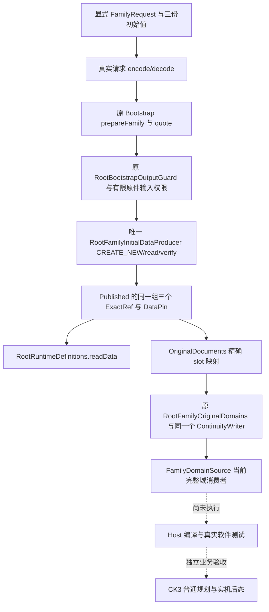

# Family 三份初始 DATA 与增量测试修复

`machine_id: xenoamess-full-tower-eb9d2c1186`。2026-10-26 北京时间恢复；本次候选写入时刻为 2026-10-25 UTC。本文记录源码候选和当前输入准备边界，未授 Java、SERVICE、CK3 或 G2 业务资格。

## 当前阻点和已交候选

Host 的同一 R5 mutable 源码位于 `D:/codex-ck3-demos/2026-10-25-java-g2-complete31-h5r5/java/ck3-control`。本岗只读该目录，Host 独占写入和 Maven/m2。

`FamilyNextEpisodeMigrationTest` 原件 16681 B，SHA-256 `db41f3c56eb60eb2439d4979846d8b0236900bff5171e96312b4df635b554f3c`，有 **10** 处不存在的单参数 `StrictJson.object(node)`。`compile_test19` 将其全部改为测试私有 `requireObject(JsonNode)`，先以 `instanceof ObjectNode` 检查，再返回受检对象；零参数构造器及原测试断言不变。生产 `StrictJson` 没有增加宽松 API，false、缺字段、null、空历史及恢复内容守卫不变。

候选目录：`D:/codex-ck3-background/ck3-java-g2-resume-r4-20261025/resume61/family_ordinary/compile_test19`。

| 文件 | 字节 | SHA-256 |
| --- | ---: | --- |
| `SOURCE-DELTA19.json` | 2088 | `2d5a48bc797f29deb79ee9f27245924ae05cf99ede2bc4c9031da0ee979088a7` |
| `FamilyNextEpisodeMigrationTest.java` | 16889 | `18d26a65acb7a2bb57cd2a09758741e7f36e308252edac762d6351e37b2f59ae` |

Host 已回复审阅差异通过并准备采用；实际编译结果以其新 invocation 为准。本岗未执行 Maven、JUnit、JVM 或 Game。

后续 Host 已实际采用 Family19，其 `MUTABLE-FAMILY19-APPLIED01.json` 为 1306 B，SHA-256 `f5e3612c2c6ac5bc6f51ad7bc545694fde00da18f080ee05ca43c1bed8a36a5b`。incremental16 的 application testCompile 又报告另一独立测试 `FamilySendObservationCodecTest:125` 将 long 转为 int 可能丢失精度；342 个测试源的诊断受 javac 100-error ceiling 限制，不能把未报到 Family19 当作全套测试通过。

新增 `compile_test29` 的窄修复只改这份测试的两行。真实 `ExpectedPostcondition(int version,...)` 的首参是 envelope schema version，生产构造器只接受共享 `POSTCONDITION_VERSION=1`；它不是 `ObservationIdentity.observationVersion`，后者为 long，且本夹具明确为 2。改用该共享常量，保留 observationVersion=2、原生完整 ID、zero pending、两种 profile 和全部 UNKNOWN/no-custody 负例。强转为 int 或 `toIntExact` 会编过后立刻因 version=2 被拒，故没有采用。

`resume61/family_ordinary/compile_test29/SOURCE-DELTA29.json` 为 3144 B，SHA-256 `948b6b2d015dfbc43765448189e1e0db2e008f21fba724a71f4c3eede0ee9ef5`；同目录保存实际前像 17920 B / `575237114dc8d80c68d0acd09dd9b627c54026315ebefa8fe2cc8e21d057a232` 和候选 17999 B / `be7d609bd5204f6703a3cf137e25b96d4cb68f81e7b92e3112c1a8a3794af639`。实际 diff 仅 shared constant static import 与首参替换，没有 main 源码变化。候选已交 Host；本岗仍未编译或运行测试，不混入未采用的 initial/natural 功能批次。

验收方随后请求核对已采用的 `FamilyNextEpisodeMigrationTest`、`FamilyCommandsIntentTest`。两份 current 源各有十个 `@Test`，没有额外测试 helper、资源、临时根或 Game 输入；前者 SHA 与 Family19 adopted 原件一致。只读检查时两份实际 `application/test-classes` 均不存在，三个关键 main class 则存在。精确来源、class 存在状态和检查时间见 `resume61/family_ordinary/test_readiness30/TEST-READINESS30.json`（5371 B，SHA-256 `f57c068a2619d5fd8b6a7ac667c7bed4a81ab8d0cf78b30acf8362e2caf4ea72`）。Host 需沿实际 application testCompile classpath 协调最小两叶编译后才能跑这二十个方法；文件存在检查本身没有授编译或 JUnit 通过。

Host incremental19 后又将三个 native-transport MAIN 叶的真实诊断单独交本岗：`FamilyCurrentRelationPublic:56` 使用已弃用的 `fields()`；`FamilyRelationCapture.QueryUnavailable` 缺 serial UID，且保留的 Optional/native outcome 引发 serial lint；`EpidemicTreatmentPresenceQueries` 六处调用不存在的 `StrictJson.bool(JsonNode)`。候选 `resume61/family_ordinary/compile_nt31/SOURCE-DELTA31.json` 为5975 B，SHA-256 `6f2b2ae6aef57077db0628ff184e6a3e93c0965d321838e33244b2105678efdf`，完整前像和三个 raw 同目录，已审实际 diff 后交 Host。

31仅沿现有 API 作窄修复：递归字段遍历改为当前 NativeWire 已使用的 `properties().forEach`；QueryUnavailable 加 UID，并只在原 outcome 字段标注 serial lint 例外，继续保留非 transient 的 final Optional 和原 accessor。该字段是失败时保全实际 ACK/原 command frame 的输入，不能为消警告而丢掉；其 export 仍沿原 archive codec。治疗读口新增文件私有 Boolean helper，先要求非 null 且 `isBoolean` 再取值，六处统一使用。`false` 仍是可用观测，missing/null/数字/字符串仍拒绝；不可用分支的显式 null 和 duration 未资格化守卫不变。没有改共享 StrictJson 或 application，没有混入未采用的初始/自然继承源码。

31三叶的当前 mutable SHA 已独立重读，全部匹配候选。Host incremental25 原日志 `D:/codex-ck3-demos/2026-10-22-java-phase1/logs/build-complete35-candidate31-h5r5-incremental25-compile.stdout.log` 为 104826 B，SHA-256 `c16476d80b356b4af171d64cda3eb0e241e2fbb68e5963bbc254888d4942ec57`；第718行 NT 模块 SUCCESS，第404行明确本轮只重编1个源，其余复用缓存。整体仍 local-service FAILURE，不能说整图通过。其现有受影响回归 `EpidemicTreatmentPresenceQueriesTest`、`FamilyRelationCaptureTest`、`FamilyRelationDifferentialTest` 尚未执行；其中现有差分/捕获测试需要原 Python parity 和相应 fixture 环境，不能拿仅编译或另写半套 mock 代替整组执行。Host 独占 mutable/Maven/m2；NativeFamily 另修的三个 NT 叶不在本候选中。

实际最小测试源依赖还包括 `FamilyCurrentRelationTest` 与 `FamilyRelationOriginalPins`，前者为 Capture/Differential 的真实同包 fixture helper，也应保留整类五个用例。四个 wholeclass 共17个 `@Test`（3+5+6+3），这是源码方法数，尚无该组执行结果。现存 OriginalPins 的17项原 bytes/SHA 加 CaptureTest 直接核验的原 capture producer，已只读检查18项全 MATCH；这不包括 Epidemic 动态导入的 unit/transport 及全部传递 import。后续原组需要 `xar.python`、`xar.repository.root`、真实 pytest，并在 Python import 前设 D 盘隔离 state/tmp 与禁 pycache 环境。五源 exact SHA 已直接交 G2Acceptance；它按实际前序小组终态安排，不复用旧执行卡或另建 runner，也不并入此前已通过的 Family20。

Host actual incremental30 在 local-service 的 `service/mcp/FamilySupplementPublicCodec.java:48-49` 报三处同样不存在的 `StrictJson.bool(JsonNode)`，日志629–637后触及100 errors。当前同一文件的 optional helper 还有第四处同 API，故 `compile_ls36` 统一窄换四处，并新增同文件 private helper：先严格要求非 null、`isBoolean` 再 `booleanValue`。`option` 的 `row.has` 短路保留，missing 仍默认 false，显式 null/数字/字符串拒绝，false 保留；ChildValue 的 verified/read_only/advertised 条件、selector 三态及公共64位表示均未改。

36唯一 map `resume61/family_ordinary/compile_ls36/SOURCE-DELTA36.json` 为 2284 B / `2e2fa179f7c7c23df0f14877700024c3e39715b57060bbe5cccda8c7b8104e96`，raw 13806 B / `e00655f0eab248f99bbc06f037f32c8ac70c0745a3c882fc0220852af0c4246b`，原像 13641 B / `061384211c1379d16faeb42229939cffd9e7ee9cd2197f11b154c7cd1544a3db` 已双读并留同目录。两处 diff hunk 已审，候选交 Host，未编未测；未混 Natural34/初始DATA。原整类回归为 `org.xar.ck3.control.service.root.FamilySupplementPublicCodecTest`，五个用例实际消费共享 codec 与 `RootFamilySupplementReadPublicProducts` 等 LS 工厂，不能只拿局部 formatter 测试代替该生产链。

Host 随后明确确认36已采用、actual31原 Boolean API 报错已清；这不授 LS 整体或上述五用例通过。actual31 的575–577行新增 `RootFamilySupplementReadPublicProducts.java:121` 无法访问包内私有 `InteractionArguments`。实读其 `ref(ObjectNode,ExactRef):100` 和公共 `ExactRef.toJson()`：两者写入相同 path/bytes/sha256 字段、值类型及顺序。37仅将该原 receipt 的序列化换为 `flat.set("subject_read",prior.originalReceipt().toJson())`，不公开私有 helper、不换空值、不改 prior 的 Subject.find/同 archive 资格、Root Origin/actor/episode/read-catalog/writer 守卫。

37 map `resume61/family_ordinary/compile_ls37/SOURCE-DELTA37.json` 为 2145 B / `fae72411e95307090e96e7c3158b14b57cb1140649d28afa6e638740ff551f34`，raw 11903 B / `497bb5e8f0e5cfb3d47dc27d68434cb91ec5a51df708a29da9903b367779717e`；双读原像 11926 B / `b81bb8f9a7e793783c6b740ac855437df5483adc05fa2f43c98df7cdf82b2443` 留同目录。唯一一行 diff 已审并交 Host，未编未测，不混初始或自然继承。生产闭环仍需当前 LS 与真实公开读入口的实际执行，原公开 codec 五例也未由源码审读取得 PASS。

随后实际读回 Host mutable 的该 target，已是11903 B / `497bb5e8f0e5cfb3d47dc27d68434cb91ec5a51df708a29da9903b367779717e`，即37源码修复已经采用，不再重投旧前像 patch。这个读回只更新 source 采用事实，未执行该公开消费者或五个回归，不授 LS 整体通过。

Family 两个原测试后续已由 G2Acceptance 在独立受管 scope 实际执行：严格 javac 两源 exit0、Job0；JUnit **20 found/started、13 successful、7 failed、0 skipped/aborted**，run child exit1、Job0。`FamilyCommandsIntentTest` 十个方法全部通过；`FamilyNextEpisodeMigrationTest` 三个通过、七个失败。正式原件为 `D:/ck3-state/ck3-java-g2-resume61-family-regression03/controls/ACTUAL-RESULT03.json`，5026 B，SHA-256 `c5919587217132a3c5737c60eefb159f46f45cc697e125f16fece257c68a7cd4`；已读该原件及完整 stdout。外部30目录/10202文件 after 内容和文件集 MATCH，只说明这批实际依赖读回未变，不授新的 whole-source 或 Game 资格。

六个失败发生在迁移测试 `request()` 构造共享 PlanningObservation 时：夹具只给了 episode/player，没有必填的 paused、map_ready、snapshot/revision/date 和 wars/armies。另一个浮点负例在 assertThrows 之外先调用严格 canonical encoder，encoder 按合同拒绝101.0，尚未进入待测 derive。`fixture_test32/SOURCE-DELTA32.json`（3849 B，SHA-256 `e4c0d9e6745c669ac2cbc063f80249bc7dbd7462e3e7c5f07c74226c676b4076`）只改该测试：按同一 synthetic before frame 补全既有必填字段，把原浮点负例作为 raw invalid JSON bytes 送入唯一 derive 的拒绝断言。候选17414 B，SHA-256 `c321454842befde2b88d1df73d4681d3d32993f16e9b9b4e843ffd48589547cf`；全部十个原方法、正反期望和生产校验不变，已通过的 Commands 测试与 main 均不改。

32候选已交 Host/G2/Capacity，待 exact 采用后使用同一独立 state/classes 缓存与原8MiB hold 的新有限 scope 重编两叶、重跑全部20。run03 RED 保留，不重开旧 closed 卡，不复制全图。32封件不等于复跑已经通过。

后续 G2Acceptance 已按新的有限 scope 实际完成32复验：compile04 严格编译两原测试源 exit0、Job0；run04 **20 found/started/successful、0 failed/skipped/aborted**，child exit0、Job0，input pre/post 和 runtime post 三项 MATCH。已读 run04 原 stdout 和 terminal；后者路径为 `D:/ck3-state/ck3-java-g2-resume61-family-regression03/g2_acceptance/run04/terminal.json`，59568 B，SHA-256 `38c484c0c358042f297d564f921a704cb62afa5bf68a47172221c99789cfada1`。外部30目录/10202文件的新鲜 before/after 也 MATCH，slot1 已归还；沿同一 state/classes 缓存和8MiB hold，没有 fresh snapshot/全图拷贝，run03 原13/7 RED继续保留。

这是 candidate32 的两份软件测试实际通过。正式 `controls/ACTUAL-RESULT04.json` 已读回，4989 B，SHA-256 `aba11c00d7fbfd25280db08158353c1c812e97e053e27a69806b489d23b35552`；其结项时 mutable 测试叶为 17414 B / `c321454842befde2b88d1df73d4681d3d32993f16e9b9b4e843ffd48589547cf`，本岗随后独立重读当前测试叶仍为该 SHA，确认已采用32。它没有运行未采用的 natural producer/caller、真实 RootPending/Core/Startup 场景、NT31 三组差分测试、完整 CI 或 CK3，不授这些范围通过。

## 三份 DATA 的真实生产和消费

`initial_data17` 已有唯一强类型 `FamilyInitialData.Documents`、三个 slot、严格初始值 codec 与 `RootFamilyInitialDataProducer`。`fresh()` 明确选择三个 `History.ABSENT`，是新局自动化历史输入；它不接受“读取已有文件失败所以填空”的替代语义。每份正文明确含 `pending:null`、`resolved:null`，`episode_history` 缺失和空数组保持不同。

RootAssembly 的 RA68 接线沿用已有有限三参数 CLI：

```text
org.xar.ck3.control.service.root.RootJavaBootstrapInputs
    <absolute-request-path> <canonical-positive-bytes> <lowercase-sha256>
```

首次发布使用精确 schema `xar.java-root-bootstrap-family-initial-request/v1`。`FamilyRequest` 的目标路径、机器、到期时间、模式、显式 documents 都来自请求；QUOTE 的 `bindingRef` 必须为 null，CREATE_NEW 必须使用真实有限 Guard binding。它不需要预先存在的三份 Family 原件，也不创建 Game、角色、episode、原生回执或另一套账本 writer。



上图实线是已定位的生产调用关系；本轮无这些调用的运行通过结论。此前 Family17 的 writer 测试直接用文件端口写初始正文，RA68 的独立测试调用真实 publisher 后读 Definitions。两段源码存在，但未把**同一次真实发布**所得 refs 一直送到 writer 和 Family consumer。

`initial_publish20` 接续这处测试缺口：仅更新 Family17 的 `RootFamilyInitialDataImportTest`，让原有三个测试的 fixture 调用真实 FamilyRequest serde → 原 Guard → 唯一 publisher，将同一组 refs 先交 `Definitions.readData`，再交 `OriginalDocuments`、原 writer importer 与 `FamilyDomainSource`。保留两个反例：选择 fresh 原件不能覆盖既有未决事务；选定原件变化时不能导入或重置账本头。测试 issuer 只沿用既有有限 Guard 夹具模型，不是生产发行器或实机资格。

候选目录：`D:/codex-ck3-background/ck3-java-g2-resume-r4-20261025/resume61/family_ordinary/initial_publish20`。

| 文件 | 字节 | SHA-256 |
| --- | ---: | --- |
| `SOURCE-DELTA20.json` | 3899 | `06267a440309930400320396833de663b8e92e65db6db51201cca4765f9ceb33` |
| `RootFamilyInitialDataImportTest.java` | 20550 | `401aa29611bb9167ecba5f4664dde8cd6922b4f953ec0c2032f22d756af6e1b8` |

Family20 保留 Family17 另外三个叶的精确原件，只接续第四个测试叶。RA68 原 map 硬绑定 Family17 的旧测试，需要 RootAssembly 明确接续；不能把同时选择两个不同 test SHA 的冲突当作已闭图。Host 在早期 incremental05 明确只纳已知编译修复，初始输入七叶留到局部图可编后的单独接线批次；后续增量运行次数不改变这份尚未采用候选的资格。

RootAssembly 后续已封正确接续 Family20 的 `resume61/root_assembly/family69/SOURCE-DELTA69-FAMILY.json`，6792 B，SHA-256 `8e1b6c9bc0cc1f9d101d45adc7aa187bc1b413b2ed44d0da48e425c9e9fdb3f6`，其 ImportTest 明确选 20550 B / `401aa296…e1b8`，不选 RA68 的旧17测试。共享 CLI/Contract 的当前唯一 winner 已另由 Event23/21 继任；RootAssembly 说明给 Host 的首发 flat 会跳过69中那两个旧共享 raw，只保留五个 Family 目标。这里关闭的是来源选择冲突；尚不能由 selector 存在推定 Host 已采用或 publisher/JUnit 已运行，也不能为接初始输入回退 current 编译修复。

后续本岗已实际读回 current mutable：上述五个 Family 目标分别与69中的独立 raw SHA 完全相同，包含 FamilyInitialData、其测试、RootFamilyInitialDataProducer、ImportTest20 和 BootstrapInputsTest。RootAssembly 也确认这与77G116实际采用一致；五叶已采用，不再重复覆盖。共享 CLI/Contract/Definitions 沿 RootAssembly 当前23/21/26 winner。本段仅更新 source 采用事实；local-service 编译、publisher/原测试、实际 Java QUOTE 和三份 DATA 发布仍须各自真实执行结果。

## 新 run 输入和验收边界

三份首场 DATA **尚未发布**。选定根为 `D:/ck3-state/ck3-java-g2-robert1066-resume61`。旧 flat `requests/family-initial-quote.json`，692 B / `05d5f0766ba2518591e838b1e1c06cefef76634975234ece12c3de6ea535432a`，因 Family Guard 恰三输出的闭根要求已停止使用。`ROOT-FIRSTLIVE-CONFIG03.json` 改用独立 `initial-data/family`；旧 grouped 请求713 B / `b0a283e7ca7aae10b8f29680b890e3811f541decaac2393f235e23531e5a7b8c` 也保留。旧来源和 finite3 参数见 `firstlive_quote23/QUOTE-REQUEST23.json`、`firstlive_quote25/GROUPED-QUOTE-REQUEST25.json`，均在本岗 resume61 根下，不复用历史 run 观察。

Readiness 的真实 Java quote07 已 RED：child exit1、Job0、三 MATCH、0.964s；缺 `Documents.child_matrilineal`。stderr 位于上述 run 根的 `bootstrap-execution/quote01/readiness/quote07/stderr.log`，3154 B / `1085a11bc2f83385fa9319e702084c0805b630615f6216ea0ba1e7c794b0d8e9`。源码核实 `ControlBuild.strictMapper` L479–484 全局 SNAKE_CASE，故不止 documents 两键，顶层六个 camel 键也必须改为蛇形；不加 alias，不改生产 Jar 或 Guard。

另建 [正确 raw 请求](D:/ck3-state/ck3-java-g2-robert1066-resume61/requests/family-initial-quote-grouped-snakecase.json)，724 B / `b8fe33abce6e20b5176bef9f364409b315513d606c50196de0aee1dcbf3fa8e9`。顶层六键和 documents 两键均为蛇形；grouped目标、三槽ABSENT、QUOTE/null binding/review08:00不变，旧713B未改。新 quote08 **实际严格 decode+QUOTE PASS**，exit0、Job0、三MATCH、0.9323542s；计划三输出81/94/82 B。原 `quote08/stdout.log` 841 B / `809af0a4c9e812db26a951df42a8e5ad7b22e0f58798e2178ec1d09d21cd634a`，`quote08/terminal.json` 40115 B / `335b3f8a008d165a403bd7d305a32853c6f4f99d16b7e1d1e634559d84c26714`，均与quote07同父目录且已实读匹配。Readiness已接入真实第六leaf DECLARE/CENSUS；仍未CREATE或发布DATA，须收到actual issuer binding后再封CREATE请求。

Host 后续运行 `FamilyInitialDataTest`、接续后的 `RootFamilyInitialDataImportTest` 与 RA 的 `RootFamilyBootstrapInputsTest`，并执行对应已有 bootstrap/Definitions CI 组。源码差异检查和精确 SHA 验证不能代替 Java 类型检查、这些测试或完整 CI。当前编译、JUnit、实际发布、原生动作和新增游戏日均未由本岗完成。

当前新财务卡为 `resume61/capacity/RESUME61-FINANCIAL101.json`，6348 B，SHA-256 `da11010a45af3d32d53d3111d90a8c630227b270cdd1789fee66632bf9169dfd`；各岗新源/元数据含原子写和收场峰值最多 2 MiB，财务及用途复核 **2026-10-26T08:00:00Z**。Family19/20 map 里较晚的普通来源 review 标签不延长此卡、不授业务启动窗口，实际新写入和重型 child 均受较早期限及 Root 调度约束。旧撤销卡保持历史，不续租，不删旧失败，不复制冻结资产。
