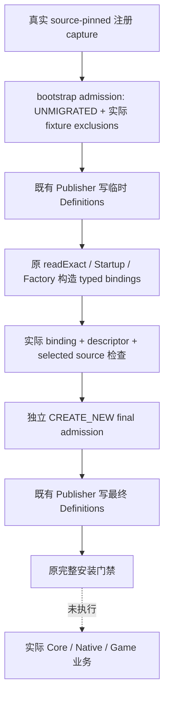

# 首场 MCP admission 的真实生产顺序

machine_id: `xenoamess-full-tower-eb9d2c1186`。2026-10-25 UTC 恢复任务期间的源码检查；来源为 R5 可复用源码与 SDK 对 Request02 原件的独立复核。本页说明源码边界，不授予当前编译、MCP 安装或 CK3 业务通过。

`RootOriginalMcpCapture.measure/capture` 已有真实 Java 入口，调用 source-pinned 原 MCP 注册，明确 **不查询 Game**。它写入 catalog、tools、resources、registration facts、inventory proof，并保留 actual receipt；前面三项对应 DATA11/13/14，actual receipt 对应 DATA15。它的 `javaAdmission` 明确为 `NOT_PRODUCED`。因此不能将 facts、inventory proof 或历史捕获结果改名当作 DATA12，也不能凭空新增“必须先有第一帧”的前置。

SDK 本轮重新读取并核对的原件为 `D:/codex-ck3-demos/2026-10-22-java-phase1/scratch/resume-current-20261024-r3/combat_contract/mcp_original01/MEASUREMENT-REQUEST02.json`，53413 B，SHA-256 `19af91b87007676d9a4d2eb85cfb3046732f81c4ba07586026e9da8128d04a41`。该原件的注册事实范围与 admission 缺失是历史事实，不是可复用的当前执行资格。SDK 的出处和进一步说明见[注册与 lobby 边界](2026-10-26-sdk-mcp-registration-and-lobby-frontier.md)。

本轮发现 R5 中 admission 的初始生产者缺失：codec 只解析已有 decisions，`McpExecutableDirectory` 只能将不成立的既有 ADMITTED 降为 UNMIGRATED。`RootRuntimeStartup` 又先从 admission 中取得真实配置的两条 fixture exclusions，随后才构造实际 typed handlers。把名册一律标为 ADMITTED 会隐藏缺口；为此增加的窄源码候选位于 `resume61/public_mcp/admission50/`，尚未编译或执行。

候选使用原 `xar.java-public-mcp-admission/v1` 单一合同，分两次排他发布，不新增 Game 动作权威、账本 writer 或运行器：

1. `RootPublicMcpAdmission.quoteBootstrap/bootstrap` 读取真实 capture 与其同一份 selected configuration。所有注册项均为 UNMIGRATED；只有原配置实际排除、原 tools 中确实不存在的两条 fixture 分支可以写 EXCLUDED_BY_CURRENT_CONFIGURATION，producer 绑定原配置文件。
2. 用既有 Definitions Publisher 和 assembler 发布临时 definitions。catalog/tools/resources 仍直接选择 capture 的物理原件；不能重编码后换路径，因为 retained capture 会校验同一份 FileRef。
3. 原 `RootRuntimeDefinitions.readExact` 构造真正的 pre-Core Startup/Factory。原本在 install 时构造的 typed 工厂适配器提前构造，调用仍通过 package-private 的延迟 session 访问，在实际调用时才取得原 ports 一次绑定的真实 Core。没有构造替代 Core，没有执行 handler，也没有启动 Game。
4. `quotePublicAdmission/publishPublicAdmission` 逐一检查同一 registry/direct 中已经构造的 typed bindings、原 descriptor 以及 selected 来源；只有这些实际证据可以产生 ADMITTED。缺少调用体或 descriptor 的条目继续为 UNMIGRATED；源枚举明确退休的 service 保留其源绑定退休语义。
5. final admission 使用独立 target 和真实输出 guard 的 CREATE_NEW；最终 definitions 只选择 final DATA12。临时 admission/definitions 保留为准备输入，永不取得 dispatch。最终安装仍消费原配置、原 typed registry 与原完整目录门禁。

quote 只报告真实重新推导内容的 bytes/SHA，不是文件或写权限。`bootstrap` 与 `qualify` 分别需要现有 Root issuer 为该单文件输出签发的新鲜 guard；旧 revoked 卡不能重用。临时文件与最终文件的占用都须计入同一工作包容量。软件测例中的 fixture refs 不得当作真实输入发布。

新增回归源覆盖 bootstrap 的两条真实配置排除、registered 普通工具保持 UNMIGRATED、实际 typed binding 到 admission codec 再到现有 executable-directory 消费者、缺 binding、源不在 selected 图内及 service/direct 冲突。另一个 actual-input test 复用现有 `RootDriverProductSourcesFactoryTest.actual()` 的严格全配置输入，真正进入 pre-Core 构造并重新推导 final bytes/SHA，再调用原完整迁移门禁；缺少实件明确失败，不跳过、不构造假 Core。测例会由现有 local-service Maven 测试收集，不新增旁路 runner。

截至此页写入，只有源码检查与 SDK 有限独立 review；JUnit、Java 静态检查、实际 provisional→final 出件、完整构造链、MCP 安装与 Game 均 **未运行**。实际 DATA11–15 首场 FileRefs 仍为 none，G2 仍不因此增加实机完成项。待 Host 完成当前增量编译修复后，再按实际诊断采用窄候选、运行受影响回归，并完成最终整体验收。
