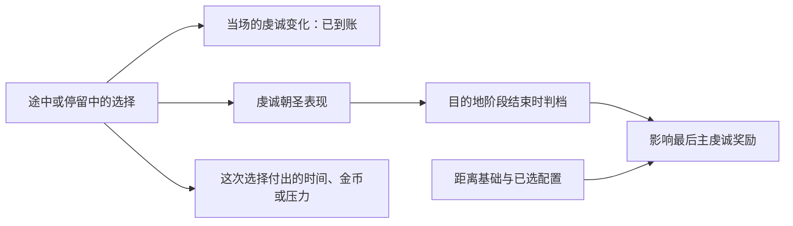

# 信仰引擎第二期导演稿V3：去一趟罗马

2026-10-21。**重写稿，仅供内容审阅；本轮不配音、不拍摄、不生成视频。** 29分钟初版和18分钟重剪均未解决主题与讲解问题，不再作为当前导演方案。

## 一、这一期到底讲什么

**工作片名：《去一趟罗马：一场普通朝圣的代价与回报》。**

**唯一主题：跟完一趟从阿普利亚出发、前往罗马、再回到阿普利亚的虔诚朝圣，讲清费用为什么会继续发生，宗教回报怎样随选择和阶段产生。**

观众看完应能说明：出发时买了什么；途中哪些额外开支来自自己的选择；为什么已经抵达还没有结束；不同宗教收益有什么用、何时取得；怎样把这趟行程的已知支出与起终变化对上。

不承诺用现有资料算出完整回报率、最优目的地或人人适用的最优选择。演示角色出发已持有20,000虔诚、奉献等级5，不能虚构成缺虔诚而急着出门的普通穷局。讲解的驱动力是读懂一趟行程，不是为这份演示存档编造奋斗目标。

上一版的导演错误：把朝圣、教首、类型和圣战分别当成“有新材料的内容”，没有让它们服务同一个问题；重剪时提前展示结果，又退回资格和规则，观众还没认清这趟行程就被迫换题。V3不沿用旧段顺序，不拿现有配音长度决定结构。

**正文全部移除：**教首建制、两种领袖、建制报价、大圣战、殉道／奇迹比较、圣物个人装备与供奉比较。圣地等级只在解释本次朝圣主虔诚奖励时作一句必要引用，不重教创建、升格和名额。配偶、婚约、NPC修道等支线只在影响当次主线账目时出现，不逐条报告全部事件。

片长随讲清所需内容确定。本稿先按约12—16分钟安排画面阅读与解释空间，这是作者预算，尚无配音实测，不以接近30分钟为目标。

## 二、讲述和画面的共同规则

全片保持同一条顺时序：**阿普利亚规划 → 出发 → 去程 → 罗马抵达与停留 → 结算 → 返程 → 阿普利亚对账。** 不用建制或别场结果穿插，不在开头放完账单后重播出发。

画面固定保留一条简洁行程线和一张随事件更新的账。行程线用“出发、抵达、结算、归返”四个节点；账目分“本次已列支出”和“整段时间钱包／宗教状态变化”。累计支出不能画成实时钱包余额，收入也不能被抹掉。

每个事件必须完成四件事才切走：交代处境，读懂实际选择，看到付出和所得，解释它对后续决定的影响。没有影响主线的事件直接略过。原版窗口承担解释主体，不能用满屏采集编号、接口名称、日志与长段免责声明代替画面。

现实宗教立场等必要说明用简短可读的片头文字保留；口播直接进入游戏。本次为机制演示存档应在开头自然交代。来源、版本、原生读数与证据编号放制作附录，旁白使用“选之前／选之后”“这笔钱”“这个阶段”等玩家语言。

## 三、完整顺序稿

以下引号内为连续旁白。镜头指令与制作备注不读入旁白。

### 第一场：从阿普利亚出发，先认清这70金币

**画面：**从本场阿普利亚位置开始，进入本场朝圣规划，罗马与“虔诚朝圣”清楚可见。显示报价70和现有243；此场尚不展示确认、扣费或人物上路。账目第一行保持“待确认：70”。上屏小字“机制演示存档；CK3 1.20.0.4”。

**旁白：**

“这次，我们从阿普利亚去罗马。

“朝圣窗口给出的这次出发报价是70金币。人物现在有243，付得起。

“接下来，我们一直跟到人物回到阿普利亚：路上为什么还会花钱，抵达罗马后会得到什么，最后怎样判断这趟行程的代价和回报。

“这里使用的是机制演示存档。人物出发前已经有两万虔诚、最高一档的奉献等级。我们用这趟实际行程看清规则，所有数字都放回它发生的时刻解释。”

**留给观众的答案：**先认清人物、目的地、当前报价与钱包。此时仍在规划，扣费只在下一场实际出发时出现一次。

### 第二场：出门前，先决定这一趟要怎样走

**画面：**承接上一场尚未确认的同一次规划，按“目的地 → 活动方式 → 路线”移动视线。只展示本场实际已确定的选项；忠诚、规模的两个未命名原生ID不擅自翻译。本场`p3-final-full10-quote-a01.png`旅行栏已有“总旅行时间：4个月”。此场末尾才唯一一次确认，展示243→173并记账70，随后人物上路，往后不再回放规划或确认。

**旁白：**

“先看我们安排了什么。这次的目的地是罗马，活动方式是虔诚朝圣。

“目的地决定你往哪里走，也参与决定结算时的基础回报。活动配置又会改变费用和奖励。看本场旅行栏，这里写着总旅行时间四个月，出发前的去程预计是52天；到罗马以后，朝圣本身还要安排目的地停留。旅行与停留都要留出时间。

“所以，出发前要连着看这三处：目的地、当前配置、路线。如果要比较两个地方，就用同一套配置分别看当前报价和路线。不能拿一个地方的活动费，配上另一个地方的旅行时间，再说哪条最划算。

“至于路上会发生什么，规划窗口无法替你预付每一个未来选择。除了付得起当前报价，还要想想出门以后手里剩多少。

“另一个需要提前知道的条件是：虔诚朝圣的最后回报，也会受途中表现影响。出发以后，每次停留和回应，都要看看它换来了什么。

“现在确认这套配置。金币从243变成173，70记入出发支出。人物正式上路。”

**制作边界：**此处解释比较方法，不宣布罗马最优。未取得本场路线全价、ETA或风险的具体读数，不用其他场次截图补成本场。不同配置的倍率留到实际奖励解释，不在此展开一遍百科。

### 第三场：去程已经开始改变收益，也改变人物状态

**画面：**行程线沿去程推进。第12天的实际事件先完整露出，再放大实际所选项；随后用小卡显示“此次选择：虔诚+50”。第56天城市事件展示实际语境与两个选项，选择后显示“压力0→75；本次金币变化0”。不得套用别场城市观光扣50金的素材。

**旁白：**

“出发后的第十二天，我们遇到一次与朝圣意图有关的事件。这次选择‘这是神的意志’，同一天虔诚增加了50。

“按这个选项的规则，它还会推进这趟朝圣的虔诚表现，同时带来十天绕行的安排。这是在用额外时间换眼前收益和后续结算的机会。

“这里的距离奖励，按出发地与目的地之间的距离来分档。绕路多走几天，不会自动把它抬到更高的距离档。所以要读的是这个选项给了什么，不能只看旅程变长就以为最后一定多赚。”

“这笔收益发生在路上。它有自己的选项和结果，不必等到罗马，也不能在最后的活动奖励里再加一遍。

“再往前，城市里的一件事把人物的注意力拉到了生命与死亡上。这次选择停下来思考，金币没有减少，压力却从0变成了75。

“这次没有花钱，却让后面能承受的压力变少了。接下来如果再出现会加压力的选项，就要带着这75点压力一起判断。”

**留给观众的答案：**途中即时虔诚与最终结算是两笔；旅途的代价还包括人物状态，免费按钮也要读后果。

### 第四场：抵达罗马以后，两次额外花钱各买了什么

**画面：**第64天抵达罗马，行程线停在“抵达”，随后展开目的地停留段。先展示抵达事件与本场压力75→64，再依次展示第65天徽章、第83天祝圣。徽章选择的“不买”项必须能读到；祝圣同时显示金币−15、虔诚+25、压力81→98。账目加入31.25和15两行。

**旁白：**

“第六十四天，人物抵达罗马，比出门前预计的52天更晚。中间经历了不止一个事件，我们不把全部差额塞给某一次绕行。这次抵达事件之后，压力从75降到64。

“抵达以后还有目的地停留。这次普通行程在这里安排了约三个月；去程、停留和返程要合在一起看，不能把三个月当成整趟时间。

“第二天，我们遇到了购买徽章的选择。窗口里也可以选择把钱留作别用。这一次买了，钱包减少31.25金币。

“这笔钱是在抵达之后、由这个选项产生的额外消费。窗口也允许不买，把31.25金币留作后用。你愿意为眼前这个购买选择再花多少钱，要带着后面的行程一起考虑。

“到第83天，这个祝圣选择出现时，人物压力已经是81。这次付出15金币，虔诚增加25，压力升到98。这个回应也会推进虔诚朝圣的表现。

“这里值得停一下：你看到的交易，同时涉及金币、虔诚和压力，还可能影响最后的表现档。窗口里的另一个祝圣回应，走的是世俗表现；这趟选的是虔诚朝圣，方向就有了区别。也可以把钱留作别用。

“如果当前最看重的是多拿这25点虔诚，15金币和新增的压力，就是眼前一起承担的代价。至于器物后续能带来多少好处，需要另外看清它的实际效果。

“到这里，账上已经列出出发70、徽章31.25、祝圣15三笔。后两笔都有具体的选择来源。把它们分开，你才知道下一次有哪些地方可以保留资金。”

**制作边界：**抵达处理朝圣者特质或经验的规则可作简短说明；本场未独立保留trait／XP前后值，不能说这次实际增加了多少经验，也不能用别场新特质提示代替。器物未核实的归属、稀有度和收益不能做成奖励弹出动画。

### 第五场：压力开始占用预算，虔诚也有自己的代价

**画面：**顺序保持第108天压力事件在前、第113天宗教体验在后。第108天三个实际选择都露出，让观众理解存在别的处理办法；放大本次斗篷选项和金币−105、压力115→97。账上新增“压力处置：105”，与朝圣直接消费分栏。五天后展示本次虔诚+100、压力97→165。

**旁白：**

“再看第108天。此时人物压力已经来到115，出现了一次压力处置事件。

“这个窗口还有借酒消愁和继续硬扛的处理方式。按事件规则，喝酒有酗酒的后续代价，硬扛则继续增加压力。选择之间要比较的东西已经不只是一笔金币。

“这一次选了买新斗篷，花去105金币，压力降到97。这里记录的是本次实际选择，不把它当成最省钱的答案。

“105金币已经超过出发时那笔70金币。它属于旅程期间的一次压力支线。出门时只留够活动报价，遇到这种局面，手里的余钱就会很紧。

“而且，花过钱以后也还要继续作选择。五天后，出现一次宗教体验。一个回应把这段经历当作悔改，另一个回应是暂时享受它。

“按规则，后者走世俗表现，并有减压处理；狂热者还要看额外的压力分支。前者则推进虔诚表现，也有处理秘密和部分不良应对特质的规则。这两条路，给人物的东西已经不同。

“这次选了悔改的回应。我们实际看到虔诚增加100，同时压力从97升到了165。这里能列入本场账的，就是这两个变化，未核实的特质变化不加进去。

“这次没有再直接扣一笔金币，付出的却是更高的压力。对一个只差少量虔诚就能办成事情的角色，这100点可能很有用；对一个已经承受不了更多压力的角色，同一选项就得重新衡量。

“这两件事连着看，才能读懂这趟行程。每个加虔诚的按钮，都要和当时的钱包、压力以及你准备拿虔诚做的事情一起考虑。我们不会把每次增加虔诚都说成白赚。”

**留给观众的答案：**同一趟朝圣中，金币与压力会相互挤占余裕；即时收益的价值随人物当前需求改变。未选项只作为本版本规则说明，画面明确标注，不剪成同一人物也经历过另一项。

### 第六场：主奖励在结算，宗教收益要分别看用途

**画面：**第143天已核实的同行者事件仅用短卡记录本次虔诚+100，不展开NPC人生。第154天进入实际结算。行程线指向“结算”，与“抵达”保持清楚距离。先展示此前已到账的50、25、100、100四笔即时虔诚，再展示结算前后24小时的+125观察区间；回顾按钮不再播放第二次+125动画。

**旁白：**

“之后的一次同行者事件，又让人物增加了100虔诚。把前面四个已经核实的即时变化列出来，是50、25、100和100，合计275。它们各自发生在选项之后。

“到了第154天，才走到这次活动的结算。从第64天抵达，到这里又经过90天。目的地的停留时间，在这条行程上清楚占着一段。

“主虔诚奖励先取距离对应的基础值，再处理当前配置、过程表现和相关加成。虔诚表现会分档，所用倍率从1.1到2.5。前面那些推进表现的选择，到这里才会影响最后这一笔；同一选项当场发的虔诚，则在当场已经拿到了。

“这就有两条回报：眼前到手的数，以及为最后表现档积累的进度。前者可以逐次记账，后者还要等结算时按最终档位处理。不能看到沿途涨了虔诚，就当成最后的主奖励已经全部发完。

“第一期讲过的普通、主要圣地差别，也只放回它实际影响的那笔结算里，不能把路上所有奖励统一再乘一次。

“看这次结算前后的余额：从20,551.13变成20,676.13，相差125。这两次读数隔了一天，125是这段时间的净增，不能全当成那一笔主奖励。我们看到这笔变化时，还没有点回顾按钮。”

**画面小字：**两次读数相隔1个游戏日，125为该时段净变化，不能全部归作单个奖励效果。旁白不展开采集方法。

**旁白续：**

“等回顾窗口出现，主奖励已经结算。再点回顾按钮，不会把同一笔主虔诚重复领一次。

“还要分清三种容易混在一起的东西。可花的虔诚，是后续行动能支付的资源；奉献进度决定人物的奉献等级；灵性满足则是眼下的宗教状态。

“这位演示人物出发时奉献等级已经是5，回来仍然是5。因此看到等级没变，不能说一路没有积累；同样，也不能把虔诚余额增长，直接说成又升了一档。

“灵性满足在这201天里从0变成35。对本场基督教人物，这是从‘悔悟之人’，跨过30的门槛，进入‘得赦之人’。该档规则包括压力损失修正增加10%，以及朝圣活动基础费的25%折扣参数。

“前面我们已经看到，压力会让人物付出真金白银。更强的减压效果，因此有具体用途；它提高的是减压效果，不能画成压力在此刻立即减少10点。基础费优惠也只覆盖对应费用项，路上买徽章和处理压力的钱仍要各自判断。

“这解释了为什么朝圣的回报不只有一笔能花的虔诚。不过，费用优惠要看以后再次规划时的实际报价；这趟已经付出的钱不会因此退回来。以后如果满足度跌破30，也就不再满足这个档位的条件。满足度0到35是整个行程的变化，不能全算到结算窗口的一个按钮上。”

**画面解释要求：**三种收益用三行、三个不同单位，随后只突出本场发生变化的部分。满足度档位与效果为版本绑定的机制说明，不能假装已经实测了下次折扣或人物全部属性净增。减压加成不能画成压力立即减少10点。活动主奖励的具体距离档、表现分和两个未命名配置尚未保留，不能做本局完整算式。过程表现使用下图解释双线，回指前文第12天和第83天的真实选择，不另插一轮机制百科：

图为奖励机制说明，不填本场未观察的表现分，不把当场275再并入主奖励重复计算。

### 第七场：把人带回阿普利亚，再把账收好

**画面：**结算后继续返程。第201天出现本场“回家真好”，随后独立人物位置显示阿普利亚，行程线到“归返”。停留最终两张并排小表，留出读完的时间：左表列已确认支出，右表列201天起终变化。落点是人物回到出发地，结束后不再接教首或类型预告。

**旁白：**

“活动结算之后，人还要走完返程。直到第201天，这次记录中的人物回到了阿普利亚。201天包含去程、停留、事件和返程。

“现在把账放在一起。

“出发70金币，徽章31.25，祝圣15，再加旅途期间那次105金币的压力处置，四笔已确认支出合计221.25金币。其中压力处置单独列出，不能说成每个朝圣者都要付的费用。这张表也只代表已经逐笔确认的支出。

“另一边，钱包从243变成约70.84。用起点减终点，只少了约172.16。两边的数字不同，是因为201天里钱包还受到收入和其他变化影响。不能把这172.16直接当成总旅费。

“宗教状态也一样分开收账：可花虔诚在这段时间净增约681.49，灵性满足0到35，奉献等级5到5。这些是整段时间的起终变化；已经逐笔看到的途中奖励和结算时段另外列着，不再重复相加。

“所以，下一次准备朝圣时，先把当下目标说清楚。急着要一笔可花虔诚，要看它在什么时候到账；希望改善宗教状态，要看满足度能进入哪一档。

“预算紧的时候，先分清哪些钱出发就要付，哪些钱取决于你愿不愿意另花。为可选消费花掉的金币，也就不能再拿来处理后面的压力。再加上这条路线占用的时间，才是你准备承担的这一趟行程。

“这趟罗马之行，就从70金币开始，一路走到了这里。出发价、途中选择和最后的回报，现在可以放在同一条行程上看了。”

**最终画面数据：**

| 已确认支出 | 金币 | 性质 |
|---|---:|---|
| 本次出发配置 | 70 | 本次确认与实扣 |
| 购买徽章选项 | 31.25 | 可选消费；物品后态未计收益 |
| 祝圣选项 | 15 | 可选消费；同次虔诚+25、压力+17 |
| 压力事件斗篷选项 | 105 | 旅程期间的普通压力支线 |
| 上述四笔合计 | 221.25 | 已列支出；不标“全旅费” |

| 201天起终观察 | 起点 | 归返 | 如何解释 |
|---|---:|---:|---|
| 钱包 | 243 | 70.8417 | 净减172.1583；混有期间收入等变化 |
| 可花虔诚 | 20,000 | 20,681.4875 | 全区间净增681.4875，不是纯活动主奖励 |
| 奉献累计 | 120,850 | 121,531.4875 | 全区间净变化，不能作为阶段单次发放值 |
| 有效奉献等级／上限 | 5／5 | 5／5 | 出发时已在本场有效上限 |
| 灵性满足 | 0 | 35 | 全区间净增35，不单独归因7000按钮 |

## 四、补证与素材安排

本稿可用来审阅主题、结构与连续讲解，不将“文稿写完”记成可立即开拍。新片制作前只处理影响上面具体镜头和句子的缺口：

1. **两项当前配置名称。** R22只保留两个default option的数字ID，现有原图没有展开中文标签。本稿不命名它们，也不代入本局精确奖励，现有资料足以支撑文稿承诺。只有后来决定增加逐项配置演示时，才补可读菜单并对应实际配置。
2. **朝圣者特质／经验。** 本稿未把未核实的经验计入已得回报。只有后来决定把它列为本趟数值收益时，才补同一可比较起点的前后证据；不能用来源定义代替本场实际所得，不为保住一个旧片段强行补拍。
3. **画面可读性。** 逐一落实上述七场的原版选项、扣费／压力／虔诚变化与归返位置。已有同场证据优先；只有确认缺失的具体镜头再安排取材。新取材明确其独立演示身份，不能伪装成R22没录到的一帧。

完整最优性价比对照、所有旅行支出归因、全部事件攻略和全部朝圣奖励百科均不作为本稿承诺。若将来要回答“罗马是否比另一目的地更划算”，另立同配置对照问题，不在本稿结尾临时加一张比较表。

## 五、事实依据与当前审阅边界

本轮在`machine_id: 4-8e1c2f1861`于2026-10-21 14:38 UTC起读取历史R22原件和版本绑定原版来源。R22是同机历史观察，不代表本轮启动、录制或运行环境资格；原`native_business_pass=false`保持。完整事件索引、具体定义与ACK不进入旁白。

- [R22全场事件索引](knowledge/r0022-all-event-source-index.json)：15事件、1通知的发生顺序、实际显示项与结果。
- [R22结尾与返程状态](knowledge/r0022-pilgrimage-ending-observed.json)：201游戏日、7000区间、当前位置与归返宗教终值。
- 起点原件：`capture-b35-p3-a01/live/4-8e1c2f1861--faith-engine--R0022/case-output/ordinary-pilgrimage-0002.actual-results.json`，46,434字节，SHA-256 `901308dd13394cc51ba7a93e3856f55caf0c4026ab5d71352e0b3263543945a3`；人物31254、PID21144、generation1、date53144328，与本场归返为同一人物／运行。起点灵性满足0、可花虔诚20000、奉献累计120850、等级5／5。
- 最终出发报价原件：同场`case-output/ordinary-pilgrimage-final-configured-full10-quote.json`，1,771字节，SHA-256 `50800865b275436d48d6e7436d9087f1240a698e34f3108b2693741583f543c6`；Stage5当前配置实际70金币，Start同日243→173。它覆盖当时已配置的出发支出，不覆盖未来事件。
- [普通朝圣来源研究](research-pilgrimage.md)、[7000奖励时点](knowledge/pilgrimage-7000-source-analysis.json)、[9001归返来源](knowledge/pilgrimage-9001-source-analysis.json)：按抵达、活动结算、归返区分，不重复计算奖励。
- 灵性满足机制：本机原版`common/spiritual_fulfillment/00_spiritual_fulfillment_types.txt:56–72`中Christian类型档位，SHA `0fcd8d191368560718b4950e3a2d2171125031d3fff7054f96f0f1d200ad31e1`；`common/script_values/pam_values.txt:2160–2171`的25%参数，由`common/script_values/50_pilgrimage_values.txt:373–384`用于活动基础费。`localization/simp_chinese/modifiers/pam_modifiers_l_simp_chinese.yml:5–6`给出“悔悟之人／得赦之人”。类型按Religion选择，本场原件为`catholic / christianity_religion`；这里陈述规则定义，不授R22全部人物净属性或未来报价实测，也不编造每月固定衰减值。

### 本稿实际审读中已修正的具体问题

- 旧材料把历史结算时点缺测扩成起点也未知：重新读R22起点原件，已能对齐0→35与奉献5→5；仍不把全区间变化当单次结算。
- “费用与回报”容易又变成四张清单：改为同一条行程、同一张更新中的账，按事件先后解释选择；实际第108天压力消费在第113天加压力事件之前，因果不倒置。
- 只讲加虔诚、没解释为何影响最后：补上即时虔诚与最终表现档的两条收益线，以及绕行时间不等于距离档升级。
- 第一稿仍在第一场展示扣费、第二场退回规划：独立审读发现后已修正为第一场只看报价，第二场末尾唯一一次确认出发；未用“顺时序”标签掩盖实际倒叙。
- 重点交易仍缺替代选择：补入祝圣的虔诚／世俗表现差别、斗篷／酒／硬扛的代价及第113天悔改／享受的不同方向；未选分支按规则呈现，不当本场实绩。
- 只报满足35没有用途：补上≥30跨档、减压修正和基础费优惠，费用范围及未来实测边界明确。
- 徽章未证、125跨日等限制曾挤占旁白：需要保留的细节放在镜头小字／制作备注，连续旁白优先讲观众所见的行动和结果。

自审重点是上述单一问题和逐场因果：删掉任一场，观众会失去哪一步理解；加入任一段，是否会迫使观众改答另一个问题。实际脚本、镜头、配音尚未生成，不再以接口、技术检查或段数核对代替内容判断。
