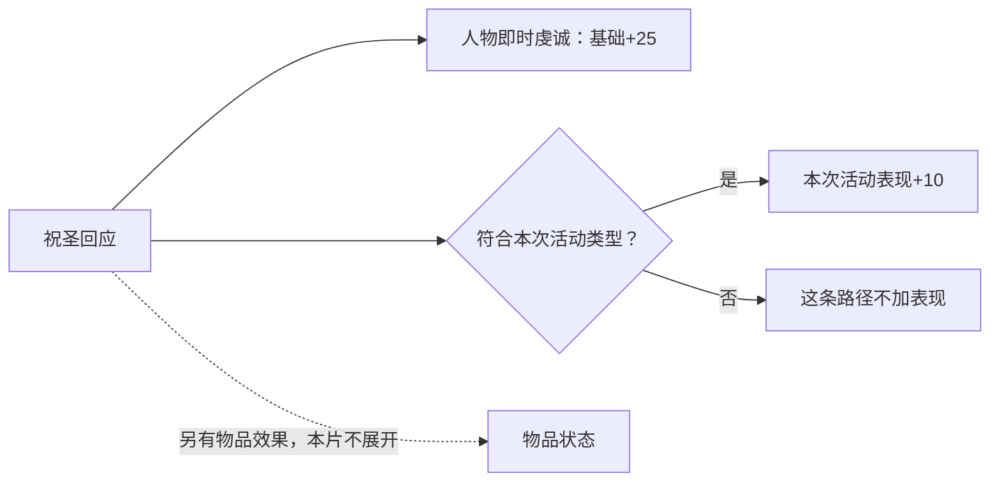

# 二期导演案 V4：朝圣在奖励什么？

**后继扩充：** 用户追加全部出发选项、宗教偏好／朝觐、全部朝圣者影响及三项公式后，当前版本为[V5完整导演案](director-v5-comprehensive-pilgrimage.md)。本文约18分钟为当时作者预算。V5展开动态金币下限后确认6840两项脚本请求均固定15，替代本文仅追到收费表达式时的保守表述；实际付款与钱包后态仍单独判断。

副题：**拆开一次“虔诚行为”的计分与兑现。**

状态：机制导演案，供审阅；未制作新视频。V3《去一趟罗马》已被用户否定，技术成片不代表教学完成。本文取代它作为二期的内容方向。

2026-10-22（北京时间）。本轮源码观察机器 `machine_id: 4-8e1c2f1861`；实际观察时间与文件身份见文末两份结构化机制链。研究限定 CK3 1.20.0.4，EXE 语义沿用对应精确版本专题，不外推其他补丁或其他机器的运行状态。

## 1. 全片要建立的观察视角

**朝圣把“获得了什么”和“怎样行动”分别记账，再在不同时间读取这些记录。**

一个选项当场给了虔诚，不足以说明它推进了本次朝圣的表现；表现更高，也不意味着灵性满足按同样比例增加。玩家看到的同一场活动，实际上把即时资源、活动评价和持续人物状态叠在了一起。

本片沿一个祝圣选择拆开这些连接，让观众能在看见“虔诚增加”时进一步判断：这个数写到了哪里，谁会在什么时候再次读取它。这里的价值是理解计算结构，以及结构怎样塑造宗教角色扮演。

不以罗贝尔的行程担任主线。去罗马、人物初始两万虔诚、第几天发生什么，均不承担章节推进。现有旅程只提供少量可以核对的观察镜头。

作者估时约18分钟，后续按连续讲稿和图解实际测定；本案尚无配音实测时长。

## 2. 贯穿全片的一个例子

使用祝圣事件 `pilgrimage.6840` 的两个回应。面向观众只显示中文选项和作用，事件 ID 留在制作来源表。

| 比较项 | 祝圣其神圣性 | 宣扬其威名 |
| --- | --- | --- |
| 即时虔诚的脚本基础值 | +25 | +25 |
| 金费 | 相同收费公式，封顶15 | 相同收费公式，封顶15 |
| 在虔诚型／Hajj活动中 | 本次活动表现 +10 | 不增加本次活动表现 |
| 在世俗型活动中 | 不增加本次活动表现 | 本次活动表现 +10 |

成立条件：活动已存在对应表现变量。两项调用的是带活动类型守卫的不同 helper；它们最终操作**同一个当前活动表现变量**，不是同时存着两条可以任意相加的“虔诚分”和“世俗分”。出发所选的活动类型与另一套人物意图也不能混为一谈。

这两项还各有物品修正等效果。本片用一条灰色旁支表示“另有物品效果”，不重新讲圣物装备、供奉或库存。本表隔离的只是即时虔诚、收费表达式和活动计分路径，不声称两项整体收益相等。

R22实际只选过第一项，实测15金币和25虔诚属于该次条件；第二项只作已核源码规则比较。不得制造“两次实机同条件试验”的印象，也不得把封顶15说成任何角色恒定收费15。

## 3. 论证与镜头

### 第一段：两个同样加25的选项，为什么评价不同？

**观众问题：** 既然两项都给虔诚，为什么本次朝圣只给其中一项记表现？

**开场主讲：**

> 这两个回应，都会让人物当场获得25点基础虔诚，收费方式也一样。如果只看这笔到账，它们很像。
>
> 但把人物放在一场虔诚型朝圣里，第一项会让本次活动的表现增加10，第二项不会。换成世俗型朝圣，匹配的方向又会反过来。
>
> 同一个按钮，既在给人物东西，也可能在评价这次行动。我们就从这里，把朝圣拆开。

钩子后接系列既定的游戏范围与1.20.0.4版本说明，完整口播沿一期审定文本，保留于正式连续稿。不能用单独的验收页或源码截图代替开场说明。

**画面：** 两个中文选项并置；先只亮共同的“+25／相同收费公式”，再各画一根通向活动表现的箭头。切换“虔诚型／世俗型”标签，匹配箭头随条件切换。不是让观众在完整UI上找不同。

**这一段必须留下的结论：** 即时得到虔诚，与按所选方式完成朝圣，属于不同的计算。

### 第二段：游戏先设定评价标准，再给行为记分

**观众问题：** 活动表现究竟记在哪里，它和人物的虔诚余额是什么关系？

**主讲：**

> 新朝圣开始时，这次活动会建立自己的表现记录，从0开始。它没有把人物的虔诚钱包清零。
>
> 之后，事件把选择送去检查：它是否符合这次所选的朝圣类型？在我们正在看的这个选项里，匹配会让表现加10。这是活动自己的分数，不是又发了10点可花虔诚；其他事件的步进也要看各自规则。
>
> 所以，选项文字同时也是一种行为分类。人物当场拿到什么，和活动怎样评价这个回应，可以不同。

**图解一：一个按钮的分叉。**



图中不画“虔诚+25 → 表现+25”，也不画“表现 → 灵性满足”这类没有来源支持的箭头。画面上的“基础”只在首次解释时说明：实际人物还可能有资源调整，后面用固定条件模型比较。

**观察视角的解释：** 可以将这套设计理解为一种“先选方向，再按方向评价行为”的角色扮演机制。这是本片对机制的解读，不冒称开发者已经公开说明其设计意图。

**转场：** 分数已经记下，但每多一分怎样影响最后的奖励？

### 第三段：表现分按档兑现，边际作用取决于离门槛多远

**观众问题：** 同样一次+10表现，为什么有时改变结算档，有时没有？

| 活动表现分 | 虔诚型／Hajj主虔诚表现倍率 |
| --- | --- |
| 低于25 | ×1.1 |
| 25至不足50 | ×1.25 |
| 50至不足75 | ×1.75 |
| 至少75 | ×2.5 |

**主讲：**

> 这里不是一分表现兑换一点虔诚。结算读的是区间：不到25、跨过25、跨过50、跨过75，分别进入不同档位。
>
> 因而，同样加10分，从55到65，仍在同一档；从65到75，就会跨过一个门槛。前一种变化仍然改变了活动记录，只是暂时没有改变这一步的结算倍率。
>
> 我们把刚才两个同样给25虔诚的回应放回来。现在才看得见：它们眼前相同的那笔收益，可以通向不同的最终结算。

**图解二：固定一次虔诚型活动，原表现65，比较同窗两项。** 假设后续没有再加分。本段只把行为接到档位；下一段再接外部条件和结算数字。

| 路径 | 当场基础虔诚 | 最终表现 | 主虔诚表现倍率 |
| --- | --- | --- | --- |
| 匹配虔诚型的回应 | +25 | 65→75 | ×2.5 |
| 世俗方向的回应 | +25 | 仍为65 | ×1.75 |

屏幕永久标“固定条件源码算例”，不使用实机钱包动画假装两条路径已经实测。两项的其他效果没有包含进这项比较；这不是对两项总价值的排序。

**画面：** 同一条表现刻度停在65，分成两路；一路走到75并跳档，一路留在65。镜头带着这两个档位进入下一段，不插入其他随机旅途事件。

### 第四段：奖励的计算顺序，决定每项加成真正影响什么

**观众问题：** 为什么不能把所有“加虔诚”效果当成一个总倍率？

沿用刚才两条路径，补上固定外部条件：短程基数100、标准虔敬程度、仪式排场加50、目的地为本信仰普通圣地，结算小计乘0.5；其他列入本式的加成均关闭，人物资源调整倍率为1。各输入先用一句话解释，再进入计算。

```text
距离基数100 → 表现倍率×1.75 → 175
                                ↓
                         排场定额+50 → 225
                                          ↓
                                  普通圣地×0.5 → 112.5
```

**主讲：**

> 这些修正进入计算的位置不同。表现倍率先作用于前面的基础值，排场的50之后才加进去；普通圣地的折半又读取它们合起来的小计。
>
> 因而，这里的排场50，在这一步最终贡献的是25；它没有先被前面的表现倍率放大。这不是记错数字，而是读取顺序不同。
>
> 看见一个奖励说明时，除了问它加多少，还要问它加在计算的哪一层。相同的数字，进入的位置不同，最后的作用就不同。

现在只替换表现倍率，让上一段两条路径真正兑现：

| 路径 | 主虔诚结算的脚本计算 |
| --- | --- |
| 匹配回应后75分 | `(100×2.5+50)×0.5 = 150` |
| 另一回应后仍65分 | `(100×1.75+50)×0.5 = 112.5` |

**同样的即时+25，模型中的主结算相差37.5。** 这是固定条件算例，不是R22/R31实际净收益；源模型与实机结果的标识继续保留。

**图解三：分层计算带。** 主画面只保留上述三步。家族、虔敬程度、资历、内心之旅、联盟等条件放在旁侧可展开的输入层，不把整段公式同时塞满画面。

完整脚本基数供导演与研究使用：

`S = (B距离 × D家族 × F虔敬程度 × T虔诚表现 + A资历 + A排场) × H内心之旅 × R普通圣地 × C联盟`

距离当前取首都领地与目的地的平方距离档，基础值100／150／250／350。增加旅行天数不自动改变这个地理档。这里只用它说明“哪些输入进入哪一层”，不展开目的地榜单或路线攻略。

**结算时机短镜头：** 目的地阶段结束时，先确定表现档，再触发回顾事件并执行奖励。回顾选项里的同一奖励调用用于提示展示；点击该按钮不会再执行一遍主虔诚奖励。不把这句话扩大为整个回顾事件没有任何其他效果。

**这一段必须留下的结论：** 一项修正的数值、作用范围和读取时机，必须放在一起理解。

### 第五段：一次宗教行为，会被几种不同长度的记忆保留下来

**观众问题：** 活动结束后，分数、钱包、奉献与灵性满足是不是同一个“虔诚程度”？

先沿刚才那笔主奖励，追踪它怎样进入人物；再将镜头从按钮上移到“活动完成”，看另一个独立结算入口。后面的灵性满足不能画成这个按钮直接产出的东西。四种记录始终服务于这张连接图，不分别开四门名词介绍。

| 记录 | 这条路径记什么 | 后续由什么读取 |
| --- | --- | --- |
| 本次活动表现 | 是否按本次所选类型行动 | 本次活动的表现判档；新活动另从0建立记录 |
| 可花虔诚 | 人物目前可支出的资源 | 行动的虔诚支付、收益与其他资源变化 |
| 奉献经验 | 与奉献等级相关的累计进度 | 奉献等级门槛；不能直接拿钱包余额替代 |
| 灵性满足 | 人物当前的宗教状态值 | 当前宗教类型对应的效果档与其他读取者 |

**主讲第一步：钱包与奉献为什么可能不同。**

> 普通增加虔诚，通常也会增加奉献经验。但这个转换会读取人物原有状态：钱包为负时，先补欠额，只有超出的部分增加奉献经验。
>
> 仍用刚才那笔150，只改变人物收款前的钱包：原有−100虔诚，先补足欠额，最后钱包到50，这次奉献经验也只增加50。它们不是两条永远同步的同义进度条。

用30秒小示意讲清即可，不重讲一期的全部奉献机制。该例来自同版本已闭合的引擎语义；不是新增实机试验，也不把规则外推到所有资源命令。

**主讲第二步：活动评价与灵性满足是平行通道。**

> 现在把镜头从这个按钮上移一层。活动完成时，还会启动另一笔结算：按当前礼仪条件，请求5或10的基础灵性满足。它没有读取刚才的表现分数。
>
> 所以，把表现做到最高档，不等于这条满足奖励也会按同一倍率增加。途中其他事件还可能改动人物状态；整趟前后差了多少，不能反过来当成这一个完成奖励的数值。

屏幕将“完成朝圣”分成两支：一支读取表现计算主虔诚，另一支按礼仪条件请求基础满足。**这两支不画成前后兑换关系。** 不再用R22的0→35充当单次结算的演示。

**主讲第三步：同一个状态，被不同系统按不同函数读取。**

> 灵性满足来到什么值，还要经过当前宗教类型的分档。对这里的基督教类型，跨30后得到减压效果修正和指定朝圣费优惠；跨65后，减压修正继续提高，但朝圣费优惠仍是同一档。
>
> 同一个指标同时影响几件事，不代表几件事会同步增强。判断它的作用，要继续追到具体的读取规则。

画面只展示两个读取者：30档减压修正+10%、65档+25%；这两个档的朝圣本体指定收费乘数都为0.75。用一条台阶升高、一条保持平台的图表示。95档的另一费用flag仅在注释中说明，不为此另起章节。

费用乘数进入的是指定收费项，小计之后仍有其他修正、定额减项和最低值；排场、部分距离收费和途中特别支出另走路径。不得画成整趟总旅费统一75折。减压修正影响后续符合条件的减压计算，不是在跨档时立即减10点，也不是每月固定减压。

本片不编造满足的固定月衰减或保档年限。持续效果依当前值和宗教类型判定；未知的自然演化速度不承担全片的任何论点，也不据此承诺永久状态或经济复利。

### 第六段：回到同一个按钮，给玩家一套新的观察法

**结尾主讲：**

> 现在再看最开始那两个回应。它们当场都给25虔诚，却可能在这次活动里留下不同的表现；表现经过门槛兑现成主奖励。人物的奉献和灵性满足，又各自按自己的条件继续计算。
>
> 这套机制同时记录了你拿到了什么、是否贯彻本次朝圣的方向，以及人物目前处于什么宗教状态。
>
> 下次看见一个宗教选项，可以沿三步追下去：它改了人物，还是给活动记了分？谁会在什么时候读取这条记录？这次变化有没有跨过某个真正改变效果的门槛？
>
> 沿着这些连接看，选项就不只是几行奖惩数字，而是几套系统在同一个行为上的交汇。

**最后一图：** 将前面逐步建立的箭头重新合在一起。图里每个节点已经解释过，不在结尾突然添加新名词。观众应能独立解释三个现象：同+25为何可能有不同主奖励；高表现为何不保证同倍率满足；状态变高为何不保证所有收益同步提高。

## 4. 画面与剪辑约束

- 主体是对照、分叉、台阶函数和分层计算；UI只负责给具体选项、类型与状态一个可辨认的落点。
- 全片不使用按第12／56／83／108天推进的章节，不用“然后我们又遇到……”连接机制。
- 同一算例的条件始终固定并常驻；改变一个变量时，只亮这一个变化。源码模型、历史实际读数、独立窗口演示分别标识。
- 不同时堆出完整公式、完整选项正文和四个状态表。每一镜只承担一条因果关系。
- R22、R31不剪成一条人物流水；现有两张独立窗口素材不承担未拍到的反事实结果。
- 原V3配音与逐日账目布局不作为本案默认输入。本轮只交导演案及自审，不启动配音、游戏或渲染。

## 5. 研究已闭合与仍缺的东西

| 项目 | 当前依据 | 对导演案的处理 |
| --- | --- | --- |
| 6840共同+25、同费、类型匹配+10 | 当前安装源与精确SHA已核 | 全片中心例，可讲；另一回应标源码比较 |
| 一个活动变量、初始化、匹配守卫、表现档 | 定义与调用者已核 | 可画因果链，不能画成两条累计表现条 |
| 主奖励的加乘顺序与阶段结算 | 定义、调用时机与回顾tooltip已核 | 可作固定条件算例；不冒称实际钱包净值 |
| 普通加虔诚与奉献的补债分支 | 同机同EXE离线语义专题 | 可作明确的条件模型，不补造实机 |
| 满足基础请求5／10、不读表现分 | 当前调用链已核 | 明确画成平行通道 |
| Christian30／65与费用具体读取处 | 当前定义、费用接线已核 | 可讲阈值和作用范围 |
| R22为何整段满足从0变35 | 没有逐次满足增量读回 | 不作为奖励公式证明，也不在本片追写成某一按钮效果 |
| 满足的被动演化速度 | 未闭合 | 不讲固定衰减率、保档年限或永久收益 |
| 同初始条件双选项的实际配对录像 | 尚无 | 当前以标明的源码模型完成论证；如后续制作选择补实机，另建合法对照，不能伪造历史 |

因此，**本案的中心机制不缺新的研究前提**。尚缺的是本案的连续讲稿、动态图和适量对应画面；配对实机是可以增加的验证素材，不是把当前源码模型改名为实测的理由。

## 6. 可复查来源

以下为本轮观察的机制链，保存读取时间、当前机器ID、文件SHA、行号、作用域与未知边界：

- [活动表现与主结算链](knowledge/pilgrimage-mechanism-reward-chain-12004.json)。关键位置：`pilgrimage_events.txt:14331–14492`、`00_pilgrimage_effects.txt:522–670,880–944,1225–1369`、`00_activity_effects.txt:4304–4384`、活动定义`pilgrimage.txt:2544–2579,2746–2748`。
- [灵性满足与后续效果链](knowledge/pilgrimage-mechanism-fulfillment-chain-12004.json)。关键位置：`00_pilgrimage_effects.txt:55–91,1136–1205`、`00_spiritual_fulfillment_types.txt:56–111`、`pam_values.txt:2160–2185`、`50_pilgrimage_values.txt:285–481`。
- [add_piety与奉献的引擎语义](../../../../docs/ck3-native-ai/holy-site-piety-experience-consumer12004.md)，特别是普通正值、负钱包与资源调整的边界。
- [安装源来源勘误](../../source-provenance-review-2026-10-17.md)：自定义风格的标识符不能单独证明本机改写；该调查原机器不同，本轮只按当前文件身份复核有限结论，不继承其安装事实。
- [本案自审](director-v4-mechanism-self-audit.md)。
