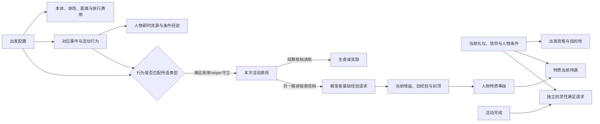

# 二期导演案 V5：朝圣在奖励什么？

副题：**从出发配置到朝圣者，拆开费用、行为评价与宗教回报。**

状态：已依据2026-10-22用户追加的四项要求形成可审阅正文、完整来源附录与内容自审。研究与导演文字交付，不启动新游戏、配音、拍摄或渲染。V4保留为此前的收窄方案；V3仍是教学未通过的历史审看片。精确未闭项见第五节，不将文档完成当作所有当前角色资格已实测。

本轮机器`machine_id: 4-8e1c2f1861`；身份实际核对`2026-10-21T19:36:36Z`。研究限定本片使用的CK3 1.20.0.4安装脚本，精确文件身份、实际观察时间及未知边界分别写入四份研究附录与结构化来源。源码定义不冒充新实机验证，也不继承其他机器的安装或运行状态。

## 1. 全片的中心认识

**宗教规则决定哪些行为算朝圣、怎样评价朝圣者；出发配置给不同计算提供输入；途中行为和结算再分别写入人物与活动。**

观众最后应能解释三件事：同样出门朝圣，为什么费用和收获不同；同样的“朝圣者”，为什么在不同宗教条件下价值不同；人物的朝圣者经验究竟怎样增加，以及哪些成长根本来自朝圣之外。

V4的“写在哪里、何时读取、是否跨门槛”保留为方法。新增四块进入主线，不用四段互不相干的知识补丁拼接：先解释宗教规则如何设置边界，再看出发界面如何向公式传参，然后计算支出与主奖励，最后解释这些行动如何留下长期人物状态。

## 2. 作者时间预算

| 段落 | 预算区间 | 这一段新解释的关系 |
| --- | --- | --- |
| 开场：同样+25，为何被不同计分 | 00:00—01:15 | 即时资源与活动评价分开记录 |
| 宗教先规定什么算朝圣 | 01:15—05:15 | 五档偏好、普通朝圣与朝觐的资格和收益条件 |
| 出发界面怎样给计算传参 | 05:15—12:15 | 类型、忠诚、排场、意图、目的地与旅行安排的独立作用 |
| 费用：各项钱加在哪里、怎样打折 | 12:15—17:15 | 本体、排场、距离、旅行与事件费各自的计算范围 |
| 虔诚：表现怎样按档兑现 | 17:15—22:15 | 距离基数、配置与表现档的有序加乘 |
| 朝圣者：全部成长来源与特质价值 | 22:15—29:45 | 特质获得、XP、等级效果、条件修正、失去与活动外入口 |
| 长期状态与收束 | 29:45—32:00 | 灵性满足的平行入口，回到整张因果图 |

**当前作者预算约32分钟**，不是配音测长或已生产时长。完整表格与罕见入口清单进入可暂停画面及研究附录；口播解释它们共享的规则，再讲改变结论的例外。不能靠把清单念得很快维持预算，也不能为了固定时长删掉用户要求的完整覆盖。连续稿写完后重新测算。

## 3. 贯穿的例子与画面方法

保留`pilgrimage.6840`的两个祝圣回应：两项基础虔诚都+25，收费表达式相同，但只有匹配本次活动类型的路径增加表现。其他物品效果画灰色旁支，比较不冒充两项整体价值相等。

解释逐层改变输入时始终保留一张“本次计算条件”小表。固定条件源码算例与历史实测分别标识；反事实分支用图解，不拼出并不存在的第二次同条件实机。界面承担对象识别，图解承担界面没说明的因果；研究编号、文件SHA与内部接口不进入旁白。

## 4. 分段主讲与导演处理

### 开场：一个按钮同时做了几件事

> 两个回应，都会给人物25点基础虔诚，收费方式也一样。但在这场虔诚朝圣里，只有其中一个会让活动表现增加10。换成世俗朝圣，匹配的方向会反过来；朝觐则仍走虔诚类的匹配。
>
> 游戏在分别记录你拿到了什么，以及你怎样完成这次朝圣。我们先从出发前的选择看起，再把费用、结算和人物成长接回这两个按钮。

镜头先呈现两个实际中文回应及共同数值，再画出不同的表现分支。钩子后保留系列的游戏范围、现实宗教立场说明与精确版本说明，沿一期已审定口吻展开，不使用内部验收语言。

### 第一章：宗教规则先设定边界

先在原版栏目中定位朝圣偏好，给出五档完整对照。依次解释资格、基础惩罚／奖励、活动费用与特质效果，避免将它们合并成一条“越鼓励奖励越多”的刻度。

> 同样是朝圣者，特质的作用还要回到人物当前的宗教条件里读取。宗教规则可以改变出发资格，也可以改变人物拿着同一个特质时得到的效果。

朝觐用一张与普通朝圣并列的关系图：可选条件→首次约束→麦加目的地→专用事件与特质→几层冷却。当地仪式单列其普通朝圣与本地决议两条路径，不能只按名字猜成“只能留在家里”。

| 偏好 | 对朝圣的具体影响 | 要看哪一层 |
| --- | --- | --- |
| 禁止 | 开始活动被拒；教义声明月虔诚获取+20%、对同宗教作战优势+5，朝圣者属于罪 | 当前人物Rite的禁止参数；已有特质也会被宗教规则评价 |
| 鼓励 | 允许普通朝圣，给基础朝圣者奖励参数；朝圣者属于美德 | 许可与特质待遇是两项规则 |
| 当地仪式 | 仍允许普通朝圣，活动本体费用在指定位置×1.75；另有本地祭祀决议 | 本体加价不扩成所有旅费；本地决议有自己的资格和奖励 |
| 强制 | −25%月虔诚获取、同信仰好感−5；朝圣者另有条件补偿；完成满足基础请求为10 | 这些月度／意见修正不等于出门当场扣25点；不直接给主虔诚式加一个倍率 |
| 朝觐 | 具有强制义务及Hajj规则；尚无朝觐者时，普通虔诚／世俗类型被锁，首次要走朝觐 | 当前Rite、是否已有Hajjaj、活动类型、目的地与冷却分别判断 |

“允许”是多个选项提供的许可参数，不是该组独立的第六项。不同宗教有默认模板，人物当前Rite可以另有选择；用宗教名称只能说明默认，不能替代当前教义。Faith决定实际圣地与保护路线等状态，人物Rite决定这里的大部分教义消费者；私人信条只在明确读取它的路径生效。

**朝觐对照镜头必须讲全：** Hajj是同一朝圣活动中的特殊类型，目的地限定麦加；当前Rite要求朝觐或符合“Islam且允许朝圣”的辅助条件才可选。尚未完成强制义务时，普通两型被锁；已有朝觐者以后另核合法性。自身记忆检查是1年，但通用目的地记忆还有5年同圣地限制，不能据1年常量承诺每年重复。非冒险者不能把自己的麦加首都当普通出发目的地；麦加本地统治者另有月度事件授予朝觐者的路径。

朝觐共享主虔诚与虔诚类表现档，另走戒衣、祈祷、奔走、泉水、献祭、剃发／剪发等专用事件与Hajjaj授予。只挑献祭作一个短对照：四档请求的即时虔诚为250／100／50／25，费用是不同动态金币档，不把所有可选奖励相加；剃发选项还读取性别教义。Hajjaj没有普通Pilgrim的经验轨道。

完整五档、宗教默认及覆盖、当地祭祀、麦加本地事件、全部朝觐条件与相关信条见[宗教与朝觐研究](research-v5-doctrines-hajj.md)。图中把资格、活动奖励、特质效果和纯AI偏好分列，不能拿AI权重解释玩家必得什么。

### 第二章：出发界面是一组不同的输入

逐栏展示完整配置，再把每栏接到它真正影响的计算。每栏先说明可选项与可用条件，接着解释它改费用、节奏、事件、表现还是人物回报。官方中文名称以当前安装本地化为准。

> 这些选项放在同一个出发界面里，但它们没有共同控制一个“朝圣质量”总数。我们把每一栏单独接出去，才能看清它买到了什么、改变了什么。

| 配置栏 | 完整活动定义 | 真实影响与限制 |
| --- | --- | --- |
| 类型 | 虔诚朝圣／世俗朝圣／朝觐 | 决定哪些回应推进本次活动表现、按哪类表现档发额外奖励；世俗仍有主虔诚奖励。朝觐另锁麦加与资格 |
| 忠诚 | 义不容辞／朝圣者／深思熟虑 | 主虔诚前段分别×0.5／1／1.25；义不容辞和深思熟虑分别加旅行速度修正+0.5／−0.5。特殊档受DLC及强制义务、急躁、耐心或既有特质等资格约束 |
| 排场 | 朴素／适度／讲究／盛况空前 | 改直接选项费、主虔诚定额、随行选择；朴素还给旅行安全−25。不是实际人数乘单价 |
| 人物意图 | 深思熟虑（反省）／行善／热忱；另覆盖共享“娱乐” | 决定条件事件、选项与对应事件／活动行为的奖励，不给所有收益统一乘一个“目的系数”。三项在朝圣host列表中显式定义；共享娱乐的效果已追，当前四项原生可选集合仍须补读，不能仅凭三项静态列表否定用户看到的四选一 |
| 目的地 | 当前信仰实际可选圣地；朝觐限定麦加 | 读取当前合法地点、同地冷却、首都与其他限制；费用和奖励各用自己的地理距离档，普通／主要关系还改变主奖励 |
| 旅行安排 | 路线／绕行、旅行主管、旅行选项、随行成员等 | 与活动配置分层；旅行选项全库29项、最多同时2项，资格、收费资源、地形安全／速度或人物效果逐项列于附录 |

这里“忠诚”沿当前简中栏目名，含义按具体投入档解释，不与奉献等级混用。忠诚栏与意图栏都可能显示“深思熟虑”，画面必须保留栏目位置，旁白分别说“忠诚档”和“反省意图”；同名不能混同。“义不容辞”的快速到达事件还有提前离开／后悔分支，不能只算一次速度加成就保证完整普通停留。

**随行必须画成两步。** 排场先用加权规则选择人物：适度／讲究／盛况空前的对应selector上限为5／10／20，候选权重含护卫、关系、神职与廷臣等条件，基本公共随行另有规则。出发事件还可能从当地抓取／创建同信仰朝圣者，按当前整队人数补到朴素7、适度5、讲究10、盛况空前20的目标；创建仅在相应玩家条件下执行，已有超过目标的人不会被这一步裁掉。它们都不是“另外再加N人”，也不保证任何角色出发后必有精确N人。主办者、公共随从、邀请宾客与临时旅伴保持区分。

排场主虔诚定额为朴素+50、适度+0、讲究+50、盛况空前+100；朴素若再满足当前Rite的内在之旅参数，另在后段×1.5。因此排场和忠诚改变的是不同位置，人物意图也另走自己的条件事件。用三根不同位置的箭头接入下一章，观众应能说明每项如何生效。

所有10项活动配置、意图定义与消费者、目的地守卫、29项旅行定义及随行入口见[完整出发选项研究](research-v5-setup-options.md)。后续原版画面逐栏展示当前实际可用项；隐藏／禁用项给条件说明，不剪成同一个人物能同时点完全部配置。

**四种目的逐项解释，不能只说“影响事件”。**

| 意图 | 具体作用 | 片中用来拆解的例子 |
| --- | --- | --- |
| 深思熟虑（反省） | 开启反省事件及目的地活动行为；默认意图不等于固定奖励 | 停下来沉思会延迟10天；无Pilgrim时给50虔诚，已有且未满时给10基础XP，满轨后另给100虔诚。虔诚／朝觐下另可能+10活动表现；性格还能改变压力。原有状态决定同一回应写入哪种奖励 |
| 行善 | 开启施舍、照料等选项，检查地点、身份及DLC；有些花动态金币换虔诚、地方效果或好感 | 海上共同事件的行善项可给随行者好感、合资格朝圣者+5基础XP及虔诚类表现+10；目的地照料旅行者、捐寺和济贫分别有自己的费用与所得，不统一固定给分 |
| 热忱 | 开启传教、招募、宗教交流及相关目的地行为；实际改信还要看目标和结果 | 一次传教动作先调用虔诚表现helper，再判外交／学识挑战。成功可能改目标Faith并给虔诚，失败可能损失虔诚；表现上升不能证明传教成功，也不是自动获得狂热人格 |
| 娱乐（共享候选） | 通用意图本身没有“选择即固定减压”；朝圣酒馆朋友事件权重可×2，仍有朋友、DLC、进度等守卫 | 邀请聊天会延迟30天并读世俗表现helper；社交者可减压，害羞或狂热者可加压；后续狂欢者特质等依事件另判。不能把娱乐等同稳拿朝圣者XP |

> 这里可以把游戏的评价方式看得更细：它有时在给一次符合方向的尝试记分，而尝试有没有成功，又是另一套结果。活动表现不是现实结果的同义词。

此句是本片对已核机制的解释，不冒称开发者公开设计意图。四项目的的条件、全部已索引消费者与共享娱乐的实际集合缺口分别保存在研究说明中。后继[候选原生链](research-v5-intent-candidates-12004.md)已确认：选择器按主办意图容器的顺序，先排除配置屏蔽项、再检查人物条件；按钮可选性另判。尚未证实的是更上游装载是否加入共享娱乐，以及当前人物的实际四项。因此后续拍摄先读回完整key／名称／可选性，不靠猜测重画第四个选项。

这一章结束时，观众应能把“虔诚／世俗”“带谁出门”“自己的目的”分别定位，而不是把几组选择当作同一个维度。

### 第三章：费用的关键在收费项与计算顺序

先画出活动本体、排场、目的地距离、旅行计划及途中事件五个盒子，再展开本体计算。公式里的每一个字母先在原版配置或人物条件中找到对象。

> 看见一项朝圣折扣，要追到它读取了哪笔钱。有的改变活动本体，有的另外进入排场或距离费；定额减项又和百分比修正处在不同位置。它们共同决定最后报价，但不能任意交换顺序。

先给出总式，再逐层展开：

```text
已展开的活动脚本费 = 活动本体 + 排场选项 + 目的地阶段费
完整规划付款 = 上项 + 已选旅行选项费 + 主管等独立实际报价
全程净支出 = 实际规划付款 + 实际事件／独立费用 − 实际退款／收入
```

国库／金币与游牧畜群等资源分别显示，不强行换算成一个金币总数。神权且有国库的活动收费路径走国库；旅行选项还有自己的资源判断。

设头衔tier为`t`、`T=max(t−1,1)`、时代系数`E=0.75／1／1.5／3`。本体原始基数按顺序计算：

```text
B = (30×T×部落折扣 + 王或帝额外50)×AI难度折扣
x = B×E
x -= 每个已具费用承诺修正对应的G_medium（四项独立检查）
x -= 有活动家族传承时的0.5×B
x *= 先段倍率组
x -= 有对应庄园参数时的0.2×B×E
x *= 后段倍率组
x = max(x,G_minor)
C_body = x×收入大臣caller倍率（适用时0.85）
```

先段倍率依次为：指定幻想朋友目的地0.5、宫廷旗标0.75、资助朝圣0.5、灵性满足指定档0.75或0.5、家族谦卑志向0.75、对应法令0.75。后段依次为：当地仪式1.75、合资格冒险／游牧人物及对应perk0.5、联盟0.9、指定反省修正0.8、指定礼仪领主折扣0.85、AI神王0.25。每项都要满足自己的守卫；完整条件、上下界与固定点执行顺序以[公式附录第2节](research-v5-cost-reward-xp-formulas.md#2-朝圣规划费用逐层相加不能全价一起打折)的逐步表为准。

`G_minor`与`G_medium`是动态值。以月收入`I`、国库下属收入因子`q`及动态金币时代上限`E_gold`表示：

```text
G_minor  = 向上整5(min(max(3×I×q,15),150×E_gold))
G_medium = 向上整5(min(max(6×I×q,50),300×E_gold))
```

`q`的0.25仅在有国库、有地且非最高领主的相应条件下适用，否则为1。这里读取收入，不能拿钱包余额代入。国库条件、无文化时代分支及AI难度细节在附录完整保留。

排场令`A=T+E−1`：朴素直接费`−10A`，适度0；讲究从`50A`、盛况空前从`100A`开始，活动家族传承“踏过圣路”分别减25／50，“旅行规划”再×0.8，资助修正再×0.5；后三项不擅自套到朴素。其余未满足项跳过。阶段距离费则为`G_medium×距离档系数×E`，之后只乘该阶段实际读取的折扣。

目的地收费距离的八档系数是0／0.2／0.4／0.6／0.8／1／1.2／1.5，阈值依次为22500、62500、422500、722500、1440000、2402500、9000000（平方地图距离）；使用首都省份到目的地，不能套用下一章奖励的距离阈值。

**计算镜头：** 公爵、人类、非部落、早期中世纪、月收入10、无折扣、适度排场，收费平方距离500000，选择低档“雇佣登山者”：本体60、排场0、距离36、旅行选项4，已展开合计100；若另需主管，保留独立报价`L`，不能默填0。再只改排场及其合法折扣条件，逐步展示“减原基数”和“现值打折”为什么不同。

旅行选项低／中／高档基础为`2T／5T／10T`，“准备充分”perk适用时×0.75；各项具体资源与游牧分支、完整12种付费项、其余17种无直接cost定义的选项及所有条件见附录。主管的脚本报价为`max(速度资质÷5,1)+max(安全资质÷5,1)`，只在该cost的root有领主且不是冒险者时进入，否则为0；但界面getter传入的root／scope尚未闭合，不能把未知对象的0写成免单，也不能当作每日旅费。原生主管价与补给producer的完整接线另列；补给不能直接当金币。这些项目使用独立报价入口，已知活动费式仍可完整复算。

这一章算清已知配置报价，旅途随机选择的未来总开支用单独一栏表示。历史70金币只保留其原场次条件，不代表所有人物的出发费或整趟总费用。

### 第四章：虔诚奖励如何兑现

沿V4的同+25例继续，解释同一个活动表现变量怎样受类型守卫更新，抵达时怎样加入距离补分，最后怎样判档。所有已进入计算的输入在上屏条件表中保持可见。

> 从55到65和从65到75，虽然都多了10分，跨过的门槛却不同。游戏先把表现归档，再把这个档位读进主奖励。

沿用固定条件模型：基础100、标准忠诚、讲究排场定额50、本信仰普通圣地系数0.5，其余相关加成关闭。比较`(100×2.5+50)×0.5=150`与`(100×1.75+50)×0.5=112.5`。条件须与研究定义一致，不能由口播另改一项而画面沿旧式计算。

完整主虔诚脚本式为：

```text
P = (R距离×D家族×F忠诚×Q表现 + A资历 + A排场)×J内在之旅×H圣地×C联盟
```

| 输入 | 完整数值及条件 |
| --- | --- |
| R距离 | 首都领地至目标圣地平方距离≤100000：100；至1000000：150；至5000000：250；再远350。活动开始保存距离档，不按旅途总天数累加 |
| D家族 | 对应博学传承第四项时1.3，否则1；与费用／XP的活动传承是两项不同来源 |
| F忠诚 | 义不容辞0.5、朝圣者1、深思熟虑1.25 |
| Q虔诚／朝觐 | 表现<25：1.1；25至不足50：1.25；50至不足75：1.75；至少75：2.5 |
| Q世俗 | 主虔诚此项为1；世俗表现另有文化接受度／修正奖励，不等于完全不赚虔诚 |
| A资历 | 确有`should_get_trait_piety`旗标时50，否则0；不能凭“已有特质”自己补旗标 |
| A排场 | 朴素／讲究50、适度0、盛况空前100 |
| J内在之旅 | 当前Rite相应参数且朴素排场时1.5，否则1；私人同名信条不自动满足 |
| H圣地 | 目标是本人信仰的普通非主要圣地时0.5，否则1 |
| C联盟 | 当前联盟具相应凝聚力参数时1.1，否则1 |

抵达时短程另给活动表现+5、中程+3；事件匹配类型的普通helper给+10、very helper给+40。它们更新同一个活动表现变量，不是可花虔诚，也不是人物特质经验。目的地阶段结束先确定表现档并执行主奖励，回顾按钮只展示该次奖励提示，不再支付一次。

主式之外另发的奖励不强塞回一个总倍率：合资格圣山地形另请求100虔诚，神贫誓愿主办者符合防重守卫另请求150，其他信条给十年修正、神秘主义机会或独立状态。原生正虔诚资源调整、逐次到账与负钱包补债另见附录；主式不等于整趟钱包净差。

**承接下一章：** 同一个65→75的比较还会把虔诚类结算的朝圣者基础经验请求从20变40，条件是人物已持有Pilgrim且当前XP<100。距离倍率、排场加项和虔诚金额不会再等比例乘这笔特质XP。用同一个例子将“主奖励”和“人物成长”画成两条读取表现档的支路。

### 第五章：朝圣者是一种怎样成长、怎样被读取的状态

先给特质获得与XP两条路径，再展示经验档位和等级效果。随后给出完整影响清单，分为获得／失去、直接XP、XP倍率、等级效果，以及只改变AI选择或事件机会的间接因素。清单里的每一项都能沿附录追到具体来源。

> “成为朝圣者”“增加朝圣者经验”和“同一个等级现在有什么用”，是三个不同的问题。它们分别由获得条件、成长入口和当前宗教／文化条件决定。

用活动外授予来源解释人物状态为何不能简单反推成“完成了几次朝圣”。信条、礼仪、个人性格、家族传承、生活方式、地产或特殊事件分别接到对应箭头，不为了呼应用户举例就编造直接倍率。

**先解释成长与档位。** 普通Pilgrim的名称按50／100经验分档；Hajjaj没有这条轨道，二者也没有自动互换的脚本。直接首次添加特质时，新轨道初始化为0；随后事件、模板或完成奖励可以另外写入经验。重复添加已持有的特质不会重置已有经验，不能凭一次`add_trait`自己再加20XP。已有者的到达奖励要进入具体分支；虔诚类结算另外按低／中／高／完美表现请求5／10／20／40。世俗表现没有这笔虔诚类经验奖励；朝觐人物若另外有Pilgrim，才可能通过共享XP的持有条件。

经验的原生计算现已按同版本EXE追到。令本次脚本基础请求为`b`、原经验为`X`：

```text
b>0：M = 1 + 当前pilgrim_xp_gain_mult + 当前trait_track_pilgrim_xp_gain_mult
b<0：M = 1 + 对应的两项xp_loss_mult
delta_raw = 向零截断(b_raw × M_raw / 100000)
X'_raw = min(10000000, max(0, X_raw + delta_raw))
实际经验增量 = (X'_raw − X_raw) / 100000
```

`raw`标度为100000；零请求不增加经验。两类属性是相加后乘，不分别乘1.5再乘1.2；结果先截断、加旧经验、再夹到0至100，随后更新等级与派生缓存。对每次事件写入逐次计算，不能把整趟所有可能请求不分顺序加成必得总数。完整原生出处见[经验执行链](research-v5-native-trait-xp.md)。

**仍沿同一算例加一个条件。** 假设结算前经验80，已有“踏过圣路”的+50%增益、没有其他增益：高表现请求20会调整为30，完美请求40调整为60；两条最终都到100，实际都只增加20。主虔诚仍可以相差37.5。相同选择对两种奖励的边际作用不同，原因可以直接在两条公式里看见。

**全部影响来源用以下总图承接逐项库存。**

| 影响方向 | 本版完整清点与片中解释 |
| --- | --- |
| 直接授予与移除 | 27处字面授予、1处字面删除，另列生成／历史／动态模板及泛型罪德处理；讲普通到达、随行者、朝觐、麦加本地身份补发、传奇圣所、营地宴会及特定NPC入口；指出实际接收者 |
| 直接XP | 43个字面写入块另加已验证的参数化模板绑定；逐项表保留资格、分支、基础值、随机范围。朝圣事件、意图事件、圣人墓／大教堂POI、营地宴会、传奇建筑、学识合约、大项目、角色生成及debug分开标识 |
| 经验增益 | 全部六条赋值，来自三类生产者：活动传承“踏过圣路”+50%；“复越高山”+20%但只在神权条件下；教会住所对应建筑四级定义各+5%，不能把四个升级定义直接当同时+20% |
| 活动配置与距离 | 类型匹配和到达补分可通过表现档改变结算XP；距离虔诚倍率、忠诚、排场定额、普通圣地折半与内在之旅倍率不直接乘这笔XP |
| 信条／教义／礼仪／文化 | 五档偏好、使徒相关信条的美德评价、保护朝圣路线分支、武僧文化参数等分别改资格、请求或特质待遇；只有同名私人信条时，必须看实际私人消费者 |
| 性格／学识／身份 | 狂热、睚眦必报、非愤世嫉俗、学识门槛、神秘主义／药师／医师／巫师、travel_smart等具体条件决定选项与互斥分支；主办／参加／随行／NPC的收款对象不同；纯AI偏好另列 |
| 等级与下游读取 | 50／100是名称等级；另有79个XP条件读取块，包含传说、曼荼罗、合约等。读取经验不是增加经验。各等级的无条件、礼仪与文化修正逐块列出，不凭源码注释拼人物总属性 |
| 失去与持续性 | 跨Religion改信有删除Pilgrim的具体入口，同Religion内换Faith不满足这条删除条件；另有按当前宗教罪恶与fame类别处理的悔改／泛型特质路径，不能把1处字面删除说成所有删除情况。本轮没有找到自动Pilgrim↔Hajjaj替换或Pilgrim月度经验衰减定义 |

这份“全部”限定为当前版本安装脚本及已验证动态绑定：完整扫描4270个定义文本、5182条宽检命中，逐项保留来源。不是只列几个常见例子。43个XP块、27处授予、倍率与条件读取的逐项表见[完整特质库存](research-v5-pilgrim-trait-inventory.md)，主片用可暂停的完整分组表配合讲解，不假装每个事件都会在一次朝圣发生。

**个人性格要用真实分支示范。** 狂热可以解锁某些经验选项，也可在经验奖励不能进入时改为减压；学识生活方式有时先接走奖励，人物拿到的是生活方式经验；这些都不等于统一给Pilgrim乘“狂热系数”或“学识系数”。教义则可以改变同一特质的收益条件。标签、成长速度与当前待遇分别解释，观众就能理解为什么不能拿朝圣者等级反推旅程次数。

**等级待遇再算一遍。** 本轮后继精确执行链已确认：源码等级块各自加载、没有预先减去低档数值，运行时累计基础块与所有已达阈值块，再按当前Rite／文化参数读条件修正。只抄最高档会漏算已有贡献。

| 普通Pilgrim经验档 | basic参数贡献 | mandatory参数额外贡献 | 当前普通强制教义的−25% | 仅这几项的月虔诚倍率修正合计 |
| --- | --- | --- | --- | --- |
| 不足50 | +5% | +35% | −25% | +15% |
| 至少50、不足100 | +15% | +75% | −25% | +65% |
| 100 | +25% | +115% | −25% | +115% |

普通强制教义同时启用basic与mandatory，所以这里两列都参加。鼓励／当地仪式若只有basic参数，特质这一列就是+5%／+15%／+25%；朝觐教义启用的是mandatory_hajj，不能给Pilgrim硬套mandatory_pilgrimage一列。Hajjaj自己的条件修正另外计算。

这张表算的是**指定来源的倍率分量**，不是人物完整月虔诚收入，也没有把美德／罪恶、其他特质、建筑或全部好感一起打包。文化武僧条件、意见、学识等同样按对应字段累计；完整原值、条件与后继原生闭链见[等级与初始化研究](research-v5-native-tier-12004.a02.md)。

> 因此，人物的特质和经验可以没有变化，当前礼仪对这个标签的待遇却已经改变。理解朝圣者，既要看他怎样得到这个标签，也要看现在由哪套规则来读取它。

**版本问题必须保留：** 普通抵达helper的主持人与非主持人分支存在无`limit`的外层`else_if`，主持人内部另有XP<100的空分支。不能按注释讲成“每次重访固定+20”。正文展示精确条件树与通常解析下的推导，缺条件默认语义若未获对应引擎证据，继续标为待确认；不会自动修脚本、补奖励或用这项不确定值计算必得总经验。

### 结尾：把计算接回人物

保留钱包与奉献补债的短例：仍固定原生虔诚调整倍率为1，这笔主奖励经资源调整后的实际正增量为150，收款前钱包−100时，人物钱包到50，奉献经验增加50。说明此处读取原钱包状态，不重讲一期的整套奉献。

再把镜头上移到活动完成：灵性满足按独立礼仪条件请求基础5或10，不读取表现倍率；途中其他变化另计。Christian30／65的减压档会提高，指定费用flag在这两档却相同。高分、到账、特质成长与持续宗教状态各有读取者。

> 回到最初那两个选项。现在我们可以从宗教规则和出发配置，一直追到活动怎样计分、奖励怎样兑现，以及人物怎样继续成长。
>
> 读一个机制时，沿三步继续看：这次改变写在哪里，谁会在什么时候读取，它有没有跨过真正改变效果的门槛。

最后合并前面已经建立的因果图，不在结尾引入新系统。不把本片扩成圣物管理、领袖建制或伟大圣战专题。



这张合图按章节逐步建立，不在开场一次塞满。独立事件也可以直接写特质经验；图中的事件支路与结算支路不互相替代。灵性满足保持独立完成入口，不画表现分通向满足的箭头。

## 5. 全量研究附录与制作边界

| 用户要求 | 完整正文 | 机器可读来源 |
| --- | --- | --- |
| 全部出发配置及具体影响 | [配置、意图与旅行选项](research-v5-setup-options.md) | [配置JSON](knowledge/pilgrimage-v5-setup-options-12004.json)：10项活动配置、3项显式意图及共享娱乐、29项旅行定义、随行两步消费者 |
| 不同宗教偏好与特殊朝觐 | [宗教、礼仪、信条与Hajj](research-v5-doctrines-hajj.md) | [宗教JSON](knowledge/pilgrimage-v5-doctrines-hajj-12004.json)：五档教义、Religion默认与Rite覆盖、实际许可／奖励／冷却调用链 |
| 所有朝圣者特质影响来源 | [全量写入与读取库存](research-v5-pilgrim-trait-inventory.md) | [特质JSON](knowledge/pilgrimage-v5-pilgrim-trait-inventory-12004.json)：4270定义文本、直接及动态授予／删除、43字面XP块、倍率、79经验读取块及活动分输入 |
| 费用、虔诚、朝圣者经验公式 | [完整有序公式与例子](research-v5-cost-reward-xp-formulas.md) | [公式JSON](knowledge/pilgrimage-v5-cost-reward-xp-formulas-12004.json)：全部已识别收费项与条件、两套距离档、主奖励与额外奖励、XP请求与原生式 |
| XP原生数值语义 | [精确EXE静态执行链](research-v5-native-trait-xp.md) | [原生JSON](knowledge/pilgrimage-v5-native-trait-xp-12004.json)：gain／loss双属性、固定点截断、0至100封顶与写入更新次序 |
| 等级聚合与直接初始化 | [后继等级执行链](research-v5-native-tier-12004.a02.md) | [等级JSON](knowledge/pilgrimage-v5-native-tier-12004.a02.json)：逐级独立加载、postload验证、运行时累计；首次轨道零值与重复授予不重置 |
| 意图候选与按钮可选性 | [候选过滤与顺序的原生链](research-v5-intent-candidates-12004.md) | [意图原生JSON](knowledge/pilgrimage-v5-intent-candidates-12004.json)：候选过滤与保序追加已闭，上游共享项加入与当前人物实际集合另列未知 |

**覆盖口径：** “全部”是当前安装版本定义、实际消费者及验证过的动态参数绑定。历史初始、NPC生成、debug入口分别列明；它们不被剪成普通玩家新增操作。纯AI权重、事件出现机会、硬资格、状态变化、效果读取分别标注，不能把所有字符串命中都算作奖励生产者。没有将角色的一切战争、健康与财务因果祖先扩成一个不可完成的全游戏研究题。

**仍需保留的精确边界：** 上游共享意图装载与第四意图当前原生候选集合；异常缺`limit`分支的引擎默认语义；主管费用getter与已展开脚本cost的root／scope绑定、补给及最终旅行综合报价。意图过滤与顺序、基础经验倍率、截断、封顶、等级块累计和直接首次初始化已经闭合，不能继续笼统标为未知；后继若补齐某一边，只改对应结论。未发生的随机费用与事件写入本来就是条件路径，不在本片编造成必得总额。

## 6. 对应画面与制作顺序

| 画面组 | 观众必须看清什么 | 当前素材边界 |
| --- | --- | --- |
| 宗教偏好 | 原版教义栏目及五档说明；Religion模板与当前Rite分开 | 需匹配版本的原版对象静帧，不能只用五张自绘卡冒充原界面 |
| Hajj | 类型锁定、麦加、朝觐者及冷却关系；特殊事件只选一个有解释价值的对照 | 不将R22普通罗马旅程说成朝觐演示 |
| 出发四组配置 | 类型、忠诚、排场、意图各自所在栏；“深思熟虑”同名两处可辨认 | 四意图候选集合必须在新现场先读回，不猜第四菜单；隐藏项另列条件 |
| 随行与旅行 | 实际队伍名单、人数目标、最多两个旅行选项以及不同资源 | 源码目标数不冒充实际成员；列表按当前角色资格呈现 |
| 费用 | 活动本体／排场／距离及旅行报价分项；切换一项后的对照 | 100金币为固定条件模型；旧70只属于历史配置 |
| 行为与兑现 | 两个祝圣回应、65→75、150／112.5及XP封顶 | 保留源码算例标识；不拼不存在的双世界实测 |
| 特质全量清单 | 普通Pilgrim与Hajjaj、经验档、宗教／文化条件、活动外来源与动态罪德路径 | 主片逐类解释，全部条目提供可读可暂停的分组表；不声称旧素材已拍齐 |
| 持续状态 | 钱包／奉献、特质XP与灵性满足的独立读取通道 | 不把R22整段0→35归因于某一完成按钮 |

先冻结连续讲稿与逐镜对象表，再按真实缺口补原版画面。既有R22／R31资料各保场次身份；旧蓝色决策面板退役规则继续适用。本轮只交导演案、来源附录和[内容自审](director-v5-comprehensive-self-audit.md)，不启动游戏、配音、拍摄或渲染。
